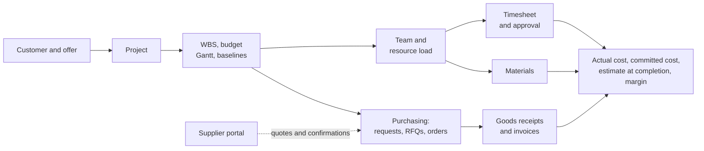

# Open Project 365

**Open Project 365** is a project and job management solution for companies that work on orders, built as a **Power Apps model-driven app** on **Microsoft Dataverse**. It follows every job from the offer to the closing: work breakdown structure and budget, Gantt planning with critical path and baselines, team and resource load, weekly timesheets with approval, materials, purchasing (requests, RFQs, orders, goods receipts, supplier invoices) and a **supplier portal** on Power Pages. Every figure — budget, actual cost, committed cost, progress, estimate at completion and margin — is updated in real time on the project.

- Single-tenant: one Dataverse environment per customer company; data is never shared between companies.
- Licences: Power Apps Premium for internal users; suppliers use the Power Pages portal.
- Publisher prefix `op365`; base language English (1033), translations Italian (1040), French (1036), German (1031).
- PCF controls: React virtual controls with Fluent UI v9.

## The problem

Construction and installation companies, engineering firms, workshops and service companies live on jobs. For each job they must know, at any moment, **what was planned, what has been spent and what is still committed** — and they usually find out too late:

- the budget lives in a spreadsheet, the plan in another tool, the hours on paper or in a separate time app, the purchases in e-mails and in the accounting system;
- hours arrive at the end of the month, valued at today's rate instead of the rate of the day they were worked;
- purchases are approved without seeing the remaining budget, and what has been ordered but not yet delivered is invisible until the invoice arrives;
- suppliers answer requests for quotation by e-mail in different formats, so comparing them is manual and error-prone;
- the project manager discovers the loss of margin only when the job is closed.

Open Project 365 puts the whole life cycle of the job in one place, on the Microsoft 365 / Power Platform stack the company already uses, with security by project team, standard auditing and in-app notifications.

## User manuals

The user manuals describe every functional area in depth, with diagrams, step-by-step procedures, field tables and the messages users may see. They are available in four languages and are kept aligned with the application (see [Keeping the documentation aligned](#keeping-the-documentation-aligned)).

| Manual | English | Italiano | Français | Deutsch |
|---|---|---|---|---|
| Getting started | [EN](docs/en/getting-started.md) | [IT](docs/it/getting-started.md) | [FR](docs/fr/getting-started.md) | [DE](docs/de/getting-started.md) |
| Master data (customers, suppliers, items, resources) | [EN](docs/en/master-data.md) | [IT](docs/it/master-data.md) | [FR](docs/fr/master-data.md) | [DE](docs/de/master-data.md) |
| Projects and team | [EN](docs/en/projects-and-team.md) | [IT](docs/it/projects-and-team.md) | [FR](docs/fr/projects-and-team.md) | [DE](docs/de/projects-and-team.md) |
| WBS, budget, Gantt and baselines | [EN](docs/en/wbs-and-planning.md) | [IT](docs/it/wbs-and-planning.md) | [FR](docs/fr/wbs-and-planning.md) | [DE](docs/de/wbs-and-planning.md) |
| Resource allocation and resource load | [EN](docs/en/resource-load.md) | [IT](docs/it/resource-load.md) | [FR](docs/fr/resource-load.md) | [DE](docs/de/resource-load.md) |
| Time tracking: timesheet, approval, reminders | [EN](docs/en/time-tracking.md) | [IT](docs/it/time-tracking.md) | [FR](docs/fr/time-tracking.md) | [DE](docs/de/time-tracking.md) |
| Materials, actual costs and cost summary | [EN](docs/en/materials-and-costs.md) | [IT](docs/it/materials-and-costs.md) | [FR](docs/fr/materials-and-costs.md) | [DE](docs/de/materials-and-costs.md) |
| Purchasing: requests, RFQs, orders, receipts, invoices | [EN](docs/en/purchasing.md) | [IT](docs/it/purchasing.md) | [FR](docs/fr/purchasing.md) | [DE](docs/de/purchasing.md) |
| Supplier portal | [EN](docs/en/supplier-portal.md) | [IT](docs/it/supplier-portal.md) | [FR](docs/fr/supplier-portal.md) | [DE](docs/de/supplier-portal.md) |
| Administration: users, security, settings, automations | [EN](docs/en/administration.md) | [IT](docs/it/administration.md) | [FR](docs/fr/administration.md) | [DE](docs/de/administration.md) |

Technical documentation (English): [Development environment setup](docs/dev-environment.md) · [Data model](docs/data-model.md).

## Repository layout

| Folder | Content |
|---|---|
| `solutions/OpenProject365` | Unpacked Dataverse solution (`pac solution unpack`) |
| `src/plugins` | C# plugins and Custom API implementations |
| `src/pcf` | PCF controls (GanttChart, WbsTreeGrid, WeeklyTimesheet, TimeApproval, ResourceLoad, CostSummary, QuoteComparison) |
| `src/webresources` | Form scripts and dialogs |
| `portal` | Power Pages supplier portal |
| `docs` | User manuals (`docs/<language>/`), [dev environment setup](docs/dev-environment.md), [data model](docs/data-model.md), ADRs |
| `tools/dataverse` | Scripts that create schema in the dev environment via the Web API |
| `tools/pcf` | Push of the PCF controls to an environment |
| `tools/docs` | Documentation consistency check |

## Keeping the documentation aligned

The manuals are part of the product. Every pull request that changes a functional behaviour (fields, buttons, statuses, rules, messages, roles, automations) must update the affected manual **in all four languages** and, when a manual is added or renamed, the table above. English is the reference version; the Italian, French and German manuals follow the same structure, keep UI labels in English as they appear on screen, and translate the explanations.

The CI runs `python3 tools/docs/check_docs.py`, which fails when a manual is missing in a language, when a relative link or anchor is broken, or when a manual is not linked from this README. Rules for contributors are in [CONTRIBUTING.md](CONTRIBUTING.md).

## Out of scope

Sales opportunities, mobile app, data migration from legacy systems, AI features (planned as a Cowork plugin).

## License

Copyright 2026 Power Builders Italia. Licensed under the [Apache License, Version 2.0](LICENSE); see also [NOTICE](NOTICE).
