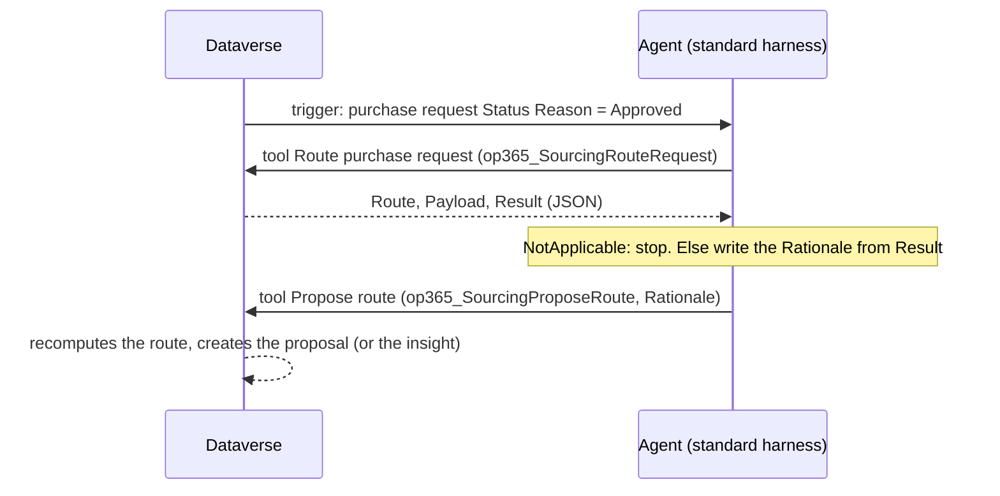

# ProjectIQ Sourcing Agent: Copilot Studio build guide (tasks 1 and 2)

The [sourcing agent](../../docs/en/sourcing-agent.md) is a Copilot Studio **autonomous agent** on the **standard harness** (generative orchestration on). Every number comes from the Custom APIs written in C#. The agent's LLM only writes the **Rationale** that the buyer reads. The agent is built in the maker portal in Dev, inside the solution `OpenProject365`. It is then exported with `export-dev` into a pull request, like any other component ([workflow](../../docs/dev-environment.md#2-export-to-the-repository-and-open-a-pull-request)).



## Prerequisites

- **Copilot Studio capacity** (Copilot Credits, or a Copilot Studio licence or pay-as-you-go plan) assigned to the environment. An autonomous agent consumes credits on every trigger run.
- The application user **ProjectIQ Sourcing Agent** and its Dataverse connection (service principal authentication) exist. See [Setting up the sourcing agent](../../docs/en/administration.md#setting-up-the-sourcing-agent). The trigger and the tools use **that** connection: the agent then reads and writes as the application user, with the role *OP365 Sourcing Agent*, and never as the maker.
- `op365_SourcingAgentUser` is set. `op365_SourcingAgentEnabled` stays **No** until the agent is tested.

## 1. Create the agent

Copilot Studio → environment Dev → **Agents** → **New agent** → **Skip to configure**:

| Field | Value |
|---|---|
| Name | `ProjectIQ Sourcing Agent` |
| Description | `Routes approved purchase requests: proposes a request for quotation or a direct order with the suppliers to invite, for a buyer to decide.` |
| Solution (Settings → Advanced) | `OpenProject365` (publisher prefix `op365`) |
| Orchestration | Generative: on |
| Knowledge, web search, general knowledge | Off: the agent works only with its tools |
| Channels | None: the agent does not chat |

## 2. Instructions

Paste as they are:

```text
You are the ProjectIQ Sourcing Agent. You work in the background: you never chat with people, never ask for input,
confirmation or credentials, and never create, update or delete records except through the tool "Propose route".

When a purchase request is approved:
1. Call "Route purchase request" with the id of the purchase request. Read Route, Payload and Result (JSON).
2. If Route is NotApplicable, stop and do nothing else.
3. Otherwise write a Rationale in English, at most 800 characters, for the buyer who decides:
   - first sentence: what is proposed (a request for quotation to N suppliers with its deadline, a direct order to a
     named supplier, or "no active, compliant supplier sells these items");
   - then the reasons in Result.reasons, and for every supplier in the payload its name, score and reasons from
     Result.suppliers;
   - mention documents expiring soon and fewer suppliers than wanted when Result says so.
   Use only facts and numbers found in Result. Never compute, round differently or invent numbers, suppliers or prices.
4. Call "Propose route" with the same purchase request id and the Rationale. It recomputes the route and creates the
   proposal; it never takes numbers from you.
5. If a tool returns an error (for example "The sourcing agent is switched off." or "An open proposal for the same
   action already exists."), stop. Do not retry and do not call other tools.
```

## 3. Tools

Both tools: **Add a tool** → **Connector** → **Microsoft Dataverse** → **Perform a bound action in selected environment**. For the connection, pick the Dataverse connection of the application user. Under authentication, choose **Maker-provided credentials** (the agent runs without a person).

| Tool name | Description (the orchestrator reads it) | Inputs |
|---|---|---|
| `Route purchase request` | `Read-only analysis of an approved purchase request: route (SourceViaRfq, DirectOrder, NoSupplier, NotApplicable), the proposal payload and the whole analysis as JSON (Result) with the ranked suppliers and the reasons.` | Environment: *current* (custom value) · Table name: `Purchase Requests` (custom value) · Action name: `op365_SourcingRouteRequest` (custom value) · Row ID: filled by AI, *the id of the approved purchase request* |
| `Propose route` | `Creates the agent proposal (or the New Supplier Needed insight) for the purchase request with your Rationale. Call it once, after Route purchase request, unless the route is NotApplicable.` | Same Environment and Table name · Action name: `op365_SourcingProposeRoute` · Row ID: filled by AI · Rationale: filled by AI, *the explanation for the buyer, written from Result* |

## 4. Trigger

**Overview** → **Triggers** → **Add trigger** → **When a row is added, modified or deleted** (Microsoft Dataverse), with the application user's connection:

| Parameter | Value |
|---|---|
| Change type | Modified |
| Table name | Purchase Requests |
| Scope | Organization |
| Select columns | `statuscode` |
| Filter rows | `statuscode eq 365000001` (Approved) |
| Additional instructions (payload) | `A purchase request was approved. Its id is op365_purchaserequestid in Body. Route it.` |

The trigger fires only when the status changes to Approved. A change of other columns does not fire it.

## 5. Test, then publish

1. Keep `op365_SourcingAgentEnabled` = No and approve a test request: on the **Activity** page the run calls *Route purchase request*. Then *Propose route* is refused with "The sourcing agent is switched off." and the agent stops (expected).
2. Set `op365_SourcingAgentEnabled` = Yes. Then run the evaluation set below, one approved request each, and check the proposal in **Open Agent Proposals**:

| # | Data | Expected |
|---|---|---|
| 1 | Amount above *Sourcing Direct Order Limit*, three suppliers sell the items | Source via RFQ, three suppliers, the rationale names them with their score |
| 2 | Amount within the limit, one supplier sells every line | Direct Order to that supplier, the rationale quotes the limit |
| 3 | Only blocked suppliers, or suppliers with expired documents | Insight *New Supplier Needed*, no proposal |
| 4 | Request that already has an RFQ | Nothing created; the run stops after *Route purchase request* |

3. **Publish**, then export with `export-dev` and open the pull request. In Test and Production the agent arrives with the solution: bind the trigger and the tools to the application user's connection there and publish.

To stop the agent at once, set `op365_SourcingAgentEnabled` = No: *Propose route* refuses and no proposal is created. A run still starts, so turn the agent off in Copilot Studio too if you need to stop the credit use.
