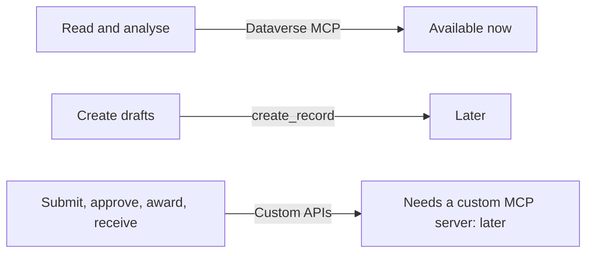

# ADR 0001: Copilot and Work IQ, read-only first

- Status: accepted (2026-10-26)
- Scope: exposure of Open Project 365 data to Microsoft Copilot and Copilot Cowork through Business Applications in Work IQ (preview)

## Context

Copilot Cowork reaches Dataverse through the **Business apps (preview)** plugin, that is the Work IQ MCP server with the identity of the user. Work IQ uses:

- the **Dataverse semantic model** of the app (in Dev `M365_Primary_model_op365_OpenProject365`; Microsoft documents `M365_Secondary_model_<app>`), created by Dataverse when Microsoft Copilot is on in the model-driven app. It cannot be created from scratch; it is tuned. Its signals are the table and column descriptions, the relationships, the public views, the form names and optionally sample rows. It is regenerated every 12 hours and has **no ALM support**;
- the **glossary** of the semantic model (business terms and synonyms), entered by makers, also without ALM;
- **business skills** (`skill` table): natural-language instructions, solution-aware;
- the **Dataverse MCP** tools: `search`, `describe`, `read_query`, `search_data`, `create_record`, `update_record`, `delete_record`, table and skill management. Write operations through Work IQ are blocked by default by tenant policy.

In Open Project 365 every status change (time entries, purchase requests, RFQs, purchase orders, goods receipts, supplier invoices, baselines) runs only through the 17 `op365_*` Custom APIs and their plugins. Dataverse MCP cannot call Custom APIs; exposing them needs a custom MCP server built with the MCP management server, published with `a365 develop-mcp publish` and approved in the Microsoft 365 admin center.

## Decision

Start **read-only**, with business skills:

1. Metadata: a description on every custom column and lookup (`tools/dataverse/workiq.py`).
2. Microsoft Copilot on the Open Project 365 app (app setting in the solution).
3. Six read-only business skills in the solution (`copilot/skills/`).
4. Glossary and table exclusions of the semantic model kept in the repository and applied by hand per environment ([copilot/glossary.md](../../copilot/glossary.md), [Copilot and Cowork](../en/copilot.md)).
5. No write tools, no custom MCP server.

### Semantic model scope

| Area | In scope | Excluded |
|---|---|---|
| Master data | account, contact, Item, Item Supplier, Supplier Document | – |
| Resources | Resource, Absence | Resource Cost (sensitive) |
| Projects | Project, Project Member, WBS Node, WBS Allocation, Baseline | Baseline Node, WBS Dependency (noise) |
| Execution | Time Entry, Material Usage | – |
| Purchasing | Purchase Request (+ Line), RFQ, RFQ Invitation, RFQ Quote, Purchase Order (+ Line), Goods Receipt (+ Line), Supplier Invoice (+ Line) | – |
| System | – | Settings |

## Consequences

- Copilot answers with the permissions of the user, including column security (OP365 Cost Visibility). To be verified in Test that indexed search respects column security.
- Every new column must get a description, or the semantic model loses quality.
- Glossary and table exclusions must be repeated in every environment, and after an environment copy Work IQ must be turned off and on.
- Next steps, each to be decided separately: draft creation (`create_record` on time entries and purchase requests with tenant policy), then a custom MCP server exposing the Custom APIs as tools; check whether the Cowork **Business apps** plugin can use published custom MCP servers.
- Dataverse MCP usage is billed (from 15 December 2025; `search_data` at the premium rate).
