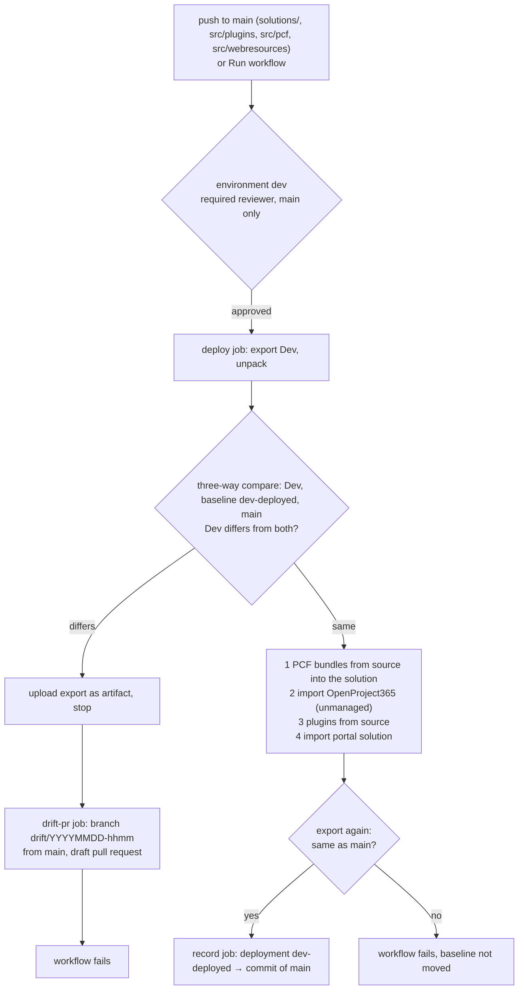

# ADR 0002: Deploy to Dev from main, with drift check

- Status: accepted (2026-10-27)
- Scope: a `deploy-dev` workflow that installs the content of `main` into the Dev environment

## Context

Today changes flow one way, Dev → repository → Test ([Environments and deployment](../dev-environment.md#environments-and-deployment)):

- Dev is changed by hand (maker portal, `tools/dataverse/*.py`, `plugins.py`, `tools/pcf/push.sh`) and exported into the repository with `pac solution export` + `unpack`;
- `deploy-test` exports the managed solutions **from Dev**, not from the repository.

Two gaps follow. Code merged in `main` (plugins, PCF controls, form scripts) reaches Dev only when someone pushes it by hand, so Test can miss it. Customizations made in Dev and never exported reach Test without a pull request. Nothing tells which of the two happened.

## Decision

A workflow `deploy-dev` imports the solutions built from `main` into Dev, after checking that Dev holds nothing that `main` does not know about.

### Baseline: the deployments of environment `dev-deployed`

Drift is a change in Dev that `main` does not know about. The baseline is the commit of the last successful deployment of environment `dev-deployed`: the `record` job creates one only after a successful, verified deployment, so it marks the last commit installed in Dev. It is a GitHub deployment, not a git tag: GitHub refuses `GITHUB_TOKEN` to create or move a ref to a commit that changes `.github/workflows`, both by `git push` and through the API ("without `workflows` permission"), and a personal token would be tied to a person and expire. Each file of the Dev export is compared three ways: equal to `main` → already exported, fine; equal to the baseline → Dev is only behind and `main` will update it, fine; different from both → drift. Comparing with the baseline alone would flag every change that was exported and merged after the last deployment (the normal daily loop); comparing with `main` alone would flag everything `main` gained since then.

### Workflow

| Item | Choice |
|---|---|
| File | `.github/workflows/deploy-dev.yml` |
| Triggers | `push` to `main` with `paths` `solutions/**`, `src/plugins/**`, `src/pcf/**`, `src/webresources/**`; `workflow_dispatch` |
| Inputs (dispatch only) | `check-only` (drift check, no import); `baseline` (commit to compare with when `dev-deployed` has no deployment yet); `skip-drift-check` (recovery after a failed run) |
| Approval | GitHub environment **`dev`**: required reviewer, deployment branches `main`, secrets `PP_ENVIRONMENT_URL`, `PP_TENANT_ID`, `PP_CLIENT_ID`, `PP_CLIENT_SECRET` |
| Concurrency | group `deploy-dev`, no cancel-in-progress: runs queue, never overlap |
| Permissions | `contents: read` + `deployments: read`; `contents: write` + `pull-requests: write` only in `drift-pr`; `deployments: write` only in `record` |
| Runner | `windows-latest` (Power Platform CLI and Git Bash) for `deploy`; `ubuntu-latest` for `precheck`, `drift-pr` and `record` |

One job, `deploy`, both checks and imports: every job that uses an environment asks for its own approval, so drift check and import share one.

### Jobs

**`deploy`** (environment `dev`)

1. Checkout with full history. Resolve the baseline: the commit of the last successful deployment of environment `dev-deployed`, else input `baseline`, else stop with a message.
2. Export `OpenProject365` and `OpenProject365SupplierPortal` unmanaged from Dev and unpack them.
3. `python3 tools/alm/compare_solution.py <baseline tree> <Dev unpack>` (baseline tree from `git archive`). Exit code 0 = same, 1 = drift; the list of differing files goes to the job summary.
4. Drift: upload the unpacked export as artifact `dev-export`, set output `drift=true`, stop. `check-only`: stop here in any case.
5. Copy the files of `src/webresources` over their copies in `solutions/OpenProject365/src/WebResources` (identical today; the source wins). `npm ci` and `npm run build` in `src/pcf`, then `tools/alm/pcf_bundles.py` copies each `bundle.js` built from source over the one in `solutions/OpenProject365/src/Controls/op365_OP365.<control>`; it stops the run if a control is missing from the solution or its manifest or strings differ (those are compared by content, so they must reach the repository through a Dev export; the `code` job of `build` runs the same check with `--check`). Pack both solutions from `main` (unmanaged) and import `OpenProject365`: publish, activate plugins, no deployment settings (Dev keeps its environment variables and connections).
6. `dotnet build` the plugins and run `tools/dataverse/plugins.py` (`PAC_*` from the `PP_*` secrets): the assembly built from source replaces the one exported earlier; steps, images and Custom APIs are created if missing.
7. Import `OpenProject365SupplierPortal` with `pac solution import`, retried up to 3 times on transient Dataverse failures (the imports publish; no separate publish, which would collide with the publish still running in Dataverse).
8. Verify: export (retried while Dataverse is still busy) and unpack again, compare with `main`. A difference fails the run and leaves the baseline where it was.

**`drift-pr`** (needs `deploy` with `drift=true`, no secrets)

Downloads `dev-export`, creates branch `drift/YYYYMMDD-hhmm` from `main` (the commit of the run), copies there only the files the three-way comparison found (added, changed, deleted in Dev), opens a **draft** pull request to `main`, then fails the run. The pull request shows exactly what Dev has and `main` does not.

**`record`** (needs `deploy` succeeded, not `check-only`)

Creates a deployment of environment `dev-deployed` for the commit of the run (`POST deployments`, no required contexts) with status `success` and a link to the run. Environment `dev-deployed` has no protection rules and is created by the first deployment; its page lists every commit verified in Dev.

### Comparison rules (`tools/alm/compare_solution.py`)

Compares two unpacked solution folders file by file after normalizing:

| Rule | Why |
|---|---|
| Ignore the `<Version>` element of `Other/Solution.xml` | `deploy-test` changes the version in Dev on every run |
| Ignore labels with `languagecode="1040"` in components not prefixed `op365_` (e.g. `Account`, `Contact`, `SystemUser`) | the Dev language pack adds them; the labels of `op365_` components are wanted translations and stay compared |
| Normalize line endings and trailing whitespace | export on Windows, repository edited anywhere |
| Compare only the presence, not the content, of built files: `PluginAssemblies/**/*.dll` and `Controls/**/bundle.js` | `deploy-dev` installs them built from source, so their bytes never match the copies in the repository; code drift is not customization drift |

Output: exit code, the list of added, removed and changed files, and a short diff per changed file (capped) for the job summary. Unit tests with sample folders in `tools/alm/test_compare_solution.py`, run by the `code` job of `build`.

## Error handling

| Case | Behaviour |
|---|---|
| Import or plugin registration fails | run fails, baseline not moved. Dev may be half updated, so the next drift check would report it: run again with `skip-drift-check` (still approved in `dev`) |
| No deployment of `dev-deployed` (first run) | run stops and asks for `baseline`: the commit that matches Dev today |
| Final verification differs | run fails, baseline not moved: a comparison rule is missing or the import did not apply a component; fix and run again |
| Drift found | draft pull request, run fails, nothing imported |
| Two merges close together | the second run waits for the first (concurrency) and starts from the state it left |

## Consequences

- Dev follows `main`: a merge in `main` reaches Dev after one approval, and `deploy-test` then exports what `main` contains.
- Customizations made in Dev and not exported can no longer be overwritten or slip into Test unseen: they block `deploy-dev` and become a pull request.
- Developers keep working in Dev as today and still export and open pull requests; `deploy-dev` does not replace the daily loop.
- An unmanaged import does not delete components removed from the repository: delete them in Dev as well (the drift check then passes, since the export matches).
- A pull request opened with `GITHUB_TOKEN` does not start other workflows: on a drift pull request the checks start after the next push to its branch.
- New one-time setup: environment `dev` with its secrets and reviewer, and the first run with `check-only` + `baseline`.
- Documentation: [Environments and deployment](../dev-environment.md#environments-and-deployment) gains the Dev step and the `dev` environment when the workflow is merged.
