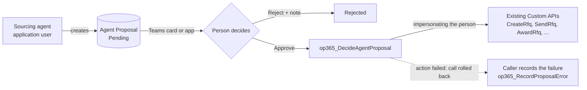

# ADR 0003: Sourcing agent writes through proposals

- Status: accepted (2026-11-03)
- Scope: the autonomous sourcing agent (Copilot Studio) and every record it creates or causes to be created in ProjectIQ. Design: [sourcing agent design](../superpowers/specs/2026-11-03-sourcing-agent-design.md); user manual: [Sourcing agent](../en/sourcing-agent.md)

## Context

[ADR 0001](0001-copilot-work-iq-read-only.md) keeps Copilot and Cowork **read-only**: they cannot call the `op365_*` Custom APIs, and a custom MCP server is a later decision. The sourcing agent has the opposite job. It must act: route purchase requests, invite suppliers, recommend an award, check invoices, send reminders. But purchasing commits company money and creates obligations to suppliers, and every status change in ProjectIQ is protected by rules that depend on **who** acts (project manager, buyer, Purchasing Approver, segregation of duties between order and invoice) and is audited under that person.

An autonomous agent that wrote with its own identity would either bypass those rules (because its application user is powerful) or be unable to do anything (because it is not a project manager). It would also make the audit trail say that "the robot" approved an invoice.

## Decision

1. **The agent writes only proposals.** It prepares a decision and writes an **Agent Proposal** row (Kind Proposal, Insight or Log) with the rationale and the evidence of the analysis. Its role **OP365 Sourcing Agent** can read the data and create proposals; it cannot write purchasing tables and cannot decide. It creates no drafts: a rejected proposal leaves nothing behind.
2. **A person decides.** A proposal is approved or rejected from a Teams adaptive card or from the app. Rejecting requires a note, which is the feedback to tune the agent. Proposals expire (5 days by default) and become Superseded when their target has moved on.
3. **The action runs as the person who approved (impersonation).** `op365_DecideAgentProposal` checks that the decider may decide that action type and then calls the existing Custom API through `IOrganizationServiceFactory.CreateOrganizationService(deciderId)`. Status rules, `EnsureManager`, the second-level approver rule and auditing therefore apply to the person, not to the agent. The role **OP365 Buyer** is added to those who may do the purchasing actions; invoice proposals stay with the Purchasing Approver or an administrator.
4. **Trust in `DecidedBy` only from `op365_SourcingAgentUser`.** The Teams flow runs with the application user's connection and tells the API who answered the card (`DecidedBy`). The API accepts that parameter only when the caller is the application user named in the environment variable `op365_SourcingAgentUser`, and checks the caller before it looks the name up, so nobody can probe user names or decide in somebody else's name. Unset variable: nobody is trusted.
5. **The failure is recorded by the caller.** When the approved action fails, the whole `op365_DecideAgentProposal` call rolls back (nothing is half done), so the API itself cannot write the failure. The caller, which knows the call failed, invokes `op365_RecordProposalError` (the card flow, the app command): Pending becomes **Failed** with the message, and Retry returns it to Pending. `op365_RecordProposalError` is therefore allowed to the agent user and to whoever can decide the proposal, because the app command runs as the buyer.
6. **One open proposal per subject** (`DedupKey`, enforced by a plugin), proposals are not editable after creation, and the status changes only through the Custom APIs.
7. **Everything ships in the one solution and is off by default**: table, Custom APIs, roles, variables and flows; `op365_SourcingAgentEnabled` is No.

## Consequences

- The buyer keeps control: nothing is created, sent or paid without a click of an authorised person, and the audit trail shows that person.
- Every proposal costs a decision. Autonomous execution, thresholds for autonomy and negotiation with suppliers are out of scope and would need a new ADR.
- A new action type needs three things: a choice value in `ProposalLogic.cs` and the table, its decider rule in `Proposals.CanDecide`, and its branch in `DecideAgentProposal`. The choice values must not be reordered.
- The application user and its two connections (Teams, Dataverse) are manual steps per environment ([Administration](../en/administration.md#setting-up-the-sourcing-agent)). The Dataverse connection of the card flow must belong to the application user, or `DecidedBy` is refused.
- Impersonation needs the platform to allow it for plugins; the end-to-end behaviour is checked by `tools/dataverse/sourcing_smoke.py` in Dev.
- Proposals are not exposed on the supplier portal. The Evidence is protected by the **OP365 Cost Visibility** column security profile.
- ADR 0001 stays valid for Copilot and Cowork: they remain read-only; only the sourcing agent writes, and only through proposals.
