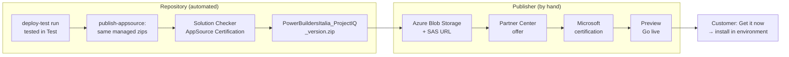
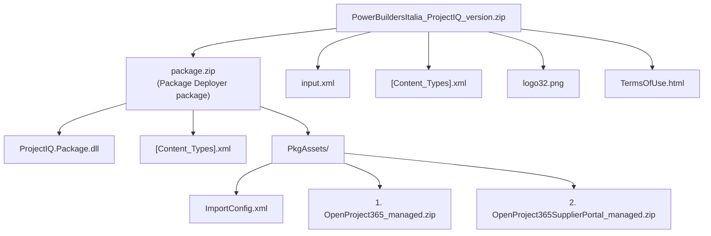
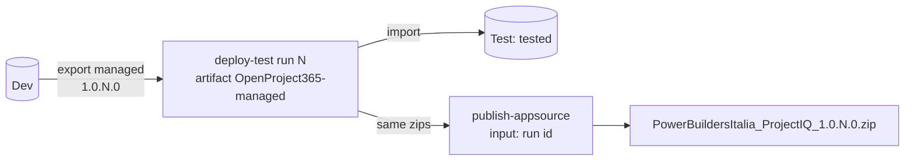

# Publishing on Microsoft AppSource

ProjectIQ is listed on [Microsoft AppSource](https://appsource.microsoft.com) as a **Dynamics 365 apps on Dataverse and Power Apps** offer with the **Get it now (Free)** listing option: a customer administrator installs it from the marketplace into one of their own Dataverse environments, at no cost (the software is open source, Apache License 2.0). This page explains what the offer is made of, how the AppSource package is built from this repository and what has to be done by hand in Partner Center.

Microsoft references: [Plan a Dynamics 365 offer](https://learn.microsoft.com/partner-center/marketplace-offers/marketplace-dynamics-365) · [Create the offer](https://learn.microsoft.com/partner-center/marketplace-offers/dynamics-365-customer-engage-offer-setup) · [Create the AppSource package](https://learn.microsoft.com/power-apps/developer/data-platform/create-package-app-appsource) · [Certification checklist](https://learn.microsoft.com/power-platform/developer/marketplace/appendix-app-certification-checklist).

## Overview



| Step | Who | Where |
|---|---|---|
| Partner Center account enrolled in the Microsoft Marketplace program, publisher verified | Publisher (once) | [Partner Center](https://partner.microsoft.com/dashboard) |
| Dev and `main` aligned, release tested in Test | Maintainer | [Environments and deployment](dev-environment.md#environments-and-deployment) |
| Build the AppSource package | Maintainer | GitHub → Actions → `publish-appsource` |
| Upload the package, create a read-only SAS URL | Publisher | Azure portal / Azure CLI |
| Create or update the offer, submit | Publisher | Partner Center |
| Certification (package, Solution Checker, functional test) | Microsoft | e-mail reports to the publisher |
| Check the preview, select **Go live** | Publisher | Partner Center |

## What the package contains

The AppSource package is a flat zip with five files. Its core is a [Package Deployer](https://learn.microsoft.com/power-platform/alm/package-deployer-tool) package that imports the two managed solutions in order.



| Source in the repository | Becomes |
|---|---|
| `appsource/ProjectIQ.Package/` (project created with `pac package init`) | `package.zip`: `ImportConfig.xml` imports the main solution first, then the supplier portal, with *publish workflows and activate plugins* on (otherwise managed imports leave the plugin steps disabled) |
| `appsource/assets/input.xml` | `input.xml`: provider, anchor solution `OpenProject365_managed.zip`, start and end date, countries, the four languages of the solutions (1033 default, 1040, 1036, 1031) |
| `appsource/assets/[Content_Types].xml`, `logo32.png`, `TermsOfUse.html` | copied as they are; `TermsOfUse.html` is the licence shown during installation |
| `appsource/assets/listing-logo-216.png` | not in the package: the large logo for the Partner Center listing |

`tools/alm/build_appsource_package.py` builds the zip and checks it: both solutions managed and with the requested version, flat layout, required files present (unit tests in `tools/alm/test_build_appsource_package.py`, run by the `build` workflow).

## Build the package

Only the publisher (GitHub user `pborg-mc`) can build a package, with two locks:

- the workflow stops at its first job (`authorize`) when it is started, or re-run, by anyone else;
- it runs in the GitHub environment **`appsource`**, whose only required reviewer is the publisher, so no run reaches its secrets without the publisher's approval. A change to the workflow on another branch cannot bypass this: the environment only accepts runs from `main`, and `main` changes only through a reviewed pull request.

One-time setup of the environment (Settings → Environments → **New environment** `appsource`): required reviewer **pborg-mc** only, *Prevent self-review* off, deployment branches **`main`** only, secrets `PP_ENVIRONMENT_URL` (the Dev URL), `PP_TENANT_ID`, `PP_CLIENT_ID`, `PP_CLIENT_SECRET` (same app registration as the environment `test`). They are used only to authenticate the Solution Checker, which runs in an environment of the tenant; the workflow changes nothing in Dev.

**The package contains exactly what was tested in Test.** Test cannot export its solutions (they are managed there), so the workflow takes the managed zips that `deploy-test` imported into Test, saved as the `OpenProject365-managed` artifact of that run. The version is the one `deploy-test` gave both solutions, `1.0.<run number>.0`, so it grows with every deployment to Test. Artifacts expire after the repository retention period (90 days by default): build the AppSource package within that time.



1. Deploy the release to Test with `deploy-test` and test it there.
2. Copy the **run id** of that `deploy-test` run: the number at the end of its URL, `.../actions/runs/<id>`.
3. In GitHub → **Actions** → **publish-appsource** → **Run workflow**, enter:
    - **deploy-test-run**: the run id; the run must be a successful `deploy-test` run from `main`;
    - **start-date** (optional): the date the package becomes available, `MM/DD/YYYY`; empty means today.
4. Approve the run in the `appsource` environment. The workflow checks the `deploy-test` run, downloads its managed zips, runs the Solution Checker with the **AppSource Certification** rule set (the one Microsoft uses) and builds the package.
5. The job fails when the checker reports **critical or high** findings: fix them in Dev, deploy to Test again and use the new run. All findings are in the `appsource-checker` artifact.
6. Download the artifact `appsource-package-<version>`: it contains `PowerBuildersItalia_ProjectIQ_<version>.zip`.

Local build (same result, needs the .NET SDK and the two managed solution zips in one folder):

```bash
python3 tools/alm/build_appsource_package.py <folder-with-managed-zips> --version 1.0.20.0 --out out/appsource
```

## Upload the package to Azure Blob Storage

Partner Center downloads the package from a URL with a read-only SAS token.

```bash
az storage container create --account-name <account> --name appsource --auth-mode login
az storage blob upload --account-name <account> --container-name appsource \
  --file PowerBuildersItalia_ProjectIQ_<version>.zip --auth-mode login
az storage blob generate-sas --account-name <account> --container-name appsource \
  --name PowerBuildersItalia_ProjectIQ_<version>.zip --permissions r \
  --expiry <date at least one month ahead> --auth-mode login --as-user --full-uri
```

Keep the container **private**: the SAS URL is the only access. The expiry must be at least one month ahead, otherwise publishing can be blocked.

## Create the offer in Partner Center

Partner Center → **Marketplace offers** → **+ New offer** → **Dynamics 365 apps on Dataverse and Power Apps**.

| Page | Field | Value for ProjectIQ |
|---|---|---|
| New offer | Offer ID | `projectiq` (cannot be changed later; publisher ID + offer ID ≤ 40 characters) |
| | Offer alias | `ProjectIQ` |
| Offer setup | Sell through Microsoft | **No**; app license management through Microsoft: **off** |
| | Listing option | **Get it now (free)** |
| | Customer leads | optional (Referrals workspace, or a CRM connection) |
| Properties | Categories | Primary **Project Management** → *Project Planning & Tracking*, *Project Time & Expense Reporting*; secondary **Operations & Supply Chain** → *Planning, Purchasing & Reporting* |
| | Industries | **Professional Services** → *Architecture & Construction*; **Manufacturing & Mobility** → *Manufacturing* (the description names both) |
| | Applicable products | **Power Apps** |
| | App version | the package version |
| | Terms and conditions | URL of the [terms of use](legal/terms-of-use.md) on the website |
| Offer listing | Name | `ProjectIQ` |
| | Search results summary | see [Listing texts](#listing-texts) |
| | Description | see [Listing texts](#listing-texts) |
| | Search keywords | `project management`, `job costing`, `timesheet` |
| | Help link | `https://power-builders-italia.github.io/projectiq/` |
| | Privacy policy link | URL of the [privacy statement](legal/privacy.md) on the website |
| | Support contact / URL | a monitored mailbox; support URL `https://github.com/Power-Builders-Italia/ProjectIQ/issues` (must differ from the help link) |
| | Engineering contact | name, e-mail, phone (digits and spaces only) |
| | Supporting documents | 1–3 PDF: e.g. the *Getting started* manual printed to PDF from the website |
| | Large logo | `appsource/assets/listing-logo-216.png` (PNG 216×216) |
| | Screenshots | 1–5 PNG 1280×720, see [Screenshots](#screenshots) |
| Availability | Preview audience | the e-mail addresses that may test the offer before **Go live** |
| Technical configuration | Base license model | **Resource** (no per-user licences are managed by Microsoft) |
| | Requires S2S outbound and CRM Secure Store Access | **off** |
| | Application configuration URL | empty |
| | URL of your package location | the SAS URL of the blob |
| | More than one CRM package | **off** |
| Supplemental content | E2E functional document | Microsoft template downloaded from Partner Center, filled in from the user manuals (main user and admin journeys) |
| Supplemental content | Solution Checker report | the `appsource-checker` artifact, if requested |

Then **Review and publish** → **Publish**. Microsoft runs the certification and e-mails the result; when the offer reaches **Preview**, test the installation with a preview-audience account and select **Go live**.

## Listing texts

Listing content is entered in **one language**: English.

**Search results summary** (≤ 100 characters):

> Project and job management on Dataverse: WBS, Gantt, timesheets, purchasing and a supplier portal.

**Description** (≤ 5,000 characters, HTML allowed):

```html
<p><b>ProjectIQ</b> follows every job from the offer to the closing, on the Microsoft Power Platform your company already uses. Budget, actual cost, committed cost, progress, estimate at completion and margin are updated in real time on every project, so project managers see a loss of margin while there is still time to act.</p>
<p>Built for construction and installation companies, engineering firms, workshops and service companies that work on orders.</p>
<ul>
<li><b>Projects and team</b>: project team with roles, security by project, in-app notifications.</li>
<li><b>WBS and planning</b>: work breakdown structure with budget, interactive Gantt with dependencies and critical path, baselines.</li>
<li><b>Resource load</b>: allocations and load per resource, company closures and absences.</li>
<li><b>Time tracking</b>: weekly timesheet, approval, daily reminder; hours valued at the rate of the day they were worked.</li>
<li><b>Materials and costs</b>: material usage, actual cost and cost summary per WBS node.</li>
<li><b>Purchasing</b>: purchase requests with approval threshold, RFQs with quote comparison, purchase orders, goods receipts and supplier invoices.</li>
<li><b>Supplier portal</b> (Power Pages): suppliers answer RFQs and confirm purchase orders online.</li>
</ul>
<p>Available in English, Italian, French and German. Open source under the Apache License 2.0; user manuals at power-builders-italia.github.io/projectiq.</p>
<p><b>Requirements</b>: a Microsoft Dataverse environment; Power Apps Premium (or equivalent) licences for internal users; Power Pages capacity for the supplier portal (optional).</p>
```

## Screenshots

Take them in Test (realistic English data from `seed_test.py`), browser window sized so the PNG is exactly **1280×720**, each with a caption:

| # | Screen | Caption |
|---|---|---|
| 1 | Project form, cost summary visible | Budget, actual and committed cost, margin in real time |
| 2 | Gantt chart of a project | Interactive Gantt with dependencies and critical path |
| 3 | Weekly timesheet | Weekly timesheet with approval |
| 4 | Quote comparison of an RFQ | Compare supplier quotes and award the order |
| 5 | Supplier portal, RFQ answer | Suppliers answer RFQs on the portal |

The listing logo must not contain text and should avoid gradients; if certification rejects the current logo, provide a flat version of it.

## After installation (customer side)

What the package cannot do by itself is described for administrators in [Administration — Installing from Microsoft AppSource](en/administration.md#installing-from-microsoft-appsource): assign roles, connect and turn on the *Daily time reminder* flow, set the environment variables, and create or reactivate the supplier portal site.

## New versions

1. Build a package from a newer `deploy-test` run, which has a higher version (see [Build the package](#build-the-package)), upload it and create a new SAS URL.
2. Partner Center → the offer → **Technical configuration**: replace the package URL; **Properties**: update **App version**.
3. **Review and publish**. After certification, customers update from the Power Platform admin center (*Dynamics 365 apps* → ProjectIQ → *Update*).

## Troubleshooting

| Problem | Cause and fix |
|---|---|
| Certification: wrong package structure | The AppSource zip must be flat with exactly the five files listed above; always use the zip produced by the workflow, do not re-zip it by hand |
| Certification: locale mismatch | The `PackageLocale` codes of `input.xml` must match the languages of the solutions (1033, 1040, 1036, 1031) |
| Partner Center cannot download the package | SAS URL expired or without read permission: generate a new one |
| `publish-appsource` refuses the run id | Use the id of a successful `deploy-test` run started from `main` (the number in its URL, not the run number shown in the title) |
| `publish-appsource` cannot download the artifact | The artifact of that `deploy-test` run expired (retention period, 90 days by default): deploy to Test again and use the new run |
| `publish-appsource` fails on the checker | Critical or high findings: read the job log or the `appsource-checker` artifact, fix in Dev, deploy to Test again, use the new run |
