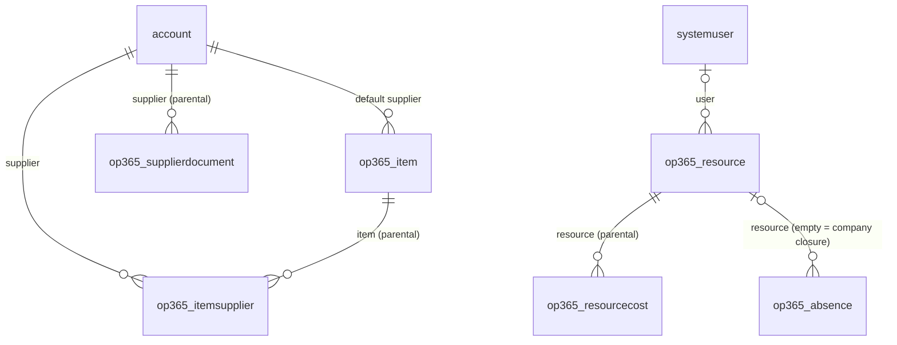
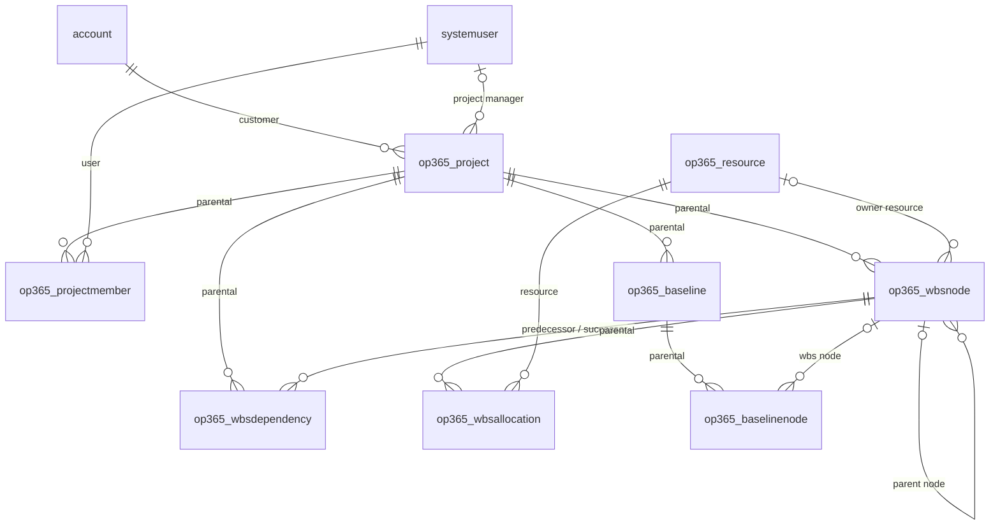
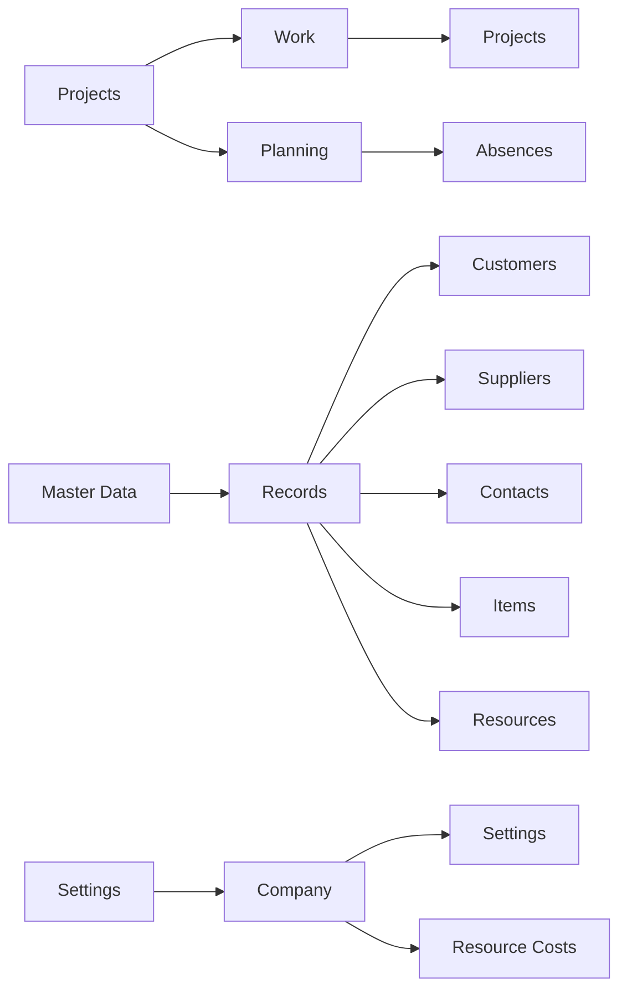

# Data model

Tables delivered so far, by roadmap phase. Full column list: specification in PROGETTI.

## Phase 1 – Master data, resources, settings



| Table | Primary column | Alternate key | Notes |
|---|---|---|---|
| `account` (std) | name | – | + IsCustomer, IsSupplier, CustomerType, VatNumber, TaxCode, SupplierStatus, SupplierCategory, Pec, Iban, Language, PaymentTerms, ExpiredDocs, ExpiringDocs |
| `contact` (std) | fullname | – | + IsDecisionMaker |
| `op365_item` | Name | Code | Code, Category, Uom, UnitCost, DefaultSupplierId, Notes |
| `op365_itemsupplier` | Name | ItemId + SupplierId | SupplierCode, Price, LeadTimeDays, MinimumLot, Notes |
| `op365_supplierdocument` | Description | – | DocumentType, Number, IssueDate, ExpiryDate, ExternalUrl, File, Notes |
| `op365_resource` | Name | – | Role, HourlyCost (secured), UserId, WeeklyHours (0–80), WorkingDays (multi-choice) |
| `op365_resourcecost` | Name | ResourceId + ValidFrom | ValidFrom, HourlyCost (secured) |
| `op365_absence` | Name | – | AbsenceType, FromDate, ToDate, Hours, Notes |
| `op365_settings` | Name | – | TimeApprovalEnabled, PurchaseRequestThreshold (single row) |

All custom tables are user-owned, with notes and auditing enabled. Choice values start at 365000000.

Still deferred (they depend on Phase 3-4 tables): Account contactcount and spend, Item usagecount and spend.

## Phase 2 – Projects, team, WBS, baselines



| Table | Primary column | Alternate key | Notes |
|---|---|---|---|
| `op365_project` | Name | Code | CustomerId, ProjectManagerId, StartDate, EndDate, ContractValue, Description, BudgetTotal, ActualCost, CommittedCost, ProgressPct. Status reasons: Offer, In Progress, Suspended (active), Closed (inactive) |
| `op365_projectmember` | Name (user name) | ProjectId + UserId | ProjectRole (Manager, Contributor, Reader), HourlyRate |
| `op365_wbsnode` | Name | – | ParentId (hierarchical), Code, OwnerResourceId, BudgetHours, BudgetLabour, BudgetMaterials, BudgetOther, BudgetTotal, ProgressPct, StartDate, EndDate, SortOrder, ActualHours |
| `op365_wbsdependency` | Name (pred → succ) | PredecessorId + SuccessorId | ProjectId, DependencyType (Finish-to-Start), LagDays |
| `op365_wbsallocation` | Name | WbsNodeId + ResourceId | Hours (> 0) |
| `op365_baseline` | Name | – | ProjectId, IsReference, Description |
| `op365_baselinenode` | Name | – | BaselineId, WbsNodeId, Code, BudgetHours, BudgetTotal, StartDate, EndDate |
| `account` (std) | – | – | + ProjectCount, ContractValueTotal |

**Totals are plugin-maintained columns, not rollup columns**: they are current right after each save (rollups refresh asynchronously) and follow one rule shared with the PCF controls. ActualCost, CommittedCost and ActualHours are filled in Phase 3-4.

A table can have only one cascading parent, so the Predecessor, Successor and Parent Node lookups only remove the link on delete; the `WbsNodeDelete` plugin deletes the dependencies and the subtree of a deleted node.

### Plugins and Custom API (`src/plugins`)

| Class | Trigger | Does |
|---|---|---|
| ResourceDefaults | Resource create (pre) | WeeklyHours 40 and Monday-Friday when empty |
| ResourceCostSync | Resource Cost create/update/delete (post) | Resource HourlyCost = cost with the latest Valid From not in the future |
| ProjectSync | Project create/update/delete (post) | Project manager becomes a Manager member; customer ProjectCount and ContractValueTotal |
| ProjectMemberName / ProjectMemberSync | Project Member create (pre) / create, update, delete (post) | Name = user; user added to or removed from the project access team of the role |
| WbsNodeBudget | WBS Node create/update (pre) | BudgetTotal = labour + materials + other |
| WbsNodeRollup | WBS Node create/update/delete (post) | Project BudgetTotal (sum) and ProgressPct (leaf progress weighted by budget, then hours, else average) |
| WbsNodeDelete | WBS Node delete (pre-validation) | Deletes dependencies and child nodes |
| WbsDependencyValidate | WBS Dependency create/update (pre) | Same project, no self link, no cycle; sets ProjectId and Name |
| BaselineReference | Baseline create/update (post) | Only one reference baseline per project |
| SaveBaseline | Custom API `op365_SaveBaseline` bound to Project (inputs Name, KeepReference; output BaselineId) | Copies budget and dates of the active WBS nodes into a new (reference) baseline |

A resource cost whose Valid From is in the future becomes current only at its next change; a daily flow in a later phase will refresh it.

### Code components (`src/pcf`)

Both are React virtual controls on the Fluent UI v9 platform library, bound to the WBS Nodes subgrid of the Project form; they read nodes, dependencies and baselines through the Web API. Strings are in `.resx` (1033).

| Control | Tab | Features |
|---|---|---|
| `OP365.WbsTreeGrid` | WBS | Expandable tree ordered by Sort Order then outline code; inline edit of dates, hours, budget parts and progress on leaf nodes; rolled-up totals on parent nodes; new node / new child node |
| `OP365.GanttChart` | Gantt | Week / month / quarter scale; summary and task bars with progress; finish-to-start arrows; critical path computed client-side (`shared/cpm.ts`); bars pushed by dependencies shown dashed; baseline dropdown (reference baseline preselected); today line |

## Security

| Component | Content |
|---|---|
| OP365 Administrator | Organization-level Create, Read, Write, Delete, Append, Append To, Assign, Share on Account, Contact and all F1 tables |
| OP365 User | Organization-level Read and Append To on the same tables (writes come with the project tables in F2-F4) |
| OP365 Cost Visibility | Column security profile: read/create/update of `op365_hourlycost` on Resource and Resource Cost |

| OP365 Administrator (F2) | Organization-level full access on Project and its child tables |
| OP365 User (F2) | User-level Read, Write, Append, Append To, Share on Project; User-level Create, Read, Write, Delete, Append, Append To on the child tables. Projects become visible through the access teams |
| Access team templates on Project | **OP365 Project Manager** (Read, Write, Append, Append To, Share), **OP365 Project Contributor** (Read, Append), **OP365 Project Reader** (Read). Templates are not solution components: the plugin creates them on first use in each environment |

OP365 roles are additive: every internal user also needs the standard **Basic User** role. Assign the Cost Visibility profile to administrators and project managers.

## App

Model-driven app **Open Project 365** (`op365_OpenProject365`).



Account has two forms, **Customer** and **Supplier**; `op365_/scripts/account.form.js` (source in `src/webresources`) opens supplier-only accounts on the Supplier form and flags new records according to the chosen form.

Project form: Summary, WBS (WBS Tree Grid), Gantt (Gantt Chart and baselines), Team, Timeline, with the **Save Baseline** command (modern command, `op365_/scripts/project.form.js`). WBS Node form: General, Budget, Dependencies, Allocations; `op365_/scripts/wbsnode.form.js` limits Parent Node to the same project.

Views: All, In Progress, Offers, Suspended and Closed Projects, WBS Nodes by Project, Project Members, Customers with/without Projects, All Customers (default), Prospects, All/Active/Blocked Suppliers, Suppliers with Document Alerts, All Items, Active Resources, Absences, plus Quick Find on Account and Item.

## Recreating the schema

The scripts in `tools/dataverse` build the schema through the Dataverse Web API inside the `OpenProject365` solution. They are idempotent and read the `PAC_*` environment variables (client credentials of an application user). Run them in order, then export and unpack the solution:

```bash
python3 tools/dataverse/phase1_tables.py
python3 tools/dataverse/phase1_security.py
python3 tools/dataverse/phase1_views.py
python3 tools/dataverse/phase1_forms.py
python3 tools/dataverse/phase2_tables.py
python3 tools/dataverse/phase2_security.py
python3 tools/dataverse/phase2_views.py
dotnet build src/plugins/OpenProject365.Plugins -c Release
python3 tools/dataverse/phase2_plugins.py
(cd src/pcf && npm ci) && tools/pcf/push.sh     # needs a pac auth profile on the environment
python3 tools/dataverse/phase2_forms.py
python3 tools/dataverse/app.py
python3 tools/dataverse/phase2_smoke.py         # end-to-end check of the plugins, cleans up after itself
```

Shared helpers: `meta.py` (columns, tables, lookups, keys, roles), `viewlib.py` (views), `formlib.py` (FormXml).
