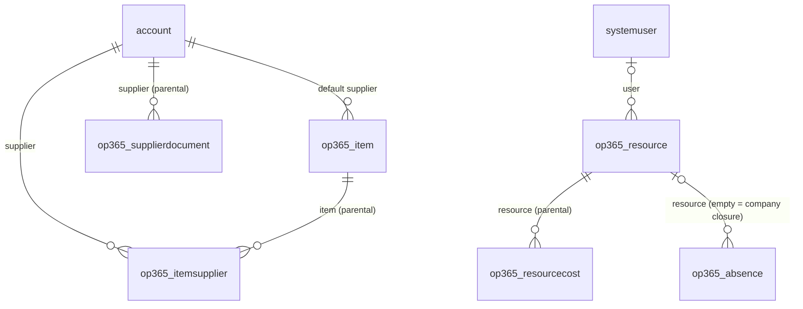
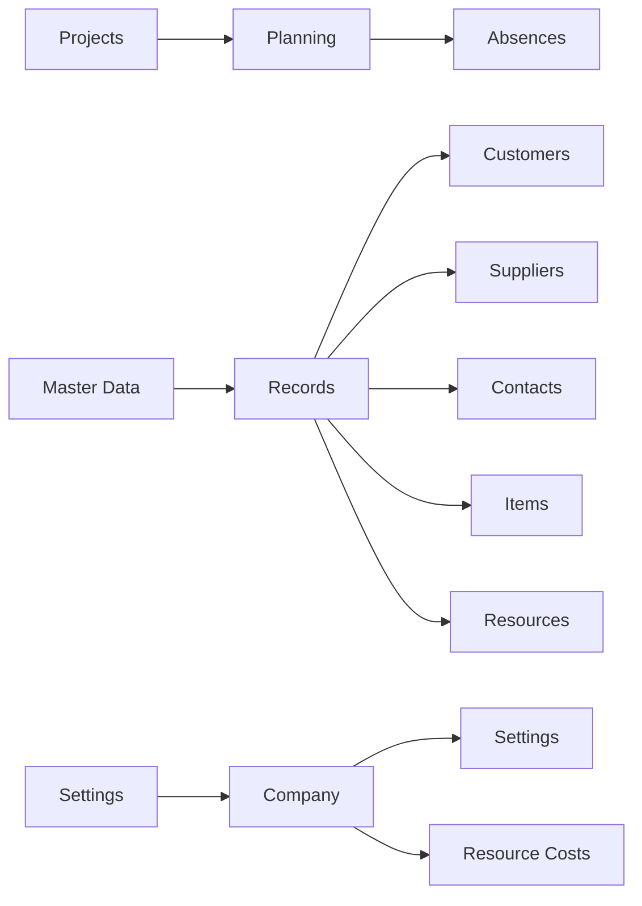

# Data model

Tables delivered so far, by roadmap phase. Full column list: specification in PROGETTI.

## Phase 1 – Master data, resources, settings



| Table | Primary column | Alternate key | Notes |
|---|---|---|---|
| `account` (std) | name | – | + IsCustomer, IsSupplier, CustomerType, VatNumber, TaxCode, SupplierStatus, SupplierCategory, Pec, Iban, Language, PaymentTerms, ExpiredDocs, ExpiringDocs |
| `contact` (std) | fullname | – | + IsDecisionMaker |
| `op365_item` | Name | Code | Code, Category, Uom, UnitCost, DefaultSupplierId, Notes |
| `op365_itemsupplier` | Name | ItemId + SupplierId | SupplierCode, Price, LeadTimeDays, MinimumLot, Notes |
| `op365_supplierdocument` | Description | – | DocumentType, Number, IssueDate, ExpiryDate, ExternalUrl, File, Notes |
| `op365_resource` | Name | – | Role, HourlyCost (secured), UserId, WeeklyHours (0–80), WorkingDays (multi-choice) |
| `op365_resourcecost` | Name | ResourceId + ValidFrom | ValidFrom, HourlyCost (secured) |
| `op365_absence` | Name | – | AbsenceType, FromDate, ToDate, Hours, Notes |
| `op365_settings` | Name | – | TimeApprovalEnabled, PurchaseRequestThreshold (single row) |

All custom tables are user-owned, with notes and auditing enabled. Choice values start at 365000000.

Deferred to later phases (they depend on tables not yet created): rollups on Account (projectcount, contractvaluetotal, contactcount, spend) and Item (usagecount, spend), the WeeklyHours default of 40 (plugin, with the F2 assembly).

## Security (Phase 1)

| Component | Content |
|---|---|
| OP365 Administrator | Organization-level Create, Read, Write, Delete, Append, Append To, Assign, Share on Account, Contact and all F1 tables |
| OP365 User | Organization-level Read and Append To on the same tables (writes come with the project tables in F2-F4) |
| OP365 Cost Visibility | Column security profile: read/create/update of `op365_hourlycost` on Resource and Resource Cost |

OP365 roles are additive: every internal user also needs the standard **Basic User** role. Assign the Cost Visibility profile to administrators and project managers.

## App (Phase 1)

Model-driven app **Open Project 365** (`op365_OpenProject365`).



Account has two forms, **Customer** and **Supplier**; `op365_/scripts/account.form.js` (source in `src/webresources`) opens supplier-only accounts on the Supplier form and flags new records according to the chosen form.

Views: All Customers (default), Prospects, All/Active/Blocked Suppliers, Suppliers with Document Alerts, All Items, Active Resources, Absences, plus Quick Find on Account and Item.

## Recreating the schema

The scripts in `tools/dataverse` build Phase 1 through the Dataverse Web API inside the `OpenProject365` solution. They are idempotent and read the `PAC_*` environment variables (client credentials of an application user). Run them in order, then export and unpack the solution:

```bash
python3 tools/dataverse/phase1_tables.py
python3 tools/dataverse/phase1_security.py
python3 tools/dataverse/phase1_views.py
python3 tools/dataverse/phase1_forms.py
python3 tools/dataverse/phase1_app.py
```
