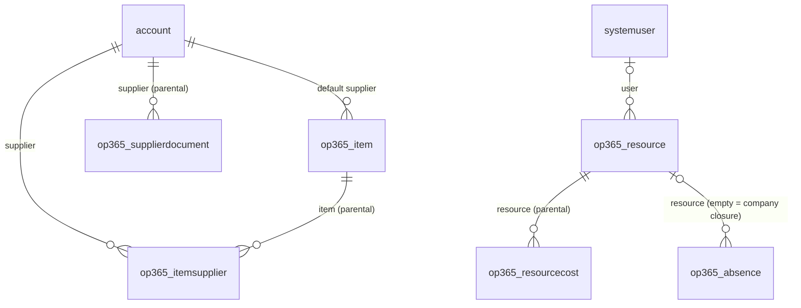

# Data model

Tables delivered so far, by roadmap phase. Full column list: specification in PROGETTI.

## Phase 1 – Master data, resources, settings



| Table | Primary column | Alternate key | Notes |
|---|---|---|---|
| `account` (std) | name | – | + IsCustomer, IsSupplier, CustomerType, VatNumber, TaxCode, SupplierStatus, SupplierCategory, Pec, Iban, Language, PaymentTerms, ExpiredDocs, ExpiringDocs |
| `contact` (std) | fullname | – | + IsDecisionMaker |
| `op365_item` | Name | Code | Code, Category, Uom, UnitCost, DefaultSupplierId, Notes |
| `op365_itemsupplier` | Name | ItemId + SupplierId | SupplierCode, Price, LeadTimeDays, MinimumLot, Notes |
| `op365_supplierdocument` | Description | – | DocumentType, Number, IssueDate, ExpiryDate, ExternalUrl, File, Notes |
| `op365_resource` | Name | – | Role, HourlyCost (secured), UserId, WeeklyHours (0–80), WorkingDays (multi-choice) |
| `op365_resourcecost` | Name | ResourceId + ValidFrom | ValidFrom, HourlyCost (secured) |
| `op365_absence` | Name | – | AbsenceType, FromDate, ToDate, Hours, Notes |
| `op365_settings` | Name | – | TimeApprovalEnabled, PurchaseRequestThreshold (single row) |

All custom tables are user-owned, with notes and auditing enabled. Choice values start at 365000000.

Deferred to later phases (they depend on tables not yet created): rollups on Account (projectcount, contractvaluetotal, contactcount, spend) and Item (usagecount, spend), the WeeklyHours default of 40 (business rule / plugin), the `OP365 Cost Visibility` column security profile.

## Recreating the schema

`tools/dataverse/phase1_tables.py` creates the Phase 1 schema through the Dataverse Web API inside the `OpenProject365` solution. It is idempotent (existing components are skipped) and reads the `PAC_*` environment variables (client credentials of an application user).

```bash
python3 tools/dataverse/phase1_tables.py
```
