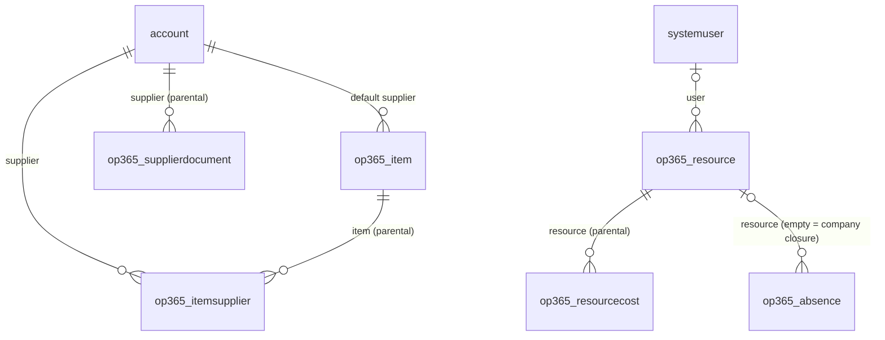
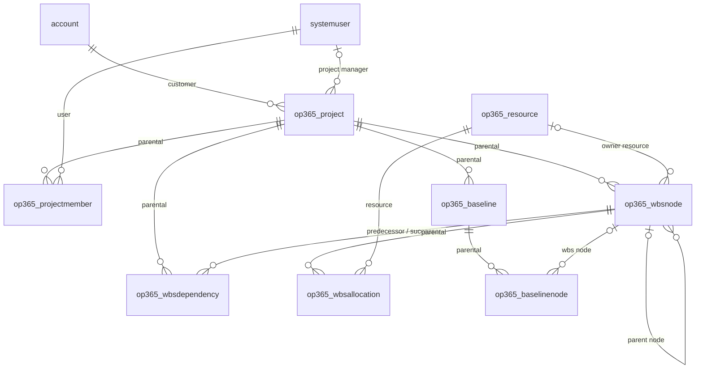
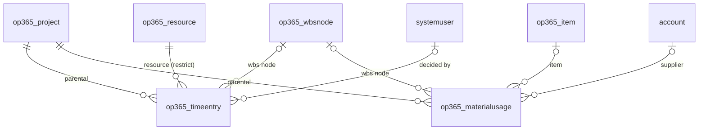
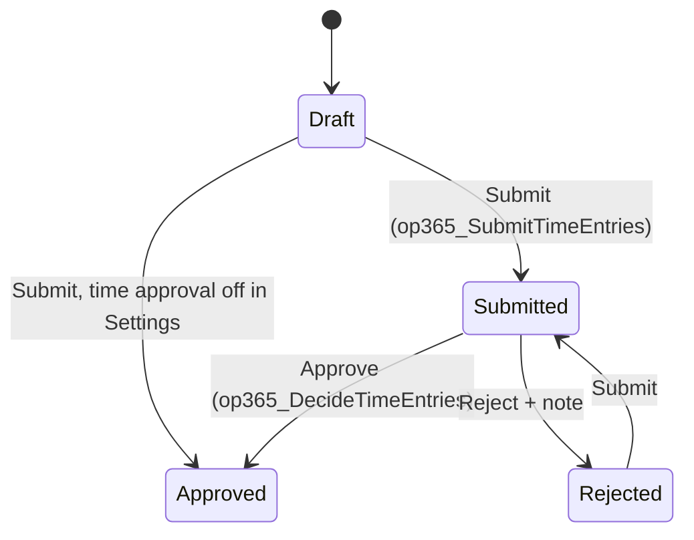
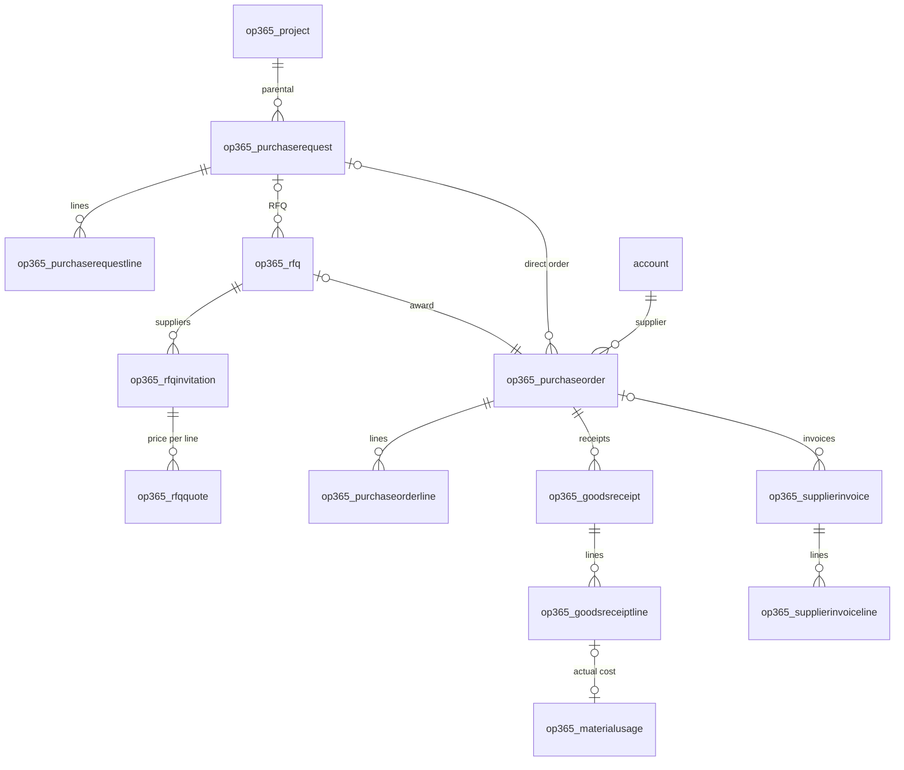
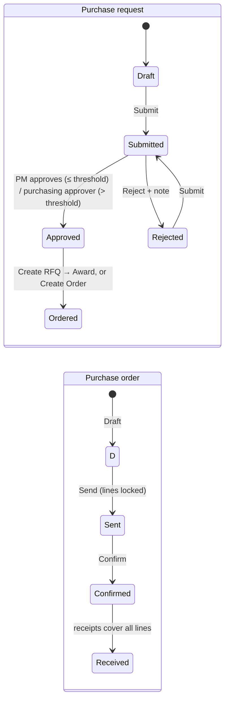
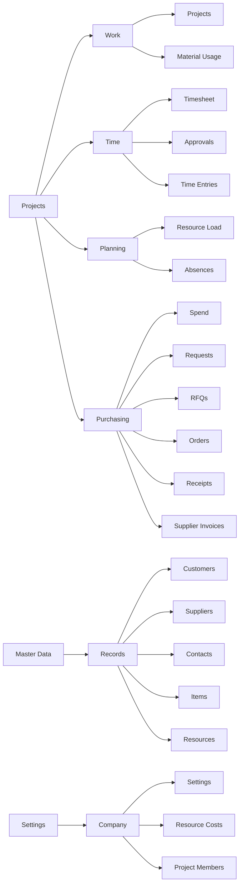

# Data model

Tables delivered so far, by roadmap phase. Full column list: specification in PROGETTI.

## Phase 1 – Master data, resources, settings



| Table | Primary column | Alternate key | Notes |
|---|---|---|---|
| `account` (std) | name | – | + IsCustomer, IsSupplier, CustomerType, VatNumber, TaxCode, SupplierStatus, SupplierCategory, Pec, Iban, Language, PaymentTerms, ExpiredDocs, ExpiringDocs |
| `contact` (std) | fullname | – | + IsDecisionMaker |
| `op365_item` | Name | Code | Code, Category, Uom, UnitCost, DefaultSupplierId, Notes |
| `op365_itemsupplier` | Name | ItemId + SupplierId | SupplierCode, Price, LeadTimeDays, MinimumLot, Notes |
| `op365_supplierdocument` | Description | – | DocumentType, Number, IssueDate, ExpiryDate, ExternalUrl, File, Notes |
| `op365_resource` | Name | – | Role, HourlyCost (secured), UserId, WeeklyHours (0–80), WorkingDays (multi-choice) |
| `op365_resourcecost` | Name | ResourceId + ValidFrom | ValidFrom, HourlyCost (secured) |
| `op365_absence` | Name | – | AbsenceType, FromDate, ToDate, Hours, Notes |
| `op365_settings` | Name | – | TimeApprovalEnabled, PurchaseRequestThreshold (single row) |

All custom tables are user-owned, with notes and auditing enabled. Choice values start at 365000000.

Account contactcount and spend, Item usagecount and spend are filled from Phase 4.

## Phase 2 – Projects, team, WBS, baselines



| Table | Primary column | Alternate key | Notes |
|---|---|---|---|
| `op365_project` | Name (required) | Code | Code: optional autonumber PRJ-###### (typed codes still allowed). CustomerId, ProjectManagerId, StartDate, EndDate, ContractValue, Description, BudgetTotal, ActualCost, CommittedCost, ProgressPct. Status reasons: Offer, In Progress, Suspended (active), Closed (inactive) |
| `op365_projectmember` | Name (user name) | ProjectId + UserId | ProjectRole (Manager, Contributor, Reader), HourlyRate |
| `op365_wbsnode` | Name | – | ParentId (hierarchical), Code, OwnerResourceId, BudgetHours, BudgetLabour, BudgetMaterials, BudgetOther, BudgetTotal, ProgressPct, StartDate, EndDate, SortOrder, ActualHours |
| `op365_wbsdependency` | Name (pred → succ) | PredecessorId + SuccessorId | ProjectId, DependencyType (Finish-to-Start), LagDays |
| `op365_wbsallocation` | Name | WbsNodeId + ResourceId | Hours (> 0) |
| `op365_baseline` | Name | – | ProjectId, IsReference, Description |
| `op365_baselinenode` | Name | – | BaselineId, WbsNodeId, Code, BudgetHours, BudgetTotal, StartDate, EndDate |
| `account` (std) | – | – | + ProjectCount, ContractValueTotal |

**Totals are plugin-maintained columns, not rollup columns**: they are current right after each save (rollups refresh asynchronously) and follow one rule shared with the PCF controls. ActualCost and ActualHours are filled from Phase 3, CommittedCost in Phase 4.

A table can have only one cascading parent, so the Predecessor, Successor and Parent Node lookups only remove the link on delete; the `WbsNodeDelete` plugin deletes the dependencies and the subtree of a deleted node.

### Plugins and Custom API (`src/plugins`)

| Class | Trigger | Does |
|---|---|---|
| ResourceDefaults | Resource create (pre) | WeeklyHours 40 and Monday-Friday when empty |
| ResourceCostSync | Resource Cost create/update/delete (post) | Resource HourlyCost = cost with the latest Valid From not in the future |
| ProjectSync | Project create/update/delete (post) | Project manager becomes a Manager member; customer ProjectCount and ContractValueTotal |
| ProjectMemberName / ProjectMemberSync | Project Member create (pre) / create, update, delete (post) | Name = user; user added to or removed from the project access team of the role |
| WbsNodeBudget | WBS Node create/update (pre) | BudgetTotal = labour + materials + other |
| WbsNodeRollup | WBS Node create/update/delete (post) | Project BudgetTotal (sum) and ProgressPct (leaf progress weighted by budget, then hours, else average) |
| WbsNodeDelete | WBS Node delete (pre-validation) | Deletes dependencies and child nodes |
| WbsDependencyValidate | WBS Dependency create/update (pre) | Same project, no self link, no cycle; sets ProjectId and Name |
| BaselineReference | Baseline create/update (post) | Only one reference baseline per project |
| SaveBaseline | Custom API `op365_SaveBaseline` bound to Project (inputs Name, KeepReference; output BaselineId) | Copies budget and dates of the active WBS nodes into a new (reference) baseline |

A resource cost whose Valid From is in the future becomes current only at its next change; a daily flow in a later phase will refresh it.

### Code components (`src/pcf`)

Both are React virtual controls on the Fluent UI v9 platform library, bound to the WBS Nodes subgrid of the Project form; they read nodes, dependencies and baselines through the Web API. Strings are in `.resx` (1033).

| Control | Tab | Features |
|---|---|---|
| `OP365.WbsTreeGrid` | WBS | Expandable tree ordered by Sort Order then outline code; inline edit of dates, hours, budget parts and progress on leaf nodes; rolled-up totals on parent nodes; new node / new child node |
| `OP365.GanttChart` | Gantt | Week / month / quarter scale; summary and task bars with progress; finish-to-start arrows; critical path computed client-side (`shared/cpm.ts`); bars pushed by dependencies shown dashed; baseline dropdown (reference baseline preselected); today line |

## Phase 3 – Execution: time, materials, actuals



| Table | Primary column | Notes |
|---|---|---|
| `op365_timeentry` | Name (resource + date, set by plugin) | ProjectId, WbsNodeId, ResourceId, EntryDate, Hours (0–24), Notes, Cost (secured), Revenue, SubmittedOn, DecidedById, DecidedOn, DecisionNote. Status reasons: Draft, Submitted, Approved, Rejected |
| `op365_materialusage` | Description | ProjectId, WbsNodeId, ItemId, SupplierId, UsageDate, Quantity, Uom, UnitCost (secured), TotalCost (secured) |
| `op365_project` (+) | – | ActualHours; ActualCost now filled |
| `op365_wbsnode` (+) | – | ActualCost; ActualHours now filled |



Actuals count **approved** hours and costs plus all material usage. Time is entered only on **In Progress** projects; submitted and approved entries are locked.

### Plugins and Custom API (Phase 3)

| Class | Trigger | Does |
|---|---|---|
| TimeEntryValidate | Time Entry create/update (pre) | Status only through the APIs; submitted/approved locked; resource = caller's resource; project In Progress; WBS node of the project; Cost = hours × hourly cost valid on the date; Revenue = hours × member hourly rate; Name |
| TimeEntryDelete | Time Entry delete (pre) | Submitted and approved entries cannot be deleted (except with the project) |
| MaterialUsageValidate | Material Usage create/update (pre) | Project In Progress; WBS node of the project; description and unit from the item; unit cost = supplier price, else item cost; TotalCost |
| ActualsRollup | Time Entry and Material Usage create/update/delete (post) | ActualHours and ActualCost of the WBS nodes and the project |
| SubmitTimeEntries | Custom API `op365_SubmitTimeEntries` (TimeEntryIds → Count) | Own entries (any for administrators) to Submitted, or Approved when approval is off; in-app notification to the project managers |
| DecideTimeEntries | Custom API `op365_DecideTimeEntries` (TimeEntryIds, Approve, Note → Count) | Project managers and administrators approve or reject (note required); in-app notification to the resource |
| GetLabourCost | Custom API function `op365_GetLabourCost` (ResourceId, Date → HourlyCost) | Hourly cost valid on a date, under the caller's column security |

### Code components (Phase 3)

| Control | Where | Features |
|---|---|---|
| `OP365.WeeklyTimesheet` | Dashboard **Timesheet** | Week grid of the current user by project / task, inline hours, add line, status badges, daily and weekly totals against weekly hours, Submit week |
| `OP365.TimeApproval` | Dashboard **Time Approval** | Submitted entries by resource and week with project split, select groups or single entries, Approve, Reject with note |
| `OP365.ResourceLoad` | Dashboard **Resource Load** | Heatmap resource × week: WBS allocations spread over working days against weekly hours minus absences and closures; 4–26 weeks; hours on undated nodes shown apart |
| `OP365.CostSummary` | Project form, **Costs** tab (bound to Actual Cost) | Contract, budget, actual (labour / materials), estimate at completion, margin; budget vs actual by top-level WBS branch |

## Phase 4 – Purchasing



| Table | Number | Notes |
|---|---|---|
| `op365_purchaserequest` | PR-##### | Project, WBS node, preferred supplier, requester, current approver, estimated amount, above threshold, approval level. Status: Draft, Submitted, Approved, Rejected, Cancelled, Ordered |
| `op365_purchaserequestline` | – | Item, quantity, unit, estimated price and amount |
| `op365_rfq` | RFQ-##### | Request, deadline, winning invitation, purchase order. Status: Draft, Sent, Awarded, Cancelled |
| `op365_rfqinvitation` | – | Supplier, email, delivery days, quoted amount, responded on. Status: To Invite, Invited, Responded, Declined |
| `op365_rfqquote` | – | Price for one request line from one invitation (the first quote sets the invitation to Responded) |
| `op365_purchaseorder` | PO-##### | Supplier, delivery place, total, received, supplier confirmed. Status: Draft, Sent, Confirmed, Received, Cancelled |
| `op365_purchaseorderline` | – | Item, WBS node, quantity, price, amount, received quantity |
| `op365_goodsreceipt` (+ lines) | GR-##### | Delivery note number and date; each line creates the material usage on the project (actual cost) |
| `op365_supplierinvoice` (+ lines) | INV-##### | Passive invoice container (manual XML/PDF, SDI later). Status: To Review, Approved, Rejected |
| Settings, Account, Item, Project (+) | – | Purchasing approver and threshold; supplier spend and contact count; item usage count and spend; project committed cost |



Committed cost of a project = open order amounts not yet received; actual cost comes from the goods receipts (material usage). Purchasing works only on **In Progress** projects.

### Plugins and Custom API (Phase 4)

| Custom API | Does |
|---|---|
| `op365_SubmitPurchaseRequest` / `DecidePurchaseRequest` / `CancelPurchaseRequest` | Two-level approval with the Settings threshold; in-app notifications |
| `op365_CreateRfq` / `SendRfq` / `AwardRfq` / `CancelRfq` | RFQ from an approved request (preferred + item suppliers), send, award one responding supplier → draft purchase order |
| `op365_CreatePurchaseOrder` | Direct order to the preferred supplier |
| `op365_SetPurchaseOrderStatus` | Draft / Sent / Confirmed / Cancelled |
| `op365_RegisterGoodsReceipt` / `CancelGoodsReceipt` | Receipt of order lines (`guid=qty`), material usage created/removed |
| `op365_DecideSupplierInvoice` | Approve or reject (note) a supplier invoice |
| `op365_SendTimeReminders` | Daily reminder to resources with missing hours (skips company closures); called by the **Daily time reminder** cloud flow |

Validation plugins lock records outside their editable status and keep the totals (request, quote, order, invoice, project committed, supplier and item spend) in sync.

### Code component and commands (Phase 4)

| Item | Where | Features |
|---|---|---|
| `OP365.QuoteComparison` | RFQ form | Line × supplier price grid, best price per line and best total, delivery days, Award button |
| Ribbon buttons (`tools/dataverse/ribbon.py`) | Request, RFQ, Order, Receipt, Invoice forms | One button per Custom API, enabled only in the statuses where it applies (`op365_/scripts/purchasing.js`, dialogs `op365_/pages/decision.html` and `receipt.html`) |
| Dashboard **Spend** | Purchasing area | Spend by supplier, by project, orders by status, open orders, invoices to review |

## Security

| Component | Content |
|---|---|
| OP365 Administrator | Organization-level Create, Read, Write, Delete, Append, Append To, Assign, Share on Account, Contact and all F1 tables |
| OP365 User | Organization-level Read and Append To on the same tables (writes come with the project tables in F2-F4) |
| OP365 Cost Visibility | Column security profile: read/create/update of `op365_hourlycost` on Resource and Resource Cost |
| OP365 Administrator (F2) | Organization-level full access on Project and its child tables |
| OP365 User (F2) | User-level Read, Write, Append, Append To, Share on Project; User-level Create, Read, Write, Delete, Append, Append To on the child tables. Projects become visible through the access teams |
| OP365 Administrator (F3) | Organization-level full access on Time Entry and Material Usage |
| OP365 User (F3) | User-level Create, Read, Write, Delete, Append, Append To on Time Entry and Material Usage |
| OP365 Cost Visibility (F3) | + Time Entry Cost, Material Usage Unit Cost and Total Cost |
| OP365 Administrator (F4) | Organization-level full access on the purchasing tables |
| OP365 User (F4) | User-level access on the purchasing tables; supplier invoices Read and Append To only |
| OP365 Cost Visibility (F4) | + supplier and item spend |
| Access team templates on Project | **OP365 Project Manager** (Read, Write, Append, Append To, Share), **OP365 Project Contributor** (Read, Append, Append To: members can log time and materials), **OP365 Project Reader** (Read). Templates are not solution components: the plugin creates them on first use in each environment |

OP365 roles are additive: every internal user also needs the standard **Basic User** role. Assign the Cost Visibility profile to administrators and project managers.

## App

Model-driven app **Open Project 365** (`op365_OpenProject365`).



Account has two forms, **Customer** and **Supplier**; `op365_/scripts/account.form.js` (source in `src/webresources`) opens supplier-only accounts on the Supplier form and flags new records according to the chosen form.

Project form: Summary, WBS (WBS Tree Grid), Gantt (Gantt Chart and baselines), Costs (Cost Summary), Time, Materials, Team, Timeline, with the **Save Baseline** command (modern command, `op365_/scripts/project.form.js`). WBS Node form: General, Budget, Dependencies, Allocations; `op365_/scripts/wbsnode.form.js` limits Parent Node to the same project. Time Entry (main and quick create) and Material Usage forms: `op365_/scripts/execution.form.js` limits WBS Node to the selected project.

Views: All, In Progress, Offers, Suspended and Closed Projects, WBS Nodes by Project, Project Members, Customers with/without Projects, All Customers (default), Prospects, All/Active/Blocked Suppliers, Suppliers with Document Alerts, All Items, Active Resources, Absences, All / My Time Entries, Time Entries to Approve, Time Entries by Project, All Material Usage, Material Usage by Project, plus Quick Find on Account, Item, Time Entry and Material Usage.

## Recreating the schema

The scripts in `tools/dataverse` build the schema through the Dataverse Web API inside the `OpenProject365` solution. They are idempotent and read the `PAC_*` environment variables (client credentials of an application user). Run them in order, then export and unpack the solution:

```bash
python3 tools/dataverse/phase1_tables.py
python3 tools/dataverse/phase1_security.py
python3 tools/dataverse/phase1_views.py
python3 tools/dataverse/phase1_forms.py
python3 tools/dataverse/phase2_tables.py
python3 tools/dataverse/project_code_autonumber.py  # Code autonumber + seed 1: run once in EVERY environment (seed is not in the solution)
python3 tools/dataverse/phase2_security.py
python3 tools/dataverse/phase2_views.py
python3 tools/dataverse/phase3_tables.py
python3 tools/dataverse/phase3_security.py
python3 tools/dataverse/phase3_views.py
python3 tools/dataverse/phase4_tables.py
python3 tools/dataverse/phase4_security.py
python3 tools/dataverse/phase4_views.py
python3 tools/dataverse/timeline.py           # notes and activities
dotnet build src/plugins/OpenProject365.Plugins -c Release
python3 tools/dataverse/plugins.py              # assembly, steps and Custom APIs of every phase
(cd src/pcf && npm ci) && tools/pcf/push.sh     # needs a pac auth profile on the environment
python3 tools/dataverse/phase2_forms.py
python3 tools/dataverse/phase3_forms.py
python3 tools/dataverse/phase4_forms.py
python3 tools/dataverse/phase4_dashboard.py
python3 tools/dataverse/flows.py              # connection reference + Daily time reminder (off)
python3 tools/dataverse/app.py                  # also publishes (views are read back in their published state)
python3 tools/dataverse/phase2_smoke.py         # end-to-end checks of the plugins, clean up after themselves
python3 tools/dataverse/phase3_smoke.py
python3 tools/dataverse/phase4_smoke.py
python3 tools/dataverse/seed_demo.py           # optional demo data (--clean removes it)
```

Ribbon buttons are solution XML: after export/unpack run `python3 tools/dataverse/ribbon.py`, pack and import into Dev.

Shared helpers: `meta.py` (columns, tables, lookups, keys, roles), `viewlib.py` (views), `formlib.py` (FormXml).
