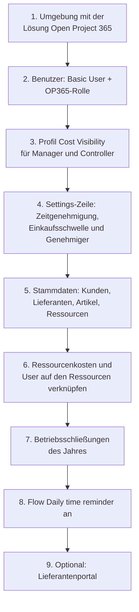

# Administration: Benutzer, Sicherheit, Einstellungen und Automatisierungen

> **Sprache:** [English](../en/administration.md) · [Italiano](../it/administration.md) · [Français](../fr/administration.md) · Deutsch
> **Handbuchverzeichnis:** [README](../../README.md#user-manuals)

Dieses Handbuch richtet sich an die Personen, die Open Project 365 in einem Unternehmen einrichten und betreiben: fachliche Administratoren, IT-Mitarbeiter und den Power-Platform-Administrator. Es erklärt, wie Sie Personen Zugriff geben, wie das Sicherheitsmodell funktioniert, was die Unternehmenseinstellungen bewirken, welche Automatisierungen im Hintergrund laufen und was nach einem Update zu prüfen ist. Technische Themen (Build, Bereitstellung, Dataverse-Schema) werden in [Development environment setup](../dev-environment.md) und [Data model](../data-model.md) behandelt (auf Englisch).

> Feld- und Schaltflächennamen stehen auf Englisch, so wie sie auf dem Bildschirm erscheinen.

## Checkliste für die Ersteinrichtung

| Schritt | Wo | Details |
|---|---|---|
| 1 | Power Platform Admin Center | Eine Dataverse-Umgebung pro Unternehmen. Die Lösung wird von der IT installiert (siehe [Entwicklungsumgebung](../dev-environment.md)) |
| 2 | Power Platform Admin Center → Users | [Sicherheitsrollen](#sicherheitsrollen) |
| 3 | Power Platform Admin Center → Column security profiles | [Kostensichtbarkeit](#kostensichtbarkeit) |
| 4 | Settings → Company → Settings | [Unternehmenseinstellungen](#unternehmenseinstellungen) |
| 5 | Master Data | [Stammdaten](master-data.md) |
| 6 | Master Data → Resources | [Stammdaten](master-data.md#ressourcen) |
| 7 | Projects → Planning → Absences (ohne Ressource) | [Stammdaten](master-data.md#abwesenheiten-und-betriebsschließungen) |
| 8 | Power Automate | [Tägliche Stundenerinnerung](#tägliche-stundenerinnerung) |
| 9 | Power Pages | [Lieferantenportal](supplier-portal.md) |

## Lizenzen

Jeder interne Benutzer braucht eine **Power Apps Premium**-Lizenz (oder eine gleichwertige Lizenz, die modellgesteuerte Apps auf Dataverse umfasst). Lieferanten, die das Portal nutzen, brauchen keine Power-Apps-Lizenz: Sie sind Portalbenutzer und durch die Power-Pages-Kapazität der Umgebung abgedeckt.

## Sicherheitsrollen

Die Rollen von Open Project 365 sind **additiv**: Jeder interne Benutzer braucht die Standardrolle **Basic User** **plus** eine Rolle von Open Project 365.

| Rolle | Für | Zugriff |
|---|---|---|
| **OP365 Administrator** | Fachliche Administratoren, Controller, Backoffice, Einkaufsgenehmiger | Organisationsweit: Anlegen, Lesen, Schreiben, Löschen, Anfügen, Zuweisen und Freigeben bei allen Tabellen von Open Project 365, Kunden, Lieferanten und Kontakten. Sieht jedes Projekt. Kann Stunden und Anforderungen in jedem Projekt genehmigen, über Lieferantenrechnungen entscheiden, Stunden für andere einreichen |
| **OP365 User** | Projektleiter, Teammitglieder, Einkäufer | Liest Stammdaten organisationsweit; legt eigene Datensätze an und verwaltet sie; sieht die Projekte, deren **Besitzer** er ist oder in denen er **Mitglied** ist, mit den Rechten seiner Projektrolle (siehe [Projekte und Team](projects-and-team.md#das-projektteam)). Lieferantenrechnungen: nur lesen |

Die Standardrolle **System Administrator** wird von allen Regeln von Open Project 365 wie OP365 Administrator behandelt.

### Was ein OP365 User je nach Projektrolle tun kann

| | Reader | Contributor | Manager |
|---|---|---|---|
| Projekt, PSP, Plan, Kosten sehen | ✓ | ✓ | ✓ |
| Eigene Stunden und eigenes Material erfassen | | ✓ | ✓ |
| Bedarfsanforderungen anlegen | | ✓ | ✓ |
| Wareneingänge buchen | | ✓ | ✓ |
| Projekt, PSP, Team, Basispläne ändern | | | ✓ |
| Stunden und Bedarfsanforderungen genehmigen (erste Stufe) | | | ✓ |
| Angebotsanfragen, Bestellungen, Bestellstatus | | | ✓ |

Projektrollen werden über **Zugriffsteams** (Access Teams) auf jedem Projekt vergeben; die drei Teamvorlagen (**OP365 Project Manager**, **OP365 Project Contributor**, **OP365 Project Reader**) werden automatisch angelegt, wenn sie zum ersten Mal benötigt werden. Löschen oder benennen Sie sie nicht um.

### Einem neuen Mitarbeiter Zugriff geben

1. Fügen Sie den Benutzer der Umgebung hinzu (Power Platform Admin Center → Environments → *Ihre Umgebung* → Users) und weisen Sie **Basic User** und **OP365 User** (oder **OP365 Administrator**) zu.
2. Wenn die Person Kosten sehen soll, fügen Sie sie dem Profil **OP365 Cost Visibility** hinzu.
3. Wenn die Person Stunden erfassen wird, legen Sie ihre **Resource** an oder öffnen Sie sie (Master Data → Resources), setzen Sie **User**, Weekly Hours, Working Days und eine Zeile **Resource Cost**.
4. Fügen Sie die Person den Teams ihrer Projekte hinzu (Registerkarte **Team** des Projekts), oder bitten Sie die Projektleiter darum.

## Kostensichtbarkeit

Kostenspalten sind durch das Feldsicherheitsprofil **OP365 Cost Visibility** geschützt. Ohne dieses Profil sieht ein Benutzer diese Felder leer oder maskiert, auch bei Datensätzen, die er öffnen kann:

| Tabelle | Geschützte Spalten |
|---|---|
| Resource | Hourly Cost |
| Resource Cost | Hourly Cost |
| Time Entry | Cost |
| Material Usage | Unit Cost, Total Cost |
| Account (Lieferant) | Spend |
| Item | Spend |

Weisen Sie das Profil (Power Platform Admin Center → *Settings* → *Users + permissions* → *Column security profiles* → **OP365 Cost Visibility** → Benutzer oder Teams hinzufügen) Administratoren, Projektleitern und Controllern zu. Die Projektsummen (Budget Total, Actual Cost, Committed Cost) sind nicht geschützt: Wer das Projekt lesen kann, sieht sie.

## Unternehmenseinstellungen

**Settings → Company → Settings** enthält eine **einzige Zeile** mit den unternehmensweiten Schaltern. Legen Sie sie einmal an, falls sie nicht existiert; legen Sie keine zweite an.

| Feld | Standard | Wirkung |
|---|---|---|
| **Name** | – | Name des Unternehmens |
| **Time Approval Enabled** | An (auch wenn die Zeile nicht existiert) | An: Eingereichte Stunden warten auf die Genehmigung eines Projektleiters. Aus: **Submit** genehmigt die Stunden sofort |
| **Purchase Request Threshold** | Leer | Betrag, ab dem eine Bedarfsanforderung zusätzlich eine Genehmigung der zweiten Stufe braucht. Leer oder 0 = nie |
| **Purchasing Approver** | Leer | Der Benutzer, der Anforderungen über der Schwelle genehmigt und über Lieferantenrechnungen entscheidet. Leer = jeder OP365 Administrator |

Änderungen gelten sofort für neue Einreichungen; bereits eingereichte Anforderungen behalten die ihnen zugewiesene Genehmigungsstufe.

## Weitere Unternehmensdaten im Bereich Settings

| Seite | Verwendung |
|---|---|
| **Resource Costs** | Alle Stundensatzzeilen aller Ressourcen: nützlich für die jährliche Anpassung der Sätze (eine Zeile pro Ressource mit dem neuen *Valid From* hinzufügen) |
| **Project Members** | Alle Mitglieder aller Projekte: nützlich, um zu prüfen, wer wo arbeitet, oder um eine Person zu entfernen, die das Unternehmen verlassen hat |

## Automatisierungen im Hintergrund

Open Project 365 hält die meisten Kennzahlen mit **Plugins** aktuell, die beim Speichern von Datensätzen in Dataverse laufen; sie brauchen keine Wartung. Nur eine Automatisierung ist zeitgesteuert.

### Tägliche Stundenerinnerung

Die **Daily time reminder** ist ein Power-Automate-Cloud-Flow in der Lösung Open Project 365. Von **Montag bis Freitag um 17:30** (Zeitzone W. Europe) ruft er die Aktion *op365_SendTimeReminders* auf, die jeder aktiven Ressource mit Benutzer, die für den Tag weniger Stunden als erwartet erfasst hat, die In-App-Benachrichtigung „Record your hours“ sendet (siehe [Zeiterfassung](time-tracking.md#die-tägliche-erinnerung)). An Betriebsschließungen werden keine Erinnerungen gesendet.

Der Flow verwendet den Verbindungsverweis **op365_dataverse** (Microsoft Dataverse). Ein Dienstprinzipal kann keine Power-Automate-Verbindungen besitzen, daher muss ein **Benutzer**:

1. eine Microsoft-Dataverse-Verbindung anlegen (Authentifizierung per Dienstprinzipal ist in Ordnung);
2. sie in der Lösung mit dem Verbindungsverweis verknüpfen (in Test-/Produktionsumgebungen ordnet die Bereitstellung sie über die Deployment Settings zu);
3. die Verbindung für den Anwendungsbenutzer der Bereitstellung freigeben (*Can use*), damit Importe den Flow einschalten können;
4. den Flow **einschalten** und am nächsten Arbeitstag seinen Ausführungsverlauf prüfen.

### Was sonst automatisch geschieht

| Automatisierung | Wann |
|---|---|
| Projektsummen, PSP-Summen und Fortschritt | Bei jedem Speichern von Elementen, Zeiteinträgen, Materialverbräuchen, Bestellungen, Wareneingängen |
| Projektanzahl und Auftragswertsumme des Kunden | Bei jeder Projektänderung |
| Einkaufsvolumen und Kontaktanzahl des Lieferanten; Bestellpositionen und Einkaufsvolumen des Artikels | Bei jeder Änderung von Bestellungen, Bestellpositionen und Kontakten |
| Stundensatz der Ressource | Bei jeder Änderung von Resource Cost |
| In-App-Benachrichtigungen | Beim Einreichen und Entscheiden von Stunden und Bedarfsanforderungen sowie durch die tägliche Erinnerung |
| Zugriff des Projektteams | Bei jeder Änderung von Projektmitgliedern |

### Benachrichtigungen

In-App-Benachrichtigungen sind in neuen Umgebungen standardmäßig aktiviert. Benutzer verwalten sie über das Glockensymbol. Benachrichtigungen blockieren nie: Kann eine nicht gesendet werden, gelingt der Vorgang trotzdem.

## Überwachung und Historie

Die Überwachung (Auditing) ist auf den Tabellen von Open Project 365 aktiviert: Sobald sie auch auf Umgebungsebene eingeschaltet ist (Power Platform Admin Center → *Settings* → *Audit and logs*), wird jede Änderung aufgezeichnet und ist im **Audit history** jedes Datensatzes sichtbar (Related → Audit history). Die Zeitachse jedes Datensatzes bewahrt Notizen, Erwähnungen und Anhänge.

## Nach einem Update der Lösung

Wenn die IT eine neue Version bereitstellt:

1. Prüfen Sie, ob die Plugin-Schritte **aktiviert** sind (ein abgebrochener Import kann sie deaktiviert lassen; die IT kann das in den *Plug-in steps* der Lösung prüfen).
2. Prüfen Sie, ob der Flow **Daily time reminder** **eingeschaltet** ist.
3. Wurde das Lieferantenportal aktualisiert, **leeren Sie den Portal-Cache** (`/_services/about` → *Clear cache*) und melden Sie sich erneut an.
4. Lesen Sie die Versionshinweise und die aktualisierten Handbücher (diese Dokumentation wird mit jeder funktionalen Änderung aktualisiert).

## Eine ausgeschiedene Person entfernen

1. Entfernen Sie sie aus den Projektteams (Settings → Project Members, nach Benutzer filtern).
2. Deaktivieren Sie ihre **Resource** (ihre bisherigen Stunden und Kosten bleiben erhalten).
3. Deaktivieren Sie den Benutzer im Power Platform Admin Center / in Microsoft 365.
4. Weisen Sie bei Bedarf Datensätze, deren Besitzer sie ist, neu zu (Assign).
5. War sie **Purchasing Approver** oder Projektleiter, aktualisieren Sie Settings und die Projekte.

## Fehlerbehebung

| Symptom | Wahrscheinliche Ursache | Lösung |
|---|---|---|
| Ein Benutzer sieht keine Projekte | Mitglied keines Projekts oder OP365-Rolle fehlt | Rolle zuweisen; den Benutzer den Projektteams hinzufügen |
| „Your user is not linked to a resource“ | Keine aktive Resource mit diesem User | User auf der Resource setzen |
| Kosten bei einem Manager leer | Profil Cost Visibility fehlt | Den Benutzer dem Profil hinzufügen |
| Niemand erhält die tägliche Erinnerung | Flow aus oder Verbindung defekt | Flow und Verbindung prüfen |
| Summen nach einem Import nicht aktualisiert | Plugin-Schritte deaktiviert | Plugin-Schritte aktivieren |
| Anforderungen über der Schwelle gehen an alle Administratoren | Purchasing Approver leer | In Settings setzen |
| Lieferanten sehen „This area is reserved to suppliers“ | Web-Rolle Supplier fehlt oder nicht angemeldet | Dem Kontakt die Web-Rolle zuweisen |
