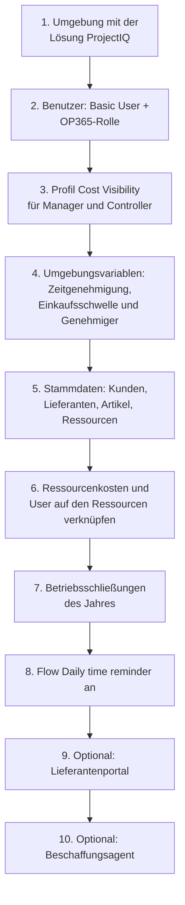
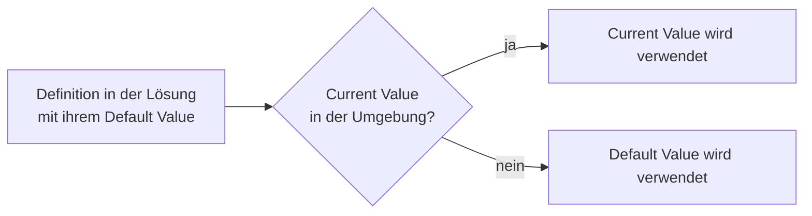
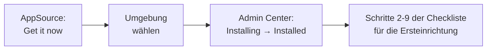

# Administration: Benutzer, Sicherheit, Einstellungen und Automatisierungen

> **Sprache:** [English](../en/administration.md) · [Italiano](../it/administration.md) · [Français](../fr/administration.md) · Deutsch
> **Handbuchverzeichnis:** [README](../../README.md#user-manuals)

Dieses Handbuch richtet sich an die Personen, die ProjectIQ in einem Unternehmen einrichten und betreiben: fachliche Administratoren, IT-Mitarbeiter und den Power-Platform-Administrator. Es erklärt, wie Sie Personen Zugriff geben, wie das Sicherheitsmodell funktioniert, was die Unternehmenseinstellungen bewirken, welche Automatisierungen im Hintergrund laufen und was nach einem Update zu prüfen ist. Technische Themen (Build, Bereitstellung, Dataverse-Schema) werden in [Development environment setup](../dev-environment.md) und [Data model](../data-model.md) behandelt (auf Englisch).

> Feld- und Schaltflächennamen stehen auf Englisch, so wie sie auf dem Bildschirm erscheinen.

## Checkliste für die Ersteinrichtung

| Schritt | Wo | Details |
|---|---|---|
| 1 | Power Platform Admin Center | Eine Dataverse-Umgebung pro Unternehmen. Die Lösung wird über [Microsoft AppSource](#installation-über-microsoft-appsource) oder von der IT installiert (siehe [Entwicklungsumgebung](../dev-environment.md)) |
| 2 | Power Platform Admin Center → Users | [Sicherheitsrollen](#sicherheitsrollen) |
| 3 | Power Platform Admin Center → Column security profiles | [Kostensichtbarkeit](#kostensichtbarkeit) |
| 4 | Power Apps → Solutions → ProjectIQ → Environment variables | [Unternehmenseinstellungen](#unternehmenseinstellungen) |
| 5 | Master Data | [Stammdaten](master-data.md) |
| 6 | Master Data → Resources | [Stammdaten](master-data.md#ressourcen) |
| 7 | Projects → Planning → Absences (ohne Ressource) | [Stammdaten](master-data.md#abwesenheiten-und-betriebsschließungen) |
| 8 | Power Automate | [Tägliche Stundenerinnerung](#tägliche-stundenerinnerung) |
| 9 | Power Pages | [Lieferantenportal](supplier-portal.md) |
| 10 | Power Platform Admin Center, Power Apps, Power Automate | [Den Beschaffungsagenten einrichten](#den-beschaffungsagenten-einrichten) |

## Lizenzen

Jeder interne Benutzer braucht eine **Power Apps Premium**-Lizenz (oder eine gleichwertige Lizenz, die modellgesteuerte Apps auf Dataverse umfasst). Lieferanten, die das Portal nutzen, brauchen keine Power-Apps-Lizenz: Sie sind Portalbenutzer und durch die Power-Pages-Kapazität der Umgebung abgedeckt.

Der [Beschaffungsagent](sourcing-agent.md) fügt einen Anwendungsbenutzer hinzu (er braucht keine Benutzerlizenz, zählt aber zu den Anwendungsbenutzern der Umgebung) und zwei Cloud-Flows, die die Verbindungen Microsoft Dataverse und Microsoft Teams nutzen. Der Agent selbst ist ein Copilot-Studio-Agent, der in späteren Versionen geliefert wird und Copilot-Studio-Kapazität verbraucht: Prüfen Sie Ihre Lizenzen, bevor Sie ihn einschalten.

## Sicherheitsrollen

Die Rollen von ProjectIQ sind **additiv**: Jeder interne Benutzer braucht die Standardrolle **Basic User** **plus** eine Rolle von ProjectIQ.

| Rolle | Für | Zugriff |
|---|---|---|
| **OP365 Administrator** | Fachliche Administratoren, Controller, Backoffice, Einkaufsgenehmiger | Organisationsweit: Anlegen, Lesen, Schreiben, Löschen, Anfügen, Zuweisen und Freigeben bei allen Tabellen von ProjectIQ, Kunden, Lieferanten und Kontakten. Sieht jedes Projekt. Kann Stunden und Anforderungen in jedem Projekt genehmigen, über Lieferantenrechnungen entscheiden, Stunden für andere einreichen |
| **OP365 User** | Projektleiter, Teammitglieder, Einkäufer | Liest Stammdaten organisationsweit; legt eigene Datensätze an und verwaltet sie; sieht die Projekte, deren **Besitzer** er ist oder in denen er **Mitglied** ist, mit den Rechten seiner Projektrolle (siehe [Projekte und Team](projects-and-team.md#das-projektteam)). Lieferantenrechnungen: nur lesen |
| **OP365 Buyer** | Einkäufer, die den Einkauf des Unternehmens führen | Zusätzlich zu Basic User (und normalerweise OP365 User): liest alle Projekte und ihre untergeordneten Tabellen; Vollzugriff auf Bedarfsanforderungen, Angebotsanfragen, Einladungen, Angebote, Bestellungen, Wareneingänge, Lieferanten und Kontakte in jedem Projekt; liest Lieferantenrechnungen (entscheidet nicht darüber); liest und schreibt die [Vorschläge des Agenten](sourcing-agent.md#vorschläge-des-agenten). Weisen Sie auch das Profil **OP365 Cost Visibility** zu |
| **OP365 Sourcing Agent** | Nur der Anwendungsbenutzer des Beschaffungsagenten | Liest Stammdaten, Projekte und Einkaufsdaten; legt Agentenvorschläge an. Schreibt keine Einkaufsdatensätze und kann nicht über Vorschläge entscheiden. Braucht das Profil **OP365 Cost Visibility** für die Ausgabenanalyse |

Die Standardrolle **System Administrator** wird von allen Regeln von ProjectIQ wie OP365 Administrator behandelt.

### Was ein OP365 User je nach Projektrolle tun kann

| | Reader | Contributor | Manager |
|---|---|---|---|
| Projekt, PSP, Plan, Kosten sehen | ✓ | ✓ | ✓ |
| Eigene Stunden und eigenes Material erfassen | | ✓ | ✓ |
| Bedarfsanforderungen anlegen | | ✓ | ✓ |
| Wareneingänge buchen | | ✓ | ✓ |
| Projekt, PSP, Team, Basispläne ändern | | | ✓ |
| Stunden und Bedarfsanforderungen genehmigen (erste Stufe) | | | ✓ |
| Angebotsanfragen, Bestellungen, Bestellstatus | | | ✓ |

Projektrollen werden über **Zugriffsteams** (Access Teams) auf jedem Projekt vergeben; die drei Teamvorlagen (**OP365 Project Manager**, **OP365 Project Contributor**, **OP365 Project Reader**) werden automatisch angelegt, wenn sie zum ersten Mal benötigt werden. Löschen oder benennen Sie sie nicht um.

### Einem neuen Mitarbeiter Zugriff geben

1. Fügen Sie den Benutzer der Umgebung hinzu (Power Platform Admin Center → Environments → *Ihre Umgebung* → Users) und weisen Sie **Basic User** und **OP365 User** (oder **OP365 Administrator**) zu.
2. Wenn die Person Kosten sehen soll, fügen Sie sie dem Profil **OP365 Cost Visibility** hinzu.
3. Wenn die Person Stunden erfassen wird, legen Sie ihre **Resource** an oder öffnen Sie sie (Master Data → Resources), setzen Sie **User**, Weekly Hours, Working Days und eine Zeile **Resource Cost**.
4. Fügen Sie die Person den Teams ihrer Projekte hinzu (Registerkarte **Team** des Projekts), oder bitten Sie die Projektleiter darum.

## Kostensichtbarkeit

Kostenspalten sind durch das Feldsicherheitsprofil **OP365 Cost Visibility** geschützt. Ohne dieses Profil sieht ein Benutzer diese Felder leer oder maskiert, auch bei Datensätzen, die er öffnen kann:

| Tabelle | Geschützte Spalten |
|---|---|
| Resource | Hourly Cost |
| Resource Cost | Hourly Cost |
| Time Entry | Cost |
| Material Usage | Unit Cost, Total Cost |
| Account | Spend (Lieferanten), IBAN |
| Item | Spend |
| Agent Proposal | Evidence |

Weisen Sie das Profil auch den Einkäufern und dem Anwendungsbenutzer des Beschaffungsagenten zu. Weisen Sie das Profil (Power Platform Admin Center → *Settings* → *Users + permissions* → *Column security profiles* → **OP365 Cost Visibility** → Benutzer oder Teams hinzufügen) Administratoren, Projektleitern und Controllern zu. Die Projektsummen (Budget Total, Actual Cost, Committed Cost) sind nicht geschützt: Wer das Projekt lesen kann, sieht sie.

## Unternehmenseinstellungen

Die unternehmensweiten Schalter sind **Umgebungsvariablen** (environment variables) der Lösung ProjectIQ. Jede Umgebung (Dev, Test, Produktion) hat eigene Werte, sodass eine Testumgebung zum Beispiel die Zeitgenehmigung überspringen kann, ohne die Produktion zu berühren. Sie sind nicht in der App: Ein Power Platform-Administrator oder ein Maker der Umgebung ändert sie.

So ändern Sie einen Wert:

1. Öffnen Sie [Power Apps](https://make.powerapps.com), wählen Sie die Umgebung, dann **Solutions** → **ProjectIQ** (oder **Default Solution**) → **Environment variables**.
2. Öffnen Sie die Variable und klicken Sie unter **Current Value** auf **+ New value** (oder bearbeiten Sie den vorhandenen Wert). Ändern Sie nicht den **Default Value** einer verwalteten Lösung.
3. **Save**. Die Änderung gilt ab der nächsten Einreichung; ein Veröffentlichen ist nicht nötig.

| Umgebungsvariable | Anzeigename | Typ | Standard | Wirkung |
|---|---|---|---|---|
| `op365_TimeApprovalEnabled` | **Time Approval Enabled** | Yes/No | Yes | Yes: Eingereichte Stunden warten auf die Genehmigung eines Projektleiters. No: **Submit** genehmigt die Stunden sofort |
| `op365_PurchaseRequestThreshold` | **Purchase Request Threshold** | Number | Leer | Betrag, ab dem eine Bedarfsanforderung zusätzlich eine Genehmigung der zweiten Stufe braucht. Leer oder 0 = nie |
| `op365_PurchasingApprover` | **Purchasing Approver** | Text | Leer | **User Name** (z. B. `anna.rossi@contoso.com`) oder primäre E-Mail des Benutzers, der Anforderungen über der Schwelle genehmigt und über Lieferantenrechnungen entscheidet. Leer, oder kein aktiver Benutzer mit diesem Namen = jeder OP365 Administrator |
| `op365_SupplierEmailTemplates` | **Supplier Email Templates** | JSON | Die ProjectIQ-Vorlagen | E-Mail-Vorlage (Typ Firma) jeder Nachricht an Lieferanten, je **Language** des Lieferanten: `{"DocumentExpiring": {"Italian": "<Vorlagentitel>", "English": "<Vorlagentitel>", "default": "English"}, "DocumentExpired": {...}, "PortalInvitation": {...}}`. `default` ist die Sprache, wenn der Lieferant keine hat oder es keine Vorlage dafür gibt |
| `op365_SupplierEmailSender` | **Supplier Email Sender** | Text | Leer | Name oder E-Mail-Adresse der **Warteschlange** (Postfach mit serverseitiger Synchronisierung), die die E-Mails an Lieferanten sendet. Leer = keine E-Mails |
| `op365_SupplierProgressUpdates` | **Supplier Progress Updates** | Yes/No | No | Yes: Im Lieferantenportal können Lieferanten den Fortschritt % der PSP-Aktivitäten ihres Umfangs aktualisieren (nur Aktivitäten ohne Unteraktivitäten). No: Sie sehen ihn nur. Siehe [Lieferantenportal](supplier-portal.md#projektlieferanten-und-psp-umfang) |
| `op365_SourcingAgentEnabled` | **Sourcing Agent Enabled** | Yes/No | No | Yes: Die Trigger des Beschaffungsagenten laufen. No: Sie stoppen sofort; offene Vorschläge können weiterhin entschieden werden |
| `op365_SourcingAgentUser` | **Sourcing Agent User** | Text | Leer | **User Name** des Anwendungsbenutzers, der den Agenten ausführt: der einzige Aufrufer, der die entscheidende Person angeben darf (der Flow der Genehmigungskarte tut das). Leer = niemand |
| `op365_SourcingApprovalTeam` | **Sourcing Approval Team** | Text | Leer | Teams-Team-ID und Kanal-ID, getrennt durch `\|`, in dem die Genehmigungskarten veröffentlicht werden |
| `op365_SourcingDirectOrderLimit` | **Sourcing Direct Order Limit** | Number | Leer | Betrag, unter dem der Agent eine Direktbestellung statt einer Angebotsanfrage vorschlägt. Leer oder 0 = immer Angebotsanfrage |
| `op365_SourcingMinQuotes` | **Sourcing Minimum Quotes** | Number | 3 | Anzahl der Lieferanten, die der Agent zu einer Angebotsanfrage einzuladen vorschlägt |
| `op365_SourcingReminderDays` | **Sourcing Reminder Days** | Number | 2 | Tage vor der Frist der Angebotsanfrage, an denen der Agent Lieferanten erinnert, die nicht geantwortet haben (spätere Aufgaben) |
| `op365_SourcingBudgetWarningPct` | **Sourcing Budget Warning %** | Number | 90 | Prozentsatz des Budgets eines Projekts oder PSP-Knotens, ab dem der Agent einen Budget Alert meldet (spätere Aufgaben) |
| `op365_SourcingProposalExpiryDays` | **Sourcing Proposal Expiry Days** | Number | 5 | Tage nach der Erstellung, nach denen ein ausstehender Vorschlag verfällt |
| `op365_InvoiceAiExtraction` | **Invoice AI Extraction** | Yes/No | Yes | Yes: Im Lieferantenportal hochgeladene PDF- und Bildrechnungen werden vom vorgefertigten Rechnungsverarbeitungsmodell von AI Builder gelesen, das AI-Builder-Credits verbraucht (etwa 32 pro Seite). No: Nur FatturaPA-XML-Dateien werden gelesen; bei den anderen geben die Lieferanten die Daten ein. Siehe [Einkauf](purchasing.md#lesen-der-datei) |

Der Purchasing Approver ist ein Benutzername und kein Lookup, weil sich die Benutzer-IDs in jeder Umgebung unterscheiden. Bereits eingereichte Anforderungen behalten die ihnen zugewiesene Genehmigungsstufe.

In Test kann die IT die Werte auch bei der Bereitstellung über die Deployment Settings setzen (siehe [Entwicklungsumgebung](../dev-environment.md#github-repository-security)); ein dort gesetzter Wert überschreibt bei jeder Bereitstellung den Wert der Umgebung.

## Weitere Unternehmensdaten im Bereich Settings

| Seite | Verwendung |
|---|---|
| **Resource Costs** | Alle Stundensatzzeilen aller Ressourcen: nützlich für die jährliche Anpassung der Sätze (eine Zeile pro Ressource mit dem neuen *Valid From* hinzufügen) |
| **Project Members** | Alle Mitglieder aller Projekte: nützlich, um zu prüfen, wer wo arbeitet, oder um eine Person zu entfernen, die das Unternehmen verlassen hat |

## Automatisierungen im Hintergrund

ProjectIQ hält die meisten Kennzahlen mit **Plugins** aktuell, die beim Speichern von Datensätzen in Dataverse laufen; sie brauchen keine Wartung. Vier Cloud-Flows sind zeit- oder ereignisgesteuert: die beiden folgenden und die zwei des [Beschaffungsagenten](#agent-proposal-approval-und-daily-agent-proposal-expiry).

### Tägliche Stundenerinnerung

Die **Daily time reminder** ist ein Power-Automate-Cloud-Flow in der Lösung ProjectIQ. Von **Montag bis Freitag um 17:30** (Zeitzone W. Europe) ruft er die Aktion *op365_SendTimeReminders* auf, die jeder aktiven Ressource mit Benutzer, die für den Tag weniger Stunden als erwartet erfasst hat, die In-App-Benachrichtigung „Record your hours“ sendet (siehe [Zeiterfassung](time-tracking.md#die-tägliche-erinnerung)). An Betriebsschließungen werden keine Erinnerungen gesendet.

Der Flow verwendet den Verbindungsverweis **op365_dataverse** (Microsoft Dataverse). Ein Dienstprinzipal kann keine Power-Automate-Verbindungen besitzen, daher muss ein **Benutzer**:

1. eine Microsoft-Dataverse-Verbindung anlegen (Authentifizierung per Dienstprinzipal ist in Ordnung);
2. sie in der Lösung mit dem Verbindungsverweis verknüpfen (in Test-/Produktionsumgebungen ordnet die Bereitstellung sie über die Deployment Settings zu);
3. die Verbindung für den Anwendungsbenutzer der Bereitstellung freigeben (*Can use*), damit Importe den Flow einschalten können;
4. den Flow **einschalten** und am nächsten Arbeitstag seinen Ausführungsverlauf prüfen.

### Täglicher Dokumentenablauf

Der Flow **Daily document expiry** läuft **jeden Tag um 06:00 Uhr** (W. Europe-Zeit) und ruft die Aktion *op365_UpdateDocumentExpiry* auf: Er aktualisiert den Ablaufstatus der Lieferantendokumente und die Hinweiszähler der Lieferanten und sendet den Lieferanten die Ablauf-E-Mails (siehe [Stammdaten](master-data.md#ablauf-und-e-mails)). Er verwendet dieselbe Verbindungsreferenz wie der Daily time reminder; schalten Sie ihn auf dieselbe Weise **ein**.

So werden die E-Mails gesendet:

1. Legen Sie eine **Warteschlange** mit Postfach an (zum Beispiel *Lieferanten*, `lieferanten@contoso.com`), genehmigen Sie die E-Mail-Adresse des Postfachs und aktivieren Sie die **serverseitige Synchronisierung** für ausgehende E-Mails.
2. Tragen Sie in **Supplier Email Sender** den Namen oder die E-Mail-Adresse der Warteschlange ein.
3. Prüfen Sie die Vorlagen unter **Settings** → **Templates** → **E-mail Templates** (*ProjectIQ - Document expiring* und *ProjectIQ - Document expired*, mit einer Version je Sprache wie *ProjectIQ - Dokument abgelaufen*). Passen Sie den Text nach Belieben an; die Platzhalter `{Document}`, `{DocumentType}`, `{Number}`, `{IssueDate}` und `{ExpiryDate}` werden für jedes Dokument gefüllt. Um andere Vorlagen zu verwenden, tragen Sie ihre Titel in **Supplier Email Templates** ein. Vorlagen sind Daten der Umgebung, nicht der Lösung: Fehlen sie, legt die IT sie mit `tools/dataverse/supplier_email_templates.py` an.
   Dieselbe Warteschlange versendet die Portaleinladungen (**Invite to Portal** am Kontakt) mit *ProjectIQ - Portal invitation* (Nachricht `PortalInvitation`; Platzhalter `{Contact}`, `{Email}`, `{Link}` und `{ExpiryDate}`). Lassen Sie `{Link}` im Text: Das ist der Registrierungslink.
4. Füllen Sie **Language** und **Email** jedes Lieferantenkontos aus.

### Agent proposal approval und Daily agent proposal expiry

Zwei Flows gehören zum [Beschaffungsagenten](sourcing-agent.md); beide werden **ausgeschaltet** angelegt:

| Flow | Wann | Tut |
|---|---|---|
| **Agent proposal approval** | Wenn ein Vorschlag (Kind Proposal) hinzugefügt wird | Veröffentlicht eine adaptive Karte mit Approve / Reject im Teams-Kanal von *Sourcing Approval Team*, wartet auf die Antwort, erfasst die Entscheidung im Namen der antwortenden Person und veröffentlicht das Ergebnis |
| **Daily agent proposal expiry** | Täglich um 06:30 (mitteleuropäische Zeit) | Ruft die Aktion *op365_ExpireAgentProposals* auf: Ausstehende Vorschläge nach ihrem **Expires On** werden Expired |

Der Genehmigungs-Flow nutzt den Verbindungsverweis **op365_teams** (Microsoft Teams) und einen eigenen Dataverse-Verbindungsverweis, **op365_dataverse_agent** (*ProjectIQ Dataverse (sourcing agent)*), der als Anwendungsbenutzer des Agenten handelt; alle anderen Flows verwenden **op365_dataverse**. Er veröffentlicht für jeden neuen Vorschlag eine Karte, auch wenn *Sourcing Agent Enabled* No ist. Die Schritte zum Einschalten stehen unter [Den Beschaffungsagenten einrichten](#den-beschaffungsagenten-einrichten).

### Was sonst automatisch geschieht

| Automatisierung | Wann |
|---|---|
| Projektsummen, PSP-Summen und Fortschritt | Bei jedem Speichern von Elementen, Zeiteinträgen, Materialverbräuchen, Bestellungen, Wareneingängen |
| Projektanzahl und Auftragswertsumme des Kunden | Bei jeder Projektänderung |
| Einkaufsvolumen und Kontaktanzahl des Lieferanten; Bestellpositionen und Einkaufsvolumen des Artikels | Bei jeder Änderung von Bestellungen, Bestellpositionen und Kontakten |
| Stundensatz der Ressource | Bei jeder Änderung von Resource Cost |
| In-App-Benachrichtigungen | Beim Einreichen und Entscheiden von Stunden und Bedarfsanforderungen sowie durch die tägliche Erinnerung; an die Projektleiter, wenn der Beschaffungsagent einen Vorschlag hinzufügt |
| Zugriff des Projektteams | Bei jeder Änderung von Projektmitgliedern |
| Lesen der Lieferantenrechnungen (FatturaPA-XML oder AI Builder) und ihre Prüfungen | Im Hintergrund, wenige Sekunden nachdem ein Lieferant eine Rechnung hochlädt oder ihre Nummer, ihr Datum oder ihre Bestellung ändert |

### Benachrichtigungen

In-App-Benachrichtigungen sind in neuen Umgebungen standardmäßig aktiviert. Benutzer verwalten sie über das Glockensymbol. Benachrichtigungen blockieren nie: Kann eine nicht gesendet werden, gelingt der Vorgang trotzdem.

## Den Beschaffungsagenten einrichten

Einmal pro Umgebung, nachdem die Lösung installiert ist. Die Grundlagen funktionieren ohne den Agenten: Sie können den gesamten Vorschlagszyklus mit dem Smoke-Test der IT prüfen, bevor es den Agenten gibt. Alles bleibt ausgeschaltet, bis Sie entscheiden.

1. **Anwendungsbenutzer anlegen.** Registrieren Sie in Microsoft Entra ID eine Anwendung (Client-ID und Secret). Fügen Sie sie im Power Platform Admin Center → Environments → *Ihre Umgebung* → Settings → Users + permissions → **Application users** mit dem Namen **ProjectIQ Sourcing Agent** hinzu und weisen Sie die Rollen **Basic User** und **OP365 Sourcing Agent** zu (OP365-Rollen ergänzen Basic User). Weisen Sie auch das Profil **OP365 Cost Visibility** zu (Column security profiles).
2. **Setzen Sie *Sourcing Agent User*** auf den **User Name** dieses Anwendungsbenutzers ([Unternehmenseinstellungen](#unternehmenseinstellungen)). Ohne ihn kann niemand im Namen einer Person entscheiden, und die Teams-Karte kann nicht funktionieren.
3. **Einkäufern Zugriff geben.** Weisen Sie **OP365 Buyer** (zusätzlich zu Basic User und OP365 User) und das Profil **OP365 Cost Visibility** den Personen zu, die über Einkaufsvorschläge entscheiden. Rechnungsvorschläge entscheidet der Purchasing Approver.
4. **Kanal wählen.** Legen Sie einen Teams-Kanal für die Karten an oder wählen Sie einen und setzen Sie *Sourcing Approval Team* auf `<team id>|<channel id>`.
5. **Verbindungen anlegen.** Ein Benutzer legt die Verbindung **Microsoft Teams** (ein Dienstkonto, das Mitglied des Teams ist) für den Verbindungsverweis **op365_teams** an, und eine Verbindung **Microsoft Dataverse**, die dem Anwendungsbenutzer aus Schritt 1 gehört (sie meldet sich als dieser Anwendungsbenutzer an), für den Verbindungsverweis **op365_dataverse_agent**, und verknüpft sie in der Lösung (Test und Produktion: über die Deployment Settings). Verwenden Sie diese Dataverse-Verbindung nur für **op365_dataverse_agent** und teilen Sie sie nicht mit anderen Benutzern: Alles, was sie verwendet, handelt als der Agent. Verknüpfen Sie sie nie mit **op365_dataverse**, das die anderen Flows verwenden.
6. **Schalten Sie** die Flows **Agent proposal approval** und **Daily agent proposal expiry** **ein** und prüfen Sie am nächsten Tag ihren Ausführungsverlauf.
7. **Agenten einschalten**, erst wenn er veröffentlicht ist: Setzen Sie *Sourcing Agent Enabled* auf Yes. Der Agent ist in jeder Umgebung standardmäßig ausgeschaltet, auch im AppSource-Paket.

Um die Einrichtung zu prüfen, ohne auf den Agenten zu warten, führt die IT den Smoke-Test aus, der im [Leitfaden zur Entwicklungsumgebung](../dev-environment.md#sourcing-agent) beschrieben ist.

## Überwachung und Historie

Die Überwachung (Auditing) ist auf den Tabellen von ProjectIQ aktiviert: Sobald sie auch auf Umgebungsebene eingeschaltet ist (Power Platform Admin Center → *Settings* → *Audit and logs*), wird jede Änderung aufgezeichnet und ist im **Audit history** jedes Datensatzes sichtbar (Related → Audit history). Die Zeitachse jedes Datensatzes bewahrt Notizen, Erwähnungen und Anhänge.

## Installation über Microsoft AppSource

ProjectIQ ist auf Microsoft AppSource kostenlos erhältlich: der schnellste Weg, es in einer neuen Umgebung zu installieren. Das AppSource-Paket installiert der Reihe nach die beiden verwalteten Lösungen **ProjectIQ** (`OpenProject365`) und das **Lieferantenportal** (`OpenProject365SupplierPortal`), mit bereits aktivierten Plugin-Schritten.

Vor dem Start: eine Dataverse-Umgebung für das Unternehmen, die Rolle **System Administrator** in dieser Umgebung und, um die App auf Italienisch, Französisch oder Deutsch anzuzeigen, diese Sprachen in der Umgebung aktiviert (*Settings* → *Languages*).

1. Öffnen Sie ProjectIQ auf [Microsoft AppSource](https://appsource.microsoft.com) und wählen Sie **Get it now**; melden Sie sich mit Ihrem Geschäftskonto an.
2. Wählen Sie die Ziel**umgebung**, akzeptieren Sie die Nutzungsbedingungen und die Microsoft-Bedingungen und wählen Sie **Install**.
3. Verfolgen Sie den Fortschritt im Power Platform Admin Center → *Environments* → Ihre Umgebung → *Resources* → **Dynamics 365 apps**: Der Status wechselt von *Installing* zu **Installed** (einige Minuten). Bei *Install failed* öffnen Sie die Details und versuchen es erneut.
4. Führen Sie die Schritte 2 bis 9 der [Checkliste für die Ersteinrichtung](#checkliste-für-die-ersteinrichtung) aus. Das Paket kann sie nicht für Sie erledigen:
    - weisen Sie den Benutzern die [Sicherheitsrollen](#sicherheitsrollen) und das Profil für die [Kostensichtbarkeit](#kostensichtbarkeit) zu;
    - legen Sie die [Umgebungsvariablen](#unternehmenseinstellungen) fest (Stundengenehmigung, Einkaufsschwelle und -genehmiger);
    - erstellen Sie die Dataverse-Verbindung des Flows [Tägliche Stundenerinnerung](#tägliche-stundenerinnerung) und **schalten** Sie den Flow ein;
    - für das [Lieferantenportal](supplier-portal.md#für-administratoren): reaktivieren Sie die importierte Website in Power Pages → *Inactive sites* und leeren Sie danach ihren Cache.

Neue Versionen werden auf AppSource veröffentlicht: Installieren Sie sie auf derselben Seite **Dynamics 365 apps** (*Update* bei ProjectIQ) und folgen Sie dann [Nach einem Update der Lösung](#nach-einem-update-der-lösung).

## Nach einem Update der Lösung

Wenn die IT eine neue Version bereitstellt:

1. Prüfen Sie, ob die Plugin-Schritte **aktiviert** sind (ein abgebrochener Import kann sie deaktiviert lassen; die IT kann das in den *Plug-in steps* der Lösung prüfen).
2. Prüfen Sie, ob der Flow **Daily time reminder** **eingeschaltet** ist (und, wenn Sie den Beschaffungsagenten nutzen, auch **Agent proposal approval** und **Daily agent proposal expiry**).
3. Wurde das Lieferantenportal aktualisiert, **leeren Sie den Portal-Cache** (`/_services/about` → *Clear cache*) und melden Sie sich erneut an.
4. Lesen Sie die Versionshinweise und die aktualisierten Handbücher (diese Dokumentation wird mit jeder funktionalen Änderung aktualisiert).

## Eine ausgeschiedene Person entfernen

1. Entfernen Sie sie aus den Projektteams (Settings → Project Members, nach Benutzer filtern).
2. Deaktivieren Sie ihre **Resource** (ihre bisherigen Stunden und Kosten bleiben erhalten).
3. Deaktivieren Sie den Benutzer im Power Platform Admin Center / in Microsoft 365.
4. Weisen Sie bei Bedarf Datensätze, deren Besitzer sie ist, neu zu (Assign).
5. War sie **Purchasing Approver** oder Projektleiter, aktualisieren Sie die [Umgebungsvariable](#unternehmenseinstellungen) und die Projekte.

## Fehlerbehebung

| Symptom | Wahrscheinliche Ursache | Lösung |
|---|---|---|
| Ein Benutzer sieht keine Projekte | Mitglied keines Projekts oder OP365-Rolle fehlt | Rolle zuweisen; den Benutzer den Projektteams hinzufügen |
| „Your user is not linked to a resource“ | Keine aktive Resource mit diesem User | User auf der Resource setzen |
| Kosten bei einem Manager leer | Profil Cost Visibility fehlt | Den Benutzer dem Profil hinzufügen |
| Niemand erhält die tägliche Erinnerung | Flow aus oder Verbindung defekt | Flow und Verbindung prüfen |
| Summen nach einem Import nicht aktualisiert | Plugin-Schritte deaktiviert | Plugin-Schritte aktivieren |
| Anforderungen über der Schwelle gehen an alle Administratoren | Purchasing Approver leer oder nicht der User Name eines aktiven Benutzers | Die [Umgebungsvariable](#unternehmenseinstellungen) setzen |
| Lieferanten sehen „This area is reserved to suppliers“ | Web-Rolle Supplier fehlt oder nicht angemeldet | Dem Kontakt die Web-Rolle zuweisen |
| Keine Karte in Teams für einen neuen Vorschlag | Flow **Agent proposal approval** aus, Teams-Verbindung defekt oder *Sourcing Approval Team* leer oder falsch | Flow, seine Verbindungen und die Einstellung prüfen |
| Der Kanal zeigt „Only the sourcing agent can decide on behalf of another user.“ | *Sourcing Agent User* leer oder nicht der Benutzer der Verbindung von **op365_dataverse_agent** | Den User Name des Anwendungsbenutzers eintragen und dessen Verbindung mit **op365_dataverse_agent** verknüpfen |
| „You cannot decide this proposal.“ | Der Person fehlt die Rolle für diesen Aktionstyp | Siehe [Wer macht was](sourcing-agent.md#wer-macht-was) |
| Vorschläge bleiben nach ihrem Datum Pending | Flow **Daily agent proposal expiry** aus | Einschalten |
