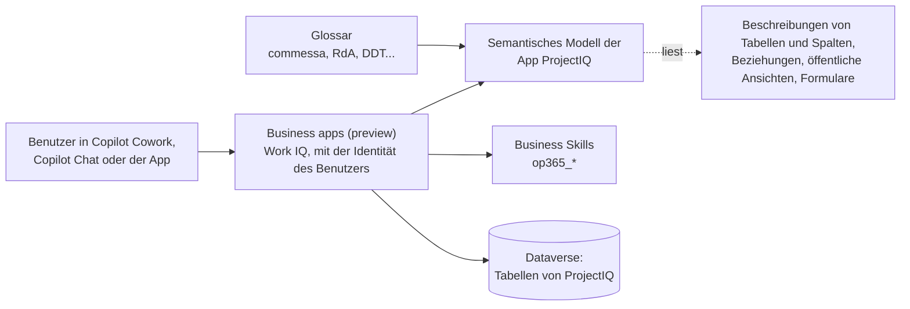
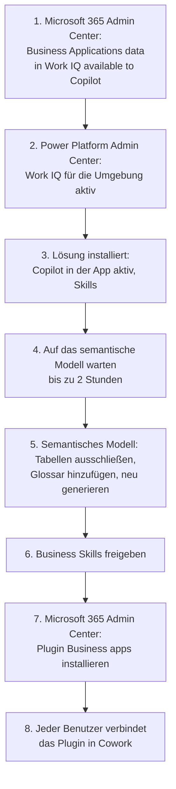

# Copilot und Cowork: Fragen zu Ihren Projekten stellen

> **Sprache:** [English](../en/copilot.md) · [Italiano](../it/copilot.md) · [Français](../fr/copilot.md) · Deutsch
> **Handbuchverzeichnis:** [README](../../README.md#user-manuals)

Die Daten von ProjectIQ können aus **Microsoft Copilot** gelesen werden: im Copilot-Bereich der App, in Microsoft 365 Copilot Chat und in **Copilot Cowork** über das Plugin **Business apps (preview)**. Benutzer fragen mit eigenen Worten („Wie läuft das Projekt PRJ-000123?“, „Welche Stunden muss ich genehmigen?“) und erhalten Antworten aus denselben Datensätzen, die sie in der App sehen, mit denselben Berechtigungen.

Diese erste Version ist **schreibgeschützt**: Copilot findet, erklärt und fasst Daten zusammen, erstellt, ändert, übermittelt oder genehmigt aber nichts. Jede Aktion bleibt bei den Schaltflächen der App.

> Feld- und Schaltflächennamen sowie Bildschirme stehen auf Englisch, so wie sie auf dem Bildschirm erscheinen. Diese Microsoft-Funktionen sind in der **Vorschau**: Namen, Bildschirme und Verhalten können sich ändern.

## Funktionsweise

| Teil | Aufgabe | Herkunft |
|---|---|---|
| Semantisches Modell | Erklärt Copilot, was Tabellen, Spalten und Beziehungen bedeuten | Von Dataverse für die App erstellt, wenn Microsoft Copilot aktiviert ist; es liest die Beschreibungen von Tabellen und Spalten, die Beziehungen, die öffentlichen Ansichten und die Formularnamen der Lösung |
| Glossar | Verknüpft Fachbegriffe (commessa, RdA, DDT, fattura passiva...) mit den Tabellen | Von einem Administrator per Skript geladen, siehe [Glossar des semantischen Modells](#glossar-des-semantischen-modells) |
| Business Skills | Schritt-für-Schritt-Anweisungen für häufige Fragen | In der Lösung enthalten, siehe [Business Skills](#business-skills) |
| Berechtigungen | Was jede Person sehen darf | Die üblichen Sicherheitsrollen, Projekt-Zugriffsteams und die Spaltensicherheit von ProjectIQ |

## Was man fragen kann

| Thema | Beispielfragen | Business Skill |
|---|---|---|
| Projektstatus | „Wie läuft das Projekt PRJ-000123?“, „Welche Projekte überschreiten das Budget?“ | ProjectIQ - Project status |
| Zu genehmigende Stunden | „Welche Stunden muss ich genehmigen?“ | ProjectIQ - Hours to approve |
| Fehlende Stunden | „Wer hat gestern keine Stunden erfasst?“ | ProjectIQ - Missing hours |
| Einkauf | „Wo steht die Bestellanforderung für das Gerüst?“, „Welche Bestellungen sind verspätet?“, „Welche Lieferantenrechnungen sind zu prüfen?“ | ProjectIQ - Purchasing status |
| Lieferanten-Compliance | „Welche Lieferanten haben ein abgelaufenes DURC?“, „Können wir bei Rossi Srl bestellen?“ | ProjectIQ - Supplier compliance |
| Ressourcenauslastung | „Wer ist nächsten Monat überlastet?“ | ProjectIQ - Resource load |

Fragen zu anderen Themen funktionieren ebenfalls: Copilot findet die richtigen Tabellen über das semantische Modell. Wenn die Antwort eine Aktion erfordert (genehmigen, übermitteln, senden, empfangen), nennt Copilot den Bildschirm der App, der dafür zu verwenden ist.

## Einrichtung (Administratoren)

Die Schritte werden einmal pro Umgebung von den Personen mit der passenden Administratorrolle ausgeführt.

| Schritt | Wer | Wo | Was |
|---|---|---|---|
| 1 | Microsoft 365-Administrator | Microsoft 365 admin center → **Copilot** → **Settings** → **Business Applications data in Work IQ available to Copilot** | **All users** oder die Entra-Gruppen der Benutzer von ProjectIQ |
| 2 | Power Platform-Administrator | Power Platform admin center → Umgebung → **Work IQ** | Aktiv. Außerdem prüfen, dass **Dataverse search** auf **On** oder **Default** steht |
| 3 | IT | Import der Lösung (siehe [dev environment](../dev-environment.md#copilot-and-work-iq), auf Englisch) | Die Lösung aktiviert **Microsoft Copilot in model-driven apps** für die App ProjectIQ, fügt die Business Skills hinzu und nimmt die Tabellen im Umfang in den **Dataverse search**-Index auf: ohne Index kennt Copilot die Tabellen, findet aber keine Datensätze |
| 4 | – | – | Die erste Generierung des semantischen Modells dauert bis zu zwei Stunden |
| 5 | System Administrator | Power Apps → **Semantic model** | Siehe [Semantisches Modell abstimmen](#semantisches-modell-abstimmen) |
| 6 | System Administrator | Power Apps → **Business skills (preview)** | Siehe [Business Skills](#business-skills) |
| 7 | Microsoft 365-Administrator | Microsoft 365 admin center → **Agents** → **Tools** → **Plugins** → **Business apps (preview)** → **Install** | **All users** oder **Specific users and groups** |
| 8 | Jeder Benutzer | Copilot → **Cowork** → **Customize** → **Business apps (preview)** → **Show more** → **Connect** neben **Business apps (preview)** | Anmelden und die Anfrage in der Authenticator-App bestätigen |

Schreibaktionen über Work IQ sind standardmäßig durch die Mandantenrichtlinie blockiert. Lassen Sie sie blockiert: In dieser Version ist ProjectIQ aus Copilot schreibgeschützt.

### Lizenzen

Jede Person benötigt die für ProjectIQ verwendete Lizenz **Power Apps Premium** und eine Lizenz **Microsoft 365 Copilot**. Die semantische Indizierung belegt zusätzliche Dataverse-Kapazität.

## Semantisches Modell abstimmen

Das semantische Modell der App heißt `M365_Primary_model_op365_OpenProject365` (in Dev gesehen; Microsoft dokumentiert auch `M365_Secondary_model_<App>`). Dataverse generiert es alle 12 Stunden neu; Änderungen an Beschreibungen, Ansichten und Glossar werden bei der nächsten Generierung übernommen, oder sofort mit einer manuellen Neugenerierung.

1. In Power Apps anmelden, die Umgebung wählen, dann **More** → **Discover all** → **Semantic model**.
2. Das Modell der App **ProjectIQ** öffnen.
3. **Configuration** wählen und **Include in semantic model** für diese Tabellen deaktivieren, dann **Save and sync** wählen:

| Tabelle | Warum sie ausgeschlossen wird |
|---|---|
| Resource Cost | Stundensätze: vertraulich und für die Antworten nicht nötig. Auch nicht im Dataverse search-Index |
| Settings | Unternehmenskonfiguration (eine einzige Zeile) |
| Baseline Node | In einer Baseline gespeicherte Werte: Sie doppeln den PSP und verwirren Fragen zum aktuellen Plan |
| WBS Dependency | Gantt-Verknüpfungen: Rauschen für fachliche Fragen |

4. **Sample table rows** ausgeschaltet lassen (Standard): Die Antworten stammen aus den echten Daten, nicht aus Beispielen.
5. Das Glossar hinzufügen, siehe nächster Abschnitt.
6. **Regenerate** wählen.

Das semantische Modell wird **nicht** mit Lösungen übertragen: Diese Schritte in jeder Umgebung (Dev, Test, Produktion) wiederholen, und nach dem Kopieren oder Verschieben einer Umgebung Work IQ aus- und wieder einschalten.

### Glossar des semantischen Modells

Das Glossar ergänzt Fachbegriffe, die Dataverse nicht aus den Metadaten ableiten kann. Die vollständige Liste liegt im Repository unter [copilot/glossary.md](../../copilot/glossary.md) (auf Englisch, mit Synonymen auf Italienisch, Französisch und Deutsch).

1. `python3 tools/dataverse/workiq.py glossary` für die Umgebung ausführen (dieselben Verbindungseinstellungen wie die anderen Dataverse-Skripte). Es legt je Zeile der Liste einen Eintrag an oder aktualisiert ihn, mit den Synonymen in der **Definition**; bei erneutem Ausführen ändert es nur abweichende Einträge.
2. Im semantischen Modell **Glossary** öffnen, um die Einträge zu prüfen, dann **Regenerate** wählen.

| Term | Italiano | Français | Deutsch |
|---|---|---|---|
| Project | commessa, progetto | projet, affaire | Projekt, Auftrag |
| Time entry | registrazione ore, rapportino, timesheet | saisie de temps, feuille de temps | Zeiteintrag, Stundenzettel |
| Purchase request | richiesta di acquisto, RdA | demande d'achat, DA | Bestellanforderung, BANF |
| RFQ | richiesta di offerta, RdO | demande de prix, appel d'offres | Angebotsanfrage, Ausschreibung |
| Purchase order | ordine di acquisto, OdA | commande d'achat, bon de commande | Bestellung |
| Goods receipt | ricevimento merci, DDT | réception de marchandises, bon de livraison | Wareneingang, Lieferschein |
| Supplier invoice | fattura fornitore, fattura passiva | facture fournisseur | Lieferantenrechnung, Eingangsrechnung |
| Supplier document | documento fornitore, DURC | document fournisseur, attestation | Lieferantendokument, Nachweis |

## Business Skills

Business Skills sind Anweisungen, die Copilot erklären, wie eine Art von Frage zu beantworten ist: welche Tabellen zu lesen sind, wie die Werte berechnet werden, was hervorzuheben ist. Sie gehören zur Lösung ProjectIQ (eindeutige Namen beginnen mit `op365_`) und werden daher mit ihr installiert und aktualisiert. Ihr Text liegt im Repository unter `copilot/skills/`.

| Skill | Liest | Verweist den Benutzer auf |
|---|---|---|
| ProjectIQ - Project status | Projekt, PSP-Knoten, Baseline, offene Einkäufe | – |
| ProjectIQ - Hours to approve | Übermittelte Stunden der Projekte des Benutzers | Projects → Time → **Approvals** |
| ProjectIQ - Missing hours | Ressourcen, Abwesenheiten, Stunden | – (der Flow Daily time reminder benachrichtigt die Personen bereits) |
| ProjectIQ - Purchasing status | Bestellanforderungen, RFQs, Bestellungen, Wareneingänge, Lieferantenrechnungen | Die Schaltflächen der Einkaufsformulare |
| ProjectIQ - Supplier compliance | Lieferanten und Lieferantendokumente | Das Lieferantenformular oder das [Lieferantenportal](supplier-portal.md) |
| ProjectIQ - Resource load | Ressourcen, Zuordnungen, Abwesenheiten | Projects → Planning → **Resource Load** |

Alle Skills sind **schreibgeschützt**: Sie erstellen oder ändern nie Datensätze.

So stellen Sie sie allen zur Verfügung:

1. In Power Apps **More** → **Business skills (preview)** wählen.
2. Prüfen, dass die sechs Skills `ProjectIQ - ...` aufgeführt und aktiv sind. Sie sind als **Organization**-Skills installiert (für alle in der Umgebung sichtbar).
3. Wenn ein Benutzer einen Skill nicht sieht, den Skill wählen → **Share** → **Anyone can view**.

Skills nicht in der Produktion bearbeiten: Änderungen erfolgen im Repository und kommen mit der Lösung.

## Sicherheit und Datenschutz

- Copilot arbeitet **mit der Identität des Benutzers**: Er sieht nur die Datensätze und Spalten, die der Benutzer in der App sieht (Sicherheitsrollen und Projekt-Zugriffsteams, siehe [Administration](administration.md#sicherheitsrollen)).
- Spalten, die durch das Profil **OP365 Cost Visibility** geschützt sind (Stundensätze, Cost der Stunden, Materialkosten, Spend der Lieferanten, siehe [Kostensichtbarkeit](administration.md#kostensichtbarkeit)), bleiben für Benutzer ohne dieses Profil verborgen. Die Skills weisen darauf hin, statt zu schätzen.
- Copilot ändert keine Daten. Jede Änderung läuft weiterhin über die App, ihre Validierungsregeln und ihre Plugins.

## Einschränkungen

- Vorschaufunktionen: Antworten können unvollständig sein; wichtige Werte immer in der App prüfen.
- Keine Aktionen aus Copilot in dieser Version: Übermitteln, Genehmigen, Senden, Vergeben, Empfangen und Stornieren bleiben in der App.
- Das semantische Modell, seine Tabelleneinstellungen und das Glossar werden pro Umgebung konfiguriert.
- Die Antworten hängen von der Qualität der Beschreibungen in der Lösung ab: Wenn eine Frage missverstanden wird, melden Sie es, damit Beschreibung oder Glossar verbessert werden können.
