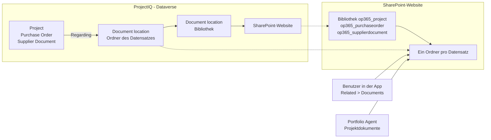
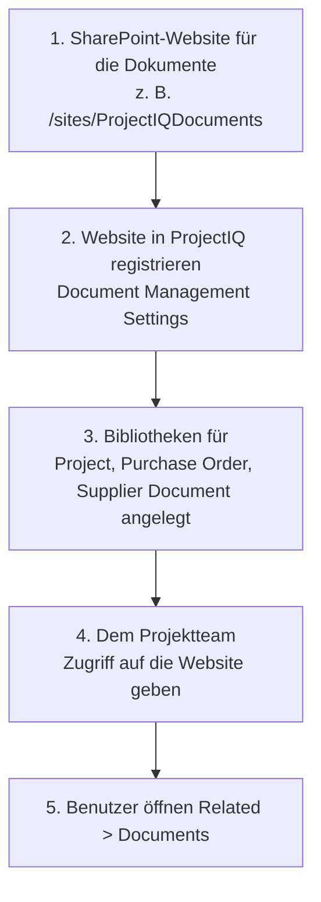

# Dokumente in SharePoint

> **Sprache:** [English](../en/documents.md) · [Italiano](../it/documents.md) · [Français](../fr/documents.md) · Deutsch
> **Handbuchindex:** [README](../../README.md#user-manuals)

Verträge, Zeichnungen, Baufortschrittsberichte, Angebote und Lieferscheine gehören zu einem Projekt, aber nicht in die Datenbank. ProjectIQ legt sie in **SharePoint** ab, mit der Standard-Dokumentverwaltung von Dataverse: Jedes **Project**, jede **Purchase Order** und jedes **Supplier Document** erhält einen eigenen SharePoint-Ordner, der vom Datensatz aus geöffnet wird. Die Dateien behalten SharePoint-Versionierung, gemeinsames Bearbeiten in Office, Suche und Freigabe; ProjectIQ speichert nur, wo der Ordner liegt.

Dieses Handbuch richtet sich an alle, die mit Projektdokumenten arbeiten (Teil 1), und an die Administratoren, die ProjectIQ mit SharePoint verbinden (Teil 2).

## Funktionsweise

| Tabelle | SharePoint-Bibliothek | Ordner |
|---|---|---|
| Project | `op365_project` | Einer pro Projekt, benannt nach dem Projekt und seiner Id |
| Purchase Order | `op365_purchaseorder` | Einer pro Bestellung |
| Supplier Document | `op365_supplierdocument` | Einer pro Dokument (zum Beispiel der gescannte DURC mit seinen Anlagen) |

Der Ordner wird angelegt, wenn **zum ersten Mal jemand Documents** am Datensatz öffnet. Dataverse speichert einen *Dokumentspeicherort* (document location), der den Datensatz mit dem Ordner verknüpft; Agent und App finden den Ordner darüber. Ein in Copilot aus einem Dokument angelegtes Projekt hat seinen Ordner bereits, mit dem Dokument darin (siehe [Portfolio Agent](portfolio-agent.md#neues-projekt-aus-einem-dokument)).

## Teil 1: mit Dokumenten arbeiten

### Dokumente eines Datensatzes öffnen

1. Öffnen Sie das Projekt (oder die Bestellung oder das Lieferantendokument).
2. Wählen Sie **Related** → **Documents**. Beim ersten Mal legt ProjectIQ den SharePoint-Ordner des Datensatzes an.
3. Das Raster listet die Dateien des Ordners: **Upload**, **New** (Word, Excel, PowerPoint, OneNote), **Open in SharePoint**, **Delete**, **Check Out** / **Check In** und **Edit Properties** arbeiten direkt in SharePoint.

| Befehl | Wirkung |
|---|---|
| **Upload** | Lädt eine oder mehrere Dateien in den Ordner (oder einen Unterordner) hoch |
| **New** | Legt ein Office-Dokument im Ordner an und öffnet es im Browser |
| **Open Location** / **Open in SharePoint** | Öffnet den Ordner in SharePoint, für Unterordner, Freigabe, Versionen und Massenverschiebungen |
| **Document Location** → **Add Location** | Verknüpft einen weiteren vorhandenen SharePoint-Ordner mit dem Datensatz (zum Beispiel einen Ordner eines Teams-Teams) |

### Wer welche Dateien sieht

- Für die Registerkarte **Documents** brauchen Sie die ProjectIQ-Rolle (siehe [Administration](administration.md#sicherheitsrollen)): **OP365 User** kann den Ordner der Datensätze anlegen, die er öffnen kann, und alle Dokumentspeicherorte lesen.
- **Welche Dateien Sie sehen, entscheiden die SharePoint-Berechtigungen.** ProjectIQ überträgt die Freigabe seiner Projekte nicht nach SharePoint: Geben Sie dem Projektteam in SharePoint Zugriff auf die Website (oder eine Bibliothek oder einen Ordner).

### ProjectIQ-Spalten

Jede Datei, die dem Ordner eines Datensatzes hinzugefügt wird, erhält innerhalb weniger Minuten die Daten dieses Datensatzes in SharePoint-Spalten, ohne dass jemand sie eingibt. Sie können die Bibliothek nach diesen Spalten sortieren, filtern und gruppieren. Microsoft Search und Copilot verwenden sie, um „die Dokumente des Projekts PRJ-000123“ oder „die Dateien des Lieferanten Rossi“ zu finden, auch wenn der Text der Datei sie nicht nennt.

| Spalte | Project | Purchase Order | Supplier Document |
|---|---|---|---|
| **ProjectIQ Record Type** | Project | Purchase Order | Supplier Document |
| **Project Code** | Code des Projekts | Code des Projekts der Bestellung | – |
| **Project Name** | Name des Projekts | Name des Projekts der Bestellung | – |
| **Customer** | Kunde des Projekts | Kunde des Projekts der Bestellung | – |
| **Project Manager** | Projektleitung | Projektleitung des Projekts der Bestellung | – |
| **PO Number** | – | Nummer der Bestellung (PO-#####) | – |
| **Supplier** | – | Lieferant der Bestellung | Lieferant des Dokuments |

- Die Werte sind die des Datensatzes **zum Zeitpunkt, an dem die Datei hinzugefügt wird**. Wenn Sie ein Projekt umbenennen oder seinen Kunden ändern, werden die vorhandenen Dateien nicht aktualisiert.
- Dateien außerhalb des Ordners eines Datensatzes werden nicht gekennzeichnet, zum Beispiel im Stamm der Bibliothek oder in einem mit **Add Location** hinzugefügten Ordner.
- Die Spalten lassen sich wie jede andere SharePoint-Spalte bearbeiten, und ProjectIQ überschreibt sie nicht. **ProjectIQ Record Id** ist in den Formularen ausgeblendet und speichert den Datensatz, zu dem die Datei gehört.

### Dokumente in Copilot

Fragen Sie im [Portfolio Agent](portfolio-agent.md#projektdokumente) „zeige die Dokumente von PRJ-000123“: Die Karte listet die Dateien und Unterordner des Projektordners, neueste zuerst, mit einem Link zu jeder Datei und zum Ordner. Ist eine SharePoint-Wissensquelle eingerichtet, können Sie auch fragen, was in einem Dokument steht (siehe [Portfolio Agent](portfolio-agent.md#fragen-zum-inhalt-von-dokumenten)).

### Lieferantendokumente

Ein **Supplier Document** (DURC, Zertifizierung, Versicherung) hat eine Spalte **File**, die das [Lieferantenportal](supplier-portal.md) nutzt. Genehmigt der Einkäufer ein Dokument, verschiebt der Flow **File approved supplier documents** die Datei in den SharePoint-Ordner des Datensatzes und leert die Spalte; so liegen alle genehmigten Dokumente in SharePoint (siehe [unten](#genehmigte-lieferantendokumente-in-sharepoint)). Der SharePoint-Ordner enthält auch die übrigen zugehörigen Dateien (Erneuerungen, Korrespondenz). Ablaufdaten und Lieferanten-Compliance beruhen wie bisher auf den Feldern des Supplier Document.

## Teil 2: Einrichtung (Administratoren)

Einmal pro Umgebung, durch den Power-Platform-Administrator gemeinsam mit einem SharePoint-Administrator.

| Schritt | Wer | Was |
|---|---|---|
| 1 | SharePoint-Administrator | Legen Sie eine SharePoint-Team- oder Kommunikationswebsite für die Dokumente an, im selben Microsoft-365-Tenant wie die Umgebung |
| 2 | Power-Platform-Administrator | Öffnen Sie in der App **Settings** (Zahnrad) → **Advanced Settings** → **Document Management** → **Document Management Settings**, wählen Sie **Project**, **Purchase Order** und **Supplier Document**, geben Sie die URL der Website ein, wählen Sie **Next** und **Finish**. Die Bibliotheken werden auf der Website angelegt. Um später eine Tabelle hinzuzufügen, führen Sie den Assistenten erneut aus und wählen Sie sie ebenfalls: die fehlende Bibliothek wird angelegt |
| 3 | Power-Platform-Administrator | Alternative zu Schritt 2 für skriptgesteuerte Umgebungen: `SHAREPOINT_SITE_URL=<URL der Website> python3 tools/dataverse/documents.py` registriert die Website als Standardwebsite; die Bibliotheken werden angelegt, wenn der erste Datensatz jeder Tabelle Documents öffnet; fehlt eine Bibliothek weiterhin, verwenden Sie Schritt 2 |
| 4 | SharePoint-Administrator | Geben Sie den Personen, die ProjectIQ nutzen, mindestens **Edit** (oder **Read**) auf der Website |
| 5 | Jeder Benutzer | Öffnen Sie **Related** → **Documents** an einem Datensatz |

Die serverbasierte SharePoint-Integration ist in Dataverse online standardmäßig aktiv; meldet **Document Management Settings**, dass sie deaktiviert ist, aktivieren Sie sie unter **Advanced Settings** → **Document Management** → **Enable Server-Based SharePoint Integration**.

Die Dokumentverwaltung der drei Tabellen sowie die Berechtigungen für Dokumentspeicherorte und SharePoint-Website der Rollen **OP365 User** und **OP365 Administrator** sind Teil der ProjectIQ-Lösung: Ein Update der Lösung bringt sie mit. Die SharePoint-Website ist eine Einstellung jeder Umgebung und nicht Teil der Lösung.

### ProjectIQ-Spalten an den Dateien

Die [ProjectIQ-Spalten](#projectiq-spalten) werden von drei Cloud-Flows der Lösung gefüllt, einer pro Bibliothek:
- **Tag project documents**
- **Tag purchase order documents**
- **Tag supplier documents**

Die Flows prüfen die Bibliothek alle 3 Minuten und verwenden zwei Verbindungsverweise:
- **op365_sharepoint** (SharePoint), der einem **dedizierten Benutzer** mit **Edit** auf der Website gehören muss;
- **op365_dataverse**.

| Schritt | Wer | Was |
|---|---|---|
| 1 | SharePoint-Admin | Die drei Bibliotheken müssen existieren (siehe [Teil 2](#teil-2-einrichtung-administratoren)). Führen Sie mit der CLI for Microsoft 365 (`npm i -g @pnp/cli-microsoft365`, dann `m365 login`), angemeldet als Websitebesitzer, `SHAREPOINT_SITE_URL=<Website-URL> python3 tools/sharepoint/document_metadata.py` aus, mit der in **Document Management Settings** registrierten URL. Das Skript fügt den drei Bibliotheken und ihrer Standardansicht die fehlenden Spalten hinzu (`ok`), lässt vorhandene unverändert (`skip`) und gibt die drei IDs aus; es kann erneut ausgeführt werden |
| 2 | Power-Platform-Admin | Setzen Sie die Umgebungsvariablen **SharePoint Site URL** (`op365_SharePointSiteUrl`), **Project Library Id**, **Purchase Order Library Id** und **Supplier Document Library Id** auf die Website-URL und die ausgegebenen IDs. In Test werden sie durch die Bereitstellung gesetzt, mit den Secrets `OP365_SHAREPOINT_SITE_URL`, `OP365_PROJECT_LIBRARY_ID`, `OP365_PURCHASE_ORDER_LIBRARY_ID` und `OP365_SUPPLIER_DOCUMENT_LIBRARY_ID` der GitHub-Umgebung `test`, siehe [dev-environment](../dev-environment.md#4-deploy-to-test) |
| 3 | Power-Platform-Admin | Erstellen Sie die SharePoint-Verbindung mit dem dedizierten Benutzer in der Umgebung selbst, auch in Test: Eine Verbindung ist nicht Teil der Lösung und kommt nicht aus Dev. Teilen Sie sie mit dem Anwendungsbenutzer der Bereitstellung (**Can use**). In Dev verknüpfen Sie sie mit **op365_sharepoint**. In Test verknüpfen Sie sie nicht von Hand: Tragen Sie ihre ID (in der URL der Verbindungsseite) in das Secret `OP365_SHAREPOINT_CONNECTION_ID` ein und führen Sie `deploy-test` aus, das den Verweis verknüpft; wer den Verweis oder die Flows in Test von Hand ändert, legt eine nicht verwaltete Ebene über die verwaltete Lösung. Schalten Sie dann die drei Flows ein (**Solutions** → **ProjectIQ** → **Cloud flows**) |
| 4 | SharePoint-Admin | Optional, für bereits vorhandene Dateien: Schritt 1 mit `--backfill` und den `PAC_*`-Variablen der Umgebung erneut ausführen |

Die Flows werden **ausgeschaltet** importiert: Prüfen Sie nach jedem Update der Lösung, dass sie noch eingeschaltet sind.

### Genehmigte Lieferantendokumente in SharePoint

Der Flow **File approved supplier documents** startet, wenn ein Lieferantendokument **Approved** wird (**Approve** in der App). Hat das Dokument eine Datei in der Spalte **File**, dann:
1. sucht der Flow den SharePoint-Ordner des Datensatzes oder registriert einen neuen (`<Beschreibung>_<Datensatz-ID>`) in der Bibliothek **op365_supplierdocument**;
2. legt er die Datei mit ihrem ursprünglichen Namen in diesem Ordner an (der Flow **Tag supplier documents** füllt danach ihre ProjectIQ-Spalten);
3. entfernt er die Datei aus der Spalte **File**. Im Portal sieht der Lieferant dann **Filed by your customer** statt der Datei.

Er verwendet dieselben Verbindungsreferenzen **op365_dataverse** und **op365_sharepoint** und die Variable **SharePoint Site URL**; die Bibliothek **op365_supplierdocument** und ihr Dokumentspeicherort müssen vorhanden sein ([Teil 2](#teil-2-einrichtung-administratoren), Schritt 2). Schlägt die Kopie fehl, bleibt die Datei in der Spalte **File**: Prüfen Sie den Ausführungsverlauf und starten Sie den Flow aus der fehlgeschlagenen Ausführung neu (**Resubmit**), ohne erneut zu genehmigen.

## Mögliche Meldungen

| Meldung | Bedeutung und Lösung |
|---|---|
| Kein **Documents** unter **Related**, oder eine Meldung, dass die Dokumentverwaltung nicht konfiguriert ist | Die Website ist nicht registriert (siehe [Teil 2](#teil-2-einrichtung-administratoren), Schritt 2), oder die ProjectIQ-App enthält die Tabellen **SharePoint Document** und **Document Location** nicht: führen Sie `tools/dataverse/app.py` aus oder fügen Sie die Tabellen im App-Designer hinzu und veröffentlichen Sie |
| Das Documents-Raster meldet fehlende Berechtigungen für den Speicherort | Ihr SharePoint-Konto hat keinen Zugriff auf die Website oder den Ordner: wenden Sie sich an den SharePoint-Administrator (Schritt 4) |
| Zugriff verweigert beim Anlegen des Ordners | Sie können nicht in die Bibliothek schreiben: fordern Sie **Edit** auf der Website an |
| Karte: "No document folder yet" | Niemand hat Documents am Projekt geöffnet: öffnen Sie das Projekt in ProjectIQ und wählen Sie **Related** → **Documents** |
| Karte: "You have no access to the SharePoint folder of this project." | Wie oben: der SharePoint-Zugriff auf die Website fehlt |
| `document_metadata.py`: `Error: File Not Found.` | Die Bibliothek existiert auf der Website nicht: Führen Sie **Document Management Settings** erneut aus und wählen Sie ihre Tabelle ([Teil 2](#teil-2-einrichtung-administratoren), Schritt 2), dann das Skript erneut |
| `document_metadata.py`: `A duplicate field name "…" was found.` | Die Bibliothek hat eine Spalte mit derselben ID, aber einem anderen internen Namen, angelegt von einer früheren Version des Skripts: Ist die Spalte leer, löschen Sie sie in den Bibliothekseinstellungen und führen Sie das Skript erneut aus |
| Die ProjectIQ-Spalten einer neuen Datei bleiben leer | Der Flow der Bibliothek ist ausgeschaltet oder seine Ausführung ist fehlgeschlagen. Prüfen Sie den Ausführungsverlauf des Flows: Die Verbindung von **op365_sharepoint** muss gültig sein, und ihr Benutzer braucht **Edit** auf der Website |
