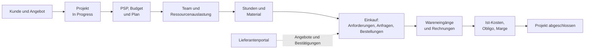
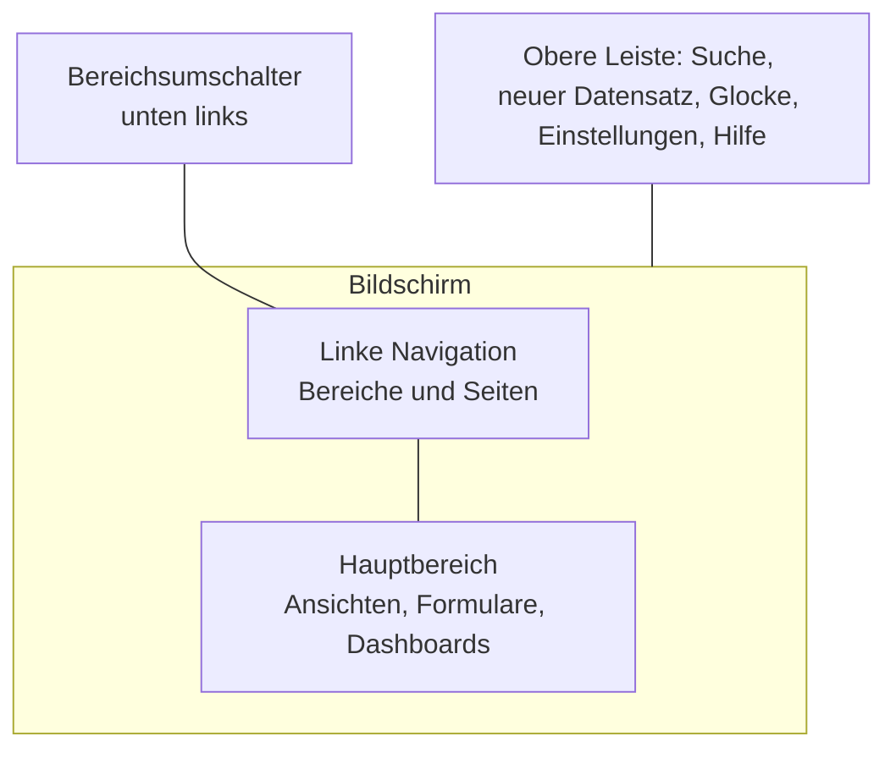
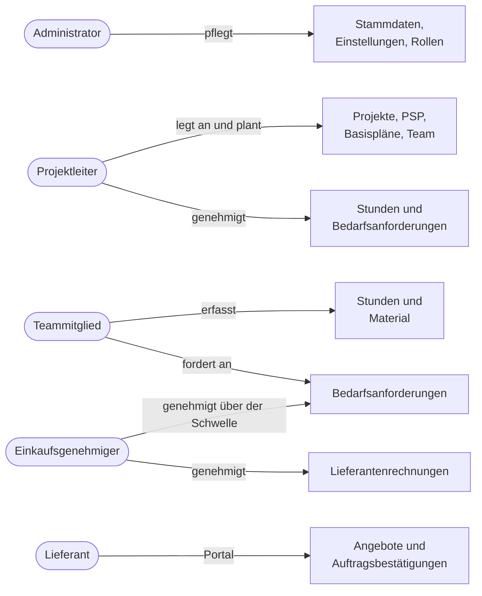

# Erste Schritte mit ProjectIQ

> **Sprache:** [English](../en/getting-started.md) · [Italiano](../it/getting-started.md) · [Français](../fr/getting-started.md) · Deutsch
> **Handbuchverzeichnis:** [README](../../README.md#user-manuals)

Diese Anleitung sollten Sie zuerst lesen, wenn Sie neu bei ProjectIQ sind. Sie erklärt, wofür die Anwendung gedacht ist, wie ihre Bausteine zusammenspielen, wie Sie sich auf den Bildschirmen zurechtfinden und welches Handbuch Sie für welche Aufgabe als Nächstes öffnen. Die anderen Handbücher behandeln jeden Funktionsbereich im Detail; dieses hier gibt Ihnen die Landkarte.

> Feld- und Schaltflächennamen stehen auf Englisch, so wie sie auf dem Bildschirm erscheinen; wo es hilft, folgt eine Übersetzung.

## Was ProjectIQ leistet

ProjectIQ ist eine Anwendung für Projekt- und Auftragsmanagement für Unternehmen, die in Aufträgen arbeiten: Bau- und Installationsunternehmen, Ingenieurbüros, Werkstätten, Dienstleister und jedes Unternehmen, das für jeden Auftrag wissen muss, **was geplant war, was bereits ausgegeben wurde und was noch gebunden ist**.

Sie läuft in Microsoft Power Apps als modellgesteuerte App (Model-driven App) auf Microsoft Dataverse. In der Praxis heißt das:

- Sie öffnen sie im Browser (oder in Teams, falls Ihr Unternehmen sie dort hinzufügt) mit Ihrem Microsoft-365-Firmenkonto;
- alle Daten liegen in der eigenen Dataverse-Umgebung Ihres Unternehmens: Jedes Unternehmen hat seine eigene Datenbank, nichts wird mit anderen Kunden geteilt;
- Sicherheit, Überwachung, Notizen, Benachrichtigungen und Suche sind die Standardfunktionen der Power Platform und verhalten sich daher wie im übrigen Dynamics 365.

Die Anwendung deckt den gesamten Lebenszyklus eines Auftrags ab:

## Die wichtigsten Begriffe auf einer Seite

| Begriff | Was es ist | Mehr dazu |
|---|---|---|
| **Customer** / **Supplier** (Kunde / Lieferant) | Unternehmen, für die Sie arbeiten oder bei denen Sie einkaufen. Beide sind Dataverse-*Accounts*: Dasselbe Unternehmen kann beides sein | [Stammdaten](master-data.md) |
| **Item** (Artikel) | Etwas, das Sie einkaufen oder in einem Auftrag verwenden (Material, Bauteil, Dienstleistung), mit Stückkosten und den Lieferanten, die es verkaufen | [Stammdaten](master-data.md) |
| **Resource** (Ressource) | Eine Person (oder ein Trupp), deren Stunden geplant und erfasst werden, mit Wochenkapazität und Stundensatz | [Stammdaten](master-data.md) |
| **Project** (Projekt) | Der Auftrag: Kunde, Projektleiter, Termine, Auftragswert, Budget, Ist-Kosten und Obligo, Fortschritt | [Projekte und Team](projects-and-team.md) |
| **Project member** (Projektmitglied) | Ein Benutzer, der als Manager, Contributor oder Reader an einem Projekt arbeitet. Die Mitgliedschaft entscheidet, wer das Projekt sieht | [Projekte und Team](projects-and-team.md) |
| **WBS node** (PSP-Element) | Ein Teil des Projektstrukturplans (PSP, englisch WBS): eine Phase, ein Arbeitspaket oder ein Vorgang, mit Budget, Terminen und Fortschritt | [PSP und Planung](wbs-and-planning.md) |
| **Dependency** (Abhängigkeit) | „Vorgang B kann erst beginnen, wenn Vorgang A beendet ist“ (Ende-Anfang, mit Verzugstagen) | [PSP und Planung](wbs-and-planning.md) |
| **Baseline** (Basisplan) | Eine eingefrorene Kopie von Budget und Terminen, um den aktuellen Plan mit dem Vereinbarten zu vergleichen | [PSP und Planung](wbs-and-planning.md) |
| **Allocation** (Zuordnung) | Geplante Stunden einer Ressource auf einem PSP-Element; sie speisen die Ressourcenauslastung | [Ressourcenauslastung](resource-load.md) |
| **Time entry** (Zeiteintrag) | Stunden, die eine Ressource an einem Tag an einem Projekt (und optional einem Vorgang) gearbeitet hat, mit Genehmigungsablauf | [Zeiterfassung](time-tracking.md) |
| **Material usage** (Materialverbrauch) | In einem Projekt verbrauchtes Material, bewertet zum Lieferantenpreis oder zu den Artikelkosten | [Material und Kosten](materials-and-costs.md) |
| **Purchase request → RFQ → Purchase order → Goods receipt → Supplier invoice** | Die Einkaufskette, vom Bedarf bis zur Rechnung (Bedarfsanforderung → Angebotsanfrage → Bestellung → Wareneingang → Lieferantenrechnung) | [Einkauf](purchasing.md) |
| **Supplier portal** (Lieferantenportal) | Eine Website, auf der Lieferanten Angebotsanfragen beantworten und Bestellungen bestätigen | [Lieferantenportal](supplier-portal.md) |
| **Settings** (Einstellungen) | Unternehmensweite Schalter: Zeitgenehmigung, Einkaufsschwelle und Genehmiger | [Administration](administration.md) |

## Anmelden

1. Öffnen Sie den Link, den Ihr Administrator Ihnen gegeben hat (er sieht aus wie `https://<firma>.crm4.dynamics.com/main.aspx?appid=...`), oder gehen Sie zu [make.powerapps.com](https://make.powerapps.com) → **Apps** und wählen Sie **ProjectIQ**.
2. Melden Sie sich mit Ihrem Firmenkonto an.
3. Wenn „You don't have permissions“ (Sie haben keine Berechtigungen) erscheint, bitten Sie Ihren Administrator, Ihnen die Sicherheitsrollen **Basic User** und **OP365 User** zuzuweisen (siehe [Administration](administration.md#sicherheitsrollen)).

Wenn Sie Stunden erfassen werden, muss Ihr Administrator Ihren Benutzer außerdem mit einem **Resource**-Datensatz verknüpfen; andernfalls meldet die Zeiterfassung „Your user is not linked to a resource“ (Ihr Benutzer ist mit keiner Ressource verknüpft).

## Sich zurechtfinden

Die Anwendung verwendet das Standardlayout modellgesteuerter Apps:

- **Bereichsumschalter** (unten in der linken Navigation): wechselt die angezeigte Seitengruppe. ProjectIQ hat vier Bereiche: **Projects**, **Purchasing**, **Master Data** und **Settings**.
- **Linke Navigation**: die Seiten des aktuellen Bereichs.
- **Ansichten** (Views): Datensatzlisten mit Spalten, Filtern und Sortierung; die Ansicht wechseln Sie über die Dropdown-Liste neben dem Ansichtstitel.
- **Formulare** (Forms): ein Datensatz, gegliedert in Registerkarten. Änderungen speichern Sie mit **Save** (oder Strg+S); das Formular speichert außerdem nach kurzer Zeit automatisch.
- **Befehlsleiste**: die Schaltflächen über einer Ansicht oder einem Formular (New, Save, Delete und die Befehle von ProjectIQ wie **Submit**, **Approve**, **Save Baseline**).
- **Dashboards**: ganze Seiten mit Diagrammen und interaktiven Komponenten (Timesheet, Time Approval, Resource Load, Spend).

### Die Navigationskarte

| Bereich | Gruppe | Seite | Typischer Benutzer |
|---|---|---|---|
| Projects | Work | **Projects**, **Material Usage** | Projektleiter, Teammitglieder |
| Projects | Time | **Timesheet**, **Approvals**, **Time Entries** | Alle, die Stunden erfassen; Manager, die genehmigen |
| Projects | Planning | **Resource Load**, **Absences** | Projektleiter, Planer |
| Purchasing | Procurement | **Purchase Requests**, **RFQs**, **Purchase Orders**, **Goods Receipts**, **Supplier Invoices** | Projektleiter, Einkäufer, Buchhaltung |
| Purchasing | Analysis | **Spend** | Einkäufer, Geschäftsleitung |
| Master Data | Records | **Customers**, **Suppliers**, **Contacts**, **Items**, **Resources** | Verwaltung, Einkäufer |
| Settings | Company | **Settings**, **Resource Costs**, **Project Members** | Administratoren |

Je nach Ihrer Sicherheitsrolle zeigen manche Seiten möglicherweise keine Datensätze an oder erlauben nicht, welche anzulegen.

## Wer macht was

| Rolle | Was Sie am häufigsten tun | Zu lesende Handbücher |
|---|---|---|
| **Teammitglied** (Contributor) | Den Wochenstundenzettel ausfüllen, Material erfassen, Bedarfsanforderungen stellen | [Zeiterfassung](time-tracking.md), [Material und Kosten](materials-and-costs.md), [Einkauf](purchasing.md) |
| **Projektleiter** (Manager) | Das Projekt anlegen, PSP und Plan aufbauen, Basispläne speichern, das Team verwalten, Stunden und Anforderungen genehmigen, Kosten verfolgen | [Projekte und Team](projects-and-team.md), [PSP und Planung](wbs-and-planning.md), [Ressourcenauslastung](resource-load.md), [Zeiterfassung](time-tracking.md), [Material und Kosten](materials-and-costs.md), [Einkauf](purchasing.md) |
| **Einkäufer / Einkaufsgenehmiger** | Anforderungen über der Schwelle genehmigen, Angebotsanfragen durchführen, Bestellungen, Wareneingänge und Rechnungen verwalten | [Einkauf](purchasing.md), [Lieferantenportal](supplier-portal.md) |
| **Administrator** | Benutzer, Rollen, Stammdaten, Einstellungen, Kostensichtbarkeit, das Lieferantenportal | [Administration](administration.md), [Stammdaten](master-data.md), [Lieferantenportal](supplier-portal.md) |
| **Lieferant** (extern) | Angebotsanfragen beantworten und Bestellungen im Portal bestätigen | [Lieferantenportal](supplier-portal.md) |

## Benachrichtigungen

ProjectIQ verwendet die **In-App-Benachrichtigungen** modellgesteuerter Apps: das Glockensymbol in der oberen Leiste. Sie erhalten eine Benachrichtigung, wenn:

| Ereignis | Wer benachrichtigt wird |
|---|---|
| Stunden zur Genehmigung eingereicht werden | Die Manager des Projekts |
| Ihre Stunden genehmigt oder abgelehnt werden (mit Begründung) | Sie (die Ressource) |
| Sie für den Tag weniger Stunden als erwartet erfasst haben (Montag–Freitag, 17:30) | Sie, mit einem Link zum Stundenzettel |
| Eine Bedarfsanforderung auf Ihre Genehmigung wartet | Der Projektleiter, danach der Einkaufsgenehmiger, wenn die Anforderung über der Schwelle liegt |
| Ihre Bedarfsanforderung genehmigt oder abgelehnt wird | Der Anforderer |

Benachrichtigungen erscheinen im Glockenbereich und für einige Sekunden als Popup oben rechts. Klicken Sie auf eine Benachrichtigung, um den Datensatz zu öffnen. Die Benachrichtigungseinstellungen sind die Standardeinstellungen der Plattform.

## Notizen, Erwähnungen und Zeitachse

Die meisten Datensätze von ProjectIQ haben eine **Timeline** (Zeitachse), meist in der rechten Spalte der ersten Registerkarte des Formulars. Sie können:

- **Notizen** hinzufügen, mit Anhängen;
- **eine Kollegin oder einen Kollegen erwähnen**, indem Sie `@` gefolgt vom Namen eingeben: Die erwähnte Person wird benachrichtigt, und die Notiz wird zu einem einfachen Kommentar-Thread;
- bei Projekten außerdem **Aktivitäten** erfassen (Telefonate, Aufgaben, Termine, E-Mails).

Die Zeitachse ist der richtige Ort für Entscheidungen, Kundenkommunikation und alles, was Sie beim Datensatz aufbewahren möchten.

## Status und gesperrte Datensätze

Viele Datensätze folgen einem Ablauf (Zeiteinträge, Bedarfsanforderungen, Bestellungen, Rechnungen...). Einige allgemeine Regeln gelten überall:

- **Statuswechsel erfolgen über die Befehlsschaltflächen** (Submit, Approve, Send, Confirm...), niemals durch Bearbeiten des Felds Status Reason. Wenn Sie es versuchen, erhalten Sie eine Meldung wie „Use Submit, Approve or Reject to change the status“.
- **Datensätze ab einem bestimmten Status sind gesperrt**: Ein eingereichter Zeiteintrag, eine versandte Bestellung, eine genehmigte Rechnung können nicht geändert werden. Um sie zu korrigieren, verwenden Sie die Schaltfläche, die sie zurücksetzt (Reject, Back to Draft, Cancel Receipt).
- **Die meiste Arbeit ist nur bei Projekten im Status In Progress möglich**: Stunden, Material und Bestellungen werden bei Angeboten, ausgesetzten oder abgeschlossenen Projekten abgelehnt.

## Suche und persönliche Ansichten

- Das **Suchfeld** in der oberen Leiste durchsucht alle Tabellen (Projekte nach Name oder Code, Kunden, Artikel, Bestellungen...).
- In jeder Ansicht können Sie Spalten filtern, die Sortierung ändern und **das Ergebnis als persönliche Ansicht speichern** (Create view). Persönliche Ansichten lassen sich mit Kollegen teilen.
- Verwenden Sie **Export to Excel** in der Befehlsleiste einer Ansicht, um Daten offline zu analysieren.

## Sprache

Die Benutzeroberfläche ist auf **Englisch, Italienisch, Französisch und Deutsch** verfügbar. Jeder Benutzer wählt die Sprache unter **Einstellungen (Zahnradsymbol) > Personalisierungseinstellungen > Sprachen > Sprache der Benutzeroberfläche**; Tabellen, Felder, Ansichten, Schaltflächen, die Projektsteuerelemente (PSP, Gantt, Zeiterfassung...), Dialoge, Fehlermeldungen und Benachrichtigungen folgen dieser Auswahl. Diese Handbücher sind in allen vier Sprachen verfügbar; einige Schaltflächen- und Feldnamen können noch auf Englisch erscheinen, mit einer Übersetzung, wo es hilft.

## Nächste Schritte

- Neu in einem Projekt? Lesen Sie [Projekte und Team](projects-and-team.md).
- Müssen Sie heute Stunden erfassen? Gehen Sie direkt zur [Zeiterfassung](time-tracking.md).
- Richten Sie das Unternehmen zum ersten Mal ein? Beginnen Sie mit [Administration](administration.md) und [Stammdaten](master-data.md).
