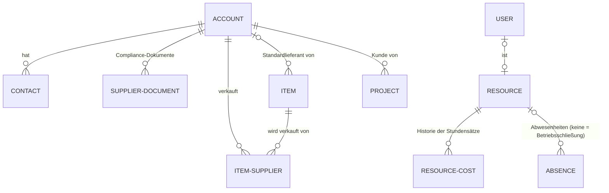
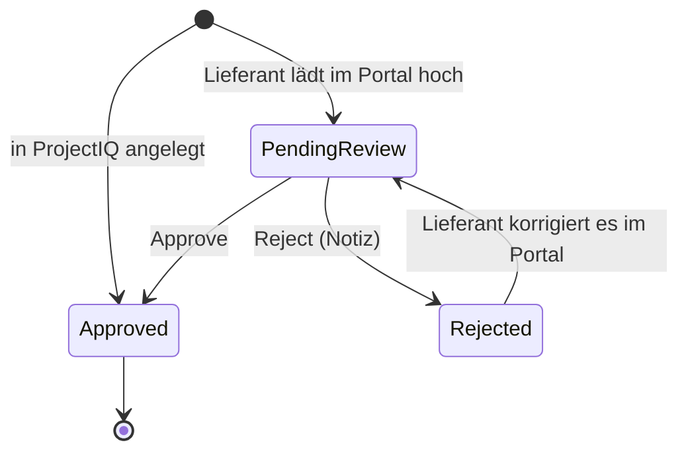
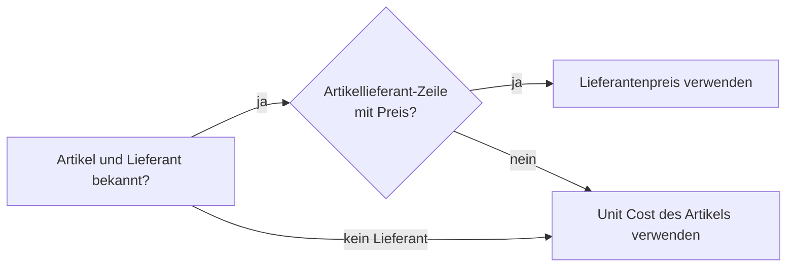
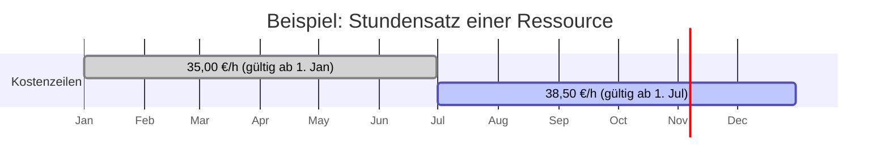
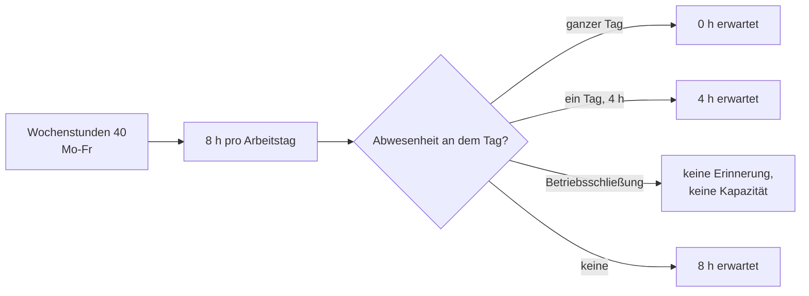

# Stammdaten: Kunden, Lieferanten, Kontakte, Artikel und Ressourcen

> **Sprache:** [English](../en/master-data.md) · [Italiano](../it/master-data.md) · [Français](../fr/master-data.md) · Deutsch
> **Handbuchverzeichnis:** [README](../../README.md#user-manuals)

Stammdaten sind die Informationen, auf die sich jeder andere Teil von ProjectIQ stützt: die Unternehmen, für die Sie arbeiten und bei denen Sie einkaufen, die Personen, mit denen Sie sprechen, die Artikel, die Sie einkaufen und verbrauchen, und die Ressourcen, deren Stunden Sie planen und erfassen. Saubere und vollständige Stammdaten machen Kosten, Einkauf und Planung verlässlich. Dieses Handbuch erklärt jeden Datensatztyp, wofür jedes Feld dient und welche Regeln die Anwendung automatisch anwendet.

> Feld- und Schaltflächennamen stehen auf Englisch, so wie sie auf dem Bildschirm erscheinen.

Alle Stammdaten befinden sich im Bereich **Master Data**, Gruppe **Records**: **Customers**, **Suppliers**, **Contacts**, **Items**, **Resources**. Die Stundensätze der Ressourcen befinden sich im Bereich **Settings**; die Unternehmenseinstellungen sind Umgebungsvariablen (siehe [Administration](administration.md#unternehmenseinstellungen)).

## Wie die Stammdaten zusammenhängen

## Kunden und Lieferanten (Accounts)

Kunden und Lieferanten werden beide als **Accounts** gespeichert, der Dataverse-Standardtabelle für Unternehmen. Ein Unternehmen kann Kunde, Lieferant oder beides gleichzeitig sein: Zwei Kontrollkästchen, **Is Customer** (ist Kunde) und **Is Supplier** (ist Lieferant), entscheiden darüber.

### Zwei Formulare, ein Datensatz

Ein Account hat zwei Formulare:

- das Formular **Customer**, mit den Daten, die Sie zum Verkaufen und Fakturieren brauchen;
- das Formular **Supplier**, mit den Daten, die Sie zum Einkaufen brauchen, sowie Compliance-Dokumenten und Artikelpreisen.

Die Anwendung wählt das richtige Formular für Sie:

- wenn Sie ein Unternehmen öffnen, das **nur Lieferant** ist, wird es im Formular Supplier angezeigt; alle anderen Accounts öffnen sich im Formular Customer;
- wenn Sie einen neuen Account aus **Suppliers** anlegen (oder das Formular Supplier wählen), wird **Is Supplier** automatisch angehakt; aus **Customers** (Formular Customer) wird **Is Customer** angehakt.

Sie können das Formular jederzeit mit der Formularauswahl neben dem Datensatznamen wechseln.

### Ansichten

| Ansicht | Zeigt |
|---|---|
| **All Customers** (Standard in Customers) | Alle als Kunde gekennzeichneten Accounts |
| **Prospects** | Kunden mit Customer Type *Prospect* (Interessent) |
| **Customers with Projects** / **Customers without Projects** | Kunden mit (oder ohne) mindestens einem Projekt |
| **All Suppliers** (Standard in Suppliers) | Alle als Lieferant gekennzeichneten Accounts |
| **Active Suppliers** / **Blocked Suppliers** | Lieferanten nach Supplier Status (aktiv / gesperrt) |
| **Suppliers with Document Alerts** | Lieferanten mit abgelaufenen oder bald ablaufenden Compliance-Dokumenten |

### Einen Lieferanten in anderen Datensätzen wählen

Felder, die auf einen Lieferanten verweisen, zeigen nur Accounts mit **Is Supplier**, mit einer festen Ansicht (die Ansichtsauswahl ist ausgeblendet):

| Feld | Verwendete Ansicht | Warum |
|---|---|---|
| **Supplier** der Bestellung, **Supplier** der RFQ-Einladung, **Preferred Supplier** der Bestellanforderung, **Default Supplier** des Artikels | **Active Suppliers** | Neue Bestellungen und Anforderungen gehen nur an aktive, nicht gesperrte Lieferanten |
| **Supplier** der Lieferantenrechnung, des Lieferantendokuments, des Lieferantenpreises des Artikels und des Materialverbrauchs | **All Suppliers** | Rechnungen, Dokumente und Historie können sich weiterhin auf einen gesperrten Lieferanten beziehen |

Beim Speichern einer Lieferantenrechnung, eines Materialverbrauchs oder einer Bestellanforderung prüft die Anwendung außerdem, dass der gewählte Account **Is Supplier** ist, und stoppt sonst mit „<name> is not a supplier.“.

### Kundenfelder (Formular Customer, Registerkarte Summary)

| Feld | Bedeutung |
|---|---|
| **Account Name** | Firmenname, so wie er auf Dokumenten erscheinen soll |
| **Is Customer** | Das Unternehmen erscheint unter den Kunden und kann als Projektkunde gewählt werden |
| **Customer Type** | *Prospect* (Interessent, zum Beispiel solange ein Angebot offen ist) oder *Customer* (Kunde) |
| **VAT Number** / **Tax Code** | USt-IdNr. und Steuernummer (in Italien Partita IVA und Codice fiscale) |
| **Primary Contact**, **Main Phone**, **Email**, **Website** | Übliche Kontaktdaten |
| **Owner** | Der für den Account zuständige Benutzer |
| **Address** | Straße, Ort, Postleitzahl, Provinz, Land |
| **Payment Terms**, **IBAN**, **PEC**, **Language** | Abrechnungsdaten; PEC ist die italienische zertifizierte E-Mail-Adresse; Language ist die Sprache für Dokumente und E-Mails an das Unternehmen (Italienisch, Englisch, Deutsch, Französisch). **IBAN** ist nur für Benutzer mit dem Profil *OP365 Cost Visibility* sichtbar. |

Schreibgeschützte, von der Anwendung gepflegte Kennzahlen: **Projects** (Anzahl der Projekte des Kunden) und **Contract Value Total** (Summe der Auftragswerte seiner Projekte). Sie werden bei jedem Anlegen, Ändern oder Löschen eines Projekts aktualisiert.

Die Registerkarte **Contacts** listet die Personen des Unternehmens auf.

### Lieferantenfelder (Formular Supplier)

Die Registerkarte **Summary** enthält dieselben Firmen-, Adress- und Zahlungsdaten wie das Kundenformular, zusätzlich:

| Feld | Bedeutung |
|---|---|
| **Is Supplier** | Das Unternehmen kann Angebotsanfragen und Bestellungen erhalten |
| **Supplier Status** | *Active* (aktiv) oder *Blocked* (gesperrt). Ein gesperrter Lieferant kann weder zu einer Angebotsanfrage eingeladen werden noch eine Bestellung erhalten: Die Anwendung stoppt Sie mit „<name> is blocked.“ |
| **Supplier Category** | Freitext zur Gruppierung von Lieferanten (zum Beispiel „Elektro“, „Beton“, „Vermietung“) |
| **Email** | Wird als Standard-Einladungsadresse in Angebotsanfragen verwendet und beim Versand einer Bestellung als **Sent To** festgehalten |

Schreibgeschützte Kennzahlen: **Spend** (Summe der Bestellungen beim Lieferanten, nur für Benutzer mit Kostensichtbarkeit sichtbar) und **Contacts** (Anzahl der Kontakte). Sie werden von den Einkaufs-Plugins gepflegt.

Die Registerkarte **Documents** listet die **Compliance-Dokumente** des Lieferanten auf und zeigt die Zähler **Document Alerts** (Expired Documents, Expiring Documents – abgelaufene und bald ablaufende Dokumente). Die Registerkarte **Item Prices** listet die Artikel, die der Lieferant verkauft, mit seinem jeweiligen Preis.

Die Zähler zählen nur **genehmigte** Dokumente und werden bei jeder Änderung eines Dokuments sowie jeden Morgen durch den Flow **Daily document expiry** aktualisiert (siehe [Ablauf und E-Mails](#ablauf-und-e-mails)).

### Lieferantendokumente

Ein Lieferantendokument erfasst ein Compliance-Dokument, das Sie für einen Lieferanten aufbewahren müssen: DURC (italienische Bescheinigung über Sozialabgaben), Handelsregisterauszug (Visura camerale), Zertifizierungen, Versicherungspolicen, Verträge und so weiter. Dokumente werden von Ihren Mitarbeitern erfasst oder vom Lieferanten im [Lieferantenportal](supplier-portal.md#unternehmensdokumente) hochgeladen; in beiden Fällen entscheidet der Einkäufer, ob ein Dokument gültig ist.

| Feld | Bedeutung |
|---|---|
| **Supplier** | Der Lieferant (das Dokument wird gelöscht, wenn der Lieferant gelöscht wird) |
| **Document Type** | DURC, Company Report, Certification, Insurance, Contract, Other (Pflichtfeld) |
| **Description** | Kurzbeschreibung (Pflichtfeld) |
| **Number** | Dokumentnummer oder Referenz |
| **Issue Date** / **Expiry Date** | Gültigkeitszeitraum (Ausstellungs- und Ablaufdatum) |
| **External URL** | Link zum Dokument in einem anderen System (zum Beispiel SharePoint) |
| **File** | Das Dokument selbst, in Dataverse hochgeladen |
| **Notes** | Sonstiges |

Der Abschnitt **Review** des Formulars ist schreibgeschützt und wird vom System ausgefüllt:

| Feld | Bedeutung |
|---|---|
| **Status Reason** | **Pending Review**, **Approved** oder **Rejected** (siehe unten) |
| **Expiry Status** | **Valid**, **Expiring** (läuft innerhalb von 30 Tagen ab), **Expired** oder **Replaced** (es gibt ein neueres genehmigtes Dokument desselben Typs) |
| **Reviewed By** / **Reviewed On** | Wer das Dokument genehmigt oder abgelehnt hat, und wann |
| **From Supplier Portal** | Ja, wenn der Lieferant das Dokument im Portal hochgeladen hat |
| **Expiry Notice Sent** | Letzte an den Lieferanten gesendete Ablauf-E-Mail für das Dokument: Expiring oder Expired; wird gelöscht, wenn sich das Ablaufdatum ändert |
| **Review Note** | Notiz des Prüfers; der Grund, den der Lieferant sieht, wenn das Dokument abgelehnt wird |

Legen Sie Dokumente auf der Registerkarte Documents des Lieferanten an (**+ New Supplier Document**), damit der Lieferant automatisch ausgefüllt wird.

#### Prüfung

- Ein **in ProjectIQ angelegtes** Dokument ist sofort **Approved**: Sie prüfen es selbst.
- Ein **vom Lieferanten hochgeladenes** Dokument ist **Pending Review**. Der Besitzer des Lieferantenkontos erhält die In-App-Benachrichtigung „Supplier document to review“. Öffnen Sie das Dokument, prüfen Sie die Datei und klicken Sie in der Befehlsleiste auf **Approve** oder **Reject**. **Reject** fragt nach einer Notiz, die der Lieferant im Portal sieht.
- Der Lieferant kann ein Dokument nur ändern oder löschen, solange es **Pending Review** oder **Rejected** ist. Eine Änderung an einem abgelehnten Dokument setzt es wieder auf **Pending Review**. Ein **Approved** Dokument kann im Portal weder geändert noch gelöscht werden: Für eine Erneuerung lädt der Lieferant ein neues Dokument hoch.
- Der Statusgrund lässt sich nicht von Hand ändern: Verwenden Sie **Approve** und **Reject**.

Nur genehmigte Dokumente zählen: Sie bestimmen den Ablaufstatus und die Hinweiszähler, und nur für sie werden Ablauf-E-Mails gesendet. Wird eine Erneuerung desselben Typs genehmigt, wird das ältere Dokument **Replaced** und löst keine Hinweise mehr aus.

#### Ablauf und E-Mails

Jeden Morgen um 06:00 Uhr (Europa/Rom) aktualisiert der Flow **Daily document expiry** den Ablaufstatus aller Dokumente und die Zähler der Lieferanten und sendet dem Lieferanten eine E-Mail:

- einmal, wenn ein genehmigtes Dokument **Expiring** wird (30 Tage vor dem Ablaufdatum);
- einmal, wenn es **Expired** wird.

Die E-Mail geht an die E-Mail-Adresse des Lieferantenkontos, wird in der Zeitachse des Dokuments erfasst und erst wieder gesendet, wenn sich das Ablaufdatum ändert. Ein Lieferant ohne E-Mail-Adresse erhält nichts: Die E-Mail geht am Morgen nach dem Eintragen der Adresse hinaus. Der Lieferant sieht die Hinweise auch im Portal (Dashboard und Seite Documents).

Der Text der E-Mails stammt aus Dataverse-**E-Mail-Vorlagen** (Typ Firma) in der Sprache des Lieferanten (Feld **Language** des Kontos). Ihr Administrator wählt die Vorlagen und das sendende Postfach in den Umgebungsvariablen **Supplier Email Templates** und **Supplier Email Sender** (siehe [Administration](administration.md#unternehmenseinstellungen)). Solange kein Absender festgelegt ist, werden Status und Zähler trotzdem aktualisiert, aber keine E-Mail gesendet.

#### Ansichten

| Ansicht | Zeigt |
|---|---|
| **Active Supplier Documents** | Alle Dokumente mit Typ, Lieferant, Nummer, Ablaufdatum, Ablaufstatus und Statusgrund |
| **Supplier Documents to Review** | Von Lieferanten gesendete Dokumente, die auf Approve oder Reject warten |
| **Expiring and Expired Supplier Documents** | Genehmigte Dokumente, die innerhalb von 30 Tagen ablaufen oder abgelaufen sind |

## Kontakte

Kontakte sind die Standardkontakte von Dataverse: die Personen, die für Ihre Kunden und Lieferanten arbeiten. ProjectIQ fügt ein Feld hinzu:

- **Is Decision Maker** (ist Entscheider): Haken Sie es bei den Personen an, die entscheiden (zum Beispiel wer das Angebot oder die Bestellung unterschreibt).

Ein Kontakt gehört über **Company Name** (übergeordneter Account) zu einem Unternehmen. Bei Lieferanten ist das auch für das [Lieferantenportal](supplier-portal.md) wichtig: Ein Lieferantenbenutzer ist ein Kontakt, dessen Unternehmen der Lieferant ist.

## Artikel

Ein Artikel (Item) ist alles, was Sie in einem Auftrag einkaufen oder verbrauchen: ein Material, ein Bauteil, ein Verbrauchsmaterial, eine Dienstleistung oder eine Miete.

| Feld | Bedeutung |
|---|---|
| **Code** | Eindeutiger Artikelcode (Pflichtfeld; die Anwendung lehnt zwei Artikel mit demselben Code ab) |
| **Name** | Bezeichnung (Pflichtfeld) |
| **Category** | Freitext zur Gruppierung von Artikeln |
| **Unit of Measure** | Stk, m, kg, h, m², ... Wird in Anforderungspositionen, Bestellpositionen und Materialverbräuche übernommen |
| **Unit Cost** | Standardkosten einer Einheit. Wird verwendet, wenn es keinen Lieferantenpreis gibt |
| **Default Supplier** | Der Lieferant, bei dem Sie den Artikel üblicherweise kaufen. Er wird automatisch eingeladen, wenn eine Angebotsanfrage für eine Anforderung angelegt wird, die den Artikel enthält |
| **Notes** | Sonstiges |

Schreibgeschützte, vom Einkauf gepflegte Kennzahlen: **Order Lines** (wie viele Bestellpositionen den Artikel verwenden) und **Spend** (bestellter Gesamtbetrag, nur mit Kostensichtbarkeit sichtbar).

### Artikellieferanten und Preise

Der Abschnitt **Suppliers** des Artikels (und die Registerkarte **Item Prices** des Lieferanten) listet die **Artikellieferanten** auf: eine Zeile für jeden Lieferanten, der den Artikel verkauft.

| Feld | Bedeutung |
|---|---|
| **Item** / **Supplier** | Das Paar; es darf nur eine Zeile für denselben Artikel und Lieferanten geben |
| **Supplier Code** | Der eigene Code des Lieferanten für den Artikel |
| **Price** | Der Stückpreis des Lieferanten |
| **Lead Time (Days)** | Übliche Lieferzeit in Tagen |
| **Minimum Lot** | Mindestmenge pro Bestellung |
| **Notes** | Konditionen, Rabatte, ... |

### Welcher Preis verwendet wird

Immer wenn die Anwendung einen Artikel bewerten muss (Materialverbrauch, Positionen von Bedarfsanforderungen und Bestellungen), sucht sie einen Preis in dieser Reihenfolge:

Sie können den vorgeschlagenen Preis in der Position jederzeit überschreiben; die Regel füllt ihn nur aus, wenn er leer ist.

## Ressourcen

Eine **Ressource** ist eine Person (oder ein Trupp oder jede andere Kapazität), deren Stunden im PSP geplant und in Zeiteinträgen erfasst werden. Eine Ressource muss kein Benutzer sein: Sie können Subunternehmer oder Arbeiter ohne Lizenz planen. Um ihre Stunden selbst zu erfassen, brauchen Personen jedoch einen mit ihrer Ressource verknüpften Benutzer.

### Ressourcenfelder

| Feld | Bedeutung |
|---|---|
| **Name** | Name der Person oder des Trupps (Pflichtfeld) |
| **Role** | Berufsbezeichnung oder Qualifikation (zum Beispiel „Elektriker“, „Bauleiter“) |
| **User** | Der Dataverse-Benutzer der Person. Erforderlich für den Stundenzettel: Der Stundenzettel findet „meine Ressource“ über dieses Feld |
| **Owner** | Besitzer des Datensatzes |
| **Weekly Hours** | Vertragliche Wochenstunden, von 0 bis 80. Standard **40** |
| **Working Days** | Die Tage, an denen die Ressource arbeitet. Standard **Montag bis Freitag** |
| **Hourly Cost** | Aktueller Stundensatz. **Lesen Sie ihn, tippen Sie ihn nicht ein**: Er wird aus den Resource Costs synchronisiert (siehe unten). Nur für Benutzer mit dem Profil *OP365 Cost Visibility* sichtbar |

Wenn Sie eine Ressource anlegen und Weekly Hours und Working Days leer lassen, trägt die Anwendung 40 Stunden und Montag–Freitag ein.

Wochenstunden und Arbeitstage werden an drei Stellen verwendet:

- in der **täglichen Erinnerung**: erwartete Stunden pro Tag = Wochenstunden ÷ Anzahl der Arbeitstage;
- im **Stundenzettel**: Die Wochensumme wird mit den Wochenstunden verglichen;
- in der **Ressourcenauslastung**: Wochenkapazität = Wochenstunden, abzüglich Abwesenheiten und Betriebsschließungen.

### Historie der Stundensätze (Resource Costs)

Kosten ändern sich im Lauf der Zeit, und die Kosten einer im März geleisteten Stunde dürfen sich nicht ändern, wenn der Satz im September erhöht wird. Deshalb wird der Stundensatz als **Historie** in der Registerkarte **Costs** der Ressource (oder unter **Settings → Resource Costs**) gespeichert:

| Feld | Bedeutung |
|---|---|
| **Resource** | Die Ressource |
| **Valid From** | Erster Tag, ab dem der Satz gilt (Pflichtfeld; eine Zeile pro Ressource und Datum) |
| **Hourly Cost** | Kosten pro Stunde ab diesem Datum (Pflichtfeld, nur mit Kostensichtbarkeit sichtbar) |

So funktioniert es:

- die **Kosten eines Zeiteintrags** sind Stunden × der Satz, der **am Datum des Eintrags** gilt (die letzte Zeile, deren Valid From nicht nach dem Datum liegt). Ein Eintrag vom 15. März verwendet 35,00; ein Eintrag vom 15. Juli verwendet 38,50, auch wenn beide heute erfasst werden;
- der auf der Ressource angezeigte **Hourly Cost** ist die Zeile mit dem spätesten Valid From, das nicht in der Zukunft liegt. Er wird bei jedem Anlegen, Ändern oder Löschen einer Kostenzeile neu berechnet;
- wenn Sie einen Satz erfassen, der in der Zukunft beginnt, zeigt das Feld der Ressource ihn an, sobald nach diesem Datum erneut eine Kostenzeile geändert wird; Zeiteinträge ab diesem Datum verwenden ihn sofort.

Hat eine Ressource überhaupt keine Kostenzeilen, wird ihr eigener Hourly Cost verwendet.

### Abwesenheiten und Betriebsschließungen

Die Registerkarte **Absences** der Ressource (und **Projects → Planning → Absences**) erfasst die Zeit, in der eine Ressource nicht verfügbar ist.

| Feld | Bedeutung |
|---|---|
| **Resource** | Wer abwesend ist. **Leer lassen, um eine Betriebsschließung zu erfassen** (zum Beispiel die Betriebsferien im August oder einen Feiertag): Sie gilt für alle |
| **Absence Type** | Vacation (Urlaub), Leave (Freistellung), Sickness (Krankheit), Closure (Schließung) (Pflichtfeld) |
| **From** / **To** | Erster und letzter Tag (Pflichtfelder) |
| **Hours** | Nur bei eintägigen Abwesenheiten: die Abwesenheitsstunden (zum Beispiel 4 für einen halben Tag). Für ganze Tage leer lassen |
| **Notes** | Sonstiges |

Abwesenheiten werden verwendet von:

- der **täglichen Erinnerung**, die an Abwesenheitstagen weniger (oder keine) Stunden erwartet und bei Betriebsschließungen nichts sendet;
- der **Ressourcenauslastung**, die die Wochenkapazität verringert.

## Bewährte Vorgehensweisen

- **Prüfen Sie auf Dubletten**, bevor Sie ein Unternehmen anlegen: Suchen Sie nach Name und USt-IdNr.
- **Haken Sie Is Customer und Is Supplier beide an**, wenn ein Unternehmen beide Rollen hat, statt zwei Accounts anzulegen.
- **Sperren** Sie einen Lieferanten, statt ihn zu löschen: Seine Historie (Bestellungen, Rechnungen, Dokumente) bleibt erhalten.
- **Tippen Sie den Stundensatz nie direkt in die Ressource**: Fügen Sie eine Resource-Cost-Zeile mit dem Startdatum hinzu.
- **Verknüpfen Sie den User** bei jeder Ressource, die Stunden erfasst, und prüfen Sie, ob der Benutzer die richtigen Sicherheitsrollen hat (siehe [Administration](administration.md)).
- **Geben Sie jedem Artikel einen Standardlieferanten** und die Preise der Lieferanten, die Sie nutzen: Angebotsanfragen, Bestellungen und Materialverbräuche werden dann vorausgefüllt.

## Mögliche Meldungen

| Meldung | Warum | Was tun |
|---|---|---|
| „<name> is not an active supplier.“ | Der Account ist inaktiv oder nicht als Lieferant gekennzeichnet | Is Supplier anhaken oder den Account reaktivieren |
| „<name> is not a supplier.“ | Der auf einer Lieferantenrechnung, einem Materialverbrauch oder einer Bestellanforderung gewählte Account ist nicht als Lieferant gekennzeichnet | Einen Lieferanten wählen oder Is Supplier am Account anhaken |
| „<name> is blocked.“ | Supplier Status ist Blocked | Wieder auf Active setzen, wenn der Lieferant wieder genutzt werden darf |
| Fehler wegen doppeltem Schlüssel beim Speichern eines Artikels | Ein anderer Artikel hat denselben Code | Einen anderen Code verwenden oder den vorhandenen Artikel öffnen |
| Fehler wegen doppeltem Schlüssel bei einem Artikellieferanten | Dieser Lieferant hat bereits eine Preiszeile für den Artikel | Die vorhandene Zeile öffnen und ändern |
| Fehler wegen doppeltem Schlüssel bei einem Ressourcensatz | Die Ressource hat bereits einen Satz mit diesem Valid From | Die vorhandene Zeile ändern |
| Hourly Cost ist leer oder zeigt *** | Sie haben das Profil Cost Visibility nicht | Wenden Sie sich an einen Administrator, wenn Sie Kosten sehen müssen |
| „Use Approve or Reject to review a supplier document.“ | Sie haben den Statusgrund eines Lieferantendokuments von Hand geändert | Verwenden Sie die Schaltfläche Approve oder Reject |
| „Add a note to reject the supplier document.“ | Reject ohne Notiz | Schreiben Sie den Grund für den Lieferanten |
| „Only supplier documents pending review can be approved or rejected.“ | Das Dokument ist bereits genehmigt oder abgelehnt | Nichts zu tun; der Lieferant sendet ein korrigiertes Dokument |
