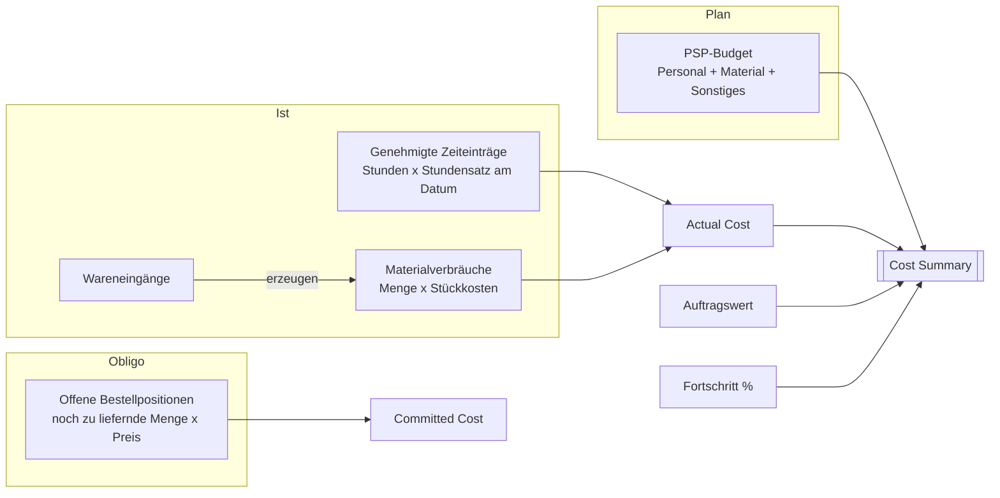
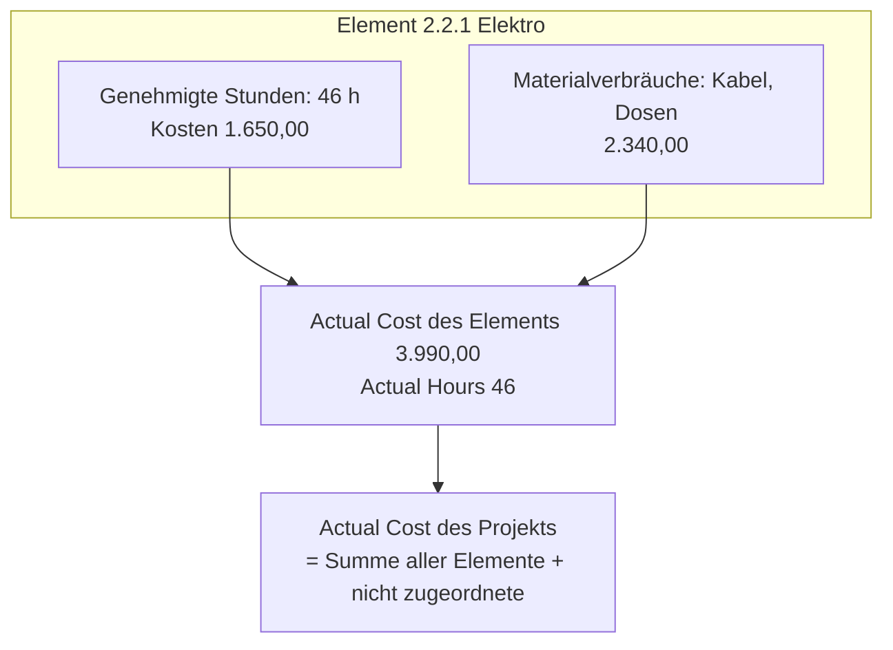
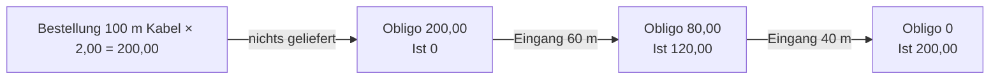

# Material, Ist-Kosten und Kostenübersicht

> **Sprache:** [English](../en/materials-and-costs.md) · [Italiano](../it/materials-and-costs.md) · [Français](../fr/materials-and-costs.md) · Deutsch
> **Handbuchverzeichnis:** [README](../../README.md#user-manuals)

Ein Projekt ist nur dann rentabel, wenn Sie jederzeit wissen, was es tatsächlich gekostet hat und was es noch kosten wird. ProjectIQ sammelt **Ist-Kosten** aus zwei Quellen — genehmigte Stunden und Materialverbräuche — und kombiniert sie mit dem **Obligo** (Committed Cost) offener Bestellungen und dem **Budget** des PSP. Die **Cost Summary** (Kostenübersicht) im Projektformular macht aus diesen Zahlen eine Prognose: die Kosten bei Fertigstellung und die erwartete Marge.

Dieses Handbuch erklärt, wie Sie Material erfassen, wie Ist-Kosten und Obligo entstehen und wie Sie die Kostenübersicht lesen.

> Feld- und Schaltflächennamen stehen auf Englisch, so wie sie auf dem Bildschirm erscheinen.

## Woher die Zahlen kommen

| Kennzahl | Quelle | Aktualisiert |
|---|---|---|
| **Budget Total** | Budget der PSP-Elemente | Beim Speichern eines Elements |
| **Actual Hours** | Genehmigte Zeiteinträge | Bei Genehmigung eines Eintrags (oder beim Einreichen, wenn die Genehmigung ausgeschaltet ist) |
| **Actual Cost** | Kosten der genehmigten Zeiteinträge + Gesamtkosten aller Materialverbräuche | Beim Speichern oder Löschen eines Eintrags oder Verbrauchs |
| **Committed Cost** | Noch zu liefernde Bestellpositionen × Preis, bei versandten oder bestätigten Bestellungen | Wenn sich Bestellungen, Positionen oder Wareneingänge ändern |
| **Progress %** | Fortschritt der Blattelemente, nach Budget gewichtet | Beim Speichern eines Elements |

Jede Kennzahl existiert sowohl auf jedem **PSP-Element** (Ist-Stunden und Ist-Kosten dieses Elements) als auch auf dem **Projekt** (Summen). Kosten, die ohne PSP-Element auf dem Projekt erfasst werden, zählen in den Projektsummen und erscheinen in der Kostenübersicht als *Not assigned to a WBS node* (keinem PSP-Element zugeordnet).

## Materialverbräuche

Ein **Materialverbrauch** (Material Usage) erfasst in einem Projekt verbrauchtes Material: was, wie viel, wann, auf welchem Vorgang, von welchem Lieferanten und zu welchen Kosten. Er kann von Hand oder automatisch durch einen Wareneingang angelegt werden (siehe [Einkauf](purchasing.md#4-wareneingänge)).

### Material von Hand erfassen

1. Öffnen Sie **Projects → Work → Material Usage** und klicken Sie auf **+ New**, oder verwenden Sie die Registerkarte **Materials** des Projekts (das Projekt ist dann vorausgefüllt) oder das Schnellerfassungsformular.
2. Wählen Sie das **Project** (muss **In Progress** sein) und optional den **WBS Node** (es werden nur Elemente dieses Projekts angeboten).
3. Setzen Sie das **Usage Date** (Verbrauchsdatum).
4. Wählen Sie den **Item**. **Description** und **Unit of Measure** werden vom Artikel übernommen, wenn sie leer sind.
5. Wählen Sie optional den **Supplier**, von dem das Material stammt.
6. Geben Sie die **Quantity** ein.
7. Lassen Sie **Unit Cost** leer, damit die Anwendung sie ausfüllt, oder geben Sie sie ein.
8. Speichern Sie: **Total Cost** = Quantity × Unit Cost.

### Felder

| Feld | Bedeutung |
|---|---|
| **Project** | Das Projekt (Pflichtfeld). Der Verbrauch wird mit dem Projekt gelöscht |
| **WBS Node** | Der Vorgang, für den das Material verwendet wird (optional, nur desselben Projekts) |
| **Usage Date** | Wann es verwendet wurde |
| **Item** | Der Artikel aus dem Katalog (optional: Sie können Material auch als Freitext erfassen) |
| **Description** | Was verwendet wurde; aus dem Artikel, wenn leer |
| **Supplier** | Woher es stammt (optional) |
| **Quantity** / **Unit of Measure** | Wie viel; die Einheit kommt aus dem Artikel, wenn leer |
| **Unit Cost** | Kosten pro Einheit (nur mit Kostensichtbarkeit sichtbar) |
| **Total Cost** | Quantity × Unit Cost, berechnet (nur mit Kostensichtbarkeit sichtbar) |

### Wie die Stückkosten vorgeschlagen werden

Wenn Sie einen Artikel wählen und Unit Cost leer lassen:

1. ist ein **Supplier** gesetzt und gibt es eine aktive **Artikellieferant**-Zeile für diesen Artikel und Lieferanten, wird deren **Price** verwendet;
2. andernfalls werden die **Unit Cost** des Artikels verwendet.

Der Vorschlag erfolgt nur, wenn der Artikel gewählt oder geändert wird; spätere Änderungen der Katalogpreise ändern vorhandene Datensätze nicht.

### Material aus Wareneingängen

Wenn ein Einkäufer einen Wareneingang zu einer Bestellung bucht, legt ProjectIQ je erhaltener Position einen Materialverbrauch zum **Bestellpreis** an, auf dem Projekt der Bestellung und dem PSP-Element der Bestellposition. Diese Datensätze sind als aus dem Wareneingang stammend gekennzeichnet und **können nicht direkt geändert oder gelöscht werden**: „This material usage comes from a goods receipt: cancel the receipt to change it.“ Um sie zu korrigieren, stornieren Sie den Wareneingang und buchen ihn erneut.

Sie müssen eingekauftes Material also **nicht** doppelt erfassen: Nehmen Sie es an, und es wird automatisch zu Ist-Kosten. Erfassen Sie von Hand nur Material aus dem Lager oder außerhalb von Bestellungen gekauftes Material.

### Ansichten

| Ansicht | Zeigt |
|---|---|
| **All Material Usage** | Alle Verbräuche, die Sie sehen können |
| **Material Usage by Project** | Wird in der Registerkarte Materials des Projekts verwendet |

Die Schnellsuche (das Suchfeld der Ansicht) ist für Materialverbräuche verfügbar.

## Ist-Kosten im Detail

- **Personal**: Nur **genehmigte** Zeiteinträge zählen (bei ausgeschalteter Zeitgenehmigung werden eingereichte Einträge sofort genehmigt). Stunden im Status Entwurf, eingereicht oder abgelehnt sind noch keine Ist-Kosten.
- **Material**: **Alle** Materialverbräuche zählen, sobald sie gespeichert sind, ob von Hand erfasst oder durch einen Wareneingang angelegt.
- Die Neuberechnung erfolgt sofort und berücksichtigt auch Verschiebungen: Wird ein Eintrag auf ein anderes Element oder Projekt verschoben, werden alte und neue Summen neu berechnet.

## Obligo

Das **Obligo** (Committed Cost) ist Geld, das Sie Lieferanten bereits zugesagt, aber noch nicht als Ware erhalten haben: für jede Position der Bestellungen im Status **Sent** (versandt) oder **Confirmed** (bestätigt), (bestellte Menge − gelieferte Menge) × Preis. Bestellungen im Entwurf (noch nicht versandt) und stornierte Bestellungen zählen nicht. Beim Wareneingang wandert der gelieferte Teil vom Obligo zu den Ist-Kosten (über den Materialverbrauch). Einzelheiten siehe [Einkauf](purchasing.md).

Das Obligo wird auch beim Einreichen einer Bedarfsanforderung verwendet: Überschreiten Ist + Obligo + die neue Anforderung das Budget des Elements (oder des Projekts), wird die Anforderung für den Genehmiger als **Over Budget** gekennzeichnet.

## Kostenübersicht

Die Registerkarte **Costs** des Projekts zeigt die Komponente **Cost Summary**.

### Kopfkennzahlen

| Kennzahl | Bedeutung |
|---|---|
| **Contract value** | Der vereinbarte Preis (Contract Value des Projekts) |
| **Budget** | Gesamtbudget des PSP |
| **Actual cost** | Ist-Kosten bis heute, aufgeteilt in **Labour** (Personal) / **Materials** (Material) |
| **Estimate at completion** | Prognose der Endkosten: **Ist-Kosten ÷ Fortschritt**, wenn der Fortschritt über null liegt; sonst der größere Wert von Budget und Ist |
| **Expected margin** | Auftragswert − Prognose bei Fertigstellung |

### Budget vs. Ist je PSP-Zweig

Unter dem Kopf zeigt eine Tabelle eine Zeile je **PSP-Element der obersten Ebene** (jeder Zweig umfasst alle seine Unterelemente):

| Spalte | Bedeutung |
|---|---|
| **WBS branch** | Code und Name des Elements der obersten Ebene |
| **Budget** | Budgetsumme des Zweigs |
| **Actual** | Ist-Kosten des Zweigs |
| **Variance** | Ist − Budget: **positiv bedeutet Budgetüberschreitung** |
| **Spent** | Bereits verbrauchter Anteil des Budgets, als Balken |
| **Hours (actual / budget)** | Genehmigte Stunden im Vergleich zu den Budgetstunden |

Kosten ohne PSP-Element erscheinen in einer letzten Zeile, **Not assigned to a WBS node**.

### Rechenbeispiel

| | Wert |
|---|---|
| Auftragswert | 120.000 |
| Budget | 100.000 |
| Ist-Kosten | 45.000 (Personal 30.000, Material 15.000) |
| Fortschritt | 40 % |
| **Prognose bei Fertigstellung** | 45.000 ÷ 0,40 = **112.500** |
| **Erwartete Marge** | 120.000 − 112.500 = **7.500** (die budgetierte Marge betrug 20.000) |

Die Prognose besagt, dass der Auftrag schneller Geld verbraucht, als er fortschreitet: In diesem Tempo endet er 12.500 über dem Budget. Sehen Sie in der Zweigtabelle nach, woher die Abweichung kommt.

> Die Prognose bei Fertigstellung ist nur so gut wie die **Fortschrittswerte**: Aktualisieren Sie den Fortschritt der Blattelemente regelmäßig. Bei Fortschritt 0 fällt die Prognose auf das Budget zurück (oder auf die Ist-Kosten, wenn diese bereits höher sind).

Meldungen: „Save the project to see its costs.“ bei einem neuen Projekt; „The cost summary could not be loaded“ bei Netzwerk- oder Berechtigungsproblemen (laden Sie das Formular neu).

## Kostensichtbarkeit

Kosten sind sensibel. Spalten mit Stundensätzen und Materialkosten sind durch das Feldsicherheitsprofil **OP365 Cost Visibility** geschützt:

- Benutzer **mit** dem Profil sehen Unit Cost, Total Cost, Cost der Zeiteinträge, Stundensätze der Ressourcen, Einkaufsvolumen je Lieferant und Artikel;
- Benutzer **ohne** das Profil sehen diese Felder leer oder maskiert, auch bei Datensätzen, die sie öffnen können.

Die Projektsummen (Actual Cost, Committed Cost, Budget Total) sind für alle sichtbar, die das Projekt lesen können. Weisen Sie das Profil Administratoren, Projektleitern und Controllern zu (siehe [Administration](administration.md#kostensichtbarkeit)).

## Mögliche Meldungen

| Meldung | Bedeutung und Lösung |
|---|---|
| „Hours and materials can be recorded only on projects In Progress.“ | Das Projekt auf In Progress setzen oder auf einem anderen Projekt erfassen |
| „The WBS node belongs to another project.“ | Ein Element des ausgewählten Projekts wählen |
| „This material usage comes from a goods receipt: cancel the receipt to change it.“ | **Cancel Receipt** auf dem Wareneingang verwenden und ihn dann erneut buchen |
| Unit Cost oder Total Cost leer | Sie haben das Profil Cost Visibility nicht, oder der Artikel hat weder Kosten noch Lieferantenpreis |
