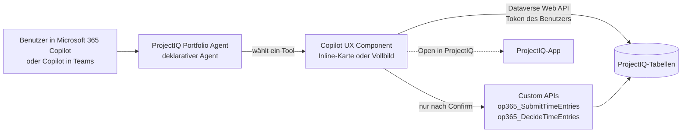
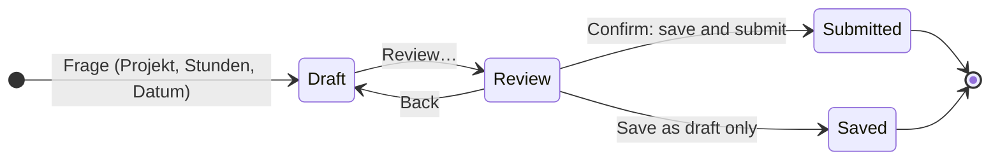
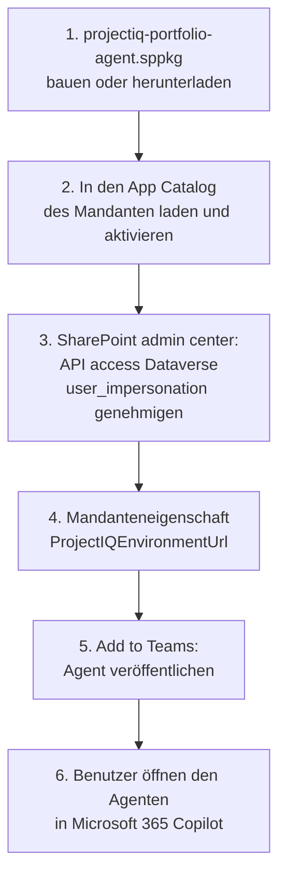

# Portfolio Agent: ProjectIQ in Microsoft 365 Copilot

> **Sprache:** [English](../en/portfolio-agent.md) · [Italiano](../it/portfolio-agent.md) · [Français](../fr/portfolio-agent.md) · Deutsch
> **Handbuchverzeichnis:** [README](../../README.md#user-manuals)

Der **ProjectIQ Portfolio Agent** bringt ProjectIQ in Microsoft 365 Copilot und Copilot in Teams. Benutzer fragen mit eigenen Worten („Welche Projekte liegen über dem Budget?“, „Erfasse heute 8 Stunden auf PRJ-000123“), und der Agent antwortet mit einer interaktiven Karte auf Basis der aktuellen ProjectIQ-Daten: Kennzahlen, Ampeln, Diagramme, eine Zeitleiste, eine Heatmap der Auslastung und Schaltflächen, um weiterzugehen oder den Datensatz in der App zu öffnen.

Er ist mit **Copilot UX Components des SharePoint Framework (SPFx)** gebaut und orientiert sich am Microsoft-Beispiel *Zava Project Tracker*, aber jede Zahl stammt aus den ProjectIQ-Tabellen in Dataverse, gelesen **mit der Identität des Benutzers**. Er ergänzt die Integration [Copilot und Cowork](copilot.md): Copilot Chat antwortet als Text aus dem semantischen Modell, der Portfolio Agent antwortet mit Karten und kann nach einer ausdrücklichen Bestätigung auch **Stunden erfassen, übermitteln und genehmigen**.

> Feld-, Schaltflächen- und Meldungstexte stehen auf Englisch, so wie sie auf dem Bildschirm erscheinen. Copilot UX Components sind ab SPFx 1.24 (Oktober 2026) allgemein verfügbar. Sie funktionieren in Microsoft 365 Copilot und Copilot in Teams im Web und auf dem Desktop, noch nicht auf Mobilgeräten.

## Funktionsweise

1. Der Agent liest die Frage und wählt **eine** Komponente (ein „Tool“) und übergibt die erkannten Werte (Projekt, Person, Datum, Stunden).
2. Die Komponente öffnet sich als Karte im Chat (**inline**); **Expand** öffnet sie im **Vollbild** mit mehr Spalten und Zeilen.
3. Die Karte liest Dataverse mit den Berechtigungen des Benutzers: Sicherheitsrollen, Projekt-Zugriffsteams und Sicherheit auf Spaltenebene gelten genau wie in der App.
4. Jede Karte teilt Copilot mit, was sie zeigt, sodass Folgefragen („Warum ist es verspätet?“, „Und die nächste Phase?“) auf denselben Daten beantwortet werden.
5. Schaltflächen auf der Karte senden eine neue Frage (zum Beispiel von *My work* zu *Project health*) oder öffnen den Datensatz in der ProjectIQ-App.

## Was Sie fragen können

| Ansicht | Beispielfragen | Zeigt | Schreibt |
|---|---|---|---|
| My work | „Was braucht diese Woche meine Aufmerksamkeit in meinen Projekten?“ | Sortierte Liste: zu genehmigende Stunden, abgelehnte und Entwurfsstunden, fehlende Stunden der Vorwoche, gefährdete Projekte, Bestellanforderungen, die auf Sie warten, verspätete Bestellungen, Rechnungen, Überlastung | – |
| Log and submit hours | „Erfasse heute 8 Stunden auf PRJ-000123“, „Übermittle meinen Stundenzettel“ | Ihre Woche, bearbeitbare Entwurfszeilen, Prüfung | Zeiteinträge (nach **Confirm**) |
| Approve hours | „Welche Stunden muss ich genehmigen?“ | Übermittelte Stunden der von Ihnen geleiteten Projekte, nach Person und Woche, mit Hinweisen | Genehmigen / ablehnen (nach **Confirm**) |
| Project health | „Wie läuft das Projekt PRJ-000123?“ | Ampel und Gründe, Budget, Ist, Obligo, Rest, Prognose bei Fertigstellung, Marge, markierte WBS-Phasen, offene Einkäufe | – |
| Project budget | „Zeige das Budget des Schuldachs“ | Budget gegen Istkosten je WBS-Zweig (Diagramm und Tabelle), Arbeit, Material, Obligo | – |
| Project timeline | „Ist PRJ-000123 verspätet? Zeige den kritischen Pfad“ | WBS-Phasen auf einer Zeitleiste mit Fortschritt, kritischem Pfad, Baseline und durch Abhängigkeiten verschobenen Balken | – |
| Project documents | „Zeige die Dokumente von PRJ-000123“ | Dateien und Unterordner des SharePoint-Ordners des Projekts, neueste zuerst, mit Autor, Größe und Links | – |
| Portfolio health | „Welche Projekte liegen über dem Budget oder sind verspätet?“ | Alle Projekte mit Ampel, Summen, Marge bei Fertigstellung | – |
| Resource load | „Wer ist in den nächsten Wochen überlastet?“, „Zeige meine Auslastung“ | Heatmap der zugewiesenen Stunden gegen die Kapazität, je Woche | – |
| Purchasing status | „Was wartet im Einkauf?“, „Welche Bestellungen sind verspätet?“ | Zu genehmigende oder zu bestellende Anforderungen, abgelaufene Angebotsanfragen, verspätete und offene Bestellungen, zu prüfende Rechnungen | – |
| Supplier compliance | „Welche Lieferanten haben einen abgelaufenen Nachweis?“, „Können wir bei Rossi Srl bestellen?“ | Gesperrte Lieferanten, abgelaufene und bald ablaufende Dokumente, ob ein Lieferant Bestellungen erhalten kann | – |
| What I can do | „Zeig mir, wobei du helfen kannst“ | Die obigen Szenarien mit je einem Beispiel | – |

Gesprächseinstiege des Agenten: *What needs my attention*, *Portfolio health*, *Hours to approve*, *Log my hours*, *Resource load*, *Explore the agent*.

## Zustand von Projekt und Portfolio

Die Ampel verwendet die von den Plugins am Projekt gepflegten Werte (siehe [WBS, Budget, Gantt und Baselines](wbs-and-planning.md) und [Material, Istkosten und Kostenübersicht](materials-and-costs.md)). Projekte im Status **Offer** oder **Closed** werden als *Not tracked* angezeigt.

| Regel | Angezeigt als | Ampel |
|---|---|---|
| Ist + Obligo über dem Budget | Actual + committed above budget | Off track |
| Prognose bei Fertigstellung über dem Auftragswert | Estimate at completion above contract value | Off track |
| Enddatum überschritten und Fortschritt unter 100 % | End date passed, not complete | Off track |
| Ist + Obligo bei 90 % des Budgets oder mehr | 90% of the budget used | At risk |
| Prognose bei Fertigstellung über dem Budget | Estimate at completion above budget | At risk |
| Fortschritt mehr als 20 Punkte hinter der verstrichenen Zeit | Progress behind elapsed time | At risk |
| Projekt **Suspended** | Project suspended | At risk |
| Kein Budget auf der WBS | No budget on the WBS | At risk |

- **Prognose bei Fertigstellung** (estimate at completion) = Istkosten ÷ Fortschritt, wenn der Fortschritt über 0 liegt, sonst der größere Wert aus Budget und Istkosten (dieselbe Regel wie das Steuerelement **Cost Summary**).
- **Marge bei Fertigstellung** = Auftragswert − Prognose bei Fertigstellung.
- **Rest** (remaining) = Budget − Ist − Obligo.

In *Project health* wird eine WBS-Phase als **Late** markiert, wenn ihr Enddatum überschritten und sie nicht abgeschlossen ist, und als **Hours over**, wenn die Iststunden die Budgetstunden übersteigen. Mit einer Referenz-Baseline ist *Slip* die Differenz in Tagen zwischen dem aktuellen Ende und dem Ende der Baseline.

## Stunden erfassen und übermitteln

Der Agent speichert nie selbst Stunden: Was Sie in der Frage schreiben, **füllt nur einen Entwurf vor**, den Sie ändern können.

1. Fragen Sie zum Beispiel „erfasse gestern 6 Stunden auf PRJ-000123 Phase 2.1, Ortsbesichtigung“. Die Karte zeigt Ihre Woche und eine Entwurfszeile mit Projekt, WBS-Knoten, Tag, Stunden und Notizen.
2. Ändern Sie die Zeile oder wählen Sie **Add hours** für weitere Zeilen; **Previous week** / **Next week** wechseln die Woche.
3. Lassen Sie **Also submit the draft and rejected entries already in this week** ausgewählt, um die ganze Woche gemeinsam zu übermitteln.
4. Wählen Sie **Review…**. Die Karte listet, was erstellt und übermittelt wird; mehr als 10 Stunden an einem Tag werden als Warnung angezeigt, mehr als 24 Stunden blockieren die Bestätigung.
5. Wählen Sie **Confirm: save and submit** (oder **Save as draft only**). Die Einträge werden wie im **Timesheet** angelegt und mit derselben Custom API wie die Schaltfläche **Submit** übermittelt, es gelten also dieselben Regeln (siehe [Zeiterfassung](time-tracking.md)): nur Projekte In Progress, Ihre eigene Ressource, Kosten zum Satz des Tages, Benachrichtigung der Projektleiter.

| Feld | Regel |
|---|---|
| Project | Pflichtfeld; nur Projekte **In Progress** werden angeboten |
| WBS node | Optional; Knoten des gewählten Projekts |
| Day | Ein Tag der angezeigten Woche |
| Hours | 0 bis 24, Komma oder Punkt, auf Viertelstunden gerundet |
| Notes | Optional, am Zeiteintrag gespeichert |

## Stunden genehmigen

1. Fragen Sie „welche Stunden muss ich genehmigen?“ (optional für ein Projekt oder eine Person). Die Karte gruppiert die Stunden im Status **Submitted** der Projekte, in denen Sie Projektleiter oder Mitglied mit der Rolle **Manager** sind, nach Person und Woche.
2. Hinweise: **Since *Datum***, wenn vor mehr als 7 Tagen übermittelt; ***n* days > 10 h**, wenn eine Person an einem Tag mehr als 10 Stunden hat.
3. Wählen Sie Gruppen (oder keine für alle) und dann **Approve selected…** / **Reject selected…**.
4. Die Prüfung zeigt die Anzahl der Einträge, Stunden und Personen. Eine Ablehnung erfordert eine **Note for the people**.
5. Wählen Sie **Confirm approval** oder **Confirm rejection**. Die Entscheidung nutzt dieselbe Custom API wie das Dashboard **Time Approval**: Genehmigte Stunden werden zu Istkosten, die Personen erhalten eine In-App-Benachrichtigung.

## Projektdokumente

Die Karte liest den SharePoint-Ordner, den ProjectIQ für das Projekt angelegt hat (siehe [Dokumente in SharePoint](documents.md)): Der Ordner wird über den Dokumentspeicherort des Projekts gefunden, dann werden seine Dateien und Unterordner **mit Ihren SharePoint-Berechtigungen** aufgelistet. Die KPIs zeigen die Anzahl der Dateien und Ordner und die letzte Änderung; wählen Sie einen Namen, um die Datei zu öffnen (Office-Dateien öffnen im Browser), oder **Open folder in SharePoint**. Hochladen und Bearbeiten bleiben in SharePoint oder unter **Related** → **Documents** der App.

## Einkauf und Lieferanten

Die Ansichten Einkauf und Lieferanten sind **schreibgeschützt**: Anforderungen genehmigen, Angebotsanfragen und Bestellungen anlegen, Wareneingänge buchen und über Rechnungen entscheiden bleibt bei den Schaltflächen der App (siehe [Einkauf](purchasing.md)). Wählen Sie eine Zeile, um den Datensatz in ProjectIQ zu öffnen.

- *Purchasing status* zeigt die Anforderungen, deren **Current Approver** Sie sind, die übrigen übermittelten Anforderungen, genehmigte Anforderungen zum Bestellen, Angebotsanfragen **Sent** mit überschrittener Frist, Bestellungen **Sent** oder **Confirmed** mit überschrittenem (verspätet) oder offenem Liefertermin und Lieferantenrechnungen **To Review**. *Committed* ist der Betrag der offenen, noch nicht gelieferten Bestellungen.
- *Supplier compliance* listet gesperrte Lieferanten und Dokumente, die abgelaufen sind oder in den nächsten 30 Tagen ablaufen. Für einen Lieferanten beantwortet sie, ob bestellt werden darf: Der Lieferant muss **Active** sein und darf kein abgelaufenes Dokument haben.

## Einrichtung (Administratoren)

Einmal pro Microsoft 365-Mandant, durch einen SharePoint-Administrator zusammen mit dem Power Platform-Administrator.

| Schritt | Wer | Was |
|---|---|---|
| 1 | IT | Das Paket aus `copilot/portfolio-agent` bauen (`npm ci`, `npm run build`, siehe [Entwicklungsumgebung](../dev-environment.md#portfolio-agent-spfx-copilot-components)) oder aus einem GitHub-Release nehmen |
| 2 | SharePoint-Administrator | `projectiq-portfolio-agent.sppkg` in den **App Catalog** des Mandanten laden, **Enable app** wählen |
| 3 | SharePoint-Administrator | SharePoint admin center → **Advanced** → **API access** → die ausstehende Anforderung **Dataverse** / **user_impersonation** genehmigen |
| 4 | SharePoint-Administrator | Die Mandanteneigenschaft `ProjectIQEnvironmentUrl` auf die URL der ProjectIQ-Umgebung setzen (zum Beispiel `https://contoso.crm4.dynamics.com`); optional `ProjectIQAppId` auf die Id der ProjectIQ-App, verwendet von den Links **Open in ProjectIQ**. Mit der CLI for Microsoft 365: `m365 spo storageentity set --appCatalogUrl <App-Catalog-URL> --key ProjectIQEnvironmentUrl --value https://contoso.crm4.dynamics.com` |
| 5 | SharePoint-Administrator | Im App Catalog das Paket wählen → **Add to Teams**: Damit wird der deklarative Agent im Agentenkatalog des Mandanten veröffentlicht. Nach Änderungen an Name, Anweisungen oder Gesprächseinstiegen wiederholen |
| 6 | Jeder Benutzer | In Microsoft 365 Copilot **Agents** → **ProjectIQ Portfolio Agent** öffnen |

Ein Paket bedient eine ProjectIQ-Umgebung (die Mandanteneigenschaft). Neue Versionen der Karten sind wenige Minuten nach der Aktualisierung des Pakets aktiv; starten Sie zum Testen eine neue Unterhaltung.

Die Schritte 1, 2 und 4 kann auch der GitHub-Workflow `deploy-agent` ausführen, nach jeder Änderung am Agenten und mit der Freigabe eines Reviewers; die Schritte 3 und 5 bleiben manuell. Einrichtung: [Portfolio Agent deployment](../dev-environment.md#portfolio-agent-deployment).

### Lizenzen

Jede Person benötigt eine **Microsoft 365 Copilot**-Lizenz und die für ProjectIQ verwendete **Power Apps Premium**-Lizenz. Copilot UX Components verursachen keine verbrauchsabhängigen Kosten.

## Sicherheit und Datenschutz

- Die Karten rufen die Dataverse Web API mit einem **delegierten Token des Benutzers** auf (Berechtigung *Dataverse user_impersonation*, in Schritt 3 genehmigt): kein Dienstkonto, keine Kopie der Daten. Eine Person sieht nur die Projekte, Zeilen und Spalten, die sie in der App sieht.
- Spalten, die durch das Profil **OP365 Cost Visibility** geschützt sind (Stundensätze, Cost der Zeiteinträge, Materialkosten, Spend der Lieferanten), erscheinen für Benutzer ohne das Profil als 0; die Karten weisen darauf hin, statt zu schätzen.
- Die einzigen Schreibvorgänge sind die eigenen Zeiteinträge des Benutzers und die Entscheidungen über Stunden, über dieselben Plugins und Custom APIs wie die App, und nur nach **Confirm**. Einkauf, Projekte und Stammdaten werden aus Copilot nie geändert.
- Was eine Karte zeigt, wird Copilot als Kontext der Unterhaltung übergeben (höchstens etwa 9 KB Text), wie bei jeder anderen Copilot-Antwort.
- Projektdokumente werden mit den **eigenen SharePoint-Berechtigungen des Benutzers** aus SharePoint gelesen (kein zusätzlicher API-Zugriff zu genehmigen): Die Karte listet nur Dateien, die die Person öffnen kann.

## Mögliche Meldungen

| Meldung | Bedeutung und Lösung |
|---|---|
| "ProjectIQ environment not configured" | Die Mandanteneigenschaft `ProjectIQEnvironmentUrl` fehlt oder ist keine Dataverse-URL: siehe [Einrichtung](#einrichtung-administratoren), Schritt 4 |
| "No access to ProjectIQ" | Der API access aus Schritt 3 ist nicht genehmigt, oder der Benutzer hat keine Sicherheitsrolle in der Umgebung |
| "Several projects match" / "No project matches ..." | Wählen Sie das Projekt über die Schaltflächen |
| "No document folder yet" | Niemand hat Documents am Projekt geöffnet: siehe [Dokumente in SharePoint](documents.md#dokumente-eines-datensatzes-öffnen) |
| "You have no access to the SharePoint folder of this project." | Ihr SharePoint-Konto hat keinen Zugriff auf die Dokumentenseite: wenden Sie sich an den SharePoint-Administrator |
| "You are not linked to a resource in ProjectIQ ..." | Keine aktive Ressource hat Ihren Benutzer im Feld *User*: Wenden Sie sich an einen Administrator |
| "Choose the project." / "Hours must be a number from 0 to 24 (quarter hours)." / "Enter the hours or remove the line." | Korrigieren Sie die Entwurfszeile |
| "More than 24 hours on ..." / "More than 10 hours on ..." | Zu viele Stunden an einem Tag (blockierend) / Stunden prüfen (Warnung) |
| "Nothing to save or submit in this week." | Keine neue Zeile und kein Entwurfs- oder abgelehnter Eintrag in der Woche |
| "Hours and materials can be recorded only on projects In Progress." und die übrigen Zeitmeldungen | Von den ProjectIQ-Plugins ausgelöst, siehe [Zeiterfassung](time-tracking.md#mögliche-meldungen) |
| "Only a manager of the project can approve or reject its time entries." | Sie sind nicht Manager dieses Projekts |

## Einschränkungen

- Nicht verfügbar auf mobilen Clients (iOS, Android) mit SPFx 1.24 GA.
- Eine ProjectIQ-Umgebung pro Mandantenpaket.
- Die Karten, der Name des Agenten, seine Beschreibung und die Unterhaltungsvorschläge sind auf Englisch, Italienisch, Französisch oder Deutsch, je nach Sprache Ihres Microsoft 365-Kontos; andere Sprachen sehen Englisch. Copilot antwortet in der Sprache der Frage. Dieses Handbuch nennt die Beschriftungen auf Englisch.
- Datumsangaben sind ganze Tage in Ihrer Zeitzone; Beträge sind in der Währung des Datensatzes, ohne Umrechnung.
