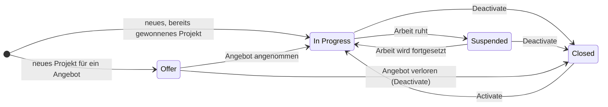
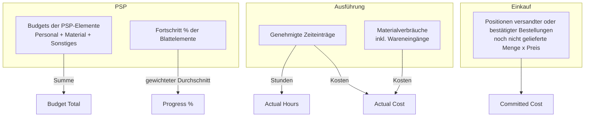
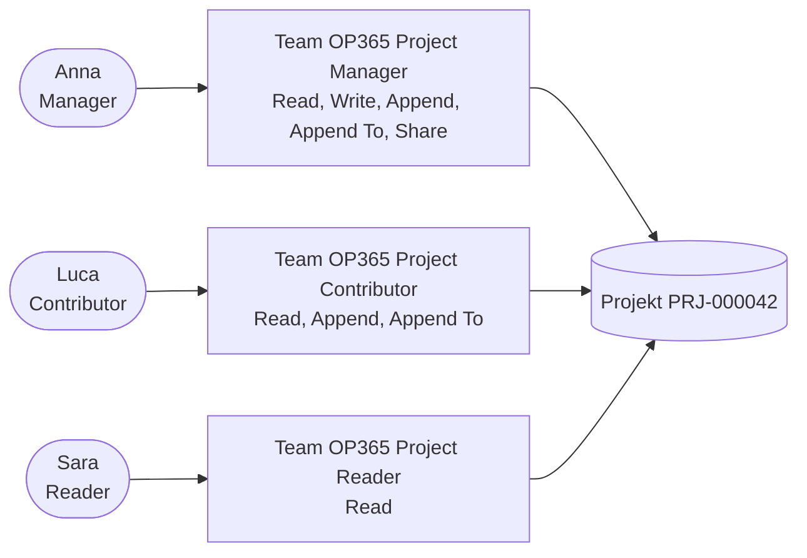

# Projekte und Projektteam

> **Sprache:** [English](../en/projects-and-team.md) · [Italiano](../it/projects-and-team.md) · [Français](../fr/projects-and-team.md) · Deutsch
> **Handbuchverzeichnis:** [README](../../README.md#user-manuals)

Das **Projekt** ist das Herzstück von Open Project 365. Alles andere — der Projektstrukturplan, der Terminplan, die Stunden, das Material, die Einkäufe — gehört zu einem Projekt, und jede Kennzahl, die Sie betrachten (Budget, Ist-Kosten, Obligo, Fortschritt, Marge), ist letztlich eine Kennzahl eines Projekts. Dieses Handbuch erklärt, wie Sie ein Projekt anlegen und durch seinen Lebenszyklus führen, was jedes Feld bedeutet, welche Kennzahlen für Sie berechnet werden und wie das **Projektteam** bestimmt, wer was sehen und tun darf.

> Feld- und Schaltflächennamen stehen auf Englisch, so wie sie auf dem Bildschirm erscheinen.

Sie finden Projekte unter **Projects → Work → Projects**.

## Lebenszyklus eines Projekts

Ein Projekt durchläuft vier Statusgründe:

| Statusgrund | Status | Bedeutung | Was Sie tun können |
|---|---|---|---|
| **Offer** (Angebot) | Aktiv | Sie erstellen oder verhandeln ein Angebot | PSP und Budget aufbauen, planen, Basispläne speichern, das Team bilden, Bedarfsanforderungen vorbereiten |
| **In Progress** (in Arbeit) | Aktiv | Der Auftrag läuft | Alles: Stunden, Material, Bedarfsanforderungen, Bestellungen, Wareneingänge |
| **Suspended** (ausgesetzt) | Aktiv | Die Arbeit ist vorübergehend unterbrochen | Daten ansehen und planen; keine neuen Stunden, kein Material, keine Bestellungen |
| **Closed** (abgeschlossen) | Inaktiv | Der Auftrag ist beendet (oder das Angebot verloren) | Nur lesen; bei Bedarf mit **Activate** reaktivieren |

Um zwischen Offer, In Progress und Suspended zu wechseln, ändern Sie das Feld **Status Reason** in der Registerkarte Summary und speichern. Zum Abschließen des Projekts verwenden Sie **Deactivate** in der Befehlsleiste; zum Wiedereröffnen **Activate**.

> **Wichtig:** Zeiteinträge, Materialverbräuche und Bestellungen werden **nur bei Projekten im Status In Progress** angenommen. Wenn Sie „Hours and materials can be recorded only on projects In Progress.“ oder „Purchase orders can be created only on projects In Progress.“ erhalten, prüfen Sie den Statusgrund des Projekts.

## Ansichten

| Ansicht | Zeigt |
|---|---|
| **All Projects** | Alle Projekte, die Sie sehen können |
| **In Progress Projects** | Laufende Aufträge |
| **Offers** | Projekte im Status Offer |
| **Suspended Projects** | Ruhende Aufträge |
| **Closed Projects** | Beendete Aufträge und verlorene Angebote |

Sie sehen nur die Projekte, deren Besitzer Sie sind, die Projekte, in denen Sie Teammitglied sind, und — mit der Rolle *OP365 Administrator* — alle Projekte (siehe [Wer ein Projekt sieht](#wer-ein-projekt-sieht)).

## Ein Projekt anlegen

1. Gehen Sie zu **Projects → Work → Projects** und klicken Sie auf **+ New**.
2. Füllen Sie mindestens den **Name** aus. Der **Code** kann leer bleiben: Er wird beim Speichern automatisch vergeben (Format `PRJ-000001`, `PRJ-000002`, ...). Verwendet Ihr Unternehmen eigene Codes, können Sie einen eingeben; Codes müssen eindeutig sein.
3. Wählen Sie den **Customer** (hier sind nur als Kunde gekennzeichnete Accounts sinnvoll) und den **Project Manager** (Projektleiter).
4. Setzen Sie **Start Date**, **End Date** und **Contract Value** (Auftragswert), wenn Sie sie kennen.
5. Wählen Sie den **Status Reason**: *Offer*, wenn Sie noch anbieten, *In Progress*, wenn der Auftrag bestätigt ist.
6. Speichern Sie. Der Projektleiter wird automatisch als **Manager** zum Team hinzugefügt.

### Felder der Registerkarte Summary

| Feld | Bedeutung | Wer es ausfüllt |
|---|---|---|
| **Code** | Eindeutiger Projektcode. Leer = automatisch `PRJ-######` | Sie oder das System |
| **Name** | Projektname (Pflichtfeld) | Sie |
| **Customer** | Der Kunden-Account | Sie |
| **Project Manager** | Der für das Projekt verantwortliche Benutzer. Wird Mitglied des Teams mit der Rolle Manager | Sie |
| **Status Reason** | Offer, In Progress, Suspended (Closed über Deactivate) | Sie |
| **Owner** | Besitzer des Datensatzes (meist der Ersteller) | System / Sie |
| **Start Date** / **End Date** | Geplante Projekttermine | Sie |
| **Contract Value** | Mit dem Kunden vereinbarter Preis (Erlös) | Sie |
| **Budget Total** | Summe der Budgets der PSP-Elemente | Berechnet |
| **Actual Cost** | Genehmigte Personalkosten + im Projekt erfasste Materialkosten | Berechnet |
| **Actual Hours** | Im Projekt erfasste genehmigte Stunden | Berechnet |
| **Committed Cost** | Wert der noch nicht gelieferten Positionen versandter oder bestätigter Bestellungen (Obligo) | Berechnet |
| **Progress %** | Gesamtfortschritt, aus dem PSP | Berechnet |
| **Description** | Leistungsumfang, Notizen, alles Nützliche | Sie |

Die rechte Spalte zeigt die **Timeline**: Notizen, Erwähnungen (`@name`) und Aktivitäten (Telefonate, Aufgaben, Termine, E-Mails) zum Projekt.

### Wie die berechneten Kennzahlen entstehen

Die berechneten Felder werden von der Anwendung **sofort beim Speichern** der zugrunde liegenden Datensätze aktualisiert; Sie müssen also nie einen Rollup aktualisieren.

- **Budget Total** = Summe der Budgetsummen der PSP-Elemente (jedes Element: Personal + Material + Sonstiges).
- **Progress %** = Fortschritt der **Blattelemente** (Elemente ohne Unterelemente), gewichtet nach ihrer Budgetsumme; hat kein Element ein Budget, gewichtet nach Budgetstunden; gibt es auch keine Stunden, einfacher Durchschnitt.
- **Actual Hours / Actual Cost** zählen nur **genehmigte** Stunden (oder alle eingereichten Stunden, wenn die Zeitgenehmigung ausgeschaltet ist, siehe [Zeiterfassung](time-tracking.md)) sowie **alle** Materialverbräuche.
- **Committed Cost** zählt, was bestellt und noch nicht geliefert wurde; trifft die Ware ein, wandert der Betrag vom Obligo zu den Ist-Kosten.

Jeder Kunde zeigt außerdem **Projects** (Anzahl) und **Contract Value Total** (Summe der Auftragswerte), aktualisiert bei jeder Änderung eines Projekts dieses Kunden.

## Das Projektformular, Registerkarte für Registerkarte

| Registerkarte | Inhalt | Handbuch |
|---|---|---|
| **Summary** | Projektdaten, Budget- und Fortschrittskennzahlen, Beschreibung, Zeitachse | dieses Handbuch |
| **WBS** | Das PSP-Raster (Tree Grid): Phasen und Vorgänge mit Terminen, Stunden, Budget und Fortschritt, direkt bearbeitbar | [PSP und Planung](wbs-and-planning.md) |
| **Gantt** | Das Gantt-Diagramm mit Abhängigkeiten, kritischem Pfad und Basisplanvergleich; die Liste der Basispläne | [PSP und Planung](wbs-and-planning.md) |
| **Costs** | Die Kostenübersicht: Auftrag, Budget, Ist, Prognose bei Fertigstellung, Marge, Budget vs. Ist je PSP-Zweig | [Material und Kosten](materials-and-costs.md) |
| **Time** | Zeiteinträge des Projekts | [Zeiterfassung](time-tracking.md) |
| **Materials** | Materialverbräuche des Projekts | [Material und Kosten](materials-and-costs.md) |
| **Purchasing** | Bedarfsanforderungen und Bestellungen des Projekts | [Einkauf](purchasing.md) |
| **Team** | Projektmitglieder und ihre Rollen | dieses Handbuch |

Die Befehlsleiste des Projektformulars enthält außerdem **Save Baseline** (siehe [PSP und Planung](wbs-and-planning.md#basispläne)).

## Das Projektteam

Die Registerkarte **Team** listet die **Projektmitglieder** auf. Jedes Mitglied ist ein Benutzer mit einer **Projektrolle**:

| Projektrolle | Darf im Projekt |
|---|---|
| **Manager** | Das Projekt und alles darin lesen und ändern, es freigeben, Zeiteinträge genehmigen, Bedarfsanforderungen genehmigen (bis zur Schwelle), Angebotsanfragen und Bestellungen anlegen, Bestellstatus ändern, Wareneingänge buchen |
| **Contributor** (Mitarbeiter) | Das Projekt lesen, eigene Stunden und eigenes Material erfassen, Bedarfsanforderungen anlegen, Wareneingänge buchen |
| **Reader** (Leser) | Das Projekt und seine Daten lesen |

### Ein Mitglied hinzufügen

1. Öffnen Sie im Projekt die Registerkarte **Team** und klicken Sie auf **+ New Project Member**.
2. Wählen Sie den **User** und die **Project Role**.
3. Setzen Sie optional die **Hourly Rate**: den Satz, mit dem die Stunden dieses Mitglieds als **Erlös** bewertet werden (Revenue des Zeiteintrags = Stunden × Stundensatz).
4. Speichern Sie. Der Name des Mitglieds wird aus dem Benutzer übernommen.

Ein Benutzer kann nur einmal Mitglied desselben Projekts sein: Um die Rolle zu ändern, öffnen Sie das vorhandene Mitglied und ändern **Project Role**.

Der **Projektleiter** des Projekts ist immer Mitglied mit der Rolle Manager: Die Anwendung fügt ihn beim Anlegen des Projekts hinzu und, wenn Sie den Projektleiter wechseln, fügt sie den neuen als Manager hinzu (oder stuft seine Rolle hoch). Der bisherige Projektleiter bleibt im Team; ändern oder entfernen Sie ihn bei Bedarf.

Alle Mitglieder aller Projekte sind für Administratoren außerdem unter **Settings → Company → Project Members** sichtbar.

### Wer ein Projekt sieht

Open Project 365 verwendet **Zugriffsteams** (Access Teams) von Dataverse: Jedes Projekt hat bis zu drei verborgene Teams, eines pro Projektrolle, und das Hinzufügen eines Mitglieds zum Projekt fügt den Benutzer dem passenden Team hinzu.

In der Praxis:

- ein Benutzer mit der Rolle **OP365 User** sieht die Projekte, deren **Besitzer** er ist, und die Projekte, in denen er **Mitglied** ist;
- das Entfernen eines Mitglieds oder das Ändern seiner Rolle ändert sofort, was es sehen und tun kann;
- ein Benutzer mit der Rolle **OP365 Administrator** sieht und ändert jedes Projekt, ob Mitglied oder nicht.

Die Teamvorlagen werden in jeder Umgebung automatisch angelegt, wenn sie zum ersten Mal benötigt werden; es gibt nichts zu konfigurieren.

## Typische Szenarien

### Vom Angebot zum Auftrag

1. Legen Sie das Projekt mit Statusgrund **Offer** an und kennzeichnen Sie den Kunden als *Prospect*.
2. Bauen Sie PSP und Budget auf ([PSP und Planung](wbs-and-planning.md)) und setzen Sie den Auftragswert.
3. Speichern Sie einen Basisplan namens „Angebot“, um festzuhalten, was Sie angeboten haben.
4. Wenn der Kunde annimmt: Ändern Sie den Statusgrund auf **In Progress**, den Kundentyp auf *Customer* und speichern Sie einen neuen Referenz-Basisplan („Vertrag“).
5. Fügen Sie das Team hinzu, planen Sie Zuordnungen und beginnen Sie mit Stundenerfassung und Einkauf.

### Einen Auftrag ruhen lassen

Setzen Sie **Suspended**. Niemand kann neue Stunden, Material oder Bestellungen erfassen, bis Sie wieder **In Progress** setzen; vorhandene Daten und der Plan bleiben unverändert.

### Einen Auftrag abschließen

1. Stellen Sie sicher, dass alle Stunden genehmigt, alle Bestellungen geliefert oder storniert und über alle Rechnungen entschieden ist.
2. Prüfen Sie die Registerkarte **Costs** auf die endgültige Marge.
3. Klicken Sie auf **Deactivate**. Das Projekt wird schreibgeschützt und verschwindet aus den In-Progress-Ansichten.

## Ein Projekt löschen

Das Löschen eines Projekts löscht alles, was dazugehört: PSP-Elemente, Abhängigkeiten, Zuordnungen, Basispläne, Mitglieder, Zeiteinträge, Materialverbräuche, Bedarfsanforderungen, Angebotsanfragen, Bestellungen und Wareneingänge (Lieferantenrechnungen bleiben erhalten, ohne Projektverknüpfung). **Verwenden Sie lieber Deactivate**: Ein abgeschlossenes Projekt behält seine Historie und seine Kennzahlen. Löschen Sie nur versehentlich angelegte Projekte.

## Mögliche Meldungen

| Meldung | Warum | Was tun |
|---|---|---|
| „Hours and materials can be recorded only on projects In Progress.“ | Das Projekt ist Offer, Suspended oder Closed | Den Statusgrund ändern, wenn die Arbeit tatsächlich begonnen hat |
| „Purchase orders can be created only on projects In Progress.“ | Dasselbe, für den Einkauf | Wie oben |
| „The project is closed.“ | Sie haben versucht, für ein inaktives Projekt einzukaufen | Das Projekt gegebenenfalls reaktivieren |
| „Only a manager of the project can …“ | Die Aktion erfordert die Projektrolle Manager | Den Projektleiter bitten, Sie als Manager hinzuzufügen oder die Aktion selbst auszuführen |
| Fehler wegen doppeltem Schlüssel beim Code | Ein anderes Projekt hat bereits diesen Code | Code für einen automatischen leer lassen oder einen anderen wählen |
| Dublettenfehler bei einem Projektmitglied | Der Benutzer ist bereits im Team | Die Rolle des vorhandenen Mitglieds ändern |
