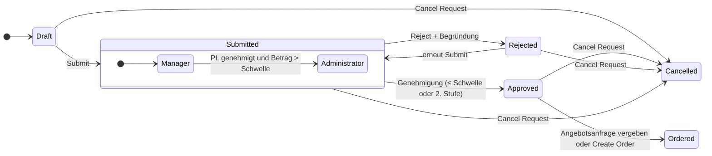
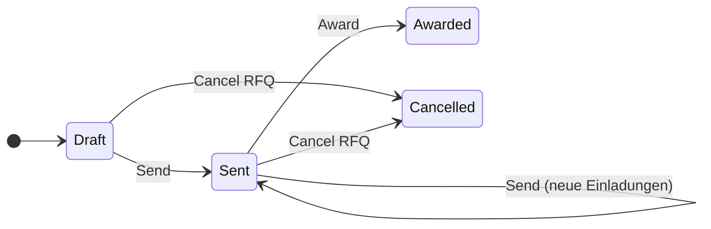
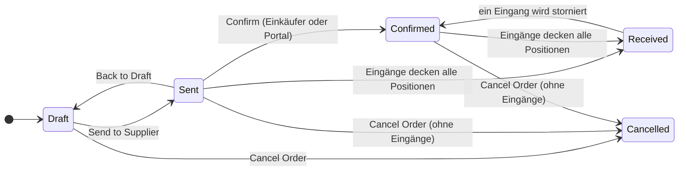
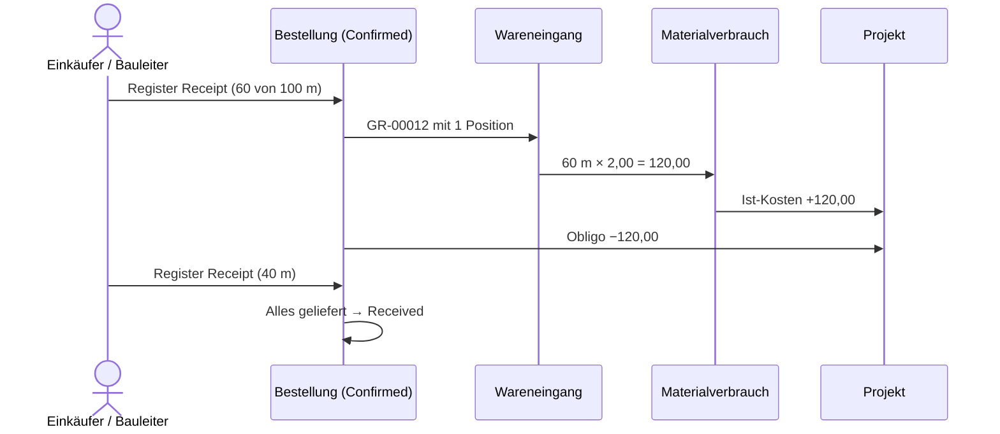

# Einkauf: Bedarfsanforderungen, Angebotsanfragen, Bestellungen, Wareneingänge und Lieferantenrechnungen

> **Sprache:** [English](../en/purchasing.md) · [Italiano](../it/purchasing.md) · [Français](../fr/purchasing.md) · Deutsch
> **Handbuchverzeichnis:** [README](../../README.md#user-manuals)

Im Einkauf werden Auftragskosten gewonnen oder verloren: das Richtige kaufen, zum richtigen Preis, bei einem zuverlässigen Lieferanten, ohne das Budget zu überschreiten. ProjectIQ bildet die gesamte Einkaufskette innerhalb des Projekts ab: Ein Teammitglied **fordert an**, was gebraucht wird, der Projektleiter (und oberhalb einer Schwelle der Einkaufsgenehmiger) **genehmigt**, der Einkäufer holt bei Lieferanten **Angebote** ein und vergleicht sie, das beste Angebot wird zur **Bestellung**, der Lieferant bestätigt sie (auch über das [Lieferantenportal](supplier-portal.md)), die Ware wird **angenommen** und zu Ist-Kosten, und die **Lieferantenrechnung** wird geprüft und genehmigt.

Jeder Schritt aktualisiert die Projektkennzahlen: das **Obligo** (Committed Cost), wenn eine Bestellung versandt wird, die **Ist-Kosten**, wenn Ware eingeht, das **Einkaufsvolumen** (Spend) je Lieferant und Artikel.

> Feld- und Schaltflächennamen sowie Meldungen stehen auf Englisch, so wie sie auf dem Bildschirm erscheinen.

Alle Einkaufsseiten befinden sich im Bereich **Purchasing**: Gruppe **Procurement** (Purchase Requests, RFQs, Purchase Orders, Goods Receipts, Supplier Invoices) und Gruppe **Analysis** (Dashboard Spend). Die Registerkarte **Purchasing** des Projektformulars listet die Anforderungen und Bestellungen des Projekts auf.

## Die Kette auf einen Blick

```mermaid
flowchart LR
    PR[Bedarfsanforderung<br/>PR-#####] -->|Submit| AP{Genehmigung}
    AP -->|≤ Schwelle:<br/>Projektleiter| OK[Approved]
    AP -->|> Schwelle:<br/>PL, dann Einkaufsgenehmiger| OK
    OK -->|Create RFQ| RFQ[Angebotsanfrage<br/>RFQ-#####]
    OK -->|Create Order| PO
    RFQ -->|Send| SUP([Lieferanten bieten an<br/>Portal oder Einkäufer])
    SUP -->|Award| PO[Bestellung<br/>PO-#####]
    PO -->|Send to Supplier| SENT[Sent]
    SENT -->|Confirm / Portal| CONF[Confirmed]
    CONF -->|Register Receipt| GR[Wareneingang<br/>GR-#####]
    GR -->|Materialverbrauch| ACT[(Ist-Kosten des Projekts)]
    PO -.-> INV[Lieferantenrechnung<br/>INV-#####]
    INV -->|Approve / Reject| DONE[Approved]
```

Nummern werden beim Speichern automatisch vergeben: Bedarfsanforderungen `PR-00001`, Angebotsanfragen `RFQ-00001`, Bestellungen `PO-00001`, Wareneingänge `GR-00001`, Lieferantenrechnungen `INV-00001`.

## Wer macht was

| Aktion | Wer sie ausführen darf |
|---|---|
| Eine Bedarfsanforderung anlegen | Ein Manager oder Contributor des Projekts, ein Administrator (als Anforderer werden Sie eingetragen) |
| Eine Anforderung einreichen | Der Anforderer, ein Manager des Projekts, ein Administrator |
| Bis zur Schwelle genehmigen / ablehnen | Der Projektleiter (aktueller Genehmiger), jeder Manager des Projekts, ein Administrator |
| Über der Schwelle genehmigen / ablehnen (zweite Stufe) | Der in den [Umgebungsvariablen](administration.md#unternehmenseinstellungen) festgelegte **Purchasing Approver** oder ein Administrator |
| Eine Anforderung stornieren | Der Anforderer, ein Manager des Projekts, ein Administrator |
| Angebotsanfragen und Bestellungen anlegen, versenden, vergeben, Bestellstatus ändern | Ein Manager des Projekts, ein Administrator |
| Wareneingänge buchen | Ein Manager oder Contributor des Projekts, ein Administrator |
| Lieferantenrechnungen genehmigen / ablehnen | Der Purchasing Approver, ein Administrator |

„Administrator“ bedeutet ein Benutzer mit der Rolle **OP365 Administrator** oder **System Administrator**.

Alle Aktionen sind **Schaltflächen in der Befehlsleiste** der Formulare. Jede Schaltfläche ist nur in den Status aktiv, in denen sie gilt, und jede Aktion fragt nach einer Bestätigung.

## 1. Bedarfsanforderungen

Eine Bedarfsanforderung (Purchase Request, PR) sagt, *was* gebraucht wird, *für welches Projekt und welchen Vorgang*, *bis wann* und ungefähr *was es kostet*.

### Eine Anforderung anlegen

1. Gehen Sie zu **Purchasing → Procurement → Purchase Requests → + New** oder zur Registerkarte **Purchasing** des Projekts.
2. Füllen Sie den Kopf aus:

| Feld | Bedeutung |
|---|---|
| **Title** | Kurze Beschreibung des Bedarfs (zum Beispiel „Kabel für das 2. OG“) |
| **Needed By** | Datum, an dem das Material auf der Baustelle benötigt wird |
| **Project** | Das Projekt (darf nicht abgeschlossen sein) |
| **WBS Node** | Der Vorgang, für den eingekauft wird (nur desselben Projekts). Wird für die Budgetprüfung verwendet und in die Bestellpositionen übernommen |
| **Preferred Supplier** | Der von Ihnen vorgeschlagene Lieferant. Erforderlich für **Create Order**; wird beim Anlegen einer Angebotsanfrage immer eingeladen |
| **Requester** | Standardmäßig Sie |
| **Justification** | Warum es gebraucht wird, alles, was der Genehmiger wissen sollte |

3. Speichern Sie, dann fügen Sie die **Lines** (Positionen) hinzu (Abschnitt *Lines*, **+ New Purchase Request Line**):

| Feld | Bedeutung |
|---|---|
| **Item** | Katalogartikel (optional) |
| **Description** | Aus dem Artikel, wenn leer |
| **Quantity** / **Unit of Measure** | Wie viel (die Einheit kommt aus dem Artikel, wenn leer) |
| **Estimated Price** | Erwarteter Stückpreis. Leer = Preis des bevorzugten Lieferanten für den Artikel, sonst die Stückkosten des Artikels |
| **Amount** | Quantity × Estimated Price (berechnet) |
| **Sort Order** | Reihenfolge der Positionen |
| **Notes** | Spezifikationen für den Lieferanten |

Der **Estimated Amount** der Anforderung ist die Summe der Positionsbeträge.

### Einreichen und genehmigen

Klicken Sie auf **Submit**. Die Anforderung wird **Submitted**, ihr Inhalt wird gesperrt (nur die Justification kann noch ergänzt werden), und die Anwendung hält im Abschnitt *Approval* drei Dinge fest:

- **Above Threshold**: ob der geschätzte Betrag die **Purchase Request Threshold** (Einkaufsschwelle, [Umgebungsvariable](administration.md#unternehmenseinstellungen)) überschreitet;
- **Over Budget**: ob Ist-Kosten + Obligo + diese Anforderung das Budget des PSP-Elements (oder des Projekts, wenn kein Element gesetzt ist) überschreiten;
- **Current Approver**: der Projektleiter, der die Benachrichtigung „Purchase request to approve“ erhält.

**Zweistufige Genehmigung**

| Stufe | Wer entscheidet | Was bei Approve passiert |
|---|---|---|
| **Manager** (erste) | Projektleiter / Manager des Projekts | Liegt die Anforderung **nicht** über der Schwelle → **Approved**. Liegt sie darüber → sie geht auf die Stufe **Administrator** über, *Manager Approved By/On* werden festgehalten, und die Genehmiger der zweiten Stufe werden benachrichtigt |
| **Administrator** (zweite) | Purchasing Approver aus der Umgebungsvariable (falls gesetzt), sonst jeder OP365 Administrator | → **Approved** |

Ist die Person, die auf der ersten Stufe genehmigt, bereits Genehmiger der zweiten Stufe, wird die Anforderung direkt genehmigt.

Zum **Ablehnen** klicken Sie auf **Reject**: Ein Dialog fragt nach dem **Reason** (Begründung, Pflicht). Die Anforderung wird **Rejected**, die Begründung in *Decision Note* gespeichert und der Anforderer benachrichtigt. Der Anforderer kann die Anforderung ändern und erneut **Submit** ausführen.

Die Ansicht **Purchase Requests to Decide** listet die Anforderungen, die auf eine Entscheidung warten; **My Purchase Requests** listet Ihre; **Open Purchase Requests** listet die noch nicht bestellten, stornierten oder abgelehnten.

> Eine Schwelle von null (oder leer) bedeutet, dass keine Anforderung die zweite Stufe braucht. *Over Budget* ist ein Hinweis für den Genehmiger: Es blockiert die Genehmigung nicht.

### Nach der Genehmigung: zwei Wege zum Einkauf

| Schaltfläche | Wann verwenden | Ergebnis |
|---|---|---|
| **Create RFQ** | Sie möchten Vergleichsangebote | Eine neue Angebotsanfrage im Status Draft, mit dem bevorzugten Lieferanten und den Standardlieferanten der Artikel bereits eingeladen |
| **Create Order** | Sie kennen Lieferant und Preis bereits | Eine Bestellung im Status Draft an den **Preferred Supplier** mit den Positionen der Anforderung; die Anforderung wird **Ordered** |

**Cancel Request** stoppt die Anforderung in jedem Status außer Ordered und Cancelled. Nur Anforderungen im Status Draft, Rejected oder Cancelled können gelöscht werden.

## 2. Angebotsanfragen (RFQ)

Eine Angebotsanfrage (Request for Quotation, RFQ) bittet einen oder mehrere Lieferanten, die Positionen einer genehmigten Anforderung anzubieten.

### Vorbereiten und versenden

1. Klicken Sie in der genehmigten Anforderung auf **Create RFQ**. Die Angebotsanfrage wird mit einer **Deadline** (Frist) in 7 Tagen und dem Titel der Anforderung in **Notes** angelegt; der bevorzugte Lieferant und die Standardlieferanten der Artikel stehen in **Invitations** mit Status *To Invite*.
2. Öffnen Sie die Angebotsanfrage. Passen Sie **Deadline** (heute oder später) und **Notes** für die Lieferanten an.
3. Fügen Sie in **Invitations** weitere Lieferanten hinzu (**+ New RFQ Invitation**): Wählen Sie den **Supplier**; die **Email** wird vom Lieferanten übernommen. Inaktive, gesperrte oder nicht als Lieferant gekennzeichnete Accounts werden abgelehnt.
4. Klicken Sie auf **Send**. Die Angebotsanfrage wird **Sent**, jede Einladung *To Invite* wird **Invited** (mit Nummer, Frist und Notizen der Anfrage), und für jeden Lieferanten wird **eine leere Angebotsposition je Anforderungsposition** vorbereitet.

Sie können nach dem Versand weitere Lieferanten hinzufügen: Fügen Sie die Einladung hinzu und klicken Sie erneut auf **Send**; nur die neuen Einladungen werden versandt.

### Angebote sammeln

Jede Einladung hat eigene **Angebotspositionen** (eine je Anforderungsposition) mit **Unit Price** und **Notes**, dazu **Delivery Days** (Lieferzeit in Tagen) und **Supplier Notes** auf Ebene der Einladung. Sie können auf zwei Arten ausgefüllt werden:

- **vom Lieferanten** im [Lieferantenportal](supplier-portal.md): Der Lieferant sieht die Angebotsanfrage, gibt Preise, Lieferzeit und Notizen ein und klickt auf *Send quote* — oder auf *Decline*;
- **vom Einkäufer**, wenn das Angebot per E-Mail oder Telefon kommt: Einladung öffnen, Registerkarte **Quotes**, Preise eingeben.

Der erste eingegebene Preis setzt die Einladung auf **Responded** (mit Antwortdatum); der Zähler **Responses** der Angebotsanfrage zeigt, wie viele Lieferanten geantwortet haben. Der **Quoted Amount** der Einladung ist die Summe von Menge × Preis über ihre Positionen.

| Status der Einladung | Bedeutung |
|---|---|
| **To Invite** | Hinzugefügt, noch nicht versandt |
| **Invited** | Versandt, wartet auf Antwort |
| **Responded** | Mindestens ein Preis eingegeben |
| **Declined** | Der Lieferant hat abgesagt (Portal) |

Nach Ablauf der Frist können Angebote nicht mehr geändert werden („The deadline of the request for quotation has passed.“); um sie zu verlängern, ändern Sie die **Deadline** der Angebotsanfrage und klicken erneut auf **Send**.

### Vergleichen und Vergeben

Die Registerkarte **Quote Comparison** der Angebotsanfrage zeigt ein Raster **Anforderungspositionen × Lieferanten**:

| Position | Menge | Lieferant A | Lieferant B | Lieferant C | Bester Preis |
|---|---|---|---|---|---|
| Kabel 3x2,5 | 500 m | 0,95 | **0,89** | 0,97 | 0,89 (B) |
| Abzweigdose | 40 Stk | **3,10** | 3,40 | – | 3,10 (A) |
| **Summe** | | **2.989,00** | 3.081,00 | 3/4 Positionen | Beste Summe: A |
| **Lieferung** | | 10 Tage | 7 Tage | 5 Tage | |

- der **beste Preis** jeder Position ist hervorgehoben;
- die **Summe** jedes Lieferanten wird angezeigt, mit „x of y lines“ (x von y Positionen), wenn der Lieferant nicht jede Position angeboten hat; die **beste Summe** wird nur unter Lieferanten ermittelt, die alle Positionen angeboten haben;
- **Lieferzeit** und Status der Einladung werden für jeden Lieferanten angezeigt;
- **Refresh** lädt die Angebote neu.

Klicken Sie unter dem gewählten Lieferanten auf **Award** und bestätigen Sie („Award the request for quotation to <supplier> and create the purchase order?“). Die Anwendung:

1. legt eine **Bestellung im Status Draft** an diesen Lieferanten an, mit den angebotenen Positionen und Preisen (nur Positionen mit Preis), dem PSP-Element der Anforderung und einer **Expected Delivery** = heute + Lieferzeit des Lieferanten;
2. setzt die Angebotsanfrage auf **Awarded** und hält die gewinnende Einladung und die Bestellung fest;
3. setzt die Bedarfsanforderung auf **Ordered**.

Nur Lieferanten, die **geantwortet** haben, können den Zuschlag erhalten. **Cancel RFQ** schließt eine Angebotsanfrage im Status Draft oder Sent ohne Bestellung.

## 3. Bestellungen

Eine Bestellung (Purchase Order, PO) ist die Verpflichtung, bei einem Lieferanten zu kaufen. Sie entsteht meist durch **Award** oder **Create Order**, ein Manager kann aber auch eine von Grund auf anlegen (**Purchasing → Purchase Orders → + New**), auf einem Projekt In Progress.

### Felder

| Feld | Bedeutung |
|---|---|
| **Number** | PO-##### (automatisch) |
| **Supplier** | Muss ein aktiver, nicht gesperrter Lieferant sein |
| **Project** | Muss **In Progress** sein |
| **Purchase Request** | Die zugrunde liegende Anforderung, falls vorhanden |
| **Order Date** | Standardmäßig heute |
| **Expected Delivery** | Wann die Ware erwartet wird |
| **Delivery Place** | Baustellenadresse oder Lager |
| **Payment Terms** | Vom Lieferanten |
| **Total Amount** | Summe der Positionen (berechnet) |
| *Abschnitt Progress* | Sent To, Sent On, Supplier Confirmed, Confirmed On, Received Amount, Received On, Cancelled On |

**Lines** (Positionen): Item, Description, **WBS Node** (desselben Projekts), Quantity, Unit, **Unit Price** (leer = Preis des Lieferanten für den Artikel, sonst Artikelkosten), **Amount**, **Received Quantity** (aus den Wareneingängen, schreibgeschützt), Sort Order, Notes.

### Status

| Schaltfläche | Ausgangsstatus | Wirkung |
|---|---|---|
| **Send to Supplier** | Draft | → **Sent**. Positionen werden gesperrt. *Sent To* hält die E-Mail des Lieferanten fest, *Sent On* das Datum. Die Bestellung wird für den Lieferanten im Portal sichtbar. Erfordert mindestens eine Position |
| **Back to Draft** | Sent | → **Draft**, um die Bestellung zu ändern (danach erneut versenden) |
| **Confirm** | Sent | → **Confirmed**, hält die Bestätigung des Lieferanten fest. Der Lieferant kann auch im Portal bestätigen, mit derselben Wirkung |
| **Register Receipt** | Sent, Confirmed | Öffnet den Dialog für den Wareneingang (siehe unten) |
| **Cancel Order** | Draft, Sent, Confirmed | → **Cancelled**, nur wenn die Bestellung keine Wareneingänge hat („Cancel the goods receipts before cancelling the order.“) |

**Received** wird nie von Hand gesetzt: Die Bestellung wird Received, wenn die Wareneingänge alle ihre Positionen abdecken. Nur Bestellungen im Status Draft oder Cancelled können gelöscht werden.

Hat eine Bestellung den Status Draft verlassen, können Sie noch **Notes**, **Expected Delivery** und **Delivery Place** ändern (zum Beispiel, wenn der Lieferant einen neuen Liefertermin ankündigt); alles andere erfordert **Back to Draft**.

> *Send to Supplier* hält fest, dass die Bestellung versandt wurde; es sendet von sich aus keine E-Mail an den Lieferanten. Senden Sie das Bestelldokument über Ihren üblichen Kanal, oder lassen Sie den Lieferanten sie im Portal finden.

### Wirkung auf die Kosten

- Bestellungen im Status Sent und Confirmed zählen für die noch nicht gelieferten Mengen im **Committed Cost** (Obligo) des Projekts.
- Jede nicht stornierte Bestellung zählt im **Spend** des Lieferanten; jede Position in **Order Lines** und **Spend** des Artikels.

## 4. Wareneingänge

Ein Wareneingang (Goods Receipt, GR) hält fest, was zu welchem Lieferschein eingetroffen ist.

### Einen Wareneingang buchen

1. Klicken Sie in einer Bestellung im Status Sent oder Confirmed auf **Register Receipt**.
2. Füllen Sie im Dialog **Receipt date** (Eingangsdatum, standardmäßig heute), **Delivery note number** (Lieferscheinnummer) und **Delivery note date** (Lieferscheindatum) aus.
3. Geben Sie für jede Bestellposition die jetzt **erhaltene Menge** ein. **Receive all** füllt alles noch zu Liefernde aus; **Clear** leert die Mengen.
4. Klicken Sie auf **Register**.

Die Anwendung:

- legt den Wareneingang (GR-#####) mit einer **Eingangsposition** je erhaltener Bestellposition an;
- legt je Position einen **Materialverbrauch** zum **Bestellpreis** an, auf dem Projekt der Bestellung und dem PSP-Element der Position → **Ist-Kosten**;
- erhöht die **Received Quantity** der Bestellpositionen (und den Received Amount der Bestellung); der gelieferte Teil verlässt das **Obligo**;
- setzt die Bestellung auf **Received**, wenn jede Position vollständig geliefert ist.

Sie können nicht mehr als bestellt annehmen: „<line>: only N still to receive.“ (nur noch N zu liefern).

### Einen Wareneingang stornieren

Ist ein Wareneingang falsch, öffnen Sie ihn und klicken auf **Cancel Receipt**. Seine Materialverbräuche und Positionen werden gelöscht, die zu liefernden Mengen wiederhergestellt, und eine Bestellung im Status Received geht zurück auf **Confirmed**. Buchen Sie danach den richtigen Wareneingang.

In einem gebuchten Wareneingang können nur die **Lieferscheindaten** und die **Notizen** geändert werden; Positionen und Mengen ändern sich nur über Cancel Receipt. Wareneingänge können nur mit **Register Receipt** angelegt werden.

## 5. Lieferantenrechnungen

Eine Lieferantenrechnung ist ein **Container** für eine Eingangsrechnung: Sie enthält die Rechnungsdaten, ihre Positionen, die XML- oder PDF-Datei, die Verknüpfung zur Bestellung und die Genehmigungsentscheidung. (Der automatische Import aus dem italienischen Austauschsystem SDI ist für eine spätere Version geplant; heute wird die Datei von Hand angehängt.)

### Eine Rechnung erfassen

1. **Purchasing → Supplier Invoices → + New** (oder die Registerkarte **Invoices** der Bestellung, damit die Bestellung bereits eingetragen ist).
2. Füllen Sie **Supplier**, **Document Type** (TD01 Invoice – Rechnung, TD02 Advance invoice – Anzahlungsrechnung, TD04 Credit note – Gutschrift, TD05 Debit note – Belastungsanzeige, TD06 Fee note – Honorarnote, TD24 Deferred invoice – Sammelrechnung, TD25 Deferred invoice (triangular) – Sammelrechnung im Dreiecksgeschäft), **Invoice Number**, **Invoice Date** und **Purchase Order** aus.
3. **Seller Name** und **Seller VAT Number** werden vom Lieferanten übernommen; das **Project** von der Bestellung.
4. Hängen Sie die XML-Datei (FatturaPA) oder das PDF in **Invoice File** an.
5. Füllen Sie optional **Order References** und **Delivery Note References** so aus, wie sie auf der Rechnung stehen.
6. Fügen Sie die **Lines** hinzu: Line Number, Code, Description, Quantity, Unit, Unit Price, Total Price (= Menge × Stückpreis, wenn leer), VAT Rate % (MwSt.-Satz) und optional die **Order Line**, auf die sie sich bezieht.
7. **Taxable Amount** (Nettobetrag), **VAT Amount** (MwSt.-Betrag) und **Total Amount** werden aus den Positionen berechnet.

Neue Rechnungen beginnen im Status **To Review**.

### Genehmigen

Der Purchasing Approver (oder ein Administrator) prüft die Rechnung gegen Bestellung und Wareneingänge und klickt dann auf **Approve** oder **Reject** (Begründung Pflicht). Entschiedene Rechnungen — und ihre Positionen — sind gesperrt.

| Status | Bedeutung |
|---|---|
| **To Review** | Wartet auf die Prüfung; Daten und Positionen können geändert werden |
| **Approved** | Zur Zahlung freigegeben |
| **Rejected** | Beanstandet; die Begründung steht in *Decision Note* |

Ansichten: **Invoices to Review**, **Approved Invoices**, **Rejected Invoices**, **Supplier Invoices by Order**.

> Normale Benutzer (OP365 User) können Lieferantenrechnungen lesen, aber weder anlegen noch ändern: Rechnungen werden von Verwaltungsmitarbeitern mit der Rolle OP365 Administrator bearbeitet.

## 6. Das Dashboard Spend

**Purchasing → Analysis → Spend** gibt Einkäufern und Geschäftsleitung einen Überblick:

| Komponente | Inhalt |
|---|---|
| **Spend by Supplier** | Balkendiagramm: Summe der Bestellungen je Lieferant |
| **Spend by Project** | Balkendiagramm: Summe der Bestellungen je Projekt |
| **Purchase Orders by Status** | Kreisdiagramm: Anzahl der Bestellungen je Status |
| **Open Purchase Orders** | Liste der noch nicht gelieferten oder stornierten Bestellungen |
| **Invoices to Review** | Liste der Rechnungen, die auf Genehmigung warten |

Klicken Sie auf ein Diagrammsegment, um zu filtern, oder öffnen Sie die Liste, um die Datensätze zu sehen.

## Ansichten

| Tabelle | Ansichten |
|---|---|
| Bedarfsanforderungen | All, My, To Decide, Open, By Project |
| Angebotsanfragen | All, Open, Awarded |
| Bestellungen | All, Open, Confirmed, Received, By Project, By Supplier |
| Wareneingänge | All, By Order |
| Lieferantenrechnungen | All, To Review, Approved, Rejected, By Order |

## Mögliche Meldungen

| Meldung | Bedeutung und Lösung |
|---|---|
| „Use Submit to send a purchase request for approval.“ / „Use Submit, Approve, Reject or Cancel to change the status of a purchase request.“ | Statuswechsel nur über die Schaltflächen |
| „A purchase request can be changed only while it is Draft or Rejected.“ / „Lines can be changed only while the purchase request is Draft or Rejected.“ | Die Anforderung ablehnen oder stornieren, um sie zu ändern |
| „Add at least one line before submitting.“ | Die Anforderung hat keine Positionen |
| „Only the requester or a manager of the project can submit the purchase request.“ | Den Anforderer oder den Projektleiter fragen |
| „This purchase request is above the threshold: only the purchasing approver or an administrator can decide it.“ | Sie befindet sich auf der zweiten Stufe |
| „Add a note to reject the purchase request.“ / „...the invoice.“ / „...time entries.“ | Die Begründung ist Pflicht |
| „Only approved purchase requests can go to a request for quotation.“ / „...can be ordered.“ | Zuerst die Anforderung genehmigen |
| „Choose the supplier: set Preferred Supplier on the request.“ | Create Order braucht einen bevorzugten Lieferanten |
| „The deadline must be today or later.“ / „The deadline has passed: move it before sending.“ | Die Frist der Angebotsanfrage ändern |
| „Invite at least one supplier.“ | Vor Send eine Einladung hinzufügen |
| „Use Send on the request for quotation to invite suppliers.“ | Der Status der Einladung ändert sich nur mit Send (oder über das Portal) |
| „This supplier already has a quote for the line: change its price.“ | Die vorhandene Angebotsposition bearbeiten |
| „Award a supplier who sent a quote.“ / „The supplier quoted no lines.“ | Nur Lieferanten, die mit Preisen geantwortet haben, können den Zuschlag erhalten |
| „<name> is not an active supplier.“ / „<name> is blocked.“ | Den Lieferanten-Account prüfen |
| „Purchase orders can be created only on projects In Progress.“ | Den Projektstatus prüfen |
| „A purchase order can be changed only while it is Draft.“ / „Lines can be changed only while the purchase order is Draft.“ | **Back to Draft** verwenden |
| „Add at least one line before sending.“ | Die Bestellung hat keine Positionen |
| „Cancel the goods receipts before cancelling the order.“ | Zuerst die Wareneingänge stornieren |
| „An order becomes Received when all its lines are received.“ | Die Wareneingänge buchen |
| „Goods can be received only on sent or confirmed purchase orders.“ | Zuerst die Bestellung versenden |
| „<line>: only N still to receive.“ / „Nothing to receive.“ | Die Mengen im Dialog prüfen |
| „Received quantities come from goods receipts.“ | Gelieferte Mengen nicht von Hand eingeben |
| „Use Register Receipt on the purchase order to receive goods, and Cancel Receipt to undo a receipt.“ | Wareneingänge werden nur über die Schaltflächen verwaltet |
| „Approved or rejected invoices cannot be changed.“ | Entschiedene Rechnungen sind endgültig |
| „Only the purchasing approver or an administrator can decide supplier invoices.“ | Den Einkaufsgenehmiger fragen |
