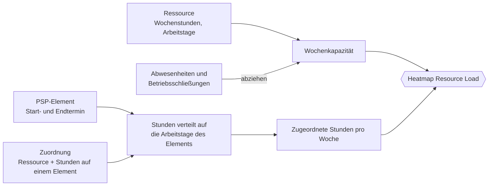
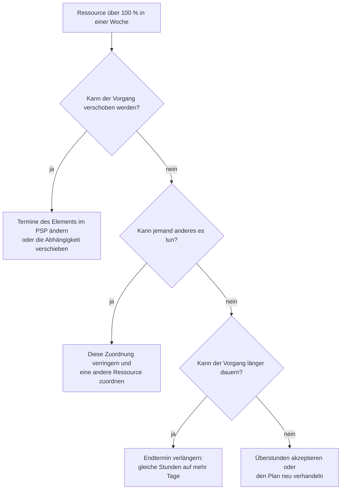

# Ressourcenzuordnung und Ressourcenauslastung

> **Sprache:** [English](../en/resource-load.md) · [Italiano](../it/resource-load.md) · [Français](../fr/resource-load.md) · Deutsch
> **Handbuchverzeichnis:** [README](../../README.md#user-manuals)

Zu wissen, *was* zu tun ist, ist die halbe Planung; die andere Hälfte ist zu wissen, *wer* es tun wird und ob diese Person Zeit hat. Open Project 365 beantwortet die zweite Frage mit **Zuordnungen** (Allocations: geplante Stunden einer Ressource auf einem PSP-Element) und dem Dashboard **Resource Load**, einer Heatmap, die Woche für Woche die einer Ressource über alle Projekte zugeordneten Stunden mit den Stunden vergleicht, die diese Ressource tatsächlich zur Verfügung hat.

Dieses Handbuch erklärt, wie Sie Ressourcen zuordnen, wie die Kapazität berechnet wird, wie Sie die Heatmap lesen und wie Sie Überlastungen beheben.

> Feld- und Schaltflächennamen stehen auf Englisch, so wie sie auf dem Bildschirm erscheinen.

## Die Zutaten

| Zutat | Wo sie gepflegt wird | Handbuch |
|---|---|---|
| **Ressource** mit Weekly Hours und Working Days | Master Data → Resources | [Stammdaten](master-data.md#ressourcen) |
| **Abwesenheiten** und **Betriebsschließungen** | Projects → Planning → Absences oder die Registerkarte Absences der Ressource | [Stammdaten](master-data.md#abwesenheiten-und-betriebsschließungen) |
| **PSP-Element** mit Start Date und End Date | Projekt → Registerkarte WBS | [PSP und Planung](wbs-and-planning.md) |
| **Zuordnung** | PSP-Element → Registerkarte Allocations | dieses Handbuch |

## Eine Ressource einem PSP-Element zuordnen

1. Öffnen Sie das PSP-Element (klicken Sie auf seinen Namen in der Registerkarte WBS des Projekts).
2. Gehen Sie zur Registerkarte **Allocations** und klicken Sie auf **+ New WBS Allocation**.
3. Wählen Sie die **Resource** und geben Sie die **Hours** ein, die Sie für diese Ressource auf diesem Element planen (müssen größer als null sein).
4. Speichern Sie.

| Feld | Bedeutung |
|---|---|
| **WBS Node** | Der Vorgang (die Zuordnung wird mit dem Element gelöscht) |
| **Resource** | Wer die Arbeit ausführt |
| **Hours** | Geplante Stunden dieser Ressource auf diesem Element (> 0) |
| **Name** | Beschreibung der Zuordnung |

Eine Ressource kann demselben Element nur einmal zugeordnet werden: Um die Stunden zu ändern, öffnen Sie die vorhandene Zuordnung. Demselben Element können mehrere Ressourcen zugeordnet werden (zum Beispiel ein Elektriker für 40 Stunden und ein Auszubildender für 24 Stunden).

> Zuordnungen sind ein **Plan**, kein Nachweis geleisteter Arbeit. Tatsächlich geleistete Stunden werden mit Zeiteinträgen erfasst ([Zeiterfassung](time-tracking.md)) und erscheinen als Actual Hours auf dem Element.

Tipp: Die **Budget Hours** des Elements sind Ihre Gesamtschätzung; die Summe seiner Zuordnungen ist die Aufteilung dieser Schätzung auf Personen. Wenn beide übereinstimmen, sind Budget und Auslastung verlässlich.

## Wie die Auslastung berechnet wird

### Kapazität

Für jede Ressource und jede Woche:

- **Tageskapazität** = Weekly Hours ÷ Anzahl der Working Days (zum Beispiel 40 ÷ 5 = 8 Stunden);
- jeder Arbeitstag trägt seine Tageskapazität bei; arbeitsfreie Tage tragen nichts bei;
- eine **Abwesenheit** entfernt den ganzen Tag oder, bei einer eintägigen Abwesenheit mit Stundenangabe, nur deren **Hours** (zum Beispiel 4 Stunden Freistellung);
- eine **Betriebsschließung** (eine Abwesenheit ohne Ressource) entfernt den Tag für alle.

### Zugeordnete Stunden

Für jede Zuordnung:

- die Stunden werden **gleichmäßig auf die Arbeitstage der Ressource** zwischen **Start Date** und **End Date** des Elements verteilt;
- der Anteil jedes Tages wird der Woche zugerechnet, in die er fällt, und unter dem Namen des Projekts geführt (im Tooltip angezeigt);
- Zuordnungen auf Elementen **ohne Termine** (oder mit Ende vor dem Beginn) lassen sich nicht im Kalender platzieren: Sie werden in der Spalte **No dates** summiert;
- gezählt werden nur aktive Zuordnungen auf aktiven Elementen aktiver Projekte (Offer, In Progress, Suspended); abgeschlossene Projekte belasten niemanden.

### Rechenbeispiel

Marco arbeitet 40 Stunden pro Woche, Montag bis Freitag. Er ist mit 60 Stunden „2.2.1 Elektro“ zugeordnet, das von Montag, 2. März, bis Freitag, 13. März, läuft (10 Arbeitstage), und mit 16 Stunden einem Element eines anderen Projekts, das von Montag, 9., bis Dienstag, 10. März, läuft. Am Freitag, 13. März, hat er Urlaub.

| Woche | Kapazität | Zugeordnet | Auslastung |
|---|---|---|---|
| 2.–6. März | 5 × 8 = 40 h | 60 ÷ 10 × 5 = 30 h | 75 % |
| 9.–13. März | 4 × 8 = 32 h (Freitag frei) | 30 h + 16 h = 46 h | 144 % — überlastet |

Beachten Sie, dass die Zuordnung auch am Urlaubstag zählt: Zuordnungen folgen den Terminen des Elements, Abwesenheiten verringern nur die Kapazität. Die Heatmap zeigt Ihnen, dass der Plan in seiner jetzigen Form nicht aufgeht.

## Das Dashboard Resource Load

Öffnen Sie **Projects → Planning → Resource Load**.

Darstellung der Heatmap (zugeordnete Stunden / Kapazität):

| Ressource | No dates | Woche ab 2. März | Woche ab 9. März | Woche ab 16. März |
|---|---|---|---|---|
| Giulia | 12 | ⬜ 16 / 40 | 🟨 38 / 40 | 🟨 40 / 40 |
| Marco | – | 🟩 30 / 40 | 🟥 46 / 32 | ⬜ 8 / 40 |

- **Zeilen**: aktive Ressourcen, alphabetisch sortiert.
- **Spalten**: die Wochen des Zeitfensters. Die erste Spalte, **No dates**, zeigt zugeordnete Stunden auf Elementen ohne Termine.
- **Zellen**: zugeordnete Stunden / Kapazität der Woche, eingefärbt nach Auslastung.
- **Tooltip** auf einer Zelle: zugeordnete Stunden, Kapazität und die Aufteilung der Stunden **nach Projekt**.

### Farbstufen

| Farbstufe | Auslastung | Bedeutung |
|---|---|---|
| ⬜ **Under 50%** | zugeordnet < 50 % der Kapazität | Viel Spielraum |
| 🟩 **50–90%** | 50 % bis 90 % | Gesunde Auslastung |
| 🟨 **90–100%** | 90 % bis 100 % | Voll ausgelastet |
| 🟥 **Over 100%** | über der Kapazität (oder Stunden bei Kapazität null) | Überlastet: Etwas muss sich bewegen |

Das Dashboard zeigt eine Legende mit diesen Stufen. (Die Emoji-Farben in diesem Handbuch deuten die Farben auf dem Bildschirm nur an.)

### Symbolleiste

| Steuerelement | Funktion |
|---|---|
| **Previous** / **Next** | Verschiebt das Zeitfenster um seine Länge zurück oder vor |
| **This week** | Kehrt zur aktuellen Woche zurück |
| **4 / 8 / 12 / 26 weeks** | Länge des Zeitfensters (Standard 8 Wochen) |
| **Refresh** | Lädt Ressourcen, Zuordnungen und Abwesenheiten neu |

## Eine Überlastung beheben

Wenn eine Zelle rot ist, haben Sie vier Hebel:

Klicken Sie nach jeder Änderung im Dashboard auf **Refresh**, um die Wirkung zu sehen.

## Bewährte Vorgehensweisen

- Geben Sie jedem Element, das zugeordnet wird, **Start- und Endtermine**: Sonst landen seine Stunden in der Spalte „No dates“ und erscheinen nie in einer Woche.
- Erfassen Sie **Abwesenheiten und Schließungen** im Voraus (Urlaub, Betriebsferien im August): Die Auslastung dieser Wochen wird dadurch realistisch.
- Halten Sie **Weekly Hours** und **Working Days** für Teilzeitkräfte und Trupps korrekt.
- Prüfen Sie das Dashboard mindestens wöchentlich mit den Projektleitern der Projekte, die sich Ressourcen teilen.

## Mögliche Meldungen

| Meldung | Bedeutung |
|---|---|
| „The resource load could not be loaded“ | Ein Netzwerk- oder Berechtigungsproblem: Refresh verwenden; besteht es weiter, Ihre Sicherheitsrollen prüfen |
| Fehler wegen doppeltem Schlüssel bei einer Zuordnung | Die Ressource ist dem Element bereits zugeordnet: Ändern Sie die vorhandene Zuordnung |
| Validierungsfehler bei Hours | Die Stunden müssen größer als null sein |
