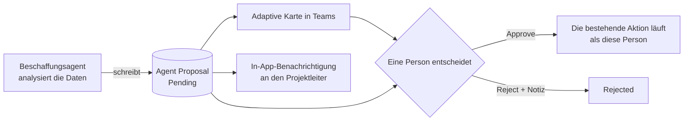
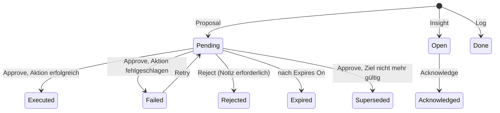
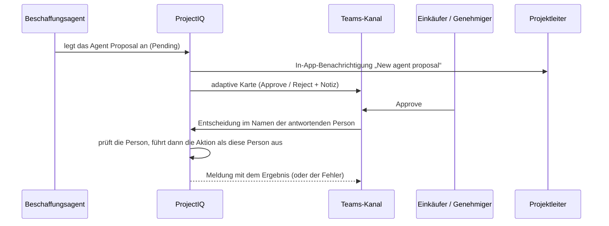
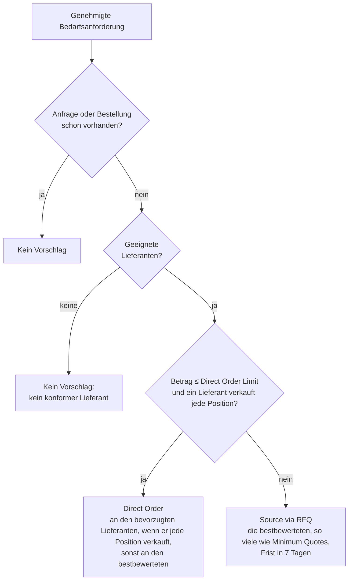

# Beschaffungsagent: Vorschläge, über die eine Person entscheidet

> **Sprache:** [English](../en/sourcing-agent.md) · [Italiano](../it/sourcing-agent.md) · [Français](../fr/sourcing-agent.md) · Deutsch
> **Handbuchverzeichnis:** [README](../../README.md#user-manuals)

Der **Beschaffungsagent** (Sourcing Agent) soll wie ein Sourcing Manager auf den Daten des [Einkaufs](purchasing.md) arbeiten: Er bereitet jede Beschaffungsentscheidung mit Zahlen und Begründung vor, damit Einkäufer nicht mehr Anforderungen, Angebote und Rechnungen „nur zur Kontrolle“ öffnen. Der Agent ändert Einkaufsdatensätze nie selbst. Er schreibt einen **Vorschlag** („diese Anforderung per Angebotsanfrage beschaffen“, „diese Angebotsanfrage an jenen Lieferanten vergeben“), eine Person liest die Begründung und entscheidet, und erst dann wird die Aktion ausgeführt, **mit der Identität und den Rechten der Person, die genehmigt hat**.

> **Demnächst.** Der Copilot-Studio-Agent, der die Vorschläge erstellt, wird in späteren Versionen geliefert, Aufgabe für Aufgabe. Diese Version liefert die Grundlagen: die Tabelle Agent Proposal, die Rollen, die Genehmigungskarte in Teams, die Befehle Approve, Reject, Retry und Acknowledge in der App, das Verfallen alter Vorschläge und die Benachrichtigungen. Solange der Agent nicht eingeschaltet ist, sind die Vorschlagsansichten leer; dieses Handbuch beschreibt, was Sie sehen und tun werden, wenn Vorschläge eintreffen.

## Was der Agent tut

Der Agent hat zehn Aufgaben, geliefert in der Reihenfolge der Einkaufskette. Jede Aufgabe endet in einem Vorschlag (eine Person entscheidet) oder in einer Insight- bzw. Protokollzeile (nur Information).

| # | Aufgabe | Ergebnis | Status |
|---|---|---|---|
| 1 | Eine genehmigte Bedarfsanforderung lenken: Angebotsanfrage oder Direktbestellung | Vorschlag **Source via RFQ** oder **Direct Order** | Analyse verfügbar ([wie](#wie-eine-anforderung-gelenkt-wird)); Agent folgt |
| 2 | Die einzuladenden Lieferanten wählen (verkaufte Artikel, gültige Dokumente, Preis, Lieferzeit, Antworten auf frühere Anfragen) | Einladungsliste im Vorschlag der Aufgabe 1 | Analyse verfügbar ([wie](#wie-eine-anforderung-gelenkt-wird)); Agent folgt |
| 3 | Die Angebote analysieren (Preis, Lieferung, Risiko) und die Vergabe empfehlen | Vorschlag **Award RFQ** | Geplant |
| 4 | Lieferanten erinnern, die eine Angebotsanfrage nicht beantwortet haben | E-Mail an den Lieferanten und Protokollzeile | Geplant |
| 5 | Lieferanten-Compliance: ablaufende oder abgelaufene Dokumente von Lieferanten mit offenen Angebotsanfragen oder Bestellungen | Insight **Compliance Alert** | Geplant |
| 6 | Dreifacher Abgleich von Rechnung, Bestellung und Wareneingang | Vorschlag **Approve Invoice** oder **Reject Invoice** | Geplant |
| 7 | Verspätete Bestellungen: bestätigt, über die Lieferzeit hinaus nicht eingegangen | E-Mail an den Lieferanten und Insight **Late Delivery** | Geplant |
| 8 | Projektbudget: verbleibendes PSP-Budget | Insight **Budget Alert** | Geplant |
| 9 | Ausgabenanalyse: zersplitterte Einkäufe über Projekte hinweg | Insight **Consolidation** | Geplant |
| 10 | Lieferantensuche und Onboarding | Insight **New Supplier Needed** und Vorschlag **Invite Supplier** | Geplant |
| – | Die in diesem Handbuch beschriebene Vorschlagsmechanik: Teams-Karte, App-Befehle, Verfall, Benachrichtigungen | – | Verfügbar |

Warum Vorschläge und keine direkten Aktionen: Der Einkauf bindet Geld und Verpflichtungen gegenüber Lieferanten. Die bestehenden Regeln (wer eine Angebotsanfrage versenden, vergeben oder eine Rechnung genehmigen darf) bleiben genau wie sie sind, und die Prüfspur zeigt die Person, die genehmigt hat, nicht einen Roboter. Die beim Ablehnen geschriebenen Notizen sind das Feedback, mit dem der Agent verbessert wird. Dies ist in [ADR 0003](../adr/0003-sourcing-agent-proposals.md) festgehalten; die schreibgeschützte Integration von Copilot und Cowork ([ADR 0001](../adr/0001-copilot-work-iq-read-only.md)) bleibt unberührt.

## Wer macht was

| Aktion | Wer darf es |
|---|---|
| Einen Vorschlag sehen | Mitglieder des Projekts (über das Projektteam), Einkäufer und Administratoren. Vorschläge ohne Projekt sehen nur Einkäufer und Administratoren |
| Die **Evidence** eines Vorschlags sehen | Benutzer mit dem Profil **OP365 Cost Visibility** |
| **Source via RFQ**, **Direct Order**, **Award RFQ** genehmigen oder ablehnen | Ein Administrator, ein Benutzer mit der Rolle **OP365 Buyer**, ein Projektleiter des Projekts des Vorschlags |
| **Invite Supplier** genehmigen oder ablehnen | Ein Administrator, ein Benutzer mit der Rolle **OP365 Buyer** |
| **Approve Invoice**, **Reject Invoice** genehmigen oder ablehnen | Der **Purchasing Approver**, ein Administrator (Funktionstrennung: Wer eine Bestellung vorbereitet, entscheidet nicht über deren Rechnung) |
| Einen fehlgeschlagenen Vorschlag mit **Retry** wiederholen | Wer über diesen Vorschlag hätte entscheiden dürfen |
| Ein Insight mit **Acknowledge** quittieren | Ein Administrator, ein Benutzer mit der Rolle **OP365 Buyer**, ein Projektleiter des Projekts des Insights |
| Vorschläge, Insights und Protokollzeilen anlegen | Nur der Beschaffungsagent (sein Anwendungsbenutzer) |
| Einen Vorschlag ändern | Niemand: Nur die **Decision Note** ist bearbeitbar, solange der Vorschlag Pending, Open oder Failed ist. Status ändern sich nur über die Befehle |

„Administrator“ bedeutet ein Benutzer mit der Rolle **OP365 Administrator** oder **System Administrator**. Die Rolle **OP365 Buyer** erlaubt auch die Einkaufsaktionen, die Projektleitern und Administratoren vorbehalten waren (Angebotsanfragen anlegen, versenden, vergeben und stornieren, Bestellungen anlegen, Bestellstatus ändern, Bedarfsanforderungen und Wareneingänge stornieren), in jedem Projekt; siehe [Einkauf](purchasing.md#wer-macht-was). Der Projektleiter des Projekts des Vorschlags erhält eine In-App-Benachrichtigung, wenn ein Vorschlag eintrifft.

## Vorschläge des Agenten

Ein **Agent Proposal** ist eine Zeile der gleichnamigen Tabelle. Sein **Kind** sagt, was es ist:

| Kind | Bedeutung | Beginnt als |
|---|---|---|
| **Proposal** | Wartet auf eine Entscheidung. Wird er genehmigt, läuft die Aktion | Pending |
| **Insight** | Eine Feststellung, die gelesen und quittiert werden soll | Open |
| **Log** | Hält fest, was der Agent bereits getan hat (zum Beispiel eine versandte Erinnerung) | Done |

### Felder

| Feld | Bedeutung |
|---|---|
| **Name** | Wird als „{Action Type} – {Datensatz}“ erzeugt, zum Beispiel „Award RFQ – RFQ-00012“, wenn der Agent ihn leer lässt |
| **Kind**, **Action Type** | Was die Zeile ist und was sie vorschlägt oder meldet. Bei der Erstellung festgelegt |
| **Status** | Pending, Open, Failed (aktiv); Executed, Rejected, Expired, Superseded, Acknowledged, Done (inaktiv) |
| **Project**, **Purchase Request**, **RFQ**, **Invitation**, **Purchase Order**, **Supplier Invoice**, **Supplier** | Die Datensätze, um die es im Vorschlag geht, als aufrufbare Links |
| **Rationale** | Die vom Agenten geschriebene Erklärung: warum er das vorschlägt |
| **Evidence** | Das Ergebnis der Analyse hinter dem Vorschlag (JSON). Nur mit dem Profil **OP365 Cost Visibility** sichtbar |
| **Amount**, **Estimated Saving** | Wert der Bestellung, Vergabe oder Rechnung und die vom Agenten erwartete Einsparung |
| **Expires On** | Bei Vorschlägen: das Erstellungsdatum plus die Tage der Einstellung *Sourcing Proposal Expiry Days* (standardmäßig 5); **Retry** setzt es ab dem Tag des neuen Versuchs neu |
| **Decided By**, **Decided On**, **Decision Note** | Wer entschieden hat, wann, und die Notiz (bis zu 2.000 Zeichen; eine längere Notiz wird gekürzt). Zum Ablehnen ist eine Notiz erforderlich |
| **Result Id** | Der von der genehmigten Aktion erzeugte Datensatz (Angebotsanfrage, Bestellung…) |
| **Error** | Die Meldung der Aktion, wenn sie fehlgeschlagen ist |

Nicht im Formular: **Payload** (die Eingaben der Aktion, etwa die einzuladenden Lieferanten) und **Dedup Key**.

### Aktionstypen

| Action Type | Kind | Läuft bei Genehmigung | Entscheidet |
|---|---|---|---|
| **Source via RFQ** | Proposal | Legt die Angebotsanfrage aus der Bedarfsanforderung an, lädt die Lieferanten des Vorschlags ein und versendet sie | Einkäufer, Projektleiter, Administrator |
| **Direct Order** | Proposal | Legt die Bestellung als Entwurf an | Einkäufer, Projektleiter, Administrator |
| **Award RFQ** | Proposal | Vergibt die Angebotsanfrage an die Einladung des Vorschlags; legt die Bestellung als Entwurf an | Einkäufer, Projektleiter, Administrator |
| **Approve Invoice**, **Reject Invoice** | Proposal | Genehmigt oder lehnt die Lieferantenrechnung ab | Purchasing Approver, Administrator |
| **Invite Supplier** | Proposal | Sendet dem Kontakt des Vorschlags die Einladung zum Lieferantenportal | Einkäufer, Administrator |
| **Supplier Reminder** | Log | Nichts: Die E-Mail ist bereits versandt | – |
| **Compliance Alert**, **Budget Alert**, **Late Delivery**, **Consolidation**, **New Supplier Needed** | Insight | Nichts | – |

### Lebenszyklus

| Status | Aktiv | Bedeutung |
|---|---|---|
| **Pending** | Ja | Wartet auf eine Entscheidung |
| **Open** | Ja | Ein Insight, das noch niemand quittiert hat |
| **Failed** | Ja | Die Person hat genehmigt, aber die Aktion ist fehlgeschlagen; siehe **Error**. Kann wiederholt werden |
| **Executed** | Nein | Genehmigt und ausgeführt; **Result Id** zeigt auf den neuen Datensatz |
| **Rejected** | Nein | Mit einer Notiz abgelehnt |
| **Expired** | Nein | Niemand hat vor **Expires On** entschieden |
| **Superseded** | Nein | Zu spät genehmigt: Der Datensatz ist nicht mehr im erwarteten Status (zum Beispiel wurde die Angebotsanfrage schon von Hand vergeben), und es wurde nichts getan |
| **Acknowledged** | Nein | Ein Insight, das jemand gelesen hat |
| **Done** | Nein | Eine Protokollzeile |

Ein Vorschlag **Source via RFQ** oder **Direct Order** wird auch dann **Superseded**, wenn seine Bedarfsanforderung bereits eine nicht stornierte Angebotsanfrage oder Bestellung hat: Jemand hat die Anforderung inzwischen beschafft.

### Regeln

- **Ein offener Vorschlag pro Gegenstand.** Der Agent kann für denselben Datensatz und dieselbe Aktion keinen zweiten aktiven Vorschlag (Pending, Open oder Failed) anlegen: Das System lehnt mit „An open proposal for the same action already exists.“ ab. Ist der erste entschieden, verfallen oder superseded, ist ein neuer möglich.
- **Niemand bearbeitet einen Vorschlag.** Rationale, Evidence, Payload, Kind, Action Type und Verknüpfungen sind bei der Erstellung festgelegt; nur die **Decision Note** kann sich ändern, und nur bis zur Entscheidung („The Decision Note cannot be changed after the proposal is decided.“). Eine direkte Statusänderung wird mit „Use Approve, Reject, Retry or Acknowledge to change the status of an agent proposal.“ abgelehnt.
- **Nur die Befehle entscheiden.** Entscheidung, Person und Zeitpunkt schreibt das System, sie werden nie eingetippt.
- **Vorschläge verfallen.** Der Flow **Daily agent proposal expiry** läuft jeden Tag um 06:30 (mitteleuropäische Zeit) und setzt Pending-Vorschläge, deren **Expires On** vor heute liegt, auf **Expired**.

## Über einen Vorschlag entscheiden

Über einen Vorschlag kann in Teams oder in der App entschieden werden. Beides bewirkt dasselbe; die erste Entscheidung gilt, und ein späterer Klick erhält „This proposal has already been decided.“

### Aus Teams

Der Flow **Agent proposal approval** veröffentlicht für jeden neuen Vorschlag eine **adaptive Karte** im Teams-Kanal, den der Administrator gewählt hat (Einstellung *Sourcing Approval Team*). Die Karte zeigt Aktionstyp, Projekt, Lieferant, Betrag, die Begründung und einen Link zum Vorschlag in der App.

1. Lesen Sie die Karte. Öffnen Sie den Vorschlag in ProjectIQ, wenn Sie die Evidence sehen möchten.
2. Zum Genehmigen wählen Sie **Approve**. Die **Note** ist optional.
3. Zum Ablehnen geben Sie in **Note (required to reject)** einen Grund ein und wählen **Reject**.
4. Der Kanal erhält eine Meldung mit dem tatsächlichen Ergebnis: „Proposal ...: Executed (decided by ...).“ oder **Rejected**, oder **Superseded (nothing was done)**, wenn der Datensatz nicht mehr im erwarteten Status war (siehe [Lebenszyklus](#lebenszyklus)).

Die Entscheidung wird auf **Ihren** Namen erfasst, erkannt an der E-Mail-Adresse Ihres Teams-Kontos, und die Aktion läuft mit **Ihren** Rechten. Die antwortende Person muss daher ein ProjectIQ-Benutzer sein, der über diesen Vorschlag entscheiden darf; andernfalls zeigt der Kanal „You cannot decide this proposal.“ oder „The user who decided is not a ProjectIQ user.“ und nichts ändert sich: Der Vorschlag bleibt **Pending** und wird nicht Failed.

Schlägt die Aktion fehl (zum Beispiel kann die Angebotsanfrage nicht versendet werden), wird nichts angelegt, der Vorschlag wird **Failed** mit dem Grund in **Error**, und der Kanal zeigt „Proposal ... not decided: ...“. Lehnen Sie ohne Notiz ab, erscheint im Kanal „Add a note to reject the proposal.“ und der Vorschlag bleibt **Pending**: Lehnen Sie ihn erneut in der App ab, mit einer Notiz.

### In der App

Öffnen Sie den Vorschlag (im Abschnitt **Agent Proposals** des Projekts oder über den Link der Karte). Die Befehle stehen in der Befehlsleiste des Formulars **Agent Proposal** und erscheinen nur dort, wo sie gelten:

| Befehl | Sichtbar, wenn | Tut |
|---|---|---|
| **Approve** | Pending | Fragt nach Bestätigung („Approve this proposal? The agent's action runs with your identity.“) und führt die Aktion aus |
| **Reject** | Pending | Öffnet einen Dialog, der eine Notiz verlangt |
| **Retry** | Failed | Setzt den Vorschlag nach Bestätigung auf **Pending** zurück, löscht den Fehler und setzt ein neues **Expires On** |
| **Acknowledge** | Open | Markiert das Insight als **Acknowledged** |

1. Lesen Sie die **Rationale** und, wenn Sie das Profil haben, die **Evidence**.
2. Wählen Sie **Approve** und bestätigen Sie, oder **Reject** und schreiben Sie die Notiz.
3. Das Formular aktualisiert sich: Der Status ist **Executed** und **Result Id** zeigt den neuen Datensatz, oder **Failed** mit dem Grund, oder **Superseded**.

Schlägt die Aktion fehl, zeigt die App die Fehlermeldung und der Vorschlag wird **Failed**. Beheben Sie die Ursache (zum Beispiel wurde die Anforderung geändert oder die Frist ist verstrichen), wählen Sie dann **Retry** und genehmigen Sie erneut.

### Was bei der Genehmigung geschieht

Die Aktion läuft in einem Schritt im Namen der Person, die genehmigt hat; alle bestehenden Regeln gelten daher für diese Person: Statusprüfungen, „Only a manager of the project or a buyer can ...“ und die Regel der zweiten Stufe für Rechnungen.

| Action Type | Was läuft |
|---|---|
| **Source via RFQ** | Legt die Angebotsanfrage aus der Bedarfsanforderung an (mit den Lieferanten und der Frist des Vorschlags, falls vorhanden) und versendet sie dann. Schlägt der zweite Schritt fehl, wird auch die Angebotsanfrage nicht angelegt |
| **Direct Order** | Legt die Bestellung als Entwurf an (Lieferant des Vorschlags, sonst der bevorzugte Lieferant der Anforderung) |
| **Award RFQ** | Vergibt die Angebotsanfrage an die Einladung des Vorschlags |
| **Approve Invoice**, **Reject Invoice** | Entscheidet über die Lieferantenrechnung; die Notiz ist die Entscheidungsnotiz, sonst die gespeicherte, sonst die Notiz des Vorschlags |
| **Invite Supplier** | Lädt den Kontakt des Vorschlags zum Lieferantenportal ein |

Ein abgelehnter Vorschlag hinterlässt nichts: Der Agent legt nie Entwürfe an.

## Wie eine Anforderung gelenkt wird

Die Aufgaben 1 und 2 arbeiten auf einer **genehmigten** Bedarfsanforderung. Zwei schreibgeschützte Analysen rechnen; der Agent erklärt die Zahlen nur im Feld **Rationale** des Vorschlags und kopiert die Analyse in **Evidence**:

- **Sourcing Suggest Suppliers** ordnet die Lieferanten, die die Anforderung bedienen könnten;
- **Sourcing Route Request** wählt zwischen Angebotsanfrage und Direktbestellung und füllt Lieferanten und Frist des Vorschlags.

Beide lesen die Daten mit den Rechten des Aufrufers: ein Benutzer sieht nur die Lieferanten und Preise, die seine Rollen lesen dürfen.

**Kandidaten.** Der bevorzugte Lieferant der Anforderung, die Lieferanten der angeforderten Artikel (Artikel-Lieferanten-Zeilen und Standardlieferant des Artikels) und die Lieferanten, deren *Supplier Category* die *Category* eines angeforderten Artikels ist.

**Nicht geeignet** (zuletzt aufgeführt, nie eingeladen): inaktiv oder kein Lieferant, **Blocked** oder mit **abgelaufenen Dokumenten**. Bald ablaufende Dokumente sind nur ein Hinweis.

**Punktzahl** der geeigneten Lieferanten, von 100 plus Bonus:

| Teil | Punkte | Berechnung |
|---|---|---|
| Abgedeckte Positionen | 40 | Anteil der Positionen, deren Artikel der Lieferant verkauft |
| Preis | 25 | Niedrigster Lieferantenpreis ÷ Preis dieses Lieferanten, auf den Positionen mit Lieferantenpreis. Kein Preis erfasst: 12,5 |
| Lieferzeit | 15 | Kürzeste Lieferzeit ÷ Lieferzeit dieses Lieferanten (die längste seiner Artikel). Unbekannt: 7,5 |
| Antworten | 15 | Beantwortete ÷ abgeschlossene Angebotsanfragen der letzten 12 Monate (abgelehnt, beantwortet oder Frist abgelaufen). Keine Historie: 7,5 |
| Bevorzugter Lieferant | +5 | Der bevorzugte Lieferant der Anforderung |

Die Gründe (Betrag gegenüber dem Limit, gewählte Lieferanten, weniger Lieferanten als *Sourcing Minimum Quotes*) gehören zur Analyse, daher sagt der Vorschlag immer warum. Wenn Sie genehmigen, wird die Anfrage oder Bestellung genau so erstellt, als hätten Sie selbst **Create RFQ** oder **Create Purchase Order** verwendet, mit Ihren Rechten.

## Insights und Protokoll

Insights und Protokollzeilen sind Information. Ein **Insight** bleibt **Open**, bis es jemand mit **Acknowledge** quittiert (ein Administrator, ein Einkäufer oder der Projektleiter des Projekts des Insights); dann wird es **Acknowledged**. Eine **Log**-Zeile entsteht als **Done** und wird nie entschieden. Für Insights und Protokoll gibt es keine Teams-Karte.

Nutzen Sie die Ansicht **Agent Log** als Verlauf von allem, was der Agent vorgeschlagen, festgestellt oder getan hat.

## Ansichten

| Ansicht | Zeigt |
|---|---|
| **Open Agent Proposals** (Standard) | Vorschläge, die auf eine Entscheidung warten, frühester Verfall zuerst |
| **Agent Insights** | Offene Insights, neueste zuerst |
| **Agent Log** | Alles, aktiv oder nicht, neueste zuerst |
| **My Agent Decisions** | Die Vorschläge, die Sie genehmigt oder abgelehnt haben, die letzten zuerst |

Im Projektformular listet der Abschnitt **Agent Proposals** die Vorschläge dieses Projekts auf.

## Meldungen, die Sie sehen können

| Meldung | Wann |
|---|---|
| This proposal has already been decided. | Jemand hat zuerst entschieden (zum Beispiel in Teams), oder der Vorschlag ist nicht mehr Pending |
| Add a note to reject the proposal. | Reject ohne Notiz |
| Only failed proposals can be retried. | **Retry** bei einem Vorschlag, der nicht Failed ist |
| You cannot decide this proposal. | Sie dürfen über diesen Aktionstyp nicht entscheiden, siehe [Wer macht was](#wer-macht-was) |
| Only the sourcing agent can decide on behalf of another user. | Ein Versuch, im Namen einer anderen Person zu entscheiden |
| The user who decided is not a ProjectIQ user. | Das Teams-Konto der antwortenden Person ist kein ProjectIQ-Benutzer |
| The sourcing agent must give the user who decided. | Ein Aufruf des Sourcing-Agenten ohne die Person, die entschieden hat (der Agent entscheidet nie selbst) |
| Use Approve, Reject, Retry or Acknowledge to change the status of an agent proposal. | Eine direkte Statusänderung |
| An agent proposal cannot be changed after it is created. | Die Änderung eines anderen Feldes als Decision Note |
| The Decision Note cannot be changed after the proposal is decided. | Die Änderung der Decision Note einer Zeile Executed, Rejected, Expired, Superseded, Acknowledged oder Done |
| An open proposal for the same action already exists. | Ein doppelter Vorschlag |
| Set the Kind and the Action Type of the agent proposal. | Ein Vorschlag, der ohne beide angelegt wurde |
| The proposal has no invitation to award. | **Award RFQ** ohne Einladung |
| The proposal has no contact to invite. | **Invite Supplier** ohne Kontakt |
| Only a manager of the project or a buyer can ... | Eine Einkaufsaktion durch jemanden, der weder Projektleiter noch Einkäufer ist |

## Einrichtung und Einstellungen

Administratoren richten den Agenten einmal pro Umgebung ein: Anwendungsbenutzer, Rollen, die folgenden Einstellungen, die Teams-Verbindung und die beiden Flows. Die Schritte stehen in der [Checkliste für die Ersteinrichtung](administration.md#checkliste-für-die-ersteinrichtung) des Administrationshandbuchs.

| Einstellung | Wirkung auf Vorschläge |
|---|---|
| *Sourcing Agent Enabled* | No (Standard): Die Trigger des Agenten stoppen; offene Vorschläge können weiterhin entschieden werden |
| *Sourcing Agent User* | Der Anwendungsbenutzer des Agenten. Nur dieser Benutzer darf die entscheidende Person angeben (der Teams-Flow tut das) |
| *Sourcing Approval Team* | Teams-Team und -Kanal der Genehmigungskarten |
| *Sourcing Proposal Expiry Days* | Tage, bis ein ausstehender Vorschlag verfällt (5) |
| *Sourcing Direct Order Limit* | Geschätzter Betrag, bis zu dem eine Anforderung direkt bestellt werden kann ([Lenkung](#wie-eine-anforderung-gelenkt-wird)). Leer: immer eine Angebotsanfrage |
| *Sourcing Minimum Quotes* | Zu einer Angebotsanfrage eingeladene Lieferanten (3) |
| *Sourcing Reminder Days*, *Sourcing Budget Warning %* | Von den Aufgaben späterer Versionen genutzt |
