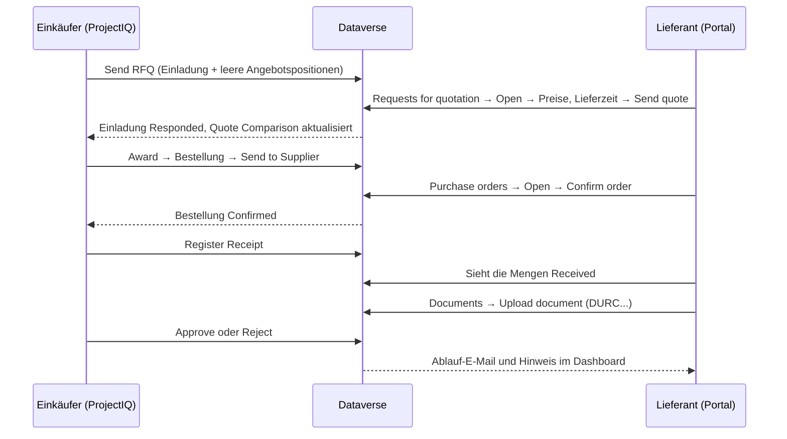
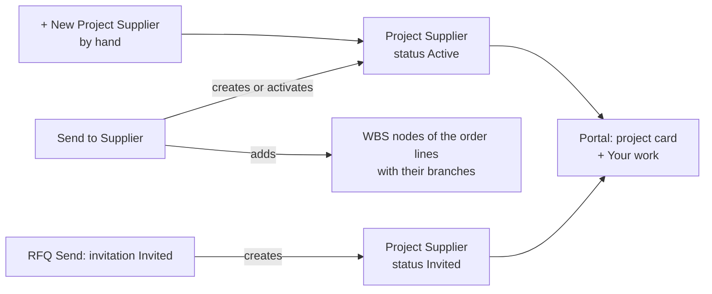
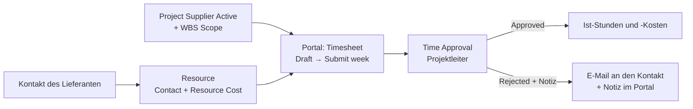
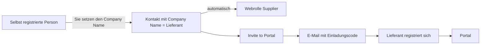

# Lieferantenportal

> **Sprache:** [English](../en/supplier-portal.md) · [Italiano](../it/supplier-portal.md) · [Français](../fr/supplier-portal.md) · Deutsch
> **Handbuchverzeichnis:** [README](../../README.md#user-manuals)

Das **Lieferantenportal** ist eine Website, erstellt mit Microsoft Power Pages auf derselben Dataverse-Datenbank wie ProjectIQ, auf der Ihre Lieferanten mit Ihnen zusammenarbeiten können, ohne E-Mails und Tabellen hin und her zu schicken. Im Portal kann ein Lieferant:

- auf einem **Dashboard** sehen, worauf Sie warten: zu beantwortende Angebotsanfragen, zu bestätigende Bestellungen, zu erneuernde Dokumente;
- die **Angebotsanfragen** sehen, die Sie ihm gesendet haben, **Stückpreise**, **Lieferzeit** und **Notizen** eingeben und sein Angebot senden — oder absagen;
- die **Bestellungen** sehen, die Sie ihm gesendet haben, mit Positionen und Beträgen, und sie **bestätigen**;
- sehen, welcher Teil jeder Bestellung bereits **geliefert** wurde;
- **seine Rechnungen hochladen** (FatturaPA-XML oder PDF): Die Daten werden automatisch gelesen und mit seinen Bestellungen abgeglichen, dann verfolgt er Genehmigung und **Zahlung**;
- die **Projekte** sehen, an denen er arbeitet, mit den ihm zugewiesenen Aktivitäten des Plans (PSP), und — wenn Sie es erlauben — deren **Fortschritt** aktualisieren;
- die **Stunden** seiner Mitarbeiter auf Ihren Projekten in einem wöchentlichen **Stundenzettel** erfassen, wenn Sie sie mit einer Ressource verknüpfen;
- seine **Unternehmensdokumente** (DURC, Zertifizierungen, Versicherungen) hochladen, die Ihr Einkäufer genehmigt, und wird vor ihrem Ablauf gewarnt.

Alles, was der Lieferant tut, ist sofort in ProjectIQ sichtbar: Angebote erscheinen im Quote Comparison der Angebotsanfrage, Bestätigungen ändern den Status der Bestellung, hochgeladene Dokumente warten auf Ihre Prüfung.

Dieses Handbuch hat zwei Teile: **Teil 1 für Lieferanten** (Sie können ihn an diese weitergeben) und **Teil 2 für Ihre internen Mitarbeiter**, die Lieferanten Zugriff geben und ihre Antworten verfolgen.

> Das Portal ist derzeit auf **Englisch**: Seiten- und Schaltflächennamen werden so wiedergegeben, wie sie auf dem Bildschirm erscheinen.

## Teil 1 — Leitfaden für Lieferanten

### Anmelden

Ihr Kunde gibt Ihnen Zugriff auf sein Lieferantenportal. Sie erhalten die Adresse des Portals (zum Beispiel `https://<kunde>-suppliers.powerappsportals.com`) und Anweisungen, wie Sie Ihr Konto anlegen oder aktivieren. Verwenden Sie die E-Mail-Adresse, die Ihr Kunde für Sie hinterlegt hat.

1. Öffnen Sie die Portaladresse und klicken Sie auf **Sign in**.
2. Melden Sie sich mit Ihrem Konto an: Geben Sie unter **Sign in with a local account** Ihre **Email** und Ihr **Password** ein (**Forgot your password?** sendet Ihnen einen Link zum Zurücksetzen), oder verwenden Sie **Microsoft Entra ID**, wenn Ihr Kunde Ihnen ein Firmenkonto gegeben hat. Noch kein Konto? Klicken Sie auf **Register**, oder auf **Redeem invitation**, wenn Sie einen Einladungscode erhalten haben.
3. Nach der Anmeldung öffnet das Portal das **Dashboard** (die Startseite leitet Sie dorthin; ist Ihr Konto noch keinem Lieferanten zugeordnet, werden Sie gebeten, sich an Ihren Kunden zu wenden). Links zeigt die Seitenleiste die Module: **Dashboard**, **Projects** (Projekte), **Requests for quotation** (Angebotsanfragen), **Purchase orders** (Bestellungen), **Invoices** (Rechnungen) und **Documents** (Dokumente). Ein blauer Zähler zeigt die zu beantwortenden Angebotsanfragen und die zu bestätigenden Bestellungen; ein orangefarbener Zähler die zu erneuernden oder zu korrigierenden Dokumente. Unten finden Sie Ihr Unternehmen, Ihren Namen und **Sign out**.

Zeigt eine Seite „This area is reserved to suppliers. Sign in with the account your customer invited.“, sind Sie nicht angemeldet oder Ihr Konto ist noch nicht als Lieferant aktiviert: Wenden Sie sich an Ihren Kunden.

Sie sehen nur die Daten **Ihres Unternehmens**. Ihre Kollegen mit eigenem Konto sehen dieselben Daten.

### Das Dashboard

Das **Dashboard** ist die Startseite:

| Bereich | Was er zeigt |
|---|---|
| Zähler | **Requests to quote** (zu beantwortende Angebotsanfragen), **Orders to confirm** (zu bestätigende Bestellungen), den Betrag **Ordered** im laufenden Jahr (bestätigte und gelieferte Bestellungen) und die **Invoices under review** (Rechnungen in Prüfung) |
| **Document compliance** | Ein Ring mit dem Anteil Ihrer genehmigten Dokumente, die gültig (grün), innerhalb von 30 Tagen ablaufend (orange) oder abgelaufen (rot) sind, sowie wie viele auf Prüfung warten oder abgelehnt wurden |
| **To do** | Eine Zeile für alles, worauf Ihr Kunde wartet: abgelaufene Dokumente zum Erneuern, abgelehnte Dokumente zum Korrigieren, Angebotsanfragen zum Beantworten (mit Frist), Bestellungen zum Bestätigen, bald ablaufende Dokumente. Klicken Sie auf eine Zeile, um die passende Seite zu öffnen |
| **Your projects** | Die ersten Projektkarten (siehe unten), mit **All projects** für die vollständige Liste |

### Projekte

**Projects** zeigt eine Karte je Projekt, das Ihr Kunde Ihrem Unternehmen zugewiesen hat: Code und Name (mit Ihrer **Rolle**, falls angegeben), **Project progress** (Projektfortschritt), **Your deliveries** (der bereits gelieferte Anteil Ihres bestellten Betrags, nur wenn Sie Bestellungen haben), **Start date**, **End date** und die Anzahl der **Orders**. Ein Projekt erscheint, wenn Ihr Kunde Sie zu einer Angebotsanfrage einlädt (Badge **Invited**), Ihnen eine Bestellung sendet oder Sie dem Projekt hinzufügt. Ein Projekt mit einer zu bestätigenden Bestellung hat einen orangefarbenen Rahmen.

**Open project** zeigt den Projektkopf (Code, Start- und Enddatum, Fortschritt) und unter **Your work** die Ihrem Unternehmen zugewiesenen Aktivitäten des Plans: **Code**, **Activity**, **Start**, **End** und **Progress**. Budgets und Kosten werden nie angezeigt.

### Den Fortschritt Ihrer Aktivitäten aktualisieren

Wenn Ihr Kunde es erlaubt, ist der **Progress** jeder Aktivität ohne Unteraktivitäten ein Feld mit **Save**: Geben Sie den Prozentsatz (0–100) ein und klicken Sie auf **Save**. Der Fortschritt der Sammelaktivitäten (fett) und des Projekts wird daraus berechnet und kann daher nicht eingegeben werden. Erlaubt Ihr Kunde es nicht, sehen Sie nur die Fortschrittsbalken.

### Eine Angebotsanfrage beantworten

1. Klicken Sie auf **Requests for quotation**. Jede Angebotsanfrage ist eine Karte mit Einladungsdatum, Nummer, Betreff, dem Betrag **Quoted**, sobald Ihre Antwort gesendet ist, und einem Balken, der die verbleibende Zeit bis zur **Deadline** (Frist) zeigt (er wird orange und dann rot, je näher die Frist rückt). Die Schaltflächen oben filtern die Karten: **All**, **To quote**, **Quoted**, **Closed**.

| Kennzeichen der Karte | Bedeutung |
|---|---|
| **To quote** | Wartet auf Ihr Angebot (orangefarbener Rahmen) |
| **Quoted** | Sie haben ein Angebot gesendet (bis zur Frist änderbar) |
| **Declined** / **Closed** | Sie haben abgesagt, oder die Frist ist abgelaufen |

2. Klicken Sie auf der Karte auf **Quote now** (oder **Change quote**, **Open**). Sie sehen Nummer, Frist, die Notizen Ihres Kunden und die Liste der Artikel mit Menge und Einheit.
3. Geben Sie für jede Position den **Unit price** (Stückpreis) und bei Bedarf **Notes** ein (Marke, Alternativprodukt, Konditionen...).
4. Geben Sie die **Delivery days** (Lieferzeit in Tagen nach Bestellung) und gegebenenfalls **Notes for the buyer** (Notizen für den Einkäufer) ein.
5. Klicken Sie auf **Send quote**. Eine grüne Meldung bestätigt: „Your quote has been sent. You can change it until the deadline.“

Gut zu wissen:

- Sie können eine Position ohne Preis lassen, wenn Sie diesen Artikel nicht liefern: „Lines without a price are not quoted.“ Wenn Sie alle Positionen anbieten, steigen Ihre Chancen, da die beste Summe nur unter Lieferanten ermittelt wird, die alle Positionen angeboten haben.
- Sie können zurückkehren und **die Preise bis zur Frist ändern**. Nach Ablauf der Frist (oder nach einer Absage) sind die Felder schreibgeschützt.
- Wenn Sie nicht antworten können, klicken Sie auf **Decline** und bestätigen Sie. Die Angebotsanfrage wird als Declined gekennzeichnet.
- Der Betrag **Quoted** in der Liste ist die Summe Menge × Stückpreis über alle Ihre Positionen.

### Eine Bestellung bestätigen

1. Klicken Sie auf **Purchase orders**. Jede Bestellung ist eine Karte mit Projekt, Bestelldatum, Nummer und Gesamtbetrag. Bestellungen, die auf Ihre Bestätigung warten, sind mit **To confirm** gekennzeichnet und zeigen erwartete Lieferung, Zahlungsbedingungen und Lieferort; die anderen zeigen einen Balken **Received** (geliefert). Die Schaltflächen oben filtern die Karten: **All**, **To confirm**, **Confirmed**, **Received**.
2. Klicken Sie auf **Review and confirm** (oder **Open**). Sie sehen Bestelldatum, erwartete Lieferung, **Delivery place** (Lieferort), **Payment terms** (Zahlungsbedingungen), Status und die Positionen mit Menge, Stückpreis, Betrag und bereits **Received** (gelieferter) Menge.
3. Prüfen Sie die Bestellung, klicken Sie auf **Confirm order** und bestätigen Sie. Der Status wird **Confirmed** mit dem Bestätigungsdatum.

| Angezeigter Status | Bedeutung |
|---|---|
| **To confirm** | Die Bestellung wurde Ihnen gesendet und wartet auf Ihre Bestätigung |
| **Confirmed** | Sie (oder der Einkäufer in Ihrem Namen) haben sie bestätigt |
| **Received** | Die gesamte Ware ist bei Ihrem Kunden eingegangen |

Stimmt etwas an der Bestellung nicht (Preis, Menge, Termin), bestätigen Sie sie nicht: Wenden Sie sich an den Einkäufer, der die Bestellung korrigiert und erneut sendet.

### Rechnungen

Unter **Invoices** senden Sie Ihre Rechnungen an Ihren Kunden und verfolgen sie bis zur Zahlung.

**Rechnungen senden**

1. Ziehen Sie Ihre Rechnungsdateien auf den Upload-Bereich oder klicken Sie auf **Choose files**. Sie können mehrere auf einmal senden: FatturaPA-**XML** (auch signiert `.p7m`), **PDF** oder Bilder, je bis 10 MB.
2. Jede Datei erscheint unter **To send** mit *Reading…*: Das Portal liest die Daten in wenigen Sekunden selbst (die Seite aktualisiert sich).
3. Jede Rechnung erhält einen Status:

| Status | Bedeutung | Was tun |
|---|---|---|
| **Ready** | Daten gelesen, Bestellung gefunden, Beträge stimmig | Nichts: senden |
| **To check** | Etwas braucht Ihren Blick: ein mit geringer Konfidenz gelesener Wert, die zu wählende Bestellung, eine Abweichung von der Bestellung | Auf **Check** klicken |
| **Blocked** | Sie haben in diesem Jahr bereits eine Rechnung mit dieser Nummer gesendet | Auf **Delete** klicken |

4. Klicken Sie auf **Send the N ready invoices**, um alle fertigen Rechnungen zusammen zu senden.

**Eine Rechnung prüfen**

**Check** (oder **Open**) zeigt links die Datei und rechts die daraus gelesenen Daten. Zu prüfende Felder sind orange markiert, und der gelbe Kasten erklärt warum. Unter **Lines and order** wird jede Position mit der Bestellung verglichen: **Same** (gleich), die Abweichung (zum Beispiel **+84.00**) oder **Not on the order** (nicht in der Bestellung). Korrigieren Sie bei Bedarf **Invoice number**, **Invoice date**, **Due date** oder **Purchase order** und schreiben Sie eine **Note for your customer**, wenn Sie etwas anderes als die Bestellung berechnen (zum Beispiel auf der Baustelle vereinbarte Mehrstunden). **Save and check** speichert und prüft erneut; dann **Send invoice**. **Delete** löscht eine noch nicht gesendete Rechnung.

Aus einer XML-Datei stammt jeder Wert aus der elektronischen Rechnung; aus einem PDF liest die KI die Werte: Prüfen Sie sie immer vor dem Senden. Eine gesendete Rechnung kann nicht mehr geändert werden: Ist sie falsch, bitten Sie Ihren Kunden, sie abzulehnen, und senden Sie sie erneut.

**Gesendete Rechnungen verfolgen**

Unter **Sent** finden Sie die Summen **Under review** (in Prüfung), **To be paid** (zu zahlen), **Paid** im laufenden Jahr und **Rejected**, dann eine Karte je Rechnung mit Bestellung und Projekt, Nummer, Betrag, Dokumenttyp und Daten. Die Schritte **Sent → Approved → Scheduled → Paid** (oder **Rejected**, in Rot) zeigen, wo sie steht; eine abgelehnte Rechnung zeigt den **Reason** (Grund), eine bezahlte Betrag, Datum und Überweisungsreferenz. Die Schaltflächen oben filtern die Karten.

### Unternehmensdokumente

**Documents** listet die Dokumente, die Ihr Kunde von Ihrem Unternehmen benötigt (DURC, Handelsregisterauszug, Zertifizierungen, Versicherungen, Verträge), mit **Number**, **Issued** (Ausstellung), **Expires** (Ablauf) und zwei Kennzeichen:

| Spalte | Kennzeichen |
|---|---|
| **Expiry** | **Valid** (gültig), **Expiring** (läuft innerhalb von 30 Tagen ab), **Expired** (abgelaufen), **Replaced** (ein neueres Dokument desselben Typs wurde genehmigt), **No expiry** (ohne Ablauf) |
| **Review** | **Pending review** (der Einkäufer hat es noch nicht geprüft), **Approved**, **Rejected** (mit Grund) |

So laden Sie ein Dokument hoch:

1. Klicken Sie auf **New document** (oder scrollen Sie zum Formular unten auf der Seite).
2. Wählen Sie den **Type** (Typ), geben Sie eine **Description** und, falls vorhanden, **Number**, **Issue date**, **Expiry date** und **Notes** ein.
3. Wählen Sie die **File** (PDF oder Bild, bis 32 MB) und klicken Sie auf **Upload document**.

Das Dokument bleibt **Pending review**, bis der Einkäufer es genehmigt. Solange es in Prüfung oder abgelehnt ist, können Sie **Edit** (Daten oder Datei ändern, dann **Save changes**) oder **Delete** klicken. Das Korrigieren eines abgelehnten Dokuments schickt es erneut in die Prüfung. Sobald es **Approved** ist, kann das Dokument nur noch angesehen werden: Zum Erneuern laden Sie ein neues Dokument desselben Typs hoch; sobald der Einkäufer es genehmigt, wird das alte **Replaced**. Sobald der Einkäufer es genehmigt, wandert die Datei in das Archiv Ihres Kunden: Die Liste zeigt **Filed by your customer** statt des Dateinamens.

Sie erhalten eine E-Mail, wenn ein genehmigtes Dokument bald abläuft (30 Tage vorher) und wenn es abläuft; das Dashboard zeigt dieselben Hinweise.

### Ihre Stunden erfassen (Timesheet)

Wenn Ihr Kunde Sie als **Ressource** seiner Projekte registriert hat, zeigt die Seitenleiste **Timesheet** (mit einem orangen Zähler, wenn Stunden abgelehnt wurden). Die Seite ist Ihr wöchentlicher Stundenzettel:

| Teil | Was er zeigt |
|---|---|
| **‹ Previous** / **Next ›** | Zwischen den Wochen wechseln; zuerst öffnet sich die aktuelle Woche |
| Zähler | Stunden **Hours this week**, **Draft**, **Submitted / Approved** und **Rejected** |
| Orange Notizen | Eine Zeile pro **Rejected**-Eintrag der Woche, mit der Notiz des Projektleiters |
| Raster | Eine Zeile pro Aktivität (Projektcode und -name, Aktivitätscode und -name), eine Spalte pro Tag von Montag bis Sonntag, die **Total** der Zeile und ihr **Status** |

1. Wählen Sie eine Aktivität in **+ Add activity**: Die Liste zeigt nur die Aktivitäten, die Ihr Kunde Ihrem Unternehmen zugewiesen hat, auf laufenden Projekten.
2. Geben Sie die Stunden jedes Tages ein (0–24, Viertelstunden erlaubt). Leeren Sie eine Zelle, um die Stunden dieses Tages zu entfernen.
3. Klicken Sie auf **Save draft**, um Ihre Arbeit zu speichern, oder auf **Submit week**, um alle Entwurfs- und abgelehnten Stunden der Woche zu speichern und zur Genehmigung einzureichen.

| Status | Bedeutung |
|---|---|
| **Draft** | Gespeichert, nicht gesendet: Sie können ihn noch ändern |
| **Submitted** | Wartet auf die Genehmigung Ihres Kunden: schreibgeschützt |
| **Approved** | Angenommen: schreibgeschützt |
| **Rejected** | Mit einer Notiz zurückgegeben (roter Rahmen): Korrigieren Sie die Stunden und klicken Sie erneut auf **Submit week**. Sie erhalten auch eine E-Mail |

### Fehler

Schlägt eine Aktion fehl, erklärt eine rote Meldung den Grund. Häufige Fälle: „Session expired: sign in again.“ (melden Sie sich erneut an und wiederholen Sie den Vorgang), „The deadline of the request for quotation has passed.“ (bitten Sie den Einkäufer um eine Fristverlängerung), „The request for quotation is closed.“ (sie wurde vergeben oder storniert), „Approved documents cannot be changed.“ oder „Approved documents cannot be deleted.“ (laden Sie stattdessen ein neues Dokument hoch), „Choose the file of the document.“ (ein neues Dokument braucht seine Datei), „Progress must be between 0 and 100.“, „Progress updates from the supplier portal are disabled.“ (Ihr Kunde hat sie deaktiviert), „Sent invoices cannot be changed.“ (bitten Sie Ihren Kunden, die Rechnung abzulehnen), „The invoice cannot be sent while it is being read or when it is a duplicate.“ (warten Sie einige Sekunden, oder löschen Sie das Duplikat), „Fill in the invoice number and date.“.
Im **Timesheet**: „You can record hours only on the activities assigned to your company.“, „Hours and materials can be recorded only on projects In Progress.“ (das Projekt ist ausgesetzt oder abgeschlossen), „Submitted or approved time entries cannot be changed.“ (bitten Sie Ihren Kunden, sie abzulehnen), „Hours must be between 0 and 24.“.

## Teil 2 — Leitfaden für interne Mitarbeiter

### Was das Portal zeigt

Das Portal ist bewusst eingeschränkt. Lieferanten lesen nur ihre eigenen Datensätze und können nur wenige Felder ändern:

| Daten | Der Lieferant kann lesen | Der Lieferant kann ändern |
|---|---|---|
| Einladungen zu Angebotsanfragen seines Unternehmens | Nummer, Frist, Notizen, Status, angebotener Betrag | **Delivery days**, **supplier notes**, **status** (nur auf Responded oder Declined) |
| Angebotspositionen dieser Einladungen | Artikel, Menge, Einheit, Preis, Notizen | **Unit price**, **notes** |
| Bestellungen seines Unternehmens (Sent, Confirmed, Received) | Kopf und Beträge | **Supplier confirmed** (bestätigt die Bestellung) |
| Positionen dieser Bestellungen | Artikel, Menge, Preis, Betrag, gelieferte Menge | Nichts |
| Projektlieferanten seines Unternehmens (Active und Invited) | Projekt, Rolle, Status | Nichts |
| Projekte dieser Projektlieferanten und seiner Bestellungen | Code, Name, Start- und Enddatum, Fortschritt | Nichts |
| PSP-Elemente seines Umfangs | Code, Name, Start- und Enddatum, Fortschritt | **Progress %** der Elemente ohne Unterelemente, nur wenn **Supplier Progress Updates** Yes ist |
| Seine Ressource (Contact = der Benutzer) und ihre Zeiteinträge | Name der Ressource und Wochenstunden; Datum, Stunden, Status und Entscheidungsnotiz der Einträge | **Draft**- oder **Rejected**-Einträge anlegen, ändern und löschen (Datum, Stunden, Aktivität des Umfangs) und **einreichen**. Nie Kosten oder Erlöse |
| Lieferantenrechnungen seines Unternehmens | Nummer, Daten, Beträge, Positionen, Status, Entscheidungsnotiz, Zahlung, Lesehinweise | Datei hochladen, **Rechnungsnummer**, **Daten**, **Bestellung** und **Lieferantennotiz**, solange Draft; **senden** (Draft → To Review), wenn nicht Pending oder Blocked; Entwürfe löschen |
| Lieferantendokumente seines Unternehmens | Alle Felder, einschließlich der Prüfnotiz | Typ, Beschreibung, Nummer, Daten, Notizen, Datei; kann sie anlegen und löschen, nur solange das Dokument nicht genehmigt ist |

Bestellungen im Entwurf oder stornierte Bestellungen und nicht versandte Angebotsanfragen werden nie angezeigt. Die Preise anderer Lieferanten, Budgets und Kosten sind nie sichtbar.

### Projektlieferanten und PSP-Umfang

Ein **Project Supplier** (Projektlieferant) gibt an, dass ein Lieferant an einem Projekt arbeitet und welche Aktivitäten des PSP er im Portal sieht (sein **WBS Scope**). Sie finden sie in der Liste **Suppliers** des Projekts (Registerkarte Purchasing) und in der Liste **Projects** des Lieferantenkontos.

- **Send** auf einer Angebotsanfrage macht jeden eingeladenen Lieferanten zu einem Projektlieferanten **Invited** (falls er es noch nicht ist).
- **Send to Supplier** auf einer Bestellung macht den Lieferanten **Active** und fügt seinem WBS Scope die PSP-Elemente der Bestellpositionen hinzu. Wird die Bestellung später storniert, bleiben der Projektlieferant und sein Umfang erhalten.
- Sie können einen Projektlieferanten von Hand über die Liste **Suppliers** des Projekts anlegen (**Project**, **Supplier**, **Role**) und in seiner Liste **WBS Scope** PSP-Elemente hinzufügen (**Add Existing WBS Node**). Ein Element bringt immer alle seine Unteraktivitäten mit, auch später angelegte.
- Um Aktivitäten auszublenden, entfernen Sie sie aus dem WBS Scope (das Entfernen eines Elements entfernt seine Unteraktivitäten nicht: entfernen Sie diese auch), oder deaktivieren Sie den Projektlieferanten, um das ganze Projekt auszublenden.
- Ob Lieferanten den Fortschritt aktualisieren dürfen, ist eine Unternehmenseinstellung, **Supplier Progress Updates** ([Administration](administration.md#unternehmenseinstellungen)); Standard ist No. *Can Update Progress* am Projektlieferanten zeigt den aktuellen Wert.

### Externe Ressourcen: Stunden aus dem Portal

Mitarbeiter eines Lieferanten können ihre Stunden im Portal erfassen, wenn Sie ihren **Kontakt** mit einer **Resource** verknüpfen ([Stammdaten](master-data.md#externe-ressourcen-personal-von-lieferanten)).

- Die Person kann Stunden nur auf den Aktivitäten des **WBS Scope** eines **Active** Projektlieferanten ihres Unternehmens erfassen, auf Projekten **In Progress**.
- **Submit week** funktioniert wie **Submit** im Stundenzettel: Die Einträge werden **Submitted** (oder sofort **Approved**, wenn **Time Approval Enabled** No ist), und die Projektleiter erhalten eine Benachrichtigung „<resource> submitted time entries on <project> from the supplier portal.“.
- Genehmigen oder lehnen Sie sie wie gewohnt in **Time Approval** ab. Bei einer Ablehnung erhält der Kontakt die E-Mail *ProjectIQ - Zeiteinträge abgelehnt* (Nachricht `TimeEntriesRejected`, versendet wie die anderen E-Mails an Lieferanten, siehe [Administration](administration.md#täglicher-dokumentenablauf)) und sieht Ihre Notiz im Portal.
- Die Kosten sind Stunden × Stundensatz der Ressource am Datum (der mit dem Lieferanten vereinbarte Satz). Der Lieferant sieht nie Kosten oder Erlöse.

### Einem Lieferanten Zugriff geben

Ein Lieferantenbenutzer ist ein **Kontakt**, dessen **Company Name** das Lieferantenkonto ist. ProjectIQ gibt einem solchen Kontakt automatisch die Webrolle **Supplier** und entzieht sie, wenn der Company Name kein Lieferant mehr ist: Webrollen weisen Sie nie von Hand zu.

1. Prüfen Sie in ProjectIQ, dass das Lieferantenkonto **Is Supplier**, **Active** und nicht **Blocked** ist.
2. Legen Sie den **Kontakt** der Person an (oder öffnen Sie ihn), mit **Company Name** = der Lieferant und ihrer **Email**.
3. Klicken Sie am Kontakt auf **Invite to Portal** und bestätigen Sie. Die Person erhält eine E-Mail mit einer Einladung (30 Tage gültig, einmal verwendbar): Damit legt sie ihr Konto an (E-Mail und Kennwort oder Microsoft), bereits mit dem Lieferanten verknüpft.
4. Senden Sie der Person [Teil 1](#teil-1--leitfaden-für-lieferanten) dieses Handbuchs.

**Invite to Portal** lehnt einen Kontakt ohne E-Mail ab („Add the e-mail address of the contact before inviting it to the supplier portal.“) oder einen, dessen Company Name kein Lieferant ist („Set a supplier as Company Name of the contact before inviting it to the supplier portal.“). Die E-Mail ist in der **Language** des Lieferanten verfasst und wird mit derselben Einrichtung wie die Ablauf-E-Mails versendet ([Administration](administration.md#täglicher-dokumentenablauf)); ohne sie erhalten Sie „The invitation e-mail could not be sent: check the environment variables op365_SupplierEmailSender and op365_SupplierEmailTemplates (PortalInvitation).“ und es wird keine Einladung angelegt. Die Einladungen finden Sie in Power Pages Management → *Invitations*.

Um den Zugriff zu entziehen, ändern Sie den Company Name des Kontakts (die Webrolle Supplier wird entfernt) oder deaktivieren Sie den Kontakt.

**Anmeldemethoden.** Neben Microsoft Entra ID bietet das Portal **lokale Konten** (E-Mail und Kennwort), damit sich auch Lieferanten außerhalb Ihres Tenants anmelden können. Personen können sich auch **selbst registrieren**: Eine selbst registrierte Person sieht nichts, bis Sie den **Company Name** ihres Kontakts auf den Lieferanten setzen, was ihr die Webrolle Supplier gibt; prüfen Sie neue Kontakte regelmäßig. Ihr Administrator kann lokale Konten oder die Selbstregistrierung ausschalten (dann können sich nur eingeladene Personen registrieren), siehe [Einrichtung der Entwicklungsumgebung](../dev-environment.md#supplier-portal-power-pages).

### Dokumente prüfen

Ein im Portal hochgeladenes Dokument ist **Pending Review**, und der Besitzer des Lieferantenkontos erhält die Benachrichtigung „Supplier document to review“. Öffnen Sie es aus der Benachrichtigung oder aus der Ansicht **Supplier Documents to Review**, prüfen Sie die Datei und klicken Sie auf **Approve** oder **Reject** (mit einer Notiz, die der Lieferant liest). Siehe [Stammdaten](master-data.md#prüfung). Ablauf-E-Mails an Lieferanten erfordern die in [Administration](administration.md#täglicher-dokumentenablauf) beschriebene Einrichtung.

### Antworten verfolgen

- In der Angebotsanfrage zeigt die Liste **Invitations** für jeden Lieferanten Status, **Responded On**, **Quoted Amount** und **Delivery Days**; der Zähler **Responses** zeigt, wie viele geantwortet haben.
- Die Registerkarte **Quote Comparison** zeigt die Angebote aus dem Portal neben den von Ihnen eingegebenen. Vergeben Sie wie in [Einkauf](purchasing.md#vergleichen-und-vergeben) beschrieben.
- Bestätigt ein Lieferant eine Bestellung im Portal, wechselt sie auf **Confirmed**, und *Supplier Confirmed* / *Confirmed On* werden gesetzt, genau als hätten Sie auf **Confirm** geklickt.

### Zu beachten

- Eine Angebotsanfrage erscheint erst nach **Send** im Portal; eine Bestellung erst nach **Send to Supplier**.
- Keine dieser Aktionen sendet von sich aus eine E-Mail: Teilen Sie dem Lieferanten mit, dass eine neue Angebotsanfrage oder Bestellung auf ihn wartet (über Ihre übliche E-Mail oder über eine Automatisierung, die Ihr Administrator hinzufügen kann).
- Setzen Sie eine Bestellung mit **Back to Draft** zurück, verschwindet sie aus dem Portal, bis sie erneut gesendet wird (das Projekt bleibt über den Projektlieferanten sichtbar).
- Nach Ablauf der Frist kann der Lieferant sein Angebot nicht mehr ändern: Verlängern Sie die **Deadline** und klicken Sie erneut auf **Send**, wenn Sie weitere Antworten möchten.

### Für Administratoren

Das Portal wird in einer eigenen Lösung, **OpenProject365SupplierPortal**, ausgeliefert, die von der Hauptlösung abhängt. Das Aussehen des Portals (Seitenleiste, Karten, Compliance-Ring) ist reines Liquid und CSS in den Webvorlagen **OP365 Supplier Style**, **OP365 Supplier Nav** und **OP365 Supplier Project Cards**. Einrichtung, Tabellenberechtigungen, Web-API-Einstellungen und Bereitstellungsschritte sind in [Development environment setup](../dev-environment.md#supplier-portal-power-pages) (auf Englisch) dokumentiert. Leeren Sie nach jeder Bereitstellung des Portals den Cache der Website (`/_services/about` → *Clear cache*, Web-Rolle Administrators) und melden Sie sich erneut an. In einer neuen Umgebung muss die importierte Website vor der Nutzung reaktiviert werden (Power Pages → *Inactive sites*).
