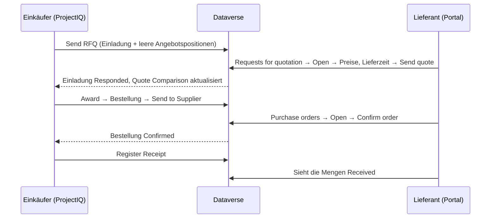

# Lieferantenportal

> **Sprache:** [English](../en/supplier-portal.md) · [Italiano](../it/supplier-portal.md) · [Français](../fr/supplier-portal.md) · Deutsch
> **Handbuchverzeichnis:** [README](../../README.md#user-manuals)

Das **Lieferantenportal** ist eine Website, erstellt mit Microsoft Power Pages auf derselben Dataverse-Datenbank wie ProjectIQ, auf der Ihre Lieferanten mit Ihnen zusammenarbeiten können, ohne E-Mails und Tabellen hin und her zu schicken. Im Portal kann ein Lieferant:

- die **Angebotsanfragen** sehen, die Sie ihm gesendet haben, **Stückpreise**, **Lieferzeit** und **Notizen** eingeben und sein Angebot senden — oder absagen;
- die **Bestellungen** sehen, die Sie ihm gesendet haben, mit Positionen und Beträgen, und sie **bestätigen**;
- sehen, welcher Teil jeder Bestellung bereits **geliefert** wurde.

Alles, was der Lieferant tut, ist sofort in ProjectIQ sichtbar: Angebote erscheinen im Quote Comparison der Angebotsanfrage, Bestätigungen ändern den Status der Bestellung.

Dieses Handbuch hat zwei Teile: **Teil 1 für Lieferanten** (Sie können ihn an diese weitergeben) und **Teil 2 für Ihre internen Mitarbeiter**, die Lieferanten Zugriff geben und ihre Antworten verfolgen.

> Das Portal ist derzeit auf **Englisch**: Seiten- und Schaltflächennamen werden so wiedergegeben, wie sie auf dem Bildschirm erscheinen.

## Teil 1 — Leitfaden für Lieferanten

### Anmelden

Ihr Kunde gibt Ihnen Zugriff auf sein Lieferantenportal. Sie erhalten die Adresse des Portals (zum Beispiel `https://<kunde>-suppliers.powerappsportals.com`) und Anweisungen, wie Sie Ihr Konto anlegen oder aktivieren. Verwenden Sie die E-Mail-Adresse, die Ihr Kunde für Sie hinterlegt hat.

1. Öffnen Sie die Portaladresse und klicken Sie auf **Sign in**.
2. Melden Sie sich mit Ihrem Konto an.
3. Das Menü zeigt **Requests for quotation** (Angebotsanfragen) und **Purchase orders** (Bestellungen).

Zeigt eine Seite „This area is reserved to suppliers. Sign in with the account your customer invited.“, sind Sie nicht angemeldet oder Ihr Konto ist noch nicht als Lieferant aktiviert: Wenden Sie sich an Ihren Kunden.

Sie sehen nur die Angebotsanfragen und Bestellungen **Ihres Unternehmens**. Ihre Kollegen mit eigenem Konto sehen dieselben Daten.

### Eine Angebotsanfrage beantworten

1. Klicken Sie auf **Requests for quotation**. Die Liste zeigt für jede Angebotsanfrage: Nummer, **Deadline** (Frist), **Status** und den Betrag **Quoted**, sobald Ihre Antwort gesendet ist.

| Status | Bedeutung |
|---|---|
| **Invited** | Wartet auf Ihr Angebot |
| **Responded** | Sie haben ein Angebot gesendet (bis zur Frist änderbar) |
| **Declined** | Sie haben abgesagt |

2. Klicken Sie auf **Open**. Sie sehen Nummer, Frist, die Notizen Ihres Kunden und die Liste der Artikel mit Menge und Einheit.
3. Geben Sie für jede Position den **Unit price** (Stückpreis) und bei Bedarf **Notes** ein (Marke, Alternativprodukt, Konditionen...).
4. Geben Sie die **Delivery days** (Lieferzeit in Tagen nach Bestellung) und gegebenenfalls **Notes for the buyer** (Notizen für den Einkäufer) ein.
5. Klicken Sie auf **Send quote**. Eine grüne Meldung bestätigt: „Your quote has been sent. You can change it until the deadline.“

Gut zu wissen:

- Sie können eine Position ohne Preis lassen, wenn Sie diesen Artikel nicht liefern: „Lines without a price are not quoted.“ Wenn Sie alle Positionen anbieten, steigen Ihre Chancen, da die beste Summe nur unter Lieferanten ermittelt wird, die alle Positionen angeboten haben.
- Sie können zurückkehren und **die Preise bis zur Frist ändern**. Nach Ablauf der Frist (oder nach einer Absage) sind die Felder schreibgeschützt.
- Wenn Sie nicht antworten können, klicken Sie auf **Decline** und bestätigen Sie. Die Angebotsanfrage wird als Declined gekennzeichnet.
- Der Betrag **Quoted** in der Liste ist die Summe Menge × Stückpreis über alle Ihre Positionen.

### Eine Bestellung bestätigen

1. Klicken Sie auf **Purchase orders**. Die Liste zeigt Nummer, **Date** (Bestelldatum), **Expected delivery** (erwartete Lieferung), **Status** und **Total**. Bestellungen, die auf Ihre Bestätigung warten, sind mit **To confirm** gekennzeichnet.
2. Klicken Sie auf **Open**. Sie sehen Bestelldatum, erwartete Lieferung, **Delivery place** (Lieferort), **Payment terms** (Zahlungsbedingungen), Status und die Positionen mit Menge, Stückpreis, Betrag und bereits **Received** (gelieferter) Menge.
3. Prüfen Sie die Bestellung, klicken Sie auf **Confirm order** und bestätigen Sie. Der Status wird **Confirmed** mit dem Bestätigungsdatum.

| Angezeigter Status | Bedeutung |
|---|---|
| **To confirm** | Die Bestellung wurde Ihnen gesendet und wartet auf Ihre Bestätigung |
| **Confirmed** | Sie (oder der Einkäufer in Ihrem Namen) haben sie bestätigt |
| **Received** | Die gesamte Ware ist bei Ihrem Kunden eingegangen |

Stimmt etwas an der Bestellung nicht (Preis, Menge, Termin), bestätigen Sie sie nicht: Wenden Sie sich an den Einkäufer, der die Bestellung korrigiert und erneut sendet.

### Fehler

Schlägt eine Aktion fehl, erklärt eine rote Meldung den Grund. Häufige Fälle: „Session expired: sign in again.“ (melden Sie sich erneut an und wiederholen Sie den Vorgang), „The deadline of the request for quotation has passed.“ (bitten Sie den Einkäufer um eine Fristverlängerung), „The request for quotation is closed.“ (sie wurde vergeben oder storniert).

## Teil 2 — Leitfaden für interne Mitarbeiter

### Was das Portal zeigt

Das Portal ist bewusst eingeschränkt. Lieferanten lesen nur ihre eigenen Datensätze und können nur wenige Felder ändern:

| Daten | Der Lieferant kann lesen | Der Lieferant kann ändern |
|---|---|---|
| Einladungen zu Angebotsanfragen seines Unternehmens | Nummer, Frist, Notizen, Status, angebotener Betrag | **Delivery days**, **supplier notes**, **status** (nur auf Responded oder Declined) |
| Angebotspositionen dieser Einladungen | Artikel, Menge, Einheit, Preis, Notizen | **Unit price**, **notes** |
| Bestellungen seines Unternehmens (Sent, Confirmed, Received) | Kopf und Beträge | **Supplier confirmed** (bestätigt die Bestellung) |
| Positionen dieser Bestellungen | Artikel, Menge, Preis, Betrag, gelieferte Menge | Nichts |

Bestellungen im Entwurf oder stornierte Bestellungen und nicht versandte Angebotsanfragen werden nie angezeigt. Die Preise anderer Lieferanten sind nie sichtbar.

### Einem Lieferanten Zugriff geben

Ein Lieferantenbenutzer ist ein **Kontakt**, dessen **Unternehmen** der Lieferanten-Account ist, mit der Web-Rolle **Supplier**.

1. Prüfen Sie in ProjectIQ, ob der Lieferanten-Account **Is Supplier**, **Active** und nicht **Blocked** ist und eine gültige **Email** hat.
2. Legen Sie den **Kontakt** der Person an (oder öffnen Sie ihn), mit **Company Name** = der Lieferant und ihrer E-Mail-Adresse.
3. Weisen Sie dem Kontakt in **Power Pages Management** (oder im Studio des Portals, *Set up → Web roles*) die Web-Rolle **Supplier** zu.
4. Ermöglichen Sie der Person die Anmeldung mit der auf Ihrer Website konfigurierten Methode (zum Beispiel durch Senden einer **Einladung** aus Power Pages Management → *Invitations* oder indem Sie sie sich mit der hinterlegten E-Mail registrieren lassen).
5. Senden Sie ihr die Portaladresse und [Teil 1](#teil-1--leitfaden-für-lieferanten) dieses Handbuchs.

Um den Zugriff zu entziehen, entfernen Sie die Web-Rolle Supplier vom Kontakt oder deaktivieren Sie den Kontakt.

### Antworten verfolgen

- In der Angebotsanfrage zeigt die Liste **Invitations** für jeden Lieferanten Status, **Responded On**, **Quoted Amount** und **Delivery Days**; der Zähler **Responses** zeigt, wie viele geantwortet haben.
- Die Registerkarte **Quote Comparison** zeigt die Angebote aus dem Portal neben den von Ihnen eingegebenen. Vergeben Sie wie in [Einkauf](purchasing.md#vergleichen-und-vergeben) beschrieben.
- Bestätigt ein Lieferant eine Bestellung im Portal, wechselt sie auf **Confirmed**, und *Supplier Confirmed* / *Confirmed On* werden gesetzt, genau als hätten Sie auf **Confirm** geklickt.

### Zu beachten

- Eine Angebotsanfrage erscheint erst nach **Send** im Portal; eine Bestellung erst nach **Send to Supplier**.
- Keine dieser Aktionen sendet von sich aus eine E-Mail: Teilen Sie dem Lieferanten mit, dass eine neue Angebotsanfrage oder Bestellung auf ihn wartet (über Ihre übliche E-Mail oder über eine Automatisierung, die Ihr Administrator hinzufügen kann).
- Setzen Sie eine Bestellung mit **Back to Draft** zurück, verschwindet sie aus dem Portal, bis sie erneut gesendet wird.
- Nach Ablauf der Frist kann der Lieferant sein Angebot nicht mehr ändern: Verlängern Sie die **Deadline** und klicken Sie erneut auf **Send**, wenn Sie weitere Antworten möchten.

### Für Administratoren

Das Portal wird in einer eigenen Lösung, **OpenProject365SupplierPortal**, ausgeliefert, die von der Hauptlösung abhängt. Einrichtung, Tabellenberechtigungen, Web-API-Einstellungen und Bereitstellungsschritte sind in [Development environment setup](../dev-environment.md#supplier-portal-power-pages) (auf Englisch) dokumentiert. Leeren Sie nach jeder Bereitstellung des Portals den Cache der Website (`/_services/about` → *Clear cache*, Web-Rolle Administrators) und melden Sie sich erneut an. In einer neuen Umgebung muss die importierte Website vor der Nutzung reaktiviert werden (Power Pages → *Inactive sites*).
