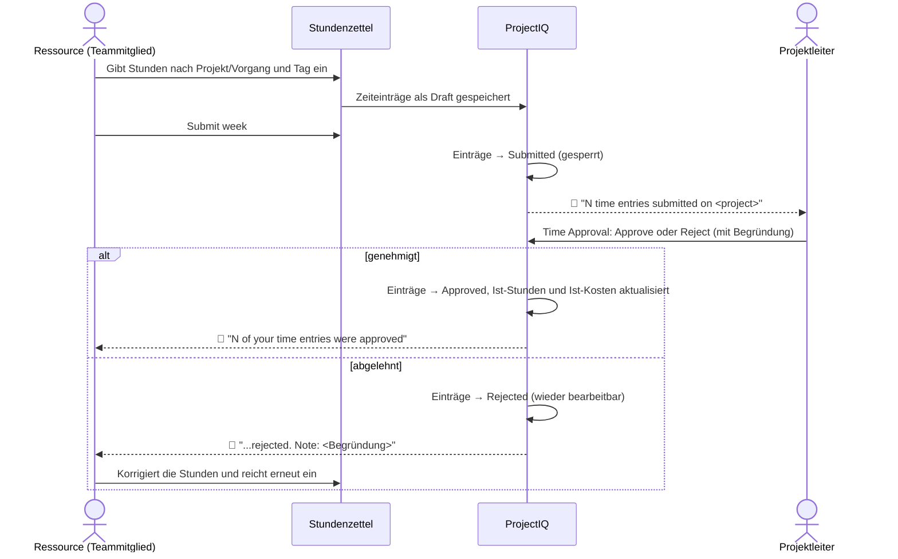
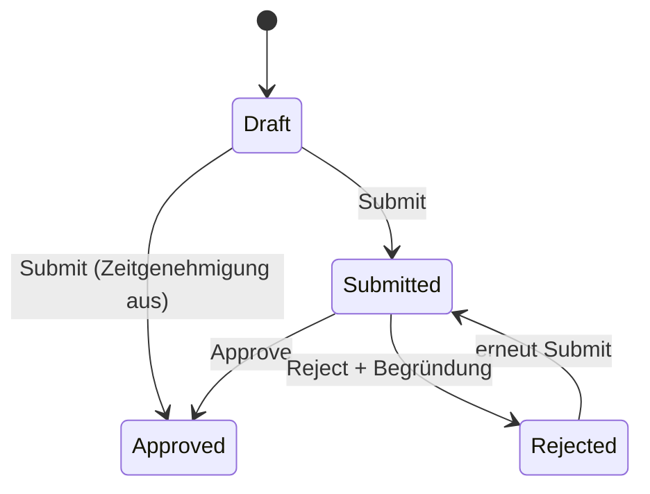
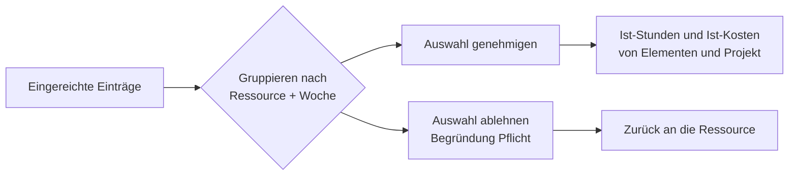

# Zeiterfassung: Stundenzettel, Genehmigung und Erinnerungen

> **Sprache:** [English](../en/time-tracking.md) · [Italiano](../it/time-tracking.md) · [Français](../fr/time-tracking.md) · Deutsch
> **Handbuchverzeichnis:** [README](../../README.md#user-manuals)

Stunden sind meist der größte Kostenblock eines Auftrags und am schwierigsten rechtzeitig zu erfassen. ProjectIQ macht ihre Erfassung zur wöchentlichen Routine: Jede Person füllt einen **Wochenstundenzettel** nach Projekt und Vorgang aus, reicht die Woche ein, und die Projektleiter **genehmigen** oder **lehnen** die Stunden über einen einzigen Bildschirm **ab**. Genehmigte Stunden werden zu **Ist-Stunden und Ist-Kosten** der PSP-Elemente und des Projekts, bewertet mit dem Stundensatz, der an dem Tag galt. Eine **tägliche Erinnerung** benachrichtigt Personen, die vergessen haben, ihre Stunden zu erfassen.

Dieses Handbuch richtet sich an alle, die Stunden erfassen (Teil 1), an die Projektleiter, die sie genehmigen (Teil 2), und an Administratoren, die den Ablauf konfigurieren (Teil 3).

> Feld- und Schaltflächennamen stehen auf Englisch, so wie sie auf dem Bildschirm erscheinen.

## Der gesamte Ablauf

### Status eines Zeiteintrags

| Status | Wer den Eintrag ändern kann | Zählt in den Ist-Werten |
|---|---|---|
| **Draft** (Entwurf) | Die Ressource (bearbeiten, löschen) | Nein |
| **Submitted** (eingereicht) | Niemand: gesperrt, solange die Genehmigung aussteht | Nein |
| **Approved** (genehmigt) | Niemand: endgültig | **Ja** |
| **Rejected** (abgelehnt) | Die Ressource (bearbeiten, löschen, erneut einreichen) | Nein |

## Teil 1 — Ihre Stunden erfassen

### Bevor Sie beginnen

- Ihr Benutzer muss mit einer **Resource** verknüpft sein (Master Data → Resources → Feld *User*). Andernfalls zeigt der Stundenzettel „Your user is not linked to a resource. Ask an administrator to set User on your Resource.“
- Sie können Stunden nur auf Projekten **In Progress** erfassen, die Sie sehen können (Sie sind Mitglied oder Besitzer).

### Das Dashboard Timesheet

Öffnen Sie **Projects → Time → Timesheet**. Sie sehen eine Woche, Montag bis Sonntag, mit **Ihren** Stunden.

| Bereich | Was er zeigt |
|---|---|
| **Symbolleiste** | **Previous week**, **This week**, **Next week**, **Refresh**, **Submit week** |
| **Zeilen** | Eine Zeile pro Kombination *Projekt / Vorgang*; der Vorgang (PSP-Element) ist optional |
| **Tagesspalten** | Stunden pro Tag; jede Zelle zeigt ein farbiges Etikett mit dem Status ihres Eintrags |
| **Spalte Total** | Stunden der Zeile in der Woche |
| **Fußzeile** | Tagessummen und Wochensumme, verglichen mit Ihren **Weekly hours** |

Darstellung:

| Projekt / Vorgang | Mo | Di | Mi | Do | Fr | Sa | So | Summe |
|---|---|---|---|---|---|---|---|---|
| PRJ-000042 Büroumbau / 2.2.1 Elektro | 8 ✅ | 6 ✅ | 8 📝 | | | | | 22 |
| PRJ-000051 Lagerhalle / 1.2 Ausführungsplanung | | 2 ✅ | | 8 📝 | 4 📝 | | | 14 |
| **Summe** (Wochenstunden 40) | 8 | 8 | 8 | 8 | 4 | | | **36 / 40** |

(✅ genehmigt, 📝 Entwurf: Die tatsächlichen Etiketten auf dem Bildschirm sind farbige Beschriftungen *Draft*, *Submitted*, *Approved*, *Rejected*.)

### Eine Zeile hinzufügen

1. Wählen Sie unten im Raster das **Project** (es werden nur Projekte In Progress aufgeführt).
2. Wählen Sie optional die **Task** (ein PSP-Element dieses Projekts). Lassen Sie sie leer, um Zeit auf das Projekt als Ganzes zu buchen.
3. Klicken Sie auf **Add line**. Eine leere Zeile erscheint.

### Stunden eingeben

1. Klicken Sie auf eine Tageszelle der Zeile und geben Sie die Stunden ein: **0 bis 24**, mit Komma oder Punkt als Dezimaltrennzeichen. Die Werte werden auf die **Viertelstunde** gerundet (1,3 wird zu 1,25).
2. Drücken Sie **Enter** oder wechseln Sie in eine andere Zelle: Der Eintrag wird sofort als **Draft** gespeichert.
3. Um Stunden zu entfernen, geben Sie **0** ein oder leeren die Zelle: Der Entwurfseintrag wird gelöscht.

Geben Sie etwas ein, das keine gültige Zahl ist, zeigt die Zelle „Enter hours between 0 and 24.“

Eine Zelle ist nur bearbeitbar, wenn sie **höchstens einen Eintrag** enthält und dieser Draft oder Rejected ist. Zellen mit eingereichten oder genehmigten Einträgen sind schreibgeschützt. Haben Sie zwei Einträge für dasselbe Projekt, denselben Vorgang und Tag erfasst (zum Beispiel über die Liste Time Entries), zeigt die Zelle ihre Summe und muss über die Liste bearbeitet werden.

### Die Woche einreichen

Wenn die Woche vollständig ist, klicken Sie auf **Submit week**. Alle **Draft**- und **Rejected**-Einträge der Woche werden auf einmal eingereicht, eine Meldung bestätigt die Anzahl („N entries submitted“), und die Projektleiter werden benachrichtigt. Eingereichte Einträge sind gesperrt.

> Reichen Sie jede Woche ein, auch wenn sie unvollständig ist: Die Genehmiger sehen Ihre Stunden früher, und die Projektkosten bleiben aktuell. Sie können später weitere Stunden hinzufügen und erneut einreichen; bereits genehmigte Einträge bleiben unberührt.

### Wenn Stunden abgelehnt werden

Sie erhalten eine Benachrichtigung mit der Begründung. Öffnen Sie den Stundenzettel in dieser Woche: Abgelehnte Zellen sind wieder bearbeitbar. Korrigieren (oder löschen) Sie sie und klicken Sie erneut auf **Submit week**.

### Notizen zu einem Eintrag und andere Erfassungswege

Der Stundenzettel ist der schnellste Weg, aber nicht der einzige:

- **Projects → Time → Time Entries** listet Ihre Einträge auf (**My Time Entries**) und ermöglicht mit **+ New** das Anlegen eines Eintrags: Projekt, Vorgang, Datum und Stunden wählen und **Notes** hinzufügen (zum Beispiel, was Sie getan haben).
- Im Projektformular listet die Registerkarte **Time** die Zeiteinträge des Projekts auf.
- Das Schnellerfassungsformular (**+** in der oberen Leiste → Time Entry) fragt Projekt, Vorgang, Datum, Stunden und Notizen ab.

Im Formular des Zeiteintrags sind nur die PSP-Elemente des gewählten Projekts wählbar. Die **Resource** wird mit Ihrer eigenen Ressource ausgefüllt; **Name** (Ressource + Datum), **Cost** und **Revenue** werden berechnet.

### Die tägliche Erinnerung

Von Montag bis Freitag um **17:30** (Zeitzone Rom) prüft die Anwendung die Stunden aller für den Tag. Haben Sie weniger Stunden als erwartet erfasst, erhalten Sie die Benachrichtigung **„Record your hours“** — „You have recorded X of Y hours on <date>.“ (Sie haben X von Y Stunden am <Datum> erfasst) — mit der Schaltfläche **Open timesheet**.

Die erwarteten Stunden sind Ihre Weekly Hours geteilt durch Ihre Arbeitstage, abzüglich etwaiger Abwesenheiten des Tages:

| Situation | Erwartete Stunden (40 h/Woche, Mo–Fr) |
|---|---|
| Normaler Arbeitstag | 8 |
| Halber Tag Freistellung (eintägige Abwesenheit, 4 Stunden) | 4 |
| Ganztägiger Urlaub oder Krankheit | 0 (keine Erinnerung) |
| Samstag oder Sonntag | 0 (keine Erinnerung) |
| Betriebsschließung | Keine Erinnerungen für niemanden |

Die Stunden zählen unabhängig von ihrem Status (auch Entwürfe); es genügt also, sie zu erfassen, damit die Erinnerung ausbleibt; Sie müssen nicht jeden Tag einreichen.

## Teil 2 — Stunden genehmigen

Genehmiger sind die **Manager** jedes Projekts (Mitglieder mit der Rolle Manager, wozu immer der Projektleiter gehört) und die Administratoren.

### Das Dashboard Time Approval

Öffnen Sie **Projects → Time → Approvals**. Es listet jeden **eingereichten** Zeiteintrag auf, den Sie sehen können, gruppiert nach **Ressource** und **Woche**.

| Spalte | Inhalt |
|---|---|
| **Resource** | Wer gearbeitet hat |
| **Week** | Montag der Woche |
| **Hours** | Summe der eingereichten Stunden der Gruppe, mit Aufteilung nach Projekt |
| **Expand** | Zeigt die einzelnen Einträge der Gruppe (Datum, Projekt, Vorgang, Stunden, Notizen) |

Zum Entscheiden:

1. Wählen Sie ganze Gruppen über ihr Kontrollkästchen aus (oder **Select all**) oder klappen Sie eine Gruppe auf und wählen einzelne Einträge.
2. Klicken Sie auf **Approve**: Eine Meldung bestätigt „N entries approved.“
3. Oder klicken Sie auf **Reject**: Ein Dialog „Reject N time entries“ fragt nach dem **Reason (sent to the resource)** (Begründung, an die Ressource gesendet), der Pflicht ist. Bestätigen Sie mit **Reject**.

Sie können nur über Einträge von Projekten entscheiden, in denen Sie Manager sind. Wählen Sie andere aus, bricht der Vorgang mit „Only a manager of the project can approve or reject its time entries.“ ab.

Die Ansicht **Time Entries to Approve** (Projects → Time → Time Entries) zeigt dieselben Einträge als Liste, und **Time Entries by Project** wird in der Registerkarte Time des Projekts verwendet.

### Was die Genehmigung bewirkt

Wenn ein Eintrag genehmigt wird:

- werden seine **Stunden** zu den **Actual Hours** seines PSP-Elements und des Projekts addiert;
- werden seine **Kosten** zu den **Actual Cost** des Elements und des Projekts addiert und erscheinen in der [Kostenübersicht](materials-and-costs.md#kostenübersicht);
- wird der Eintrag endgültig: Er kann weder geändert noch gelöscht werden.

## Wie Stunden bewertet werden

Jeder Zeiteintrag trägt zwei Beträge, die bei jedem Speichern berechnet werden:

| Betrag | Formel | Sichtbar für |
|---|---|---|
| **Cost** (Kosten) | Stunden × der **am Datum des Eintrags gültige Stundensatz** der Ressource (aus der Historie Resource Costs) | Nur Benutzer mit dem Profil *OP365 Cost Visibility* |
| **Revenue** (Erlös) | Stunden × die **Hourly Rate** des Benutzers der Ressource als Mitglied des Projekts (0, wenn nicht gesetzt) | Benutzer, die den Eintrag lesen können |

Beispiel: Marcos Kosten betragen 35,00 €/h bis 30. Juni und 38,50 €/h ab 1. Juli. 8 Stunden am 28. Juni kosten 280,00; 8 Stunden am 2. Juli kosten 308,00, auch wenn beide Einträge am selben Tag erfasst werden. Beträgt Marcos Hourly Rate im Projekt 55,00 €/h, haben beide Einträge einen Erlös von 440,00.

## Teil 3 — Konfiguration (Administratoren)

| Einstellung | Wo | Wirkung |
|---|---|---|
| **Time Approval Enabled** | Umgebungsvariable `op365_TimeApprovalEnabled` ([Administration](administration.md#unternehmenseinstellungen)) | Yes (Standard): Eingereichte Stunden warten auf Genehmigung. No: **Submit** genehmigt die Einträge sofort (sie zählen direkt in den Ist-Werten) |
| **User** auf der Ressource | Master Data → Resources | Verknüpft eine Person mit ihrer Ressource: erforderlich für den Stundenzettel |
| **Weekly Hours**, **Working Days** | Ressource | Erwartete Stunden (Erinnerung, Wochensumme) |
| **Absences** | Planning → Absences | Verringern die erwarteten Stunden; Betriebsschließungen setzen die Erinnerungen aus |
| **Hourly Rate** auf dem Projektmitglied | Projekt → Team | Erlös der Stunden des Mitglieds |
| Flow **Daily time reminder** | Power Automate, Lösung ProjectIQ | Versendet die Erinnerungen (Mo–Fr 17:30). Siehe [Administration](administration.md#tägliche-stundenerinnerung) |

Administratoren können Einträge im Namen anderer einreichen und Einträge jedes Projekts genehmigen oder ablehnen.

## Mögliche Meldungen

| Meldung | Bedeutung und Lösung |
|---|---|
| „Your user is not linked to a resource. Ask an administrator to set User on your Resource.“ | Keine aktive Ressource hat Ihren Benutzer im Feld *User* |
| „Hours and materials can be recorded only on projects In Progress.“ | Das Projekt ist ein Angebot, ausgesetzt oder abgeschlossen |
| „The WBS node belongs to another project.“ | Der gewählte Vorgang gehört nicht zum ausgewählten Projekt |
| „Submitted or approved time entries cannot be changed.“ / „...cannot be deleted.“ | Bitten Sie den Projektleiter, den Eintrag abzulehnen, wenn er korrigiert werden muss |
| „Use Submit, Approve or Reject to change the status of time entries.“ | Der Status kann nicht direkt bearbeitet werden |
| „Only draft or rejected time entries can be submitted.“ | Einige ausgewählte Einträge sind bereits eingereicht oder genehmigt |
| „You can submit only your own time entries.“ | Nur Administratoren können für andere einreichen |
| „Select at least one time entry.“ | Es wurde nichts ausgewählt |
| „Add a note to reject time entries.“ | Die Begründung der Ablehnung ist Pflicht |
| „Only submitted time entries can be approved or rejected.“ | Über den Eintrag wurde bereits entschieden (vielleicht von einem anderen Manager): Aktualisieren Sie |
| „Enter hours between 0 and 24.“ | Der im Stundenzettel eingegebene Wert ist ungültig |
