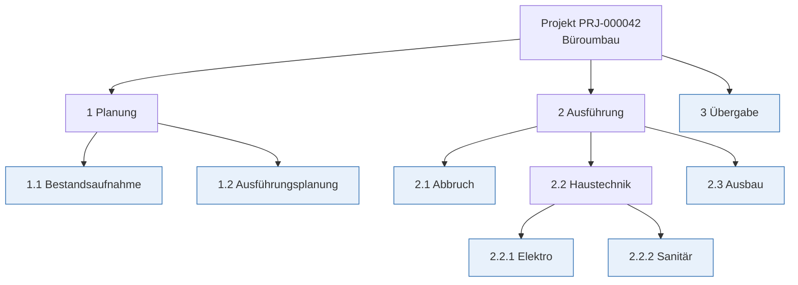
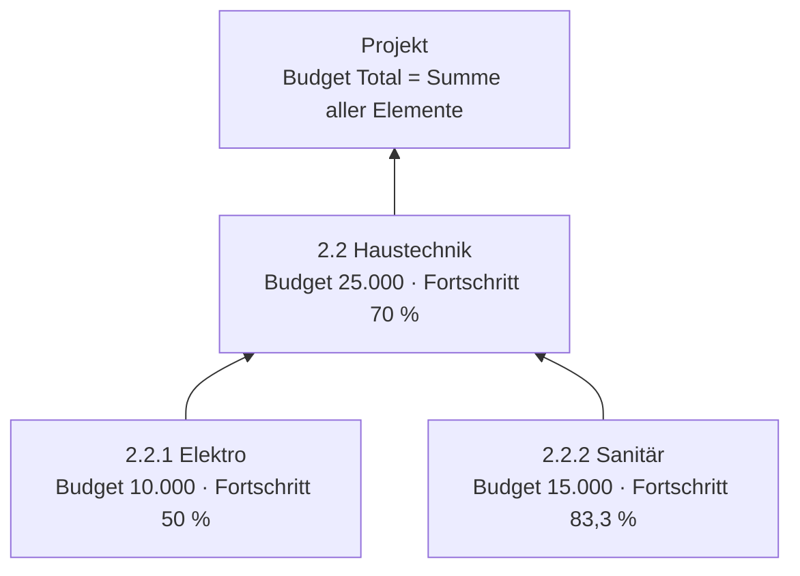
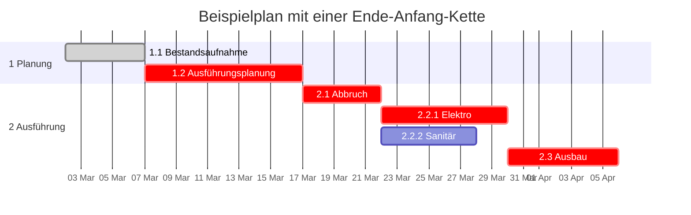
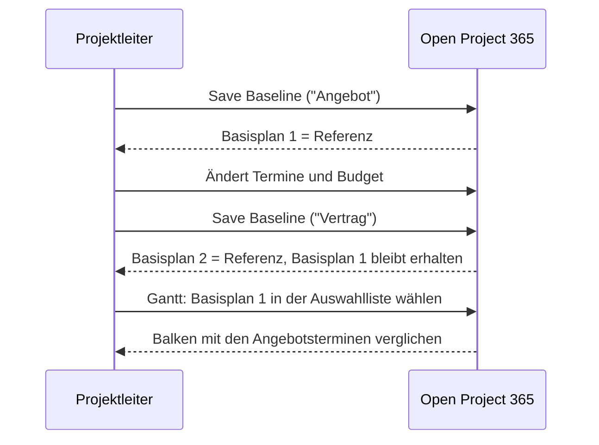

# PSP, Budget, Gantt und Basispläne

> **Sprache:** [English](../en/wbs-and-planning.md) · [Italiano](../it/wbs-and-planning.md) · [Français](../fr/wbs-and-planning.md) · Deutsch
> **Handbuchverzeichnis:** [README](../../README.md#user-manuals)

Der **Projektstrukturplan (PSP)**, englisch *Work Breakdown Structure (WBS)*, gliedert ein Projekt in Phasen, Arbeitspakete und Vorgänge. In Open Project 365 ist der PSP der Ort, an dem das Budget aufgebaut, Termine und Abhängigkeiten geplant, der Fortschritt gemeldet und Stunden und Kosten gesammelt werden. Darauf setzen das **Gantt-Diagramm** mit dem **kritischen Pfad** und die **Basispläne** (Baselines) auf: eingefrorene Kopien des Plans, mit denen Sie das Vereinbarte mit dem tatsächlichen Verlauf vergleichen.

Dieses Handbuch behandelt die Registerkarten **WBS** und **Gantt** des Projektformulars, das Formular des PSP-Elements, Abhängigkeiten, Zuordnungen und Basispläne. Die geplanten Stunden je Ressource werden in [Ressourcenauslastung](resource-load.md) behandelt.

> Feld- und Schaltflächennamen stehen auf Englisch, so wie sie auf dem Bildschirm erscheinen.

## Begriffe

- Ein **PSP-Element** (WBS node) ist jedes Element des Baums. Ein Element kann ein **übergeordnetes Element** haben, sodass der Baum so tief sein kann wie nötig.
- Ein **Blattelement** (oben hervorgehoben) hat keine Unterelemente: Es ist ein echter Vorgang. Budget, Termine und Fortschritt werden in Blattelementen eingegeben.
- Ein **übergeordnetes Element** (Sammelvorgang) hat Unterelemente: Im PSP-Raster und im Gantt werden seine Werte aus den darunterliegenden Elementen **verdichtet**.
- Eine **Abhängigkeit** verknüpft zwei Elemente: Der Nachfolger kann erst beginnen, wenn der Vorgänger beendet ist (Ende-Anfang), optional nach einigen **Verzugstagen**.
- Eine **Zuordnung** (Allocation) gibt an, wie viele Stunden eine Ressource an einem Element arbeiten soll.
- Ein **Basisplan** ist eine Momentaufnahme von Budget und Terminen aller Elemente zu einem bestimmten Zeitpunkt.

## Das PSP-Element

### Felder

**Registerkarte General**

| Feld | Bedeutung |
|---|---|
| **Project** | Das Projekt (Pflichtfeld). Das Element wird mit dem Projekt gelöscht |
| **Parent Node** | Das übergeordnete Element im Baum. Nur Elemente **desselben Projekts** sind wählbar. Leer = Element der obersten Ebene |
| **Code** | Gliederungscode, zum Beispiel `2.2.1`. Freitext; er wird für die Sortierung verwendet (siehe unten) |
| **Name** | Name der Phase oder des Vorgangs (Pflichtfeld) |
| **Owner Resource** | Die für das Element verantwortliche Ressource |
| **Sort Order** | Optionale Zahl, die die Position unter Geschwisterelementen erzwingt |
| **Start Date** / **End Date** | Geplante Termine |
| **Progress %** | Fertigstellungsgrad (0–100), in Blattelementen eingegeben |
| **Owner** | Besitzer des Datensatzes |

**Registerkarte Budget**

| Feld | Bedeutung |
|---|---|
| **Budget Hours** | Geplante Stunden |
| **Actual Hours** | Genehmigte, auf dem Element erfasste Stunden (berechnet) |
| **Budget Labour** | Geplante Personalkosten |
| **Budget Materials** | Geplante Materialkosten |
| **Budget Other** | Sonstige geplante Kosten (Fremdleistungen, Mieten, Reisen...) |
| **Budget Total** | Personal + Material + Sonstiges (beim Speichern berechnet) |
| **Actual Cost** | Genehmigte Personalkosten + Materialverbräuche auf dem Element (berechnet) |

**Registerkarte Dependencies**: **Predecessors** (Vorgänger, auf die dieses Element wartet) und **Successors** (Nachfolger, die auf dieses Element warten).

**Registerkarte Allocations**: die auf dem Element geplanten Ressourcen und Stunden.

### Reihenfolge der Elemente

Geschwisterelemente werden in dieser Reihenfolge angezeigt:

1. nach **Sort Order**, wenn gesetzt (kleinere zuerst);
2. dann nach **Code**, in natürlicher Gliederungsreihenfolge: `1.2` kommt vor `1.10`, `2` vor `10`;
3. dann nach **Name**.

In den meisten Fällen genügen also einheitliche Codes; verwenden Sie Sort Order, wenn Sie eine andere Reihenfolge als die der Codes wünschen.

## Die Registerkarte WBS (WBS Tree Grid)

Die Registerkarte WBS des Projekts zeigt den ganzen Baum als aufklappbares Raster.

| Spalte | Blattelemente | Übergeordnete Elemente |
|---|---|---|
| **Name** (mit Code) | Klicken, um das Formular des Elements zu öffnen | Auf den Pfeil klicken zum Auf-/Zuklappen; auf den Namen klicken, um das Formular zu öffnen |
| **Start** / **End** | Direkt bearbeitbar | Frühester Beginn / spätestes Ende der darunterliegenden Elemente (grau, verdichtet) |
| **Budget Hours** | Direkt bearbeitbar | Summe der darunterliegenden Elemente |
| **Labour**, **Materials**, **Other** | Direkt bearbeitbar | – |
| **Budget Total** | Berechnet | Summe der darunterliegenden Elemente |
| **Progress %** | Direkt bearbeitbar | Budgetgewichteter Fortschritt der darunterliegenden Blätter |

Die letzte Zeile zeigt die **Total** (Summe) der Stunden und des Budgets für das ganze Projekt. Verdichtete Werte sind grau dargestellt; fahren Sie mit der Maus darüber, um den Tooltip „Includes child nodes“ (enthält Unterelemente) zu sehen.

### Symbolleiste

| Schaltfläche | Funktion |
|---|---|
| **New node** | Öffnet ein neues PSP-Element-Formular für das Projekt (oberste Ebene) |
| **New child node** | Öffnet ein neues Element unter der ausgewählten Zeile (zuerst eine Zeile anklicken, um sie auszuwählen) |
| **Expand all** / **Collapse all** | Öffnet oder schließt alle Zweige |
| **Refresh** | Lädt den Baum neu (nach Änderungen an Elementen in einem anderen Fenster verwenden) |

### Direkt bearbeiten

1. Klicken Sie auf eine Zelle eines Blattelements (Termine, Stunden, Personal, Material, Sonstiges, Fortschritt).
2. Geben Sie den Wert ein. Dezimalzahlen können Komma oder Punkt verwenden.
3. Drücken Sie **Enter** oder klicken Sie woanders hin, um zu speichern; **Esc** bricht ab.

Die Änderung wird sofort gespeichert, die Budgetsumme des Elements neu berechnet und **Budget Total** und **Progress %** des Projekts aktualisiert. Kann ein Wert nicht gespeichert werden, zeigt die Meldung „The change could not be saved“ den Grund an.

> Wurde das Projekt noch nicht gespeichert, zeigt das Raster „Save the project to build its WBS.“ (Speichern Sie das Projekt, um seinen PSP aufzubauen.)

### Einen PSP schnell aufbauen

1. Legen Sie die Phasen der obersten Ebene mit **New node** an (Code `1`, `2`, `3`...).
2. Wählen Sie eine Phase, klicken Sie auf **New child node** und legen Sie ihre Vorgänge an (`1.1`, `1.2`...).
3. Füllen Sie Termine, Stunden und Budget direkt im Raster aus.
4. Öffnen Sie die Elemente, die Abhängigkeiten oder Zuordnungen brauchen, und fügen Sie diese in ihren Registerkarten hinzu.

## Wie Budget und Fortschritt verdichtet werden

- **Budget Total eines Elements** = Budget Labour + Budget Materials + Budget Other, bei jedem Speichern neu berechnet.
- **Budget Total des Projekts** = Summe der Budgetsummen der Elemente.
- **Fortschritt** eines Sammelelements und des Projekts = Fortschritt der **Blattelemente**, gewichtet nach ihrer Budgetsumme: (10.000 × 50 % + 15.000 × 83,3 %) ÷ 25.000 = 70 %. Hat kein Blatt ein Budget, sind die Gewichte die Budgetstunden; gibt es auch keine Stunden, wird ein einfacher Durchschnitt verwendet.

> Geben Sie Budgetbeträge **nur in Blattelementen** ein. Ein in einem übergeordneten Element eingegebenes Budget wird trotzdem zur Projektsumme addiert und kann doppelt zählen, wenn auch seine Unterelemente ein Budget haben.

## Abhängigkeiten

Eine Abhängigkeit besagt, dass der **Nachfolger** erst beginnen kann, wenn der **Vorgänger** beendet ist.

| Feld | Bedeutung |
|---|---|
| **Predecessor** | Das Element, das zuerst fertig sein muss |
| **Successor** | Das Element, das wartet |
| **Dependency Type** | *Finish-to-Start* (Ende-Anfang) |
| **Lag Days** | Kalendertage, die nach dem Ende des Vorgängers gewartet wird (0 = der Nachfolger kann am Folgetag beginnen) |
| **Project** / **Name** | Werden automatisch ausgefüllt („Vorgänger → Nachfolger“) |

Legen Sie Abhängigkeiten in der Registerkarte **Dependencies** eines Elements an: **+ New WBS Dependency** in *Predecessors* (dieses Element wartet auf ein anderes) oder in *Successors* (ein anderes Element wartet auf dieses).

Die Anwendung prüft jede Abhängigkeit beim Speichern:

| Regel | Meldung |
|---|---|
| Ein Element kann nicht von sich selbst abhängen | „A WBS node cannot depend on itself.“ |
| Beide Elemente müssen im selben Projekt sein | „Predecessor and successor must belong to the same project.“ |
| Keine Schleifen (A → B → C → A) | „This dependency would create a cycle in the plan.“ |
| Dasselbe Paar nur einmal | Ein Fehler wegen doppeltem Schlüssel |

Wenn Sie ein Element löschen, werden auch seine Abhängigkeiten und alle Unterelemente gelöscht.

## Die Registerkarte Gantt (Gantt Chart)

Die Registerkarte Gantt stellt den PSP auf einer Zeitachse dar.

Was Sie sehen:

- **Linke Spalte**: der PSP-Baum (mit den Pfeilen auf-/zuklappen; auf einen Namen klicken, um das Element zu öffnen).
- **Sammelbalken** (dunkel) für übergeordnete Elemente, vom frühesten Beginn bis zum spätesten Ende ihrer Unterelemente.
- **Vorgangsbalken** für Blattelemente, mit dem **Fortschritt** als dunklere Füllung.
- **Pfeile** für Ende-Anfang-Abhängigkeiten.
- **Kritischer Pfad** in Rot: die Kette der Vorgänge ohne Puffer, also die Vorgänge, deren Verzögerung das Projektende verzögern würde. Er wird aus den geplanten Terminen und den Abhängigkeiten (mit Verzug) berechnet.
- **Verschobene Balken**: Wenn die Abhängigkeiten einen Vorgang zwingen, später als geplant zu beginnen, wird der Vorgang gestrichelt an dem Datum gezeichnet, an dem er tatsächlich beginnen kann („Pushed by dependencies to ...“).
- **Basisplanbalken**: schmale Balken unter jedem Vorgang mit den Terminen des gewählten Basisplans.
- **Heute-Linie**: eine senkrechte Linie am heutigen Datum.
- **Tooltip**: Fahren Sie über einen Balken, um Termine, Fortschritt, Puffer (Tage), Zugehörigkeit zum kritischen Pfad und die Basisplantermine zu sehen.

### Symbolleiste

| Steuerelement | Funktion |
|---|---|
| **Weeks** / **Months** / **Quarters** | Ändert den Zeitmaßstab (Wochen / Monate / Quartale) |
| **Baseline** | Wählt den Basisplan für den Vergleich. Der **Referenz**-Basisplan ist vorausgewählt; *No baseline* blendet den Vergleich aus |
| **Critical path** | Blendet die Hervorhebung des kritischen Pfads ein oder aus |
| **Refresh** | Lädt Elemente, Abhängigkeiten und Basispläne neu |

Meldungen:

- „No WBS node has start and end dates yet.“ — tragen Sie in der Registerkarte WBS Termine ein.
- „Some dependencies form a loop and were ignored.“ — der kritische Pfad ignoriert Vorgänge in einer Schleife; das kann nur bei außerhalb der Anwendung importierten Daten vorkommen, da Schleifen beim Speichern abgelehnt werden.

## Basispläne

Ein Basisplan friert **Budgetstunden, Budgetsumme, Starttermin und Endtermin** jedes aktiven PSP-Elements zu einem Zeitpunkt ein. Typische Basispläne sind „Angebot“, „Vertrag“, „Neuplanung nach Nachtrag 1“.

### Einen Basisplan speichern

1. Klicken Sie im Projektformular in der Befehlsleiste auf **Save Baseline**.
2. Bestätigen Sie. Der aktuelle PSP wird in einen neuen Basisplan mit dem Namen „Baseline jjjj-mm-tt hh:mm UTC“ kopiert, der zum **Referenz**-Basisplan wird.
3. Das Gantt und die Liste **Baselines** (Registerkarte Gantt) werden aktualisiert, und die Benachrichtigung „Baseline saved.“ erscheint.

Öffnen Sie den Basisplan aus der Liste, um ihn **umzubenennen** oder eine **Description** hinzuzufügen. Sein Abschnitt **Nodes** listet die eingefrorenen Werte jedes Elements auf.

### Referenz-Basisplan

Jedes Projekt hat **höchstens einen Referenz-Basisplan**: den, den das Gantt für den Vergleich vorauswählt. Das Speichern eines neuen Basisplans macht diesen zur Referenz. Um eine andere Referenz zu wählen, öffnen Sie den gewünschten Basisplan und haken **Is Reference** an: Die bisherige Referenz wird automatisch aufgehoben.

Basispläne werden durch spätere Änderungen am PSP nie verändert. Nach einem Basisplan angelegte Elemente erscheinen nicht darin; gelöschte Elemente bleiben darin erhalten.

## Bewährte Vorgehensweisen

- Halten Sie die **Codes einheitlich** (`1`, `1.1`, `1.1.1`): Sortierung, Lesbarkeit und Auswertungen profitieren davon.
- Setzen Sie **Budget, Termine und Fortschritt auf Blätter**; lassen Sie die Sammelelemente verdichten.
- Fügen Sie **Abhängigkeiten nur dort hinzu, wo sie wirklich bestehen**: Der kritische Pfad ist nur so gut wie die Verknüpfungen.
- **Speichern Sie einen Basisplan** an jedem formalen Meilenstein (Angebot, Vertrag, genehmigter Nachtrag) und geben Sie ihm einen sprechenden Namen.
- Aktualisieren Sie den **Fortschritt** wöchentlich: Er bestimmt den Projektfortschritt und die Prognose bei Fertigstellung in der [Kostenübersicht](materials-and-costs.md#kostenübersicht).

## Mögliche Meldungen

| Meldung | Bedeutung |
|---|---|
| „Save the project to build its WBS.“ / „Save the project to see its Gantt.“ | Das Projekt ist neu und noch nicht gespeichert |
| „The WBS could not be loaded“ / „The plan could not be loaded“ | Ein Netzwerk- oder Berechtigungsproblem; Refresh verwenden, dann Ihren Zugriff auf das Projekt prüfen |
| „The change could not be saved“ | Der direkt eingegebene Wert wurde abgelehnt (zum Beispiel Fortschritt außerhalb von 0–100 oder kein Schreibzugriff) |
| „Save the project before saving a baseline.“ | Save Baseline wurde bei einem neuen Projekt geklickt |
| „The WBS node belongs to another project.“ | Ein Zeiteintrag, Materialverbrauch oder eine Anforderung verwies auf ein Element eines anderen Projekts |
