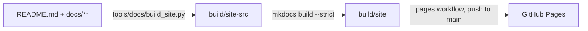

# Development environment setup

The solution lives unpacked in `solutions/OpenProject365/src`. Publisher and solution are defined in `src/Other/Solution.xml`.

| Item | Value |
|---|---|
| Solution unique name | `OpenProject365` |
| Solution display name | Open Project 365 |
| Publisher unique name | `PowerBuildersItalia` |
| Publisher prefix | `op365` |
| Choice value prefix | `36500` (choice values start at 365000000) |
| Base language | 1033 (English) |

## First import (creates publisher and solution)

Requires the [Power Platform CLI](https://learn.microsoft.com/power-platform/developer/cli/introduction).

```powershell
pac auth create --environment https://<dev-org>.crm4.dynamics.com
pac solution pack --folder solutions/OpenProject365/src --zipfile out/OpenProject365.zip --packagetype Unmanaged
pac solution import --path out/OpenProject365.zip
```

Alternatively download the `OpenProject365-unmanaged` artifact from the `build` workflow run and import it from make.powerapps.com.

## Daily loop

1. Customize in the dev environment, always inside the **Open Project 365** solution.
2. Export and unpack back into the repo:

```powershell
pac solution export --name OpenProject365 --path out/OpenProject365.zip --managed false
pac solution unpack --zipfile out/OpenProject365.zip --folder solutions/OpenProject365/src --packagetype Unmanaged --allowDelete true
```

3. Commit on a feature branch and open a pull request.

## Code

| Folder | Build | Tests |
|---|---|---|
| `src/plugins` | `dotnet build src/plugins/OpenProject365.Plugins -c Release` (.NET Framework 4.6.2, strong-named) | `dotnet test src/plugins/OpenProject365.Plugins.Tests` |
| `src/pcf` | `npm ci && npm run build` (all eight controls, ESLint included) | `npm test` (Jest: WBS tree, critical path, time scale, timesheet, approval, resource load, cost summary, quote comparison, progress bar) |

Deploy to dev: `python3 tools/dataverse/plugins.py` registers or updates the assembly; `tools/pcf/push.sh` pushes each control into the solution (`pac pcf push` accepts one manifest per project). In the cloud container create the pac profile with `--accept-cleartext-caching` (no keyring).

## Cloud flows

`tools/dataverse/flows.py` creates the connection reference `op365_dataverse` (Microsoft Dataverse) and the **Daily time reminder** flow (Mon–Fri 17:30, W. Europe) that calls `op365_SendTimeReminders`. The flow is created off. A service principal cannot own connections (InvalidUserPlan), so a user creates the Dataverse connection (service principal authentication is fine) and turns the flow on. In Dev link it to the reference in the solution; in Test the `deploy-test` workflow maps the reference through `deployment/test.settings.json`, whose `#{OP365_DATAVERSE_CONNECTION_ID}#` token is replaced with the variable of the same name of the GitHub environment `test`, so the managed layer stays clean and no environment ids are in the repository. Share the target connection with the application user (Can use) so the import can turn the flow on.

After a solution import check that plugin steps are enabled: an interrupted import can leave them disabled.

## Copilot and Work IQ

`tools/dataverse/workiq.py` prepares the read-only exposure of Open Project 365 to Microsoft Copilot and Copilot Cowork (Business Applications in Work IQ, preview). Design and decisions: [ADR 0001](adr/0001-copilot-work-iq-read-only.md). User and admin guide: [Copilot and Cowork](en/copilot.md).

- Writes the descriptions of the custom columns and lookups (the `DESCRIPTIONS` table in the script): the Dataverse semantic model reads them, so keep a description on every new column.
- Sets the app setting `m365copilotmodelappenabled` = 2 (**Microsoft Copilot in model-driven apps** on) on the Open Project 365 app; with it Dataverse indexes the app tables and creates the semantic model of the app (`M365_Primary_model_op365_OpenProject365` in Dev).
- Creates or updates the business skills from `copilot/skills/*.md` (front matter `name` and `description`, body = instructions) as **Organization** skills (`ispersonal` = No) and adds them to the solution (component type 10441). The unique name is the file name.

Run it after the table scripts, then export and unpack the solution. The script is idempotent.

Not in the solution, to configure by hand in every environment (no documented API, no ALM support): Work IQ on the environment, table exclusions and glossary of the semantic model ([copilot/glossary.md](../copilot/glossary.md)), installation of the **Business apps (preview)** plugin. Steps in [Copilot and Cowork](en/copilot.md#set-up-administrators).

When exporting from Dev, drop the Italian (1040) labels the Dev language pack adds to standard components, unless they are part of the change.

## Supplier portal (Power Pages)

The portal is a separate solution, `OpenProject365SupplierPortal`, that depends on `OpenProject365`.
The site uses the enhanced data model. Suppliers sign in, answer RFQs (prices on the lines created by Send) and confirm purchase orders.

- Create the site only in Dev, in make.powerpages.microsoft.com (a user, not the service principal), then run
  `python tools/portal/supplier_portal.py`: Supplier web role, table permissions (Account / Parent scope), Web API site settings, pages and menu.
  The script is idempotent and writes into the portal solution.
- A supplier user is a contact whose parent account is the supplier, with the **Supplier** web role.
- Never use `pac pages upload` with the service principal: it creates empty components that cannot be deleted.
- Table permission roles must be stored in the component JSON (`adx_entitypermission_webrole`) as well as in the
  `powerpagecomponent_powerpagecomponent` relationship: the runtime reads the first, the studio shows the second. The script does both.
- After changes made through the API: Clear cache at `/_services/about` (Administrators role), then sign out and in.
- Export/unpack like the main solution, into `solutions/OpenProject365SupplierPortal/src`. deploy-test imports it after the main solution.
  In a new environment the imported site must be reactivated (Power Pages, Inactive sites) before use.

## Translations (Italian, French, German)

English (1033) is the base language; German (1031), French (1036) and Italian (1040) are enabled in Dev and Test.

| Part | Where the text lives | How to update |
|---|---|---|
| Tables, columns, choices, views, forms, app, buttons | Solution labels | `python3 tools/dataverse/translations.py` exports the translations (SOAP `ExportTranslation`), fills the empty German, French and Italian cells from `tools/dataverse/translations.json` (English text -> [de, fr, it]), imports and publishes. `export-only` only lists the missing labels. Then export/unpack the solution as usual. |
| PCF controls | `src/pcf/<Control>/strings/<Control>.<lcid>.resx` | Add the key to the 1033 resx and a `Control\|Key\|de\|fr\|it` line to `tools/pcf/strings.txt`, then `python3 tools/pcf/gen_resx.py`. Day and month names use `userLocale(context.userSettings.languageId)`. |
| Form scripts and dialog pages | `TEXT` table at the top of each file in `src/webresources` | English text -> [de, fr, it]; `t("...")` picks the user's language. Never compare form or field labels in code: use ids. |
| Plugin errors and notifications | `src/plugins/OpenProject365.Plugins/Text.cs` | Messages stay English in the code. Add every new message to `Text.Templates` (`{0}` for variable parts); `PluginBase` and `Rules.Notify` translate into the user's interface language. |

Glossary: project = Commessa / Projekt / projet; WBS node = Nodo WBS / PSP-Element / nœud WBS; purchase request = Richiesta di acquisto / Bestellanforderung / demande d'achat; RFQ = Richiesta di offerta (RdO) / Angebotsanfrage / demande de prix; purchase order = Ordine di acquisto / Bestellung / commande d'achat; goods receipt = Ricevimento merci / Wareneingang / réception de marchandises; baseline = Baseline / Basisplan / planning de référence.

## CI and Solution Checker

The `build` workflow builds and tests the plugins and the PCF controls and packs the solution on every PR. After a merge to `main` its `checker` job runs the Solution Checker on the packed solution, in the GitHub environment `solution-checker` (deployment branches: `main`), when these environment secrets exist: `PP_ENVIRONMENT_URL`, `PP_TENANT_ID`, `PP_CLIENT_ID`, `PP_CLIENT_SECRET` (preferably an app registration of its own, application user of the dev environment with a minimal role). Pull requests never see these secrets. The step fails if the analysis cannot run; findings are listed in the job log and in the `solution-checker-logs` artifact.

## Documentation website (GitHub Pages)

The manuals are also published as a website at <https://power-builders-italia.github.io/open-project-365/>, built with [Material for MkDocs](https://squidfunk.github.io/mkdocs-material/) from the same Markdown files: the repository stays the only source, and every page has an edit link back to its file on GitHub.



- `tools/docs/build_site.py` stages the files: the README becomes the home page, links to files outside `docs/` (CONTRIBUTING, copilot, LICENSE) point to GitHub. The sources are never changed.
- Look and feel: logo and favicon in `docs/assets/` (from the Open Project 365 icon), brand colours (green `#0c723d`, red `#d3010f`, grey `#5b5959`) in `docs/assets/extra.css`.
- `mkdocs.yml` holds the menu (one tab per language plus Technical): add a new manual there too. Mermaid diagrams and the `#anchors` of the manuals work as on GitHub.
- The `pages` workflow builds the site on pull requests that touch the docs (`--strict` fails on broken links) and publishes it on every push to `main` (or Actions > pages > Run workflow).
- One-time setup: Settings > Pages > Build and deployment > Source **GitHub Actions**. The `github-pages` environment is created on the first run.
- Local preview:

  ```bash
  pip install -r tools/docs/requirements.txt
  python3 tools/docs/build_site.py && mkdocs serve -f mkdocs.yml
  ```

## Environments

| Environment | Status |
|---|---|
| Dev (`<dev-org>.crm4.dynamics.com`, secret `PP_ENVIRONMENT_URL`) | available, unmanaged solution |
| Test (`<test-org>.crm4.dynamics.com`, secret `TEST_ENVIRONMENT_URL`) | managed solution, deployed with the `deploy-test` workflow (Actions > deploy-test > Run workflow); plugin steps are activated on import |
| Build | not needed yet: CI only packs and checks |

### Test data

`tools/dataverse/seed_test.py` loads a large, fictitious English dataset: 50 customers, 30 suppliers (3 blocked) with contacts and compliance documents, 54 items with supplier prices, 18 resources with cost history and absences, and 23 projects of ten types in every status (Offer, In Progress, Suspended, Closed) with WBS, dependencies, allocations, baselines, time entries in every status, material usage, purchasing in every status and a timeline of notes, tasks, phone calls and appointments. Dates are relative to the day of the run. Running it again replaces the previous test data; `--clean` only removes it.

```bash
PAC_ENVIRONMENT_URL=https://<test-org>.crm4.dynamics.com SEED_USER_EMAIL=<user email> python3 tools/dataverse/seed_test.py
```

The project manager of every project, and the resource linked to them, is the user in `SEED_USER_EMAIL` (default: the first interactive user).

## GitHub repository security

The repository is public: environment URLs, tenant, app and connection ids and user names live only in GitHub **environment secrets**. Not in variables: the Actions logs of a public repository are public, and only secrets are masked. No repository-level secrets: any workflow pushed to a branch by a user with write access could read them.

- **Environment `test`** (Settings > Environments): required reviewer, deployment branches limited to `main`. `deploy-test` runs in it (the environment name is the `settings` input).
  - Secrets: `PP_ENVIRONMENT_URL`, `PP_TENANT_ID`, `PP_CLIENT_ID`, `PP_CLIENT_SECRET` (the app registration, application user in Dev and Test), `TEST_ENVIRONMENT_URL` (target URL; the workflow has no input to override it, so a user who can run it cannot deploy to another environment), `OP365_DATAVERSE_CONNECTION_ID` (Dataverse connection id in Test, Power Apps > Connections > the connection's URL).
  - Optional secrets for the company settings ([environment variables](data-model.md#company-settings-environment-variables)): `OP365_TIME_APPROVAL_ENABLED` (`yes`/`no`), `OP365_PURCHASE_REQUEST_THRESHOLD` (number, dot as decimal separator), `OP365_PURCHASING_APPROVER` (User Name in Test). `deploy-test` writes them into `deployment/test.settings.json`; an empty or missing secret is left out, so Test keeps its current value (or the default).
- **Environment `solution-checker`**: deployment branches limited to `main`, no reviewer; secrets `PP_*` for the Solution Checker (see [CI and Solution Checker](#ci-and-solution-checker)).
- **Collaborators**: give the *Triage* role and let them open pull requests from forks; *Write* lets a user run `deploy-test` (still gated by the `test` reviewer).
- **Actions**: every third-party action is pinned to a commit SHA (tag in a comment); update them together. Workflows run with a read-only `GITHUB_TOKEN` (`permissions: contents: read`); only the `deploy` job of `pages` gets `pages: write` and `id-token: write`, as GitHub Pages requires. Never use `pull_request_target`.
- **Settings > Actions > General**: "Require approval for all outside collaborators" for fork pull requests.
- **Branch protection on `main`**: pull request required, review from code owners ([CODEOWNERS](../.github/CODEOWNERS)), `build` checks required.
- **Code security**: secret scanning and push protection on; Dependabot alerts on; CodeQL default setup.
- **Dependabot version updates** ([dependabot.yml](../.github/dependabot.yml)): weekly grouped PRs for actions, PCF (npm), plugins (NuGet) and the documentation website (pip, no MkDocs major). Fluent UI and React are never bumped (they must match the PCF platform libraries) and majors are skipped for npm and NuGet.
- Vulnerability reports: [SECURITY.md](../SECURITY.md).

