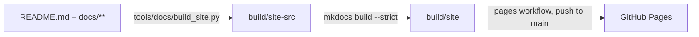
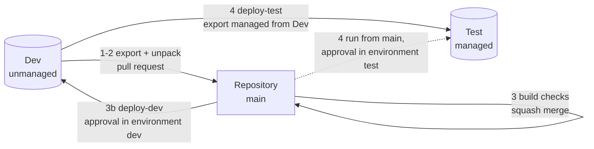
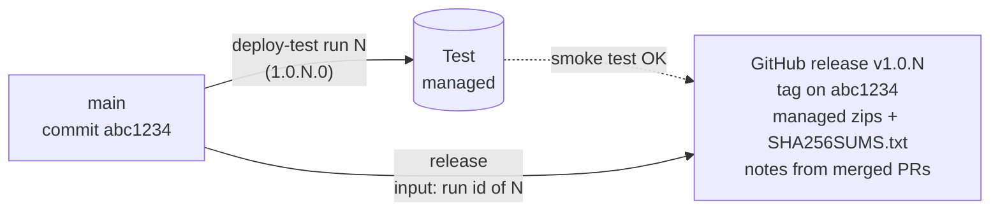

# Development environment setup

The solution lives unpacked in `solutions/OpenProject365/src`. Publisher and solution are defined in `src/Other/Solution.xml`.

The product was renamed from *Open Project 365* to **ProjectIQ** (display names, documentation, website and repository). Technical names keep the original form so that existing environments upgrade in place: solution unique names `OpenProject365` and `OpenProject365SupplierPortal`, publisher `PowerBuildersItalia`, prefix `op365`, app unique name `op365_OpenProject365`, plugin assembly `OpenProject365.Plugins` and the `OP365 …` security roles.

| Item | Value |
|---|---|
| Solution unique name | `OpenProject365` |
| Solution display name | ProjectIQ |
| Publisher unique name | `PowerBuildersItalia` |
| Publisher prefix | `op365` |
| Choice value prefix | `36500` (choice values start at 365000000) |
| Base language | 1033 (English) |

## First import (creates publisher and solution)

Requires the [Power Platform CLI](https://learn.microsoft.com/power-platform/developer/cli/introduction).

```powershell
pac auth create --environment https://<dev-org>.crm4.dynamics.com
pac solution pack --folder solutions/OpenProject365/src --zipfile out/OpenProject365.zip --packagetype Unmanaged
pac solution import --path out/OpenProject365.zip
```

Alternatively download the `OpenProject365-unmanaged` artifact from the `build` workflow run and import it from make.powerapps.com.

## Daily loop

1. Customize in the dev environment, always inside the **ProjectIQ** solution.
2. Export and unpack back into the repo:

```powershell
pac solution export --name OpenProject365 --path out/OpenProject365.zip --managed false
pac solution unpack --zipfile out/OpenProject365.zip --folder solutions/OpenProject365/src --packagetype Unmanaged --allowDelete true
```

3. Commit on a feature branch and open a pull request.

## Code

| Folder | Build | Tests |
|---|---|---|
| `src/plugins` | `dotnet build src/plugins/OpenProject365.Plugins -c Release` (.NET Framework 4.6.2, strong-named) | `dotnet test src/plugins/OpenProject365.Plugins.Tests` |
| `src/pcf` | `npm ci && npm run build` (all eight controls, ESLint included) | `npm test` (Jest: WBS tree, critical path, time scale, timesheet, approval, resource load, cost summary, quote comparison, progress bar) |

Deploy to dev: `python3 tools/dataverse/plugins.py` registers or updates the assembly; `tools/pcf/push.sh` pushes each control into the solution (`pac pcf push` accepts one manifest per project). In the cloud container create the pac profile with `--accept-cleartext-caching` (no keyring).

## Cloud flows

`tools/dataverse/flows.py` creates the connection reference `op365_dataverse` (Microsoft Dataverse) and the **Daily time reminder** flow (Mon–Fri 17:30, W. Europe) that calls `op365_SendTimeReminders`. The flow is created off. A service principal cannot own connections (InvalidUserPlan), so a user creates the Dataverse connection (service principal authentication is fine) and turns the flow on. In Dev link it to the reference in the solution; in Test the `deploy-test` workflow maps the reference through `deployment/test.settings.json`, whose `#{OP365_DATAVERSE_CONNECTION_ID}#` token is replaced with the secret of the same name of the GitHub environment `test`, so the managed layer stays clean and no environment ids are in the repository. Share the target connection with the application user (Can use) so the import can turn the flow on.

After a solution import check that plugin steps are enabled: an interrupted import can leave them disabled.

## Copilot and Work IQ

`tools/dataverse/workiq.py` prepares the read-only exposure of ProjectIQ to Microsoft Copilot and Copilot Cowork (Business Applications in Work IQ, preview). Design and decisions: [ADR 0001](adr/0001-copilot-work-iq-read-only.md). User and admin guide: [Copilot and Cowork](en/copilot.md).

- Writes the descriptions of the custom columns and lookups, primary name columns included (the `DESCRIPTIONS` table in the script): the Dataverse semantic model reads them, so keep a description on every new column and add its German, French and Italian text to `tools/dataverse/translations.json`.
- Sets the app setting `m365copilotmodelappenabled` = 2 (**Microsoft Copilot in model-driven apps** on) on the ProjectIQ app; with it Dataverse indexes the app tables and creates the semantic model of the app (`M365_Primary_model_op365_OpenProject365` in Dev).
- Creates or updates the business skills from `copilot/skills/*.md` (front matter `name` and `description`, body = instructions) as **Organization** skills (`ispersonal` = No) and adds them to the solution (component type 10441). The unique name is the file name.
- Turns on **Dataverse search** (`SyncToExternalSearchIndex`) for the tables in scope, all except Resource Cost, Baseline Node and WBS Dependency: Copilot reads records through the search index, so a new table in scope must be added there too.
- Writes the glossary of the app semantic model from [copilot/glossary.md](../copilot/glossary.md) (`copilotglossaryterm` records linked to the model, synonyms in the description). The entries are written without the solution header and stay out of the solution: they point to the model of one environment, and in the solution deploy-dev would report them as drift. The semantic model is not in solutions, so run `workiq.py glossary` (this step only) in every environment once the model exists, then select **Regenerate**.

Run it after the table scripts, then export and unpack the solution. The script is idempotent.

Not in the solution, to configure by hand in every environment (no documented API, no ALM support): Work IQ on the environment, table exclusions of the semantic model, installation of the **Business apps (preview)** plugin. Steps in [Copilot and Cowork](en/copilot.md#set-up-administrators).

When exporting from Dev, drop the Italian (1040) labels the Dev language pack adds to standard components, unless they are part of the change.

## Supplier portal (Power Pages)

The portal is a separate solution, `OpenProject365SupplierPortal`, that depends on `OpenProject365`.
The site uses the enhanced data model. Suppliers sign in, answer RFQs (prices on the lines created by Send) and confirm purchase orders.

- Create the site only in Dev, in make.powerpages.microsoft.com (a user, not the service principal), then run
  `python tools/portal/supplier_portal.py`: Supplier web role, table permissions (Account / Parent scope), Web API site settings, pages and menu.
  The script is idempotent and writes into the portal solution.
- A supplier user is a contact whose parent account is the supplier, with the **Supplier** web role.
- Never use `pac pages upload` with the service principal: it creates empty components that cannot be deleted.
- Table permission roles must be stored in the component JSON (`adx_entitypermission_webrole`) as well as in the
  `powerpagecomponent_powerpagecomponent` relationship: the runtime reads the first, the studio shows the second. The script does both.
- After changes made through the API: Clear cache at `/_services/about` (Administrators role), then sign out and in.
- Export/unpack like the main solution, into `solutions/OpenProject365SupplierPortal/src`. deploy-test imports it after the main solution.
  In a new environment the imported site must be reactivated (Power Pages, Inactive sites) before use.

## Translations (Italian, French, German)

English (1033) is the base language; German (1031), French (1036) and Italian (1040) are enabled in Dev and Test.

| Part | Where the text lives | How to update |
|---|---|---|
| Tables, columns, choices, views, forms, app, buttons | Solution labels | `python3 tools/dataverse/translations.py` exports the translations (SOAP `ExportTranslation`), fills the empty German, French and Italian cells from `tools/dataverse/translations.json` (English text -> [de, fr, it]), imports and publishes. `export-only` only lists the missing labels. Then export/unpack the solution as usual. |
| PCF controls | `src/pcf/<Control>/strings/<Control>.<lcid>.resx` | Add the key to the 1033 resx and a `Control\|Key\|de\|fr\|it` line to `tools/pcf/strings.txt`, then `python3 tools/pcf/gen_resx.py`. Day and month names use `userLocale(context.userSettings.languageId)`. |
| Form scripts and dialog pages | `TEXT` table at the top of each file in `src/webresources` | English text -> [de, fr, it]; `t("...")` picks the user's language. Never compare form or field labels in code: use ids. |
| Plugin errors and notifications | `src/plugins/OpenProject365.Plugins/Text.cs` | Messages stay English in the code. Add every new message to `Text.Templates` (`{0}` for variable parts); `PluginBase` and `Rules.Notify` translate into the user's interface language. |

Glossary: project = Commessa / Projekt / projet; WBS node = Nodo WBS / PSP-Element / nœud WBS; purchase request = Richiesta di acquisto / Bestellanforderung / demande d'achat; RFQ = Richiesta di offerta (RdO) / Angebotsanfrage / demande de prix; purchase order = Ordine di acquisto / Bestellung / commande d'achat; goods receipt = Ricevimento merci / Wareneingang / réception de marchandises; baseline = Baseline / Basisplan / planning de référence.

## CI and Solution Checker

The `build` workflow builds and tests the plugins and the PCF controls and packs the solution on every PR. After a merge to `main` its `checker` job runs the Solution Checker on the packed solution, in the GitHub environment `solution-checker` (deployment branches: `main`), when these environment secrets exist: `PP_ENVIRONMENT_URL`, `PP_TENANT_ID`, `PP_CLIENT_ID`, `PP_CLIENT_SECRET` (preferably an app registration of its own, application user of the dev environment with a minimal role). Pull requests never see these secrets. The step fails if the analysis cannot run; findings are listed in the job log and in the `solution-checker-logs` artifact.

## AppSource package

The manual `publish-appsource` workflow takes the managed solutions of a `deploy-test` run (the zips imported into Test), runs the Solution Checker with the **AppSource Certification** rule set and builds the AppSource package with `tools/alm/build_appsource_package.py` (Package Deployer project in `appsource/ProjectIQ.Package`). Publishing steps in Partner Center: [Publishing on Microsoft AppSource](appsource.md).

## Documentation website (GitHub Pages)

The manuals are also published as a website at <https://power-builders-italia.github.io/projectiq/>, built with [Material for MkDocs](https://squidfunk.github.io/mkdocs-material/) from the same Markdown files: the repository stays the only source, and every page has an edit link back to its file on GitHub.



- `tools/docs/build_site.py` stages the files: the README becomes the home page, links to files outside `docs/` (CONTRIBUTING, copilot, LICENSE) point to GitHub. The sources are never changed.
- Look and feel: logo and favicon in `docs/assets/` (from the ProjectIQ icon), brand colours (green `#0c723d`, red `#d3010f`, grey `#5b5959`) in `docs/assets/extra.css`.
- `mkdocs.yml` holds the menu (one tab per language plus Technical): add a new manual there too. Mermaid diagrams and the `#anchors` of the manuals work as on GitHub.
- The `pages` workflow builds the site on pull requests that touch the docs (`--strict` fails on broken links) and publishes it on every push to `main` (or Actions > pages > Run workflow).
- One-time setup: Settings > Pages > Build and deployment > Source **GitHub Actions**. The `github-pages` environment is created on the first run.
- Local preview:

  ```bash
  pip install -r tools/docs/requirements.txt
  python3 tools/docs/build_site.py && mkdocs serve -f mkdocs.yml
  ```

## Environments and deployment

Changes are made in **Dev**, reviewed in the **repository** and installed in **Test** as a managed solution. After every merge, `deploy-dev` brings `main` back into Dev, so Dev and `main` stay aligned ([ADR 0002](adr/0002-deploy-dev.md)). Every deployment waits for the approval of a person.



| Environment | Solution | How it is updated |
|---|---|---|
| Dev (`<dev-org>.crm4.dynamics.com`, secret `PP_ENVIRONMENT_URL`) | unmanaged | by hand for the work in progress (maker portal, `tools/dataverse/*.py`, `plugins.py`, `tools/pcf/push.sh`, `tools/portal/supplier_portal.py`); with `deploy-dev` after each merge in `main` |
| Test (`<test-org>.crm4.dynamics.com`, secret `TEST_ENVIRONMENT_URL`) | managed | only with the `deploy-test` workflow |
| Build | — | not needed: CI only packs and checks |

**The `deploy-test` workflow exports the solutions from Dev, not from the repository.** Test receives what Dev contains when the workflow runs. Before deploying, Dev and `main` must match: export every change made in Dev and merge it, and let `deploy-dev` install `main` into Dev (step 3b). The workflow checks it first and deploys nothing if they differ.

### Roles

| Who | Can | Needs |
|---|---|---|
| Contributor | change Dev, open pull requests | System Customizer (or higher) in Dev; *Triage* on the repository (pull requests from a fork) or *Write* |
| Maintainer | review and merge pull requests, run `deploy-test` | *Write* or *Admin* on the repository |
| Dev approver | approve each run of `deploy-dev` | required reviewer of the GitHub environment `dev` |
| Test approver | approve each run of `deploy-test` | required reviewer of the GitHub environment `test` |

### 1. Change Dev

Work always inside the **ProjectIQ** solution (or **ProjectIQ Supplier Portal** for the portal).

| Change | How |
|---|---|
| Tables, columns, forms, views, app, security roles | maker portal, or the schema scripts in `tools/dataverse` |
| Plugins and Custom APIs | `dotnet build src/plugins/OpenProject365.Plugins -c Release`, then `python3 tools/dataverse/plugins.py` ([Code](#code)) |
| PCF controls | `npm ci && npm run build` in `src/pcf`, then `tools/pcf/push.sh` (optionally only the controls you changed) |
| Form scripts and dialog pages | edit `src/webresources`, then run the `tools/dataverse/phase*_forms.py` script that uploads the file |
| Cloud flows | `tools/dataverse/flows.py` ([Cloud flows](#cloud-flows)) |
| Translations | `tools/dataverse/translations.py` ([Translations](#translations-italian-french-german)) |
| Copilot | `tools/dataverse/workiq.py` ([Copilot and Work IQ](#copilot-and-work-iq)) |
| Supplier portal | `tools/portal/supplier_portal.py` ([Supplier portal](#supplier-portal-power-pages)) |

The scripts in `tools/dataverse` read `PAC_ENVIRONMENT_URL`, `PAC_TENANT_ID`, `PAC_CLIENT_ID` and `PAC_CLIENT_SECRET` (an application user of Dev).

### 2. Export to the repository and open a pull request

```powershell
pac solution export --name OpenProject365 --path out/OpenProject365.zip --managed false
pac solution unpack --zipfile out/OpenProject365.zip --folder solutions/OpenProject365/src --packagetype Unmanaged --allowDelete true
pac solution export --name OpenProject365SupplierPortal --path out/OpenProject365SupplierPortal.zip --managed false
pac solution unpack --zipfile out/OpenProject365SupplierPortal.zip --folder solutions/OpenProject365SupplierPortal/src --packagetype Unmanaged --allowDelete true
```

- Commit on a branch created from `main`; open the pull request with the template.
- Drop the Italian (1040) labels the Dev language pack adds to standard components, unless they are part of the change.
- A functional change updates the user manuals in all four languages ([CONTRIBUTING](../CONTRIBUTING.md)); run `python3 tools/docs/check_docs.py`.

### 3. Checks and merge

- On the pull request the `build` workflow runs `docs`, `code` (plugins and PCF build and tests) and `solution` (packs both solutions). All three are required by the `main` ruleset.
- Merge with **Squash and merge** (the only method allowed).
- After the merge, `checker` runs the Solution Checker and `pages` publishes the documentation website.

### 3b. Deploy to Dev

`deploy-dev` starts by itself after a merge that touches `solutions/`, `src/plugins/`, `src/pcf/` or `src/webresources/` (or Actions > deploy-dev > Run workflow). The Dev approver opens the run, **Review deployments**, selects `dev` and **Approve and deploy**. The workflow:

1. exports both solutions from Dev and looks for changes `main` does not know about (`tools/alm/compare_solution.py`): a file of Dev counts only if it differs both from `main` (so it was not exported) and from the baseline, the commit of the last successful deployment of environment `dev-deployed` (the last commit installed in Dev) (so Dev is not just behind). Customizing Dev, exporting and merging before the run is therefore fine. The solution version, the platform version attributes, the Italian labels of standard components and the bytes of the plugin assembly and PCF bundles are not compared;
2. if there are such changes, imports nothing: it opens a draft pull request `Dev drift since <commit>` with only those files, from a branch `drift/<date>` started at `main`, and the run fails. Review it, merge it (or remove the changes from Dev) and run `deploy-dev` again;
3. otherwise imports both solutions packed from `main` (unmanaged, Dev keeps its environment variables and connections), with the PCF bundles built from source (`tools/alm/pcf_bundles.py` copies each `bundle.js` into the solution before packing), and registers the plugins built from source with `plugins.py`. A control whose manifest or strings changed, or a new control, stops the run: push it to Dev with `tools/pcf/push.sh` and export it first (the `code` check of the pull request reports it too);
4. exports again and checks that Dev now matches `main`; then the `record` job records the commit just installed as a deployment of environment `dev-deployed` (Settings > Environments, or the Deployments page of the repository).

| Input (Run workflow) | Use |
|---|---|
| `check-only` | only compare Dev with the repository (step 1, and the drift pull request if they differ); import nothing |
| `baseline` | commit that matches Dev, needed on the first run, when environment `dev-deployed` has no deployment yet. Until then the runs started by a merge are skipped (no approval is asked) |
| `skip-drift-check` | import without comparing: only to recover after a run that failed during the import |

An unmanaged import does not delete components: to remove a component, delete it in Dev too, then export and merge as usual.

### 4. Deploy to Test

Before you start: Dev matches `main` (see above), and the secrets of the environment `test` are set ([GitHub repository security](#github-repository-security)).

1. **Actions > deploy-test > Run workflow**, branch `main`, settings `test`.
2. The test approver opens the run, **Review deployments**, selects `test` and **Approve and deploy**.
3. The workflow, in order:
   1. exports both solutions unmanaged from Dev and compares them with `main` (`tools/alm/compare_solution.py`, same rules as `deploy-dev`: solution version, platform version attributes, Italian labels of standard components and the bytes of the plugin assembly and PCF bundles are not compared). Any difference stops the run before anything is changed in Dev or Test, and the summary of the run lists the files;
   2. sets the version `1.0.<run number>.0` of `OpenProject365` in Dev and exports it as managed;
   3. imports it into Test with *stage and upgrade* (components removed from the solution are deleted in Test), activates the plugin steps and applies `deployment/test.settings.json`: the `op365_dataverse` connection reference and the company settings come from the secrets of the environment `test` (an empty secret keeps the value in Test);
   4. does the same for `OpenProject365SupplierPortal`, after the main solution;
   5. keeps both managed packages as the `OpenProject365-managed` artifact of the run.
4. After the run:
   - check in Test that the plugin steps are enabled (an interrupted import can leave them disabled);
   - clear the portal cache (`/_services/about` > *Clear cache*) and sign in again;
   - first deployment only: reactivate the portal site (Power Pages > *Inactive sites*) and turn on the **Daily time reminder** flow.

Never customize Test: an unmanaged layer on top of the managed solution hides the next upgrades. Make the change in Dev and deploy again.

### 5. Release on GitHub

A GitHub release freezes a version that passed Test: it carries the same managed zips that `deploy-test` imported into Test, so whoever downloads it installs exactly what was tested. The `release` workflow builds nothing: it takes the `OpenProject365-managed` artifact of a `deploy-test` run (kept 90 days).



1. Test the deployment in Test (the smoke scripts `tools/dataverse/phase*_smoke.py` and a manual check).
2. Copy the run id of the `deploy-test` run (the number in its URL `.../actions/runs/<id>`).
3. **Actions > release > Run workflow**, branch `main`, `deploy-test-run` = that id. Leave `draft` on; tick `prerelease` for a version that is not meant for customers yet.
4. The release approver opens the run, **Review deployments**, selects `release` and **Approve and deploy**.
5. The workflow, in order:
   1. checks that the run is a successful `deploy-test` run from `main` and that the release `v1.0.<run number>` does not exist yet;
   2. downloads its managed zips and checks that both are managed and have the version `1.0.<run number>.0`;
   3. creates the release `ProjectIQ 1.0.<run number>.0`, tag `v1.0.<run number>` on the commit that run deployed, with `OpenProject365_managed.zip`, `OpenProject365SupplierPortal_managed.zip` and `SHA256SUMS.txt`. The notes start with the version and the install order, then list the pull requests merged since the previous release, grouped by label as set in [.github/release.yml](../.github/release.yml) (`bug`, `documentation`, `dependencies`, the rest under *Changes*; label a pull request `skip-changelog` to leave it out).
6. In **Releases**, open the draft, edit the notes if needed (e.g. a short summary on top, upgrade notes) and **Publish release**: the tag is created at that moment.

To install a release in an environment: import `OpenProject365_managed.zip`, then `OpenProject365SupplierPortal_managed.zip` (Power Apps > Solutions > Import, or `pac solution import`), then do the steps listed after a deployment to Test (plugin steps, portal cache, flow). Check a download with `sha256sum -c SHA256SUMS.txt`.

| Symptom | Cause and fix |
|---|---|
| *run … is …, not deploy-test* / *ran on …, not main* / *ended with 'failure'* | use the id of a successful `deploy-test` run started from `main` |
| *release v1.0.N already exists* | that run is already released (also as a draft): delete the draft, or release a newer run |
| *Unable to download artifact* | the artifact of the run expired (90 days): run `deploy-test` again and release the new run |

### Troubleshooting

| Symptom | Cause and fix |
|---|---|
| The run waits with *Waiting for review* | the test approver must approve it (step 4.2) |
| *Branch "…" is not allowed to deploy to test due to environment protection rules* | run the workflow from `main` |
| *Set the TEST_ENVIRONMENT_URL secret of the GitHub environment test* | add the secret to the environment `test` |
| *The OP365_DATAVERSE_CONNECTION_ID secret is not set (see docs/dev-environment.md)* | add the id of the Dataverse connection in Test ([Cloud flows](#cloud-flows)) |
| *Dev does not match main: run deploy-dev (it opens a drift pull request if Dev has changes not in main), then deploy again* | Dev has changes not exported, or `main` has merges not yet installed in Dev: run `deploy-dev` (step 3b), handle its drift pull request if it opens one, then run `deploy-test` again |
| *No deployment of dev-deployed: run the workflow with the baseline input (the commit that matches Dev)* | first run of `deploy-dev`: Run workflow with `baseline` (and `check-only` to try it first) |
| *Dev has changes not in main: see the draft pull request* | step 3b.2: review the drift pull request, merge it or remove the changes from Dev, run `deploy-dev` again |
| *Dev does not match main after the import: see the summary* | a component was not applied, or Dev changed during the run: read the summary of the run, fix and run again; the baseline did not move |
| *A PCF control differs from the solution beyond bundle.js: push it to Dev and export* | the manifest or the strings of a control (or a new control) are not in `solutions/` yet: `tools/pcf/push.sh <Control>` into Dev, export, merge, run `deploy-dev` again |
| `deploy-dev` reports drift right after a run that failed during the import | the failed run left Dev half updated: run `deploy-dev` with `skip-drift-check` |
| Test has a component that is not in the repository | it was in Dev but never exported: export it (step 2) or remove it from Dev, then deploy again |

### Test data

`tools/dataverse/seed_test.py` loads a large, fictitious English dataset: 50 customers, 30 suppliers (3 blocked) with contacts and compliance documents, 54 items with supplier prices, 18 resources with cost history and absences, and 23 projects of ten types in every status (Offer, In Progress, Suspended, Closed) with WBS, dependencies, allocations, baselines, time entries in every status, material usage, purchasing in every status and a timeline of notes, tasks, phone calls and appointments. Dates are relative to the day of the run. Running it again replaces the previous test data; `--clean` only removes it.

```bash
PAC_ENVIRONMENT_URL=https://<test-org>.crm4.dynamics.com SEED_USER_EMAIL=<user email> python3 tools/dataverse/seed_test.py
```

The project manager of every project, and the resource linked to them, is the user in `SEED_USER_EMAIL` (default: the first interactive user).

## GitHub repository security

The repository is public: environment URLs, tenant, app and connection ids and user names live only in GitHub **environment secrets**. Not in variables: the Actions logs of a public repository are public, and only secrets are masked. No repository-level secrets: any workflow pushed to a branch by a user with write access could read them.

- **Environment `test`** (Settings > Environments): required reviewer, deployment branches limited to `main`. `deploy-test` runs in it (the environment name is the `settings` input).
  - Secrets: `PP_ENVIRONMENT_URL`, `PP_TENANT_ID`, `PP_CLIENT_ID`, `PP_CLIENT_SECRET` (the app registration, application user in Dev and Test), `TEST_ENVIRONMENT_URL` (target URL; the workflow has no input to override it, so a user who can run it cannot deploy to another environment), `OP365_DATAVERSE_CONNECTION_ID` (Dataverse connection id in Test, Power Apps > Connections > the connection's URL).
  - Optional secrets for the company settings ([environment variables](data-model.md#company-settings-environment-variables)): `OP365_TIME_APPROVAL_ENABLED` (`yes`/`no`), `OP365_PURCHASE_REQUEST_THRESHOLD` (number, dot as decimal separator), `OP365_PURCHASING_APPROVER` (User Name in Test). `deploy-test` writes them into `deployment/test.settings.json`; an empty or missing secret is left out, so Test keeps its current value (or the default).
- **Environment `dev`**: required reviewer, deployment branches limited to `main`. `deploy-dev` runs in it. Secrets `PP_ENVIRONMENT_URL`, `PP_TENANT_ID`, `PP_CLIENT_ID`, `PP_CLIENT_SECRET` (an application user of Dev with System Administrator or System Customizer). Its `drift-pr` and `record` jobs need no secrets: they use `GITHUB_TOKEN` with write access (`contents` and `pull-requests`, `deployments`) in those two jobs only, and Settings > Actions > General > **Allow GitHub Actions to create and approve pull requests** must be on for `drift-pr`.
- **Environment `appsource`**: required reviewer the publisher only (`pborg-mc`), deployment branches limited to `main`; secrets `PP_*` as in `test` (only for the Solution Checker). `publish-appsource` runs in it and also refuses any other actor ([Publishing on Microsoft AppSource](appsource.md#build-the-package)).
- **Environment `release`**: required reviewer (whoever may publish a version), deployment branches limited to `main`; no secrets. `release` runs in it ([Release on GitHub](#5-release-on-github)).
- **Environment `solution-checker`**: deployment branches limited to `main`, no reviewer; secrets `PP_*` for the Solution Checker (see [CI and Solution Checker](#ci-and-solution-checker)).
- **Collaborators**: give the *Triage* role and let them open pull requests from forks; *Write* lets a user run `deploy-test` (still gated by the `test` reviewer).
- **Actions**: every third-party action is pinned to a commit SHA (tag in a comment); update them together. Workflows run with a read-only `GITHUB_TOKEN` (`permissions: contents: read`, plus `deployments: read` in `deploy-dev`); write access is given per job, only where needed: `deploy` of `pages` (`pages: write`, `id-token: write`, as GitHub Pages requires), `drift-pr` of `deploy-dev` (`contents: write`, `pull-requests: write`), `record` of `deploy-dev` (`deployments: write`). `publish-appsource` adds `actions: read` to download the artifact of a `deploy-test` run; `release` adds `actions: read` and `contents: write` (tag and release). Never use `pull_request_target`.
- **Settings > Actions > General**: "Require approval for all outside collaborators" for fork pull requests.
- **Ruleset `main`** (Settings > Rules > Rulesets, target: default branch, active): deletion and force push blocked; pull request required, squash merge only, no required approvals (a sole maintainer cannot approve their own pull requests); required status checks `docs`, `code` and `solution` from `build` (not `checker`, which runs only after the merge). The code owners in [CODEOWNERS](../.github/CODEOWNERS) are requested as reviewers automatically, but their approval is not required.
- **Code security**: secret scanning and push protection on; Dependabot alerts on; CodeQL default setup.
- **Dependabot version updates** ([dependabot.yml](../.github/dependabot.yml)): weekly grouped PRs for actions, PCF (npm), plugins (NuGet) and the documentation website (pip, no MkDocs major). Fluent UI and React are never bumped (they must match the PCF platform libraries), `@microsoft/eslint-plugin-power-apps` stays below 0.6 (it requires ESLint 10, which `pcf-scripts` does not accept yet) and majors are skipped for npm and NuGet.
- Vulnerability reports: [SECURITY.md](../SECURITY.md).

