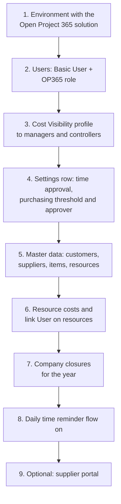

# Administration: users, security, settings and automations

> **Language:** English · [Italiano](../it/administration.md) · [Français](../fr/administration.md) · [Deutsch](../de/administration.md)
> **Manual index:** [README](../../README.md#user-manuals)

This manual is for the people who set up and run Open Project 365 in a company: functional administrators, IT staff and the Power Platform administrator. It explains how to give people access, how the security model works, what the company settings do, which automations run in the background and what to check after an update. Technical topics (building, deploying, the Dataverse schema) are covered in [Development environment setup](../dev-environment.md) and [Data model](../data-model.md).

## First setup checklist

| Step | Where | Details |
|---|---|---|
| 1 | Power Platform admin center | One Dataverse environment per company. The solution is installed by IT (see [dev environment](../dev-environment.md)) |
| 2 | Power Platform admin center → Users | [Security roles](#security-roles) |
| 3 | Power Platform admin center → Column security profiles | [Cost visibility](#cost-visibility) |
| 4 | Settings → Company → Settings | [Company settings](#company-settings) |
| 5 | Master Data | [Master data](master-data.md) |
| 6 | Master Data → Resources | [Master data](master-data.md#resources) |
| 7 | Projects → Planning → Absences (no resource) | [Master data](master-data.md#absences-and-company-closures) |
| 8 | Power Automate | [Daily time reminder](#daily-time-reminder) |
| 9 | Power Pages | [Supplier portal](supplier-portal.md) |

## Licences

Every internal user needs a **Power Apps Premium** licence (or an equivalent licence that includes model-driven apps on Dataverse). Suppliers using the portal do not need a Power Apps licence: they are portal users, covered by the Power Pages capacity of the environment.

## Security roles

Open Project 365 roles are **additive**: every internal user needs the standard **Basic User** role **plus** one Open Project 365 role.

| Role | For | Access |
|---|---|---|
| **OP365 Administrator** | Functional administrators, controllers, back office, purchasing approver | Organization-wide: create, read, write, delete, append, assign and share on all Open Project 365 tables, customers, suppliers and contacts. Sees every project. Can approve hours and requests on every project, decide supplier invoices, submit hours for others |
| **OP365 User** | Project managers, team members, buyers | Reads master data organisation-wide; creates and manages their own records; sees the projects they **own** or where they are **members**, with the rights of their project role (see [Projects and team](projects-and-team.md#the-project-team)). Supplier invoices: read only |

The standard **System Administrator** role is treated like OP365 Administrator by all Open Project 365 rules.

### What an OP365 User can do, by project role

| | Reader | Contributor | Manager |
|---|---|---|---|
| See the project, WBS, plan, costs | ✓ | ✓ | ✓ |
| Record own hours and materials | | ✓ | ✓ |
| Create purchase requests | | ✓ | ✓ |
| Register goods receipts | | ✓ | ✓ |
| Change the project, WBS, team, baselines | | | ✓ |
| Approve hours and purchase requests (first level) | | | ✓ |
| RFQs, orders, order statuses | | | ✓ |

Project roles are granted through **access teams** on each project; the three team templates (**OP365 Project Manager**, **OP365 Project Contributor**, **OP365 Project Reader**) are created automatically the first time they are needed. Do not delete or rename them.

### Giving access to a new employee

1. Add the user to the environment (Power Platform admin center → Environments → *your environment* → Users) and assign **Basic User** and **OP365 User** (or **OP365 Administrator**).
2. If they will see costs, add them to the **OP365 Cost Visibility** profile.
3. If they will record hours, create or open their **Resource** (Master Data → Resources), set **User**, Weekly Hours, Working Days and a **Resource Cost** row.
4. Add them to the teams of their projects (project **Team** tab), or ask the project managers to do it.

## Cost visibility

Cost columns are protected by the column security profile **OP365 Cost Visibility**. Without it a user sees these fields empty or masked, even on records they can open:

| Table | Protected columns |
|---|---|
| Resource | Hourly Cost |
| Resource Cost | Hourly Cost |
| Time Entry | Cost |
| Material Usage | Unit Cost, Total Cost |
| Account (supplier) | Spend |
| Item | Spend |

Assign the profile (Power Platform admin center → *Settings* → *Users + permissions* → *Column security profiles* → **OP365 Cost Visibility** → add users or teams) to administrators, project managers and controllers. Project totals (Budget Total, Actual Cost, Committed Cost) are not protected: whoever can read the project sees them.

## Company settings

**Settings → Company → Settings** holds a **single row** with the company-wide switches. Create it once if it does not exist; do not create a second one.

| Field | Default | Effect |
|---|---|---|
| **Name** | – | Company name |
| **Time Approval Enabled** | On (also when the row does not exist) | On: submitted hours wait for a project manager's approval. Off: **Submit** approves hours immediately |
| **Purchase Request Threshold** | Empty | Amount above which a purchase request also needs second-level approval. Empty or 0 = never |
| **Purchasing Approver** | Empty | The user who approves requests above the threshold and decides supplier invoices. Empty = every OP365 Administrator |

Changes apply immediately to new submissions; requests already submitted keep the approval level they were given.

## Other company data in the Settings area

| Page | Use |
|---|---|
| **Resource Costs** | All hourly cost rows of all resources: useful for yearly rate updates (add a row per resource with the new *Valid From*) |
| **Project Members** | All members of all projects: useful to check who works where, or to remove a person who left the company |

## Background automations

Open Project 365 keeps most figures up to date with **plugins** that run inside Dataverse when records are saved; they need no maintenance. Only one automation is scheduled.

### Daily time reminder

The **Daily time reminder** is a Power Automate cloud flow in the Open Project 365 solution. From **Monday to Friday at 17:30** (W. Europe time) it calls the action *op365_SendTimeReminders*, which sends the in-app notification "Record your hours" to every active resource with a user who recorded fewer hours than expected for the day (see [Time tracking](time-tracking.md#the-daily-reminder)). No reminders are sent on company closures.

The flow uses the connection reference **op365_dataverse** (Microsoft Dataverse). A service principal cannot own Power Automate connections, so a **user** must:

1. create a Microsoft Dataverse connection (service principal authentication is fine);
2. link it to the connection reference in the solution (in Test/Production environments the deployment maps it through the deployment settings);
3. share the connection with the deployment application user (*Can use*) so imports can turn the flow on;
4. turn the flow **on** and check its run history the next working day.

### What else happens automatically

| Automation | When |
|---|---|
| Project totals, WBS totals and progress | On every save of nodes, time entries, material usage, orders, receipts |
| Customer project count and contract value total | On every project change |
| Supplier spend and contact count; item order lines and spend | On every order, order line and contact change |
| Resource hourly cost | On every Resource Cost change |
| In-app notifications | On submissions and decisions of hours and purchase requests, and from the daily reminder |
| Project team access | On every project member change |

### Notifications

In-app notifications are on by default in new environments. Users manage them from the bell icon. Notifications are never blocking: if one cannot be sent, the operation still succeeds.

## Auditing and history

Auditing is enabled on the Open Project 365 tables: once auditing is also on at environment level (Power Platform admin center → *Settings* → *Audit and logs*), every change is recorded and visible in the **Audit history** of each record (Related → Audit history). The timeline of each record keeps notes, mentions and attachments.

## After an update of the solution

When IT deploys a new version:

1. Check that the plugin steps are **enabled** (an interrupted import can leave them disabled; IT can verify in the solution's *Plug-in steps*).
2. Check that the **Daily time reminder** flow is **on**.
3. If the supplier portal was updated, **clear the portal cache** (`/_services/about` → *Clear cache*) and sign in again.
4. Read the release notes and the updated manuals (this documentation is updated together with every functional change).

## Removing a person who left

1. Remove them from the project teams (Settings → Project Members, filter by user).
2. Deactivate their **Resource** (their past hours and costs stay).
3. Disable the user in the Power Platform admin center / Microsoft 365.
4. Reassign records they own (Assign) if needed.
5. If they were the **Purchasing Approver** or a project manager, update Settings and the projects.

## Troubleshooting

| Symptom | Likely cause | Fix |
|---|---|---|
| A user sees no projects | Not a member of any project, or missing OP365 role | Add the role; add them to project teams |
| "Your user is not linked to a resource" | No active Resource with that User | Set User on the Resource |
| Costs empty for a manager | Missing Cost Visibility profile | Add the user to the profile |
| Nobody receives the daily reminder | Flow off or connection broken | Check the flow and its connection |
| Totals not updated after an import | Plugin steps disabled | Enable the plugin steps |
| Requests above the threshold go to all administrators | Purchasing Approver empty | Set it in Settings |
| Suppliers see "This area is reserved to suppliers" | Missing Supplier web role or not signed in | Assign the web role to the contact |
