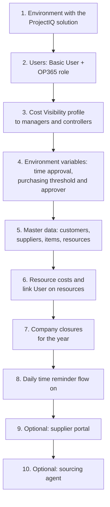
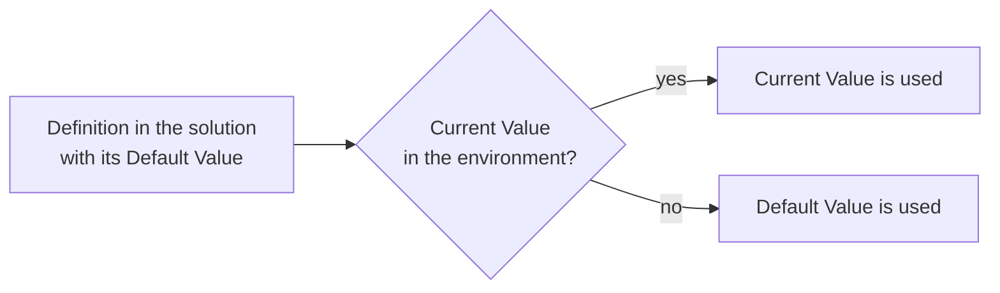
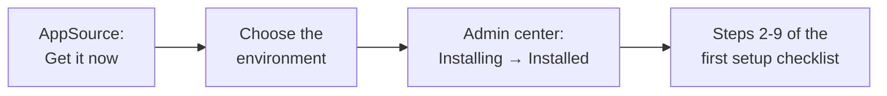

# Administration: users, security, settings and automations

> **Language:** English · [Italiano](../it/administration.md) · [Français](../fr/administration.md) · [Deutsch](../de/administration.md)
> **Manual index:** [README](../../README.md#user-manuals)

This manual is for the people who set up and run ProjectIQ in a company: functional administrators, IT staff and the Power Platform administrator. It explains how to give people access, how the security model works, what the company settings do, which automations run in the background and what to check after an update. Technical topics (building, deploying, the Dataverse schema) are covered in [Development environment setup](../dev-environment.md) and [Data model](../data-model.md).

## First setup checklist

| Step | Where | Details |
|---|---|---|
| 1 | Power Platform admin center | One Dataverse environment per company. The solution is installed from [Microsoft AppSource](#installing-from-microsoft-appsource) or by IT (see [dev environment](../dev-environment.md)) |
| 2 | Power Platform admin center → Users | [Security roles](#security-roles) |
| 3 | Power Platform admin center → Column security profiles | [Cost visibility](#cost-visibility) |
| 4 | Power Apps → Solutions → ProjectIQ → Environment variables | [Company settings](#company-settings) |
| 5 | Master Data | [Master data](master-data.md) |
| 6 | Master Data → Resources | [Master data](master-data.md#resources) |
| 7 | Projects → Planning → Absences (no resource) | [Master data](master-data.md#absences-and-company-closures) |
| 8 | Power Automate | [Daily time reminder](#daily-time-reminder) |
| 9 | Power Pages | [Supplier portal](supplier-portal.md) |
| 10 | Power Platform admin center, Power Apps, Power Automate | [Setting up the sourcing agent](#setting-up-the-sourcing-agent) |

## Licences

Every internal user needs a **Power Apps Premium** licence (or an equivalent licence that includes model-driven apps on Dataverse). Suppliers using the portal do not need a Power Apps licence: they are portal users, covered by the Power Pages capacity of the environment.

The [sourcing agent](sourcing-agent.md) adds an application user (it needs no user licence, but it counts against the application users of the environment) and two cloud flows that use the Microsoft Dataverse and Microsoft Teams connections. The agent itself is a Copilot Studio autonomous agent that uses Copilot Studio capacity (Copilot Credits) on every run: check your licensing before you switch it on.

## Security roles

ProjectIQ roles are **additive**: every internal user needs the standard **Basic User** role **plus** one ProjectIQ role.

| Role | For | Access |
|---|---|---|
| **OP365 Administrator** | Functional administrators, controllers, back office, purchasing approver | Organization-wide: create, read, write, delete, append, assign and share on all ProjectIQ tables, customers, suppliers and contacts. Sees every project. Can approve hours and requests on every project, decide supplier invoices, submit hours for others |
| **OP365 User** | Project managers, team members, buyers | Reads master data organisation-wide; creates and manages their own records; sees the projects they **own** or where they are **members**, with the rights of their project role (see [Projects and team](projects-and-team.md#the-project-team)). Supplier invoices: read only |

| **OP365 Buyer** | Buyers who run purchasing for the company | In addition to Basic User (and normally OP365 User): reads all projects and their child tables; full access to purchase requests, RFQs, invitations, quotes, orders, goods receipts, supplier accounts and contacts on every project; reads supplier invoices (does not decide them); reads and writes the [agent proposals](sourcing-agent.md#agent-proposals). Assign the **OP365 Cost Visibility** profile too |
| **OP365 Sourcing Agent** | The application user of the sourcing agent only | Reads master data, projects and purchasing data; creates agent proposals. It does not write purchasing records and cannot decide proposals. Needs the **OP365 Cost Visibility** profile for the spend analysis |

The standard **System Administrator** role is treated like OP365 Administrator by all ProjectIQ rules.

### What an OP365 User can do, by project role

| | Reader | Contributor | Manager |
|---|---|---|---|
| See the project, WBS, plan, costs | ✓ | ✓ | ✓ |
| Record own hours and materials | | ✓ | ✓ |
| Create purchase requests | | ✓ | ✓ |
| Register goods receipts | | ✓ | ✓ |
| Change the project, WBS, team, baselines | | | ✓ |
| Approve hours and purchase requests (first level) | | | ✓ |
| RFQs, orders, order statuses | | | ✓ |

Project roles are granted through **access teams** on each project; the three team templates (**OP365 Project Manager**, **OP365 Project Contributor**, **OP365 Project Reader**) are created automatically the first time they are needed. Do not delete or rename them.

### Giving access to a new employee

1. Add the user to the environment (Power Platform admin center → Environments → *your environment* → Users) and assign **Basic User** and **OP365 User** (or **OP365 Administrator**).
2. If they will see costs, add them to the **OP365 Cost Visibility** profile.
3. If they will record hours, create or open their **Resource** (Master Data → Resources), set **User**, Weekly Hours, Working Days and a **Resource Cost** row.
4. Add them to the teams of their projects (project **Team** tab), or ask the project managers to do it.

## Cost visibility

Cost columns are protected by the column security profile **OP365 Cost Visibility**. Without it a user sees these fields empty or masked, even on records they can open:

| Table | Protected columns |
|---|---|
| Resource | Hourly Cost |
| Resource Cost | Hourly Cost |
| Time Entry | Cost |
| Material Usage | Unit Cost, Total Cost |
| Account | Spend (suppliers), IBAN |
| Item | Spend |
| Agent Proposal | Evidence |

Assign the profile also to the buyers and to the application user of the sourcing agent. Assign the profile (Power Platform admin center → *Settings* → *Users + permissions* → *Column security profiles* → **OP365 Cost Visibility** → add users or teams) to administrators, project managers and controllers. Project totals (Budget Total, Actual Cost, Committed Cost) are not protected: whoever can read the project sees them.

## Company settings

The company-wide switches are **environment variables** of the ProjectIQ solution. Each environment (Dev, Test, Production) has its own values, so a test environment can, for example, skip time approval without touching production. They are not in the app: a Power Platform administrator or a maker of the environment changes them.

To change a value:

1. Open [Power Apps](https://make.powerapps.com), select the environment, then **Solutions** → **ProjectIQ** (or **Default Solution**) → **Environment variables**.
2. Open the variable and, under **Current Value**, click **+ New value** (or edit the existing one). Do not change the **Default Value** of a managed solution.
3. **Save**. The change applies to the next submission; no publish is needed.

| Environment variable | Display name | Type | Default | Effect |
|---|---|---|---|---|
| `op365_TimeApprovalEnabled` | **Time Approval Enabled** | Yes/No | Yes | Yes: submitted hours wait for a project manager's approval. No: **Submit** approves hours immediately |
| `op365_PurchaseRequestThreshold` | **Purchase Request Threshold** | Number | Empty | Amount above which a purchase request also needs second-level approval. Empty or 0 = never |
| `op365_PurchasingApprover` | **Purchasing Approver** | Text | Empty | **User Name** (e.g. `anna.rossi@contoso.com`) or primary email of the user who approves requests above the threshold and decides supplier invoices. Empty, or no enabled user with that name = every OP365 Administrator |
| `op365_SupplierEmailTemplates` | **Supplier Email Templates** | JSON | The ProjectIQ templates | E-mail template (Account type) of each message to suppliers, by supplier **Language**: `{"DocumentExpiring": {"Italian": "<template title>", "English": "<template title>", "default": "English"}, "DocumentExpired": {...}, "PortalInvitation": {...}}`. `default` is the language used when the supplier has none or it has no template |
| `op365_SupplierEmailSender` | **Supplier Email Sender** | Text | Empty | Name or e-mail address of the **queue** (mailbox with server-side synchronization) that sends the e-mails to suppliers. Empty = no e-mails |
| `op365_SupplierProgressUpdates` | **Supplier Progress Updates** | Yes/No | No | Yes: on the supplier portal suppliers can update the progress % of the WBS activities of their scope (activities without sub-activities only). No: they only see it. See [Supplier portal](supplier-portal.md#project-suppliers-and-wbs-scope) |
| `op365_SourcingAgentEnabled` | **Sourcing Agent Enabled** | Yes/No | No | Yes: the sourcing agent triggers run. No: they stop at once; open proposals can still be decided |
| `op365_SourcingAgentUser` | **Sourcing Agent User** | Text | Empty | **User Name** of the application user that runs the agent: the only caller trusted to pass the person who decided (the approval card flow does). Empty = nobody |
| `op365_SourcingApprovalTeam` | **Sourcing Approval Team** | Text | Empty | Teams team id and channel id separated by `\|`, where the approval cards are posted |
| `op365_SourcingDirectOrderLimit` | **Sourcing Direct Order Limit** | Number | Empty | Amount below which the agent proposes a direct purchase order instead of an RFQ. Empty or 0 = always RFQ |
| `op365_SourcingMinQuotes` | **Sourcing Minimum Quotes** | Number | 3 | Number of suppliers the agent proposes to invite to an RFQ |
| `op365_SourcingReminderDays` | **Sourcing Reminder Days** | Number | 2 | Days before the RFQ deadline when the agent reminds the suppliers who have not answered (later tasks) |
| `op365_SourcingBudgetWarningPct` | **Sourcing Budget Warning %** | Number | 90 | Percentage of the budget of a project or WBS node above which the agent reports a Budget Alert (later tasks) |
| `op365_SourcingProposalExpiryDays` | **Sourcing Proposal Expiry Days** | Number | 5 | Days after creation when a pending proposal expires |
| `op365_InvoiceAiExtraction` | **Invoice AI Extraction** | Yes/No | Yes | Yes: PDF and image invoices uploaded on the supplier portal are read by the AI Builder prebuilt invoice processing model, which consumes AI Builder credits (about 32 per page). No: only FatturaPA XML files are read; suppliers type the data of the others. See [Purchasing](purchasing.md#reading-the-file) |

The Purchasing Approver is a user name and not a lookup because user ids differ in every environment. Requests already submitted keep the approval level they were given.

In Test, IT can also set the values at deployment time through the deployment settings (see [dev environment](../dev-environment.md#github-repository-security)); a value set there overwrites the one in the environment at each deployment.

## Other company data in the Settings area

| Page | Use |
|---|---|
| **Resource Costs** | All hourly cost rows of all resources: useful for yearly rate updates (add a row per resource with the new *Valid From*) |
| **Project Members** | All members of all projects: useful to check who works where, or to remove a person who left the company |

## Background automations

ProjectIQ keeps most figures up to date with **plugins** that run inside Dataverse when records are saved; they need no maintenance. Four cloud flows are scheduled or triggered: the two below and the two of the [sourcing agent](#agent-proposal-approval-and-daily-agent-proposal-expiry).

### Daily time reminder

The **Daily time reminder** is a Power Automate cloud flow in the ProjectIQ solution. From **Monday to Friday at 17:30** (W. Europe time) it calls the action *op365_SendTimeReminders*, which sends the in-app notification "Record your hours" to every active resource with a user who recorded fewer hours than expected for the day (see [Time tracking](time-tracking.md#the-daily-reminder)). No reminders are sent on company closures.

The flow uses the connection reference **op365_dataverse** (Microsoft Dataverse). A service principal cannot own Power Automate connections, so a **user** must:

1. create a Microsoft Dataverse connection (service principal authentication is fine);
2. link it to the connection reference in the solution (in Test/Production environments the deployment maps it through the deployment settings);
3. share the connection with the deployment application user (*Can use*) so imports can turn the flow on;
4. turn the flow **on** and check its run history the next working day.

### Daily document expiry

The **Daily document expiry** flow runs **every day at 06:00** (W. Europe time) and calls the action *op365_UpdateDocumentExpiry*: it refreshes the expiry status of the supplier documents and the supplier alert counters, and e-mails the expiry notices to suppliers (see [Master data](master-data.md#expiry-and-e-mails)). It uses the same connection reference as the Daily time reminder; turn it **on** in the same way.

To send the e-mails:

1. Create a **queue** with a mailbox (for example *Suppliers*, `suppliers@contoso.com`), approve the mailbox e-mail address and enable **server-side synchronization** for outgoing e-mail.
2. Set **Supplier Email Sender** to the name or the e-mail address of the queue.
3. Check the templates in **Settings** → **Templates** → **E-mail Templates** (*ProjectIQ - Document expiring* and *ProjectIQ - Document expired*, with a version per language such as *ProjectIQ - Documento scaduto*). Change their text as you like; placeholders `{Document}`, `{DocumentType}`, `{Number}`, `{IssueDate}` and `{ExpiryDate}` are filled in for each document. To use other templates, write their titles in **Supplier Email Templates**. Templates are data of the environment, not of the solution: if they are missing, IT creates them with `tools/dataverse/supplier_email_templates.py`.
   The same queue sends the portal invitations (**Invite to Portal** on the contact) with *ProjectIQ - Portal invitation* (message `PortalInvitation`; placeholders `{Contact}`, `{Email}`, `{Link}` and `{ExpiryDate}`). Keep `{Link}` in its text: it is the registration link.
4. Fill in the **Language** and the **Email** of each supplier account.

### Agent proposal approval and Daily agent proposal expiry

Two flows belong to the [sourcing agent](sourcing-agent.md); both are created **off**:

| Flow | When | Does |
|---|---|---|
| **Agent proposal approval** | When a proposal (Kind Proposal) is added | Posts an adaptive card with Approve / Reject in the Teams channel of *Sourcing Approval Team*, waits for the answer, records the decision in the name of the person who answered, and posts the outcome |
| **Daily agent proposal expiry** | Every day at 06:30 (W. Europe time) | Calls the action *op365_ExpireAgentProposals*: pending proposals past their **Expires On** become Expired |

The approval flow uses the connection reference **op365_teams** (Microsoft Teams) and its own Dataverse connection reference **op365_dataverse_agent** (*ProjectIQ Dataverse (sourcing agent)*), which acts as the application user of the agent; all the other flows use **op365_dataverse**. It posts a card for every new proposal even when *Sourcing Agent Enabled* is No. The steps to turn them on are in [Setting up the sourcing agent](#setting-up-the-sourcing-agent).

### What else happens automatically

| Automation | When |
|---|---|
| Project totals, WBS totals and progress | On every save of nodes, time entries, material usage, orders, receipts |
| Customer project count and contract value total | On every project change |
| Supplier spend and contact count; item order lines and spend | On every order, order line and contact change |
| Resource hourly cost | On every Resource Cost change |
| In-app notifications | On submissions and decisions of hours and purchase requests, and from the daily reminder; to the project managers when the sourcing agent adds a proposal |
| Project team access | On every project member change |
| Reading of supplier invoices (FatturaPA XML or AI Builder) and their checks | In the background, a few seconds after a supplier uploads an invoice or changes its number, date or order |

### Notifications

In-app notifications are on by default in new environments. Users manage them from the bell icon. Notifications are never blocking: if one cannot be sent, the operation still succeeds.

## Setting up the sourcing agent

Do this once per environment, after the solution is installed. The foundations work without the agent: you can test the whole proposal cycle with the smoke test of IT before the agent exists. Everything is off until you decide.

1. **Create the application user.** In Microsoft Entra ID register an application (client id and secret). In the Power Platform admin center → Environments → *your environment* → Settings → Users + permissions → **Application users**, add it with the name **ProjectIQ Sourcing Agent** and assign the roles **Basic User** and **OP365 Sourcing Agent** (OP365 roles add to Basic User). Also assign the **OP365 Cost Visibility** profile (Column security profiles).
2. **Set *Sourcing Agent User*** to the **User Name** of this application user ([Company settings](#company-settings)). Without it nobody can decide on behalf of a person, so the Teams card cannot work.
3. **Give the buyers access.** Assign **OP365 Buyer** (in addition to Basic User and OP365 User) and the **OP365 Cost Visibility** profile to the people who decide purchasing proposals. The Purchasing Approver decides invoice proposals.
4. **Choose the channel.** Create or pick a Teams channel for the cards and set *Sourcing Approval Team* to `<team id>|<channel id>`.
5. **Create the connections.** A user creates the **Microsoft Teams** connection (a service account that is a member of the team) for the connection reference **op365_teams**, and a **Microsoft Dataverse** connection owned by the application user of step 1 (it signs in as that application user) for the connection reference **op365_dataverse_agent**, then links them in the solution (Test and Production: through the deployment settings). Use that Dataverse connection only for **op365_dataverse_agent** and do not share it with other users: whatever uses it acts as the agent. Never link it to **op365_dataverse**, which the other flows use.
6. **Turn on** the flows **Agent proposal approval** and **Daily agent proposal expiry** and check their run history the next day.
7. **Build and publish the agent** in Copilot Studio with the application user's Dataverse connection, following the [build guide](../../copilot/sourcing-agent/README.md).
8. **Switch the agent on** only when it is published: set *Sourcing Agent Enabled* to Yes. The agent is off by default in every environment, also in the AppSource package.

To check the setup without waiting for the agent, IT runs the smoke test described in the [development environment guide](../dev-environment.md#sourcing-agent).

## Auditing and history

Auditing is enabled on the ProjectIQ tables: once auditing is also on at environment level (Power Platform admin center → *Settings* → *Audit and logs*), every change is recorded and visible in the **Audit history** of each record (Related → Audit history). The timeline of each record keeps notes, mentions and attachments.

## Installing from Microsoft AppSource

ProjectIQ is free on Microsoft AppSource: the quickest way to install it in a new environment. The AppSource package installs the two managed solutions in order, **ProjectIQ** (`OpenProject365`) and the **supplier portal** (`OpenProject365SupplierPortal`), with the plugin steps already enabled.

Before you start: a Dataverse environment for the company, the **System Administrator** role in it, and, to show the app in Italian, French or German, those languages enabled in the environment (*Settings* → *Languages*).

1. Open ProjectIQ on [Microsoft AppSource](https://appsource.microsoft.com) and select **Get it now**; sign in with your work account.
2. Choose the target **environment**, accept the terms of use and the Microsoft terms, and select **Install**.
3. Follow the progress in the Power Platform admin center → *Environments* → your environment → *Resources* → **Dynamics 365 apps**: the status goes from *Installing* to **Installed** (it takes several minutes). If it shows *Install failed*, open the details and retry.
4. Complete steps 2 to 9 of the [first setup checklist](#first-setup-checklist). The package cannot do these for you:
    - give users the [security roles](#security-roles) and the [Cost visibility](#cost-visibility) profile;
    - set the [environment variables](#company-settings) (time approval, purchasing threshold and approver);
    - create the Dataverse connection of the [Daily time reminder](#daily-time-reminder) flow and turn the flow **on**;
    - for the [supplier portal](supplier-portal.md#for-administrators): reactivate the imported site in Power Pages → *Inactive sites*, then clear its cache.

New versions are published on AppSource: install them from the same **Dynamics 365 apps** page (*Update* on ProjectIQ), then follow [After an update of the solution](#after-an-update-of-the-solution).

## After an update of the solution

When IT deploys a new version:

1. Check that the plugin steps are **enabled** (an interrupted import can leave them disabled; IT can verify in the solution's *Plug-in steps*).
2. Check that the **Daily time reminder** flow is **on** (and, if you use the sourcing agent, **Agent proposal approval** and **Daily agent proposal expiry**).
3. If the supplier portal was updated, **clear the portal cache** (`/_services/about` → *Clear cache*) and sign in again.
4. Read the release notes and the updated manuals (this documentation is updated together with every functional change).

## Removing a person who left

1. Remove them from the project teams (Settings → Project Members, filter by user).
2. Deactivate their **Resource** (their past hours and costs stay).
3. Disable the user in the Power Platform admin center / Microsoft 365.
4. Reassign records they own (Assign) if needed.
5. If they were the **Purchasing Approver** or a project manager, update the [environment variable](#company-settings) and the projects.

## Troubleshooting

| Symptom | Likely cause | Fix |
|---|---|---|
| A user sees no projects | Not a member of any project, or missing OP365 role | Add the role; add them to project teams |
| "Your user is not linked to a resource" | No active Resource with that User | Set User on the Resource |
| Costs empty for a manager | Missing Cost Visibility profile | Add the user to the profile |
| Nobody receives the daily reminder | Flow off or connection broken | Check the flow and its connection |
| Totals not updated after an import | Plugin steps disabled | Enable the plugin steps |
| Requests above the threshold go to all administrators | Purchasing Approver empty, or not the User Name of an enabled user | Set the [environment variable](#company-settings) |
| Suppliers see "This area is reserved to suppliers" | Missing Supplier web role or not signed in | Assign the web role to the contact |
| No card in Teams for a new proposal | Flow **Agent proposal approval** off, Teams connection broken, or *Sourcing Approval Team* empty or wrong | Check the flow, its connections and the setting |
| The channel shows "Only the sourcing agent can decide on behalf of another user." | *Sourcing Agent User* empty, or not the user of the connection of **op365_dataverse_agent** | Set the User Name of the application user and link its connection to **op365_dataverse_agent** |
| "You cannot decide this proposal." | The person lacks the role for that action type | See [Who does what](sourcing-agent.md#who-does-what) |
| Proposals stay Pending after their date | Flow **Daily agent proposal expiry** off | Turn it on |
