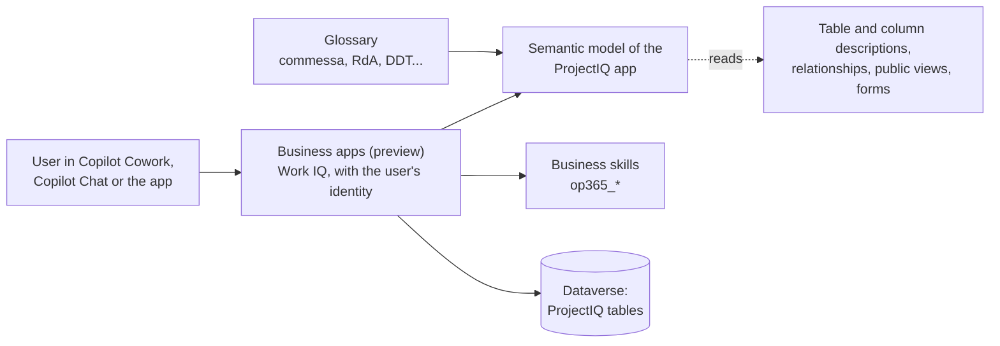
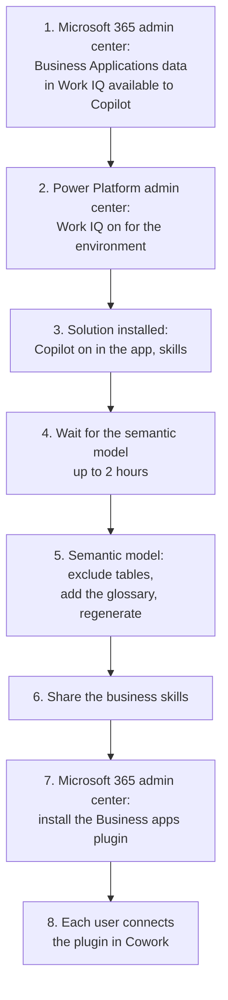

# Copilot and Cowork: asking questions about your projects

> **Language:** English · [Italiano](../it/copilot.md) · [Français](../fr/copilot.md) · [Deutsch](../de/copilot.md)
> **Manual index:** [README](../../README.md#user-manuals)

ProjectIQ data can be read from **Microsoft Copilot**: in the Copilot pane of the app, in Microsoft 365 Copilot Chat and in **Copilot Cowork** through the **Business apps (preview)** plugin. People ask in their own words ("how is project PRJ-000123 going?", "which hours do I have to approve?") and get answers built from the same records they see in the app, with the same permissions.

This first release is **read-only**: Copilot finds, explains and summarises data, but it does not create, change, submit or approve anything. Every action stays on the buttons of the app.

> These Microsoft features are in **preview**: names, screens and behaviour may change.

## How it works

| Part | What it does | Where it comes from |
|---|---|---|
| Semantic model | Tells Copilot what the tables, columns and relationships mean | Created by Dataverse for the app when Microsoft Copilot is on; it reads the descriptions of tables and columns, the relationships, the public views and the form names of the solution |
| Glossary | Maps business words (commessa, RdA, DDT, fattura passiva...) to the tables | Entered by an administrator, see [Semantic model glossary](#semantic-model-glossary) |
| Business skills | Step-by-step instructions for the common questions | Delivered in the solution, see [Business skills](#business-skills) |
| Permissions | What each person can see | The usual security roles, project access teams and column security of ProjectIQ |

## What you can ask

| Topic | Example questions | Business skill |
|---|---|---|
| Project status | "How is project PRJ-000123 going?", "Which projects are over budget?" | ProjectIQ - Project status |
| Hours to approve | "Which hours do I have to approve?" | ProjectIQ - Hours to approve |
| Missing hours | "Who has not entered their hours yesterday?" | ProjectIQ - Missing hours |
| Purchasing | "Where is the purchase request for the scaffolding?", "Which orders are late?", "Which supplier invoices are to review?" | ProjectIQ - Purchasing status |
| Supplier compliance | "Which suppliers have an expired DURC?", "Can we order from Rossi Srl?" | ProjectIQ - Supplier compliance |
| Resource load | "Who is overloaded next month?" | ProjectIQ - Resource load |

Questions outside these topics also work: Copilot uses the semantic model to find the right tables. When the answer needs an action (approve, submit, send, receive), Copilot tells you which screen of the app to use.

## Set up (administrators)

The steps are done once per environment, by the people with the right admin role.

| Step | Who | Where | What |
|---|---|---|---|
| 1 | Microsoft 365 admin | Microsoft 365 admin center → **Copilot** → **Settings** → **Business Applications data in Work IQ available to Copilot** | **All users**, or the Entra groups of the ProjectIQ users |
| 2 | Power Platform admin | Power Platform admin center → environment → **Work IQ** | On. Also check that **Dataverse search** is **On** or **Default** |
| 3 | IT | Solution import (see [dev environment](../dev-environment.md#copilot-and-work-iq)) | The solution turns on **Microsoft Copilot in model-driven apps** for the ProjectIQ app, adds the business skills and puts the tables in scope in the **Dataverse search** index: without it Copilot knows the tables but finds no records |
| 4 | – | – | The first generation of the semantic model takes up to two hours |
| 5 | System Administrator | Power Apps → **Semantic model** | See [Tune the semantic model](#tune-the-semantic-model) |
| 6 | System Administrator | Power Apps → **Business skills (preview)** | See [Business skills](#business-skills) |
| 7 | Microsoft 365 admin | Microsoft 365 admin center → **Agents** → **Tools** → **Plugins** → **Business apps (preview)** → **Install** | **All users** or **Specific users and groups** |
| 8 | Each user | Copilot → **Cowork** → **Customize** → **Business apps (preview)** → **Show more** → **Connect** next to **Business apps (preview)** | Sign in and approve the request in the Authenticator app |

Write actions through Work IQ are blocked by default by tenant policy. Keep them blocked: ProjectIQ is read-only from Copilot in this release.

### Licences

Each person needs the **Power Apps Premium** licence used for ProjectIQ and a **Microsoft 365 Copilot** licence. Semantic indexing uses extra Dataverse capacity.

## Tune the semantic model

The semantic model of the app is named `M365_Primary_model_op365_OpenProject365` (as seen in Dev; Microsoft also documents `M365_Secondary_model_<app>`). Dataverse regenerates it every 12 hours; changes to descriptions, views and the glossary are picked up at the next regeneration, or at once with a manual regeneration.

1. Sign in to Power Apps, select the environment, then **More** → **Discover all** → **Semantic model**.
2. Open the model of the **ProjectIQ** app.
3. Select **Configuration** and clear **Include in semantic model** for these tables, then select **Save and sync**:

| Table | Why it is excluded |
|---|---|
| Resource Cost | Hourly costs: sensitive, and not needed to answer questions. Also kept out of the Dataverse search index |
| Settings | Company configuration (single row) |
| Baseline Node | Values saved in a baseline: they duplicate the WBS and confuse "current" questions |
| WBS Dependency | Gantt links: noise for business questions |

4. Leave **Sample table rows** off (default): answers come from live data, not from samples.
5. Add the glossary, see the next section.
6. Select **Regenerate**.

The semantic model is **not** moved by solutions: repeat these steps in every environment (Dev, Test, production), and after a copy or move of an environment turn Work IQ off and on again.

### Semantic model glossary

The glossary adds business words that Dataverse cannot infer from the metadata. The full list is kept in the repository in [copilot/glossary.md](../../copilot/glossary.md).

1. In the semantic model, select **Glossary** → **Add item**.
2. For each row of the list, enter **Term** and **Definition**, then add the **Synonyms** (open the entry again and select **Edit** if the synonyms field is not on the first screen).
3. Select **Add term**, then **Regenerate** when all terms are in.

| Term | Synonyms (examples) |
|---|---|
| Project | commessa, progetto |
| Time entry | ore, rapportino, timesheet |
| Purchase request | RdA, richiesta di acquisto |
| RFQ | RdO, richiesta di offerta |
| Purchase order | OdA, ordine fornitore |
| Goods receipt | entrata merce, DDT |
| Supplier invoice | fattura passiva |
| Supplier document | DURC |

## Business skills

Business skills are instructions that tell Copilot how to answer a type of question: which tables to read, how to compute the figures, what to flag. They are part of the ProjectIQ solution (unique names starting with `op365_`), so they are installed and updated with it. Their text is kept in the repository in `copilot/skills/`.

| Skill | Reads | Points the user to |
|---|---|---|
| ProjectIQ - Project status | Project, WBS nodes, baseline, open purchases | – |
| ProjectIQ - Hours to approve | Submitted time entries of the user's projects | Projects → Time → **Approvals** |
| ProjectIQ - Missing hours | Resources, absences, time entries | – (the Daily time reminder flow already notifies people) |
| ProjectIQ - Purchasing status | Purchase requests, RFQs, purchase orders, goods receipts, supplier invoices | The buttons of the purchasing forms |
| ProjectIQ - Supplier compliance | Suppliers and supplier documents | The supplier form, or the [supplier portal](supplier-portal.md) |
| ProjectIQ - Resource load | Resources, allocations, absences | Projects → Planning → **Resource Load** |

All skills are **read-only**: they never create or change records.

To make them available to everyone:

1. In Power Apps select **More** → **Business skills (preview)**.
2. Check that the six `ProjectIQ - ...` skills are listed and active. They are installed as **Organization** skills (viewable by everyone in the environment).
3. If a skill is not visible to a user, select it → **Share** → **Anyone can view**.

Do not edit the skills in production: changes are made in the repository and delivered with the solution.

## Security and privacy

- Copilot works **with the identity of the user**: it sees only the records and columns the user can see in the app (security roles and project access teams, see [Administration](administration.md#security-roles)).
- Columns protected by the **OP365 Cost Visibility** profile (hourly costs, time entry Cost, material costs, supplier Spend, see [Cost visibility](administration.md#cost-visibility)) stay hidden for users without that profile. The skills say so instead of guessing.
- Copilot does not change data. Every change still goes through the app, its validation rules and its plugins.

## Limits

- Preview features: answers may be incomplete; always check important figures in the app.
- No actions from Copilot in this release: submitting, approving, sending, awarding, receiving and cancelling stay in the app.
- The semantic model, its table settings and the glossary are configured per environment.
- Answers depend on the quality of the descriptions in the solution: when a question is misunderstood, report it so the description or the glossary can be improved.
