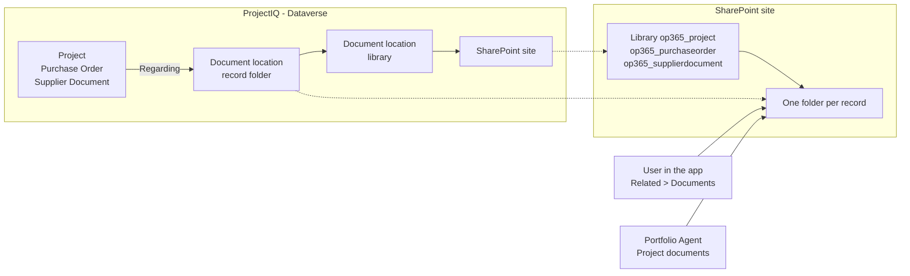
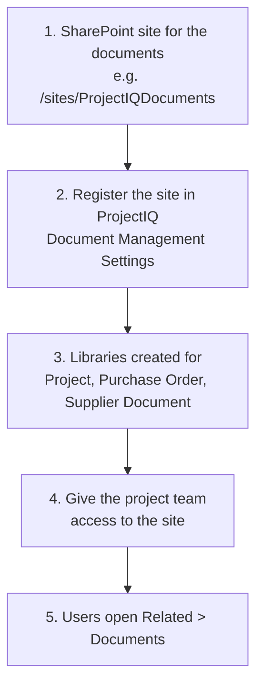

# Documents in SharePoint

> **Language:** English · [Italiano](../it/documents.md) · [Français](../fr/documents.md) · [Deutsch](../de/documents.md)
> **Manual index:** [README](../../README.md#user-manuals)

Contracts, drawings, progress reports, quotes and delivery notes belong to a job, but they do not belong in the database. ProjectIQ keeps them in **SharePoint**, with the standard Dataverse document management: each **Project**, **Purchase Order** and **Supplier Document** gets its own SharePoint folder, opened from the record. Files keep SharePoint versioning, co-authoring in Office, search and sharing; ProjectIQ only stores where the folder is.

This manual is for everybody who works with project documents (part 1) and for the administrators who connect ProjectIQ to SharePoint (part 2).

## How it works

| Table | SharePoint library | Folder |
|---|---|---|
| Project | `op365_project` | One per project, named after the project and its id |
| Purchase Order | `op365_purchaseorder` | One per order |
| Supplier Document | `op365_supplierdocument` | One per document (for example the scanned DURC with its attachments) |

The folder is created the **first time someone opens Documents** on the record. Dataverse saves a *document location* that links the record to the folder; the agent and the app find the folder through it. A project created in Copilot from a document already has its folder, with the document in it (see [Portfolio Agent](portfolio-agent.md#new-project-from-a-document)).

## Part 1: working with documents

### Opening the documents of a record

1. Open the project (or purchase order, or supplier document).
2. Select **Related** → **Documents**. The first time, ProjectIQ creates the SharePoint folder of the record.
3. The grid lists the files of the folder: **Upload**, **New** (Word, Excel, PowerPoint, OneNote), **Open in SharePoint**, **Delete**, **Check Out** / **Check In** and **Edit Properties** work directly on SharePoint.

| Command | What it does |
|---|---|
| **Upload** | Uploads one or more files into the folder (or a subfolder) |
| **New** | Creates an Office document in the folder and opens it in the browser |
| **Open Location** / **Open in SharePoint** | Opens the folder in SharePoint, for subfolders, sharing, versions and bulk moves |
| **Document Location** → **Add Location** | Links another existing SharePoint folder to the record (for example a folder in a Teams team) |

### Who sees which files

- To see the **Documents** tab you need the ProjectIQ role (see [Administration](administration.md#security-roles)): **OP365 User** can create the folder of the records they can open and read every document location.
- **SharePoint permissions decide which files you see.** ProjectIQ does not copy its project sharing to SharePoint: give the project team access to the site (or to a library or folder) in SharePoint.

### Documents in Copilot

In the [Portfolio Agent](portfolio-agent.md#project-documents) ask "show the documents of PRJ-000123": the card lists the files and subfolders of the project folder, most recent first, with a link to each file and to the folder.

### Supplier documents

A **Supplier Document** (DURC, certification, insurance) still has its **File** column, used by the [supplier portal](supplier-portal.md). The SharePoint folder of the record is for the other files that go with it (renewals, correspondence). Expiry dates and supplier compliance keep working on the Supplier Document fields as before.

## Part 2: set up (administrators)

Done once per environment, by the Power Platform administrator with a SharePoint administrator.

| Step | Who | What |
|---|---|---|
| 1 | SharePoint admin | Create a SharePoint team or communication site for the documents, in the same Microsoft 365 tenant as the environment |
| 2 | Power Platform admin | In the app open **Settings** (gear) → **Advanced Settings** → **Document Management** → **Document Management Settings**, select **Project**, **Purchase Order** and **Supplier Document**, enter the site URL, select **Next** and **Finish**. The libraries are created on the site |
| 3 | Power Platform admin | Alternative to step 2 for scripted environments: `SHAREPOINT_SITE_URL=<site URL> python3 tools/dataverse/documents.py` registers the site as the default site; the libraries are then created when the first record of each table opens Documents |
| 4 | SharePoint admin | Give the people who use ProjectIQ at least **Edit** (or **Read**) on the site |
| 5 | Each user | Open **Related** → **Documents** on a record |

Server-based SharePoint integration is on by default in Dataverse online; if **Document Management Settings** reports it is off, enable it from **Advanced Settings** → **Document Management** → **Enable Server-Based SharePoint Integration**.

Document management on the three tables, and the document location and SharePoint site privileges of the **OP365 User** and **OP365 Administrator** roles, are part of the ProjectIQ solution: an update of the solution brings them. The SharePoint site is a setting of each environment and is not in the solution.

## Messages you may see

| Message | Meaning and solution |
|---|---|
| No **Documents** under **Related**, or a message that document management is not configured | The site is not registered (see [Part 2](#part-2-set-up-administrators), step 2), or the ProjectIQ app does not contain the **SharePoint Document** and **Document Location** tables: run `tools/dataverse/app.py` or add the tables in the app designer and publish |
| The Documents grid says you have no permission on the location | Your SharePoint account has no access to the site or folder: ask the SharePoint administrator (step 4) |
| Access denied when the folder is created | You cannot write in the library: ask for **Edit** on the site |
| Card: "No document folder yet" | Nobody has opened Documents on the project: open the project in ProjectIQ and select **Related** → **Documents** |
| Card: "You have no access to the SharePoint folder of this project." | As above: SharePoint access to the site is missing |
