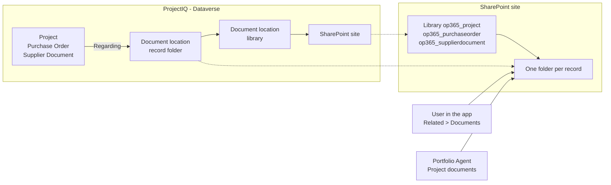
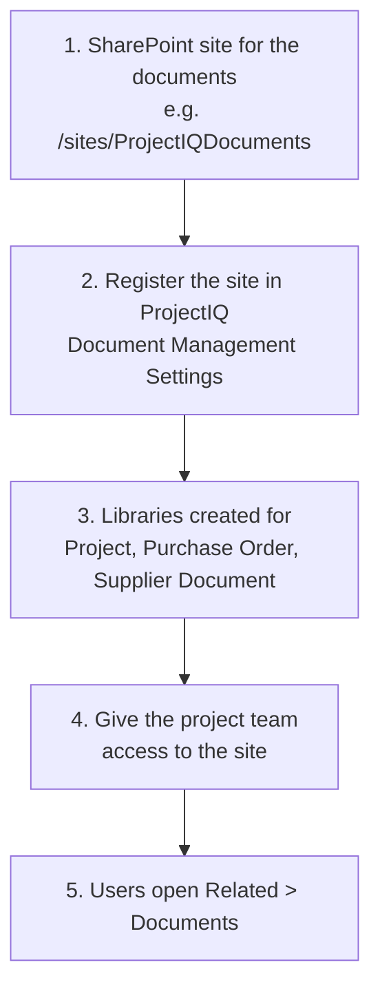

# Documents in SharePoint

> **Language:** English · [Italiano](../it/documents.md) · [Français](../fr/documents.md) · [Deutsch](../de/documents.md)
> **Manual index:** [README](../../README.md#user-manuals)

Contracts, drawings, progress reports, quotes and delivery notes belong to a job, but they do not belong in the database. ProjectIQ keeps them in **SharePoint**, with the standard Dataverse document management: each **Project**, **Purchase Order** and **Supplier Document** gets its own SharePoint folder, opened from the record. Files keep SharePoint versioning, co-authoring in Office, search and sharing; ProjectIQ only stores where the folder is.

This manual is for everybody who works with project documents (part 1) and for the administrators who connect ProjectIQ to SharePoint (part 2).

## How it works

| Table | SharePoint library | Folder |
|---|---|---|
| Project | `op365_project` | One per project, named after the project and its id |
| Purchase Order | `op365_purchaseorder` | One per order |
| Supplier Document | `op365_supplierdocument` | One per document (for example the scanned DURC with its attachments) |

The folder is created the **first time someone opens Documents** on the record. Dataverse saves a *document location* that links the record to the folder; the agent and the app find the folder through it. A project created in Copilot from a document already has its folder, with the document in it (see [Portfolio Agent](portfolio-agent.md#new-project-from-a-document)).

## Part 1: working with documents

### Opening the documents of a record

1. Open the project (or purchase order, or supplier document).
2. Select **Related** → **Documents**. The first time, ProjectIQ creates the SharePoint folder of the record.
3. The grid lists the files of the folder: **Upload**, **New** (Word, Excel, PowerPoint, OneNote), **Open in SharePoint**, **Delete**, **Check Out** / **Check In** and **Edit Properties** work directly on SharePoint.

| Command | What it does |
|---|---|
| **Upload** | Uploads one or more files into the folder (or a subfolder) |
| **New** | Creates an Office document in the folder and opens it in the browser |
| **Open Location** / **Open in SharePoint** | Opens the folder in SharePoint, for subfolders, sharing, versions and bulk moves |
| **Document Location** → **Add Location** | Links another existing SharePoint folder to the record (for example a folder in a Teams team) |

### Who sees which files

- To see the **Documents** tab you need the ProjectIQ role (see [Administration](administration.md#security-roles)): **OP365 User** can create the folder of the records they can open and read every document location.
- **SharePoint permissions decide which files you see.** ProjectIQ does not copy its project sharing to SharePoint: give the project team access to the site (or to a library or folder) in SharePoint.

### ProjectIQ columns

Every file added to the folder of a record gets the data of that record in SharePoint columns, within a few minutes, without anybody typing them. You can sort, filter and group the library by them, and Microsoft Search and Copilot use them to find "the documents of project PRJ-000123" or "the files of supplier Rossi" even when the text of the file does not say so.

| Column | Project | Purchase Order | Supplier Document |
|---|---|---|---|
| **ProjectIQ Record Type** | Project | Purchase Order | Supplier Document |
| **Project Code** | Code of the project | Code of the project of the order | – |
| **Project Name** | Name of the project | Name of the project of the order | – |
| **Customer** | Customer of the project | Customer of the project of the order | – |
| **Project Manager** | Project manager | Project manager of the project of the order | – |
| **PO Number** | – | Number of the order (PO-#####) | – |
| **Supplier** | – | Supplier of the order | Supplier of the document |

- The values are those of the record **when the file is added**: renaming a project or changing its customer does not update the files already there.
- Files outside a record folder (in the root of the library, or in a folder added with **Add Location**) are not tagged.
- The columns can be edited like any other SharePoint column; ProjectIQ does not overwrite them. **ProjectIQ Record Id** (hidden from the forms) keeps the record the file belongs to.

### Documents in Copilot

In the [Portfolio Agent](portfolio-agent.md#project-documents) ask "show the documents of PRJ-000123": the card lists the files and subfolders of the project folder, most recent first, with a link to each file and to the folder. When a SharePoint knowledge source is set, you can also ask what a document says (see [Portfolio Agent](portfolio-agent.md#questions-on-the-content-of-documents)).

### Supplier documents

A **Supplier Document** (DURC, certification, insurance) still has its **File** column, used by the [supplier portal](supplier-portal.md). The SharePoint folder of the record is for the other files that go with it (renewals, correspondence). Expiry dates and supplier compliance keep working on the Supplier Document fields as before.

## Part 2: set up (administrators)

Done once per environment, by the Power Platform administrator with a SharePoint administrator.

| Step | Who | What |
|---|---|---|
| 1 | SharePoint admin | Create a SharePoint team or communication site for the documents, in the same Microsoft 365 tenant as the environment |
| 2 | Power Platform admin | In the app open **Settings** (gear) → **Advanced Settings** → **Document Management** → **Document Management Settings**, select **Project**, **Purchase Order** and **Supplier Document**, enter the site URL, select **Next** and **Finish**. The libraries are created on the site |
| 3 | Power Platform admin | Alternative to step 2 for scripted environments: `SHAREPOINT_SITE_URL=<site URL> python3 tools/dataverse/documents.py` registers the site as the default site; the libraries are then created when the first record of each table opens Documents |
| 4 | SharePoint admin | Give the people who use ProjectIQ at least **Edit** (or **Read**) on the site |
| 5 | Each user | Open **Related** → **Documents** on a record |

Server-based SharePoint integration is on by default in Dataverse online; if **Document Management Settings** reports it is off, enable it from **Advanced Settings** → **Document Management** → **Enable Server-Based SharePoint Integration**.

Document management on the three tables, and the document location and SharePoint site privileges of the **OP365 User** and **OP365 Administrator** roles, are part of the ProjectIQ solution: an update of the solution brings them. The SharePoint site is a setting of each environment and is not in the solution.

### ProjectIQ columns on the files

The [ProjectIQ columns](#projectiq-columns) are filled by three cloud flows of the solution, one per library:
- **Tag project documents**
- **Tag purchase order documents**
- **Tag supplier documents**

The flows check the library every 3 minutes and use two connection references:
- **op365_sharepoint** (SharePoint), which must belong to a **dedicated user** with **Edit** on the site;
- **op365_dataverse**.

| Step | Who | What |
|---|---|---|
| 1 | SharePoint admin | With the CLI for Microsoft 365 signed in as a site owner, run `SHAREPOINT_SITE_URL=<site URL> python3 tools/sharepoint/document_metadata.py`. The script adds the columns to the three libraries (internal names `ProjectIQ*`, which the flows use) and prints their ids. The three libraries must already exist (see below). Use the script, not columns added by hand: SharePoint would derive other internal names from the display names |
| 2 | Power Platform admin | Set the environment variables **SharePoint Site URL** (`op365_SharePointSiteUrl`), **Project Library Id**, **Purchase Order Library Id** and **Supplier Document Library Id** with the site URL and the printed ids (in Test through the deployment, see [dev-environment](../dev-environment.md#4-deploy-to-test)) |
| 3 | Power Platform admin | In the target environment (not in Dev: a connection is not a solution component) open **Power Apps** → **Connections** → **New connection** → **SharePoint** and sign in as the dedicated user. **Share** it with the application user of the deployment (**Can use**). In Test copy the connection id from the URL of the connection page into the secret `OP365_SHAREPOINT_CONNECTION_ID`: the deployment links **op365_sharepoint** to it |
| 4 | Power Platform admin | Turn the three flows on (**Solutions** → **ProjectIQ** → **Cloud flows**) |
| 5 | SharePoint admin | Optional, for the files that were already there: run step 1 again with `--backfill` and the `PAC_*` variables of the environment |

The flows are imported **off**: after an update of the solution check that they are still on.

In a managed environment (Test) do not link the connection reference or edit the flows by hand: that adds an unmanaged layer that later imports do not overwrite. Let the deployment do the link.

The library of a table exists only after **Document Management Settings** has been run with that table selected. If a table was enabled later (for example **Supplier Document**), run **Document Management Settings** again, select it too and finish: opening Documents on a record does not create the library.

## Messages you may see

| Message | Meaning and solution |
|---|---|
| No **Documents** under **Related**, or a message that document management is not configured | The site is not registered (see [Part 2](#part-2-set-up-administrators), step 2), or the ProjectIQ app does not contain the **SharePoint Document** and **Document Location** tables: run `tools/dataverse/app.py` or add the tables in the app designer and publish |
| The Documents grid says you have no permission on the location | Your SharePoint account has no access to the site or folder: ask the SharePoint administrator (step 4) |
| Access denied when the folder is created | You cannot write in the library: ask for **Edit** on the site |
| Card: "No document folder yet" | Nobody has opened Documents on the project: open the project in ProjectIQ and select **Related** → **Documents** |
| Card: "You have no access to the SharePoint folder of this project." | As above: SharePoint access to the site is missing |
| The ProjectIQ columns of a new file stay empty | The flow of the library is off or its run failed: check the flow run history; the connection of **op365_sharepoint** must be valid and its user must have **Edit** on the site |
| `document_metadata.py` stops with *File Not Found* | A library does not exist on the site yet: run **Document Management Settings** again with its table selected, then run the script again |
| `document_metadata.py` stops with *A duplicate field name … was found* | The library has columns with the same display names but other internal names (added by hand or by an old version of the script): if they are empty delete them, then run the script again |
