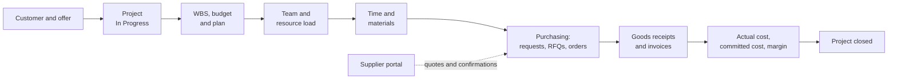
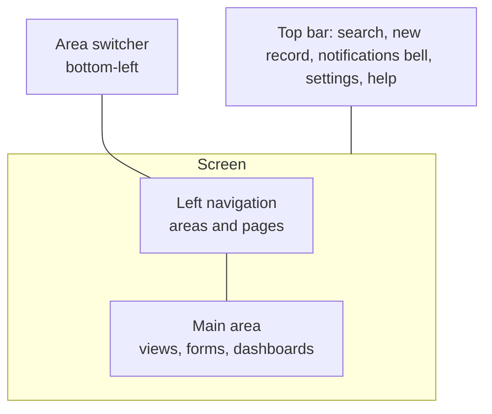
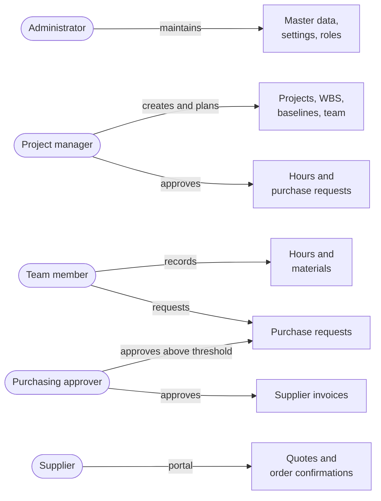

# Getting started with Open Project 365

> **Language:** English · [Italiano](../it/getting-started.md) · [Français](../fr/getting-started.md) · [Deutsch](../de/getting-started.md)
> **Manual index:** [README](../../README.md#user-manuals)

This guide is the first thing to read if you are new to Open Project 365. It explains what the application is for, how its pieces fit together, how to find your way around the screens, and which manual to open next for each task. The other manuals go into each functional area in depth; this one gives you the map.

## What Open Project 365 does

Open Project 365 is a project and job management application for companies that work on orders ("commesse"): construction and installation companies, engineering firms, workshops, service companies and any business that needs to know, for every job, **what was planned, what has been spent and what is still committed**.

It runs inside Microsoft Power Apps as a model-driven app on Microsoft Dataverse. In practice this means:

- you open it from a browser (or from Teams, if your company adds it there) with your company Microsoft 365 account;
- all data lives in your company's own Dataverse environment: every company has its own database, nothing is shared with other customers;
- security, auditing, notes, notifications and search are the standard ones of the Power Platform, so they behave like the rest of Dynamics 365.

The application covers the whole life cycle of a job:

## Main concepts in one page

| Concept | What it is | Where to read more |
|---|---|---|
| **Customer** / **Supplier** | Companies you work for or buy from. Both are Dataverse *accounts*: the same company can be both | [Master data](master-data.md) |
| **Item** | Something you buy or use on a job (material, component, service), with a unit cost and the suppliers that sell it | [Master data](master-data.md) |
| **Resource** | A person (or a crew) whose hours are planned and recorded, with a weekly capacity and an hourly cost | [Master data](master-data.md) |
| **Project** | The job: customer, project manager, dates, contract value, budget, actual and committed cost, progress | [Projects and team](projects-and-team.md) |
| **Project member** | A user who works on a project as Manager, Contributor or Reader. Membership decides who sees the project | [Projects and team](projects-and-team.md) |
| **WBS node** | A piece of the work breakdown structure: a phase, a work package or a task, with budget, dates and progress | [WBS and planning](wbs-and-planning.md) |
| **Dependency** | "Task B can start only after task A finishes" (finish-to-start, with lag days) | [WBS and planning](wbs-and-planning.md) |
| **Baseline** | A frozen copy of budget and dates, used to compare the current plan with what was agreed | [WBS and planning](wbs-and-planning.md) |
| **Allocation** | Hours of a resource planned on a WBS node; they feed the resource load | [Resource load](resource-load.md) |
| **Time entry** | Hours a resource worked on a project (and optionally a task) on a day, with an approval workflow | [Time tracking](time-tracking.md) |
| **Material usage** | Material consumed on a project, valued at the supplier price or at the item cost | [Materials and costs](materials-and-costs.md) |
| **Purchase request → RFQ → Purchase order → Goods receipt → Supplier invoice** | The purchasing chain, from the need to the invoice | [Purchasing](purchasing.md) |
| **Supplier portal** | A website where suppliers answer requests for quotation and confirm orders | [Supplier portal](supplier-portal.md) |
| **Settings** | Company-wide switches: time approval, purchasing threshold and approver | [Administration](administration.md) |

## Signing in

1. Open the link your administrator gave you (it looks like `https://<company>.crm4.dynamics.com/main.aspx?appid=...`), or go to [make.powerapps.com](https://make.powerapps.com) → **Apps** and choose **Open Project 365**.
2. Sign in with your company account.
3. If you see "You don't have permissions", ask your administrator to give you the **Basic User** and **OP365 User** security roles (see [Administration](administration.md#security-roles)).

If you will record hours, your administrator must also link your user to a **Resource** record; otherwise the timesheet tells you "Your user is not linked to a resource".

## Finding your way around

The application uses the standard model-driven layout:

- **Area switcher** (bottom of the left navigation): changes the group of pages shown. Open Project 365 has four areas: **Projects**, **Purchasing**, **Master Data** and **Settings**.
- **Left navigation**: the pages of the current area.
- **Views**: lists of records with columns, filters and sorting; switch view with the drop-down next to the view title.
- **Forms**: one record, organised in tabs. Changes are saved with **Save** (or Ctrl+S); the form also auto-saves after a short time.
- **Command bar**: the buttons above a view or form (New, Save, Delete, and the Open Project 365 commands such as **Submit**, **Approve**, **Save Baseline**).
- **Dashboards**: full pages with charts and interactive components (Timesheet, Time Approval, Resource Load, Spend).

### The navigation map

| Area | Group | Page | Typical user |
|---|---|---|---|
| Projects | Work | **Projects**, **Material Usage** | Project managers, team members |
| Projects | Time | **Timesheet**, **Approvals**, **Time Entries** | Everyone who records hours; managers who approve |
| Projects | Planning | **Resource Load**, **Absences** | Project managers, planners |
| Purchasing | Procurement | **Purchase Requests**, **RFQs**, **Purchase Orders**, **Goods Receipts**, **Supplier Invoices** | Project managers, buyers, accounts |
| Purchasing | Analysis | **Spend** | Buyers, management |
| Master Data | Records | **Customers**, **Suppliers**, **Contacts**, **Items**, **Resources** | Administrative staff, buyers |
| Settings | Company | **Settings**, **Resource Costs**, **Project Members** | Administrators |

Depending on your security role, some pages may show no records or may not allow you to create them.

## Who does what

| Role | What you will do most | Manuals to read |
|---|---|---|
| **Team member** (Contributor) | Fill in the weekly timesheet, record materials, raise purchase requests | [Time tracking](time-tracking.md), [Materials and costs](materials-and-costs.md), [Purchasing](purchasing.md) |
| **Project manager** (Manager) | Create the project, build the WBS and the plan, save baselines, manage the team, approve hours and requests, follow costs | [Projects and team](projects-and-team.md), [WBS and planning](wbs-and-planning.md), [Resource load](resource-load.md), [Time tracking](time-tracking.md), [Materials and costs](materials-and-costs.md), [Purchasing](purchasing.md) |
| **Buyer / purchasing approver** | Approve requests above the threshold, run RFQs, manage orders, receipts and invoices | [Purchasing](purchasing.md), [Supplier portal](supplier-portal.md) |
| **Administrator** | Users, roles, master data, settings, cost visibility, the supplier portal | [Administration](administration.md), [Master data](master-data.md), [Supplier portal](supplier-portal.md) |
| **Supplier** (external) | Answer RFQs and confirm orders on the portal | [Supplier portal](supplier-portal.md) |

## Notifications

Open Project 365 uses the **in-app notifications** of model-driven apps: the bell icon in the top bar. You receive a notification when:

| Event | Who is notified |
|---|---|
| Hours are submitted for approval | The managers of the project |
| Your hours are approved or rejected (with the reason) | You (the resource) |
| You have recorded fewer hours than expected for the day (Monday–Friday, 17:30) | You, with a link to the timesheet |
| A purchase request is waiting for your approval | The project manager, then the purchasing approver if the request is above the threshold |
| Your purchase request is approved or rejected | The requester |

Notifications appear in the bell panel and, for a few seconds, as a toast in the top right corner. Click a notification to open the record. Notification preferences are the standard ones of the platform.

## Notes, mentions and timeline

Most Open Project 365 records have a **Timeline**, usually in the right-hand column of the first tab of the form. You can:

- add **notes**, with attachments;
- **mention a colleague** by typing `@` followed by the name: the colleague is notified and the note becomes a lightweight comment thread;
- on projects, also record **activities** (phone calls, tasks, appointments, emails).

The timeline is the right place for decisions, customer communications and anything you want to keep with the record.

## Statuses and locked records

Many records follow a workflow (time entries, purchase requests, orders, invoices...). A few general rules apply everywhere:

- **Status changes go through the command buttons** (Submit, Approve, Send, Confirm...), never by editing the Status Reason field. If you try, you get a message such as "Use Submit, Approve or Reject to change the status".
- **Records past a certain status are locked**: a submitted timesheet entry, a sent purchase order, an approved invoice cannot be changed. To fix them, use the button that brings them back (Reject, Back to Draft, Cancel Receipt).
- **Most work happens only on projects In Progress**: hours, materials and purchase orders are refused on offers, suspended or closed projects.

## Search and personal views

- The **search box** in the top bar searches all tables (projects by name or code, customers, items, purchase orders...).
- In any view you can filter columns, change sorting and **save the result as a personal view** (Create view). Personal views can be shared with colleagues.
- Use **Export to Excel** from the command bar of a view to analyse data offline.

## Language

The application is currently delivered in **English**; Italian, French and German translations of the user interface are planned. These manuals are already available in all four languages. In the Italian, French and German manuals, button and field names are written in English, as they appear on screen, with a translation where it helps.

## Next steps

- New to a project? Read [Projects and team](projects-and-team.md).
- Need to record hours today? Go straight to [Time tracking](time-tracking.md).
- Setting up the company for the first time? Start from [Administration](administration.md) and [Master data](master-data.md).
