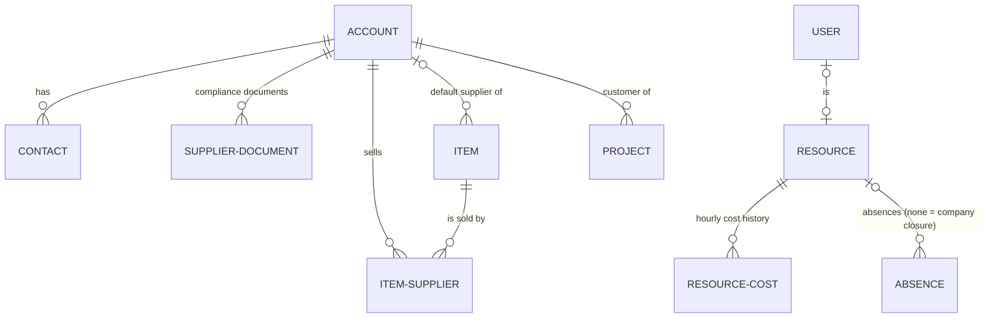
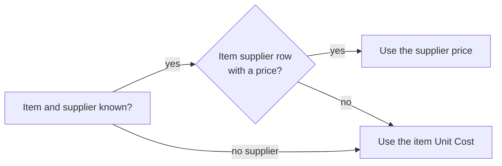
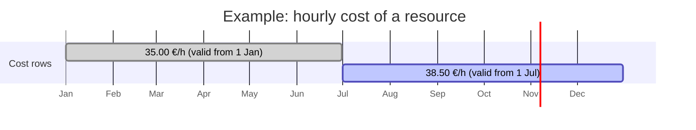
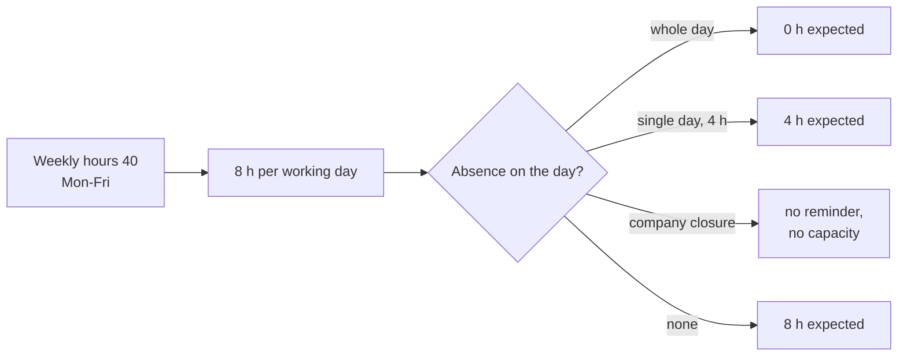

# Master data: customers, suppliers, contacts, items and resources

> **Language:** English · [Italiano](../it/master-data.md) · [Français](../fr/master-data.md) · [Deutsch](../de/master-data.md)
> **Manual index:** [README](../../README.md#user-manuals)

Master data is the information every other part of ProjectIQ relies on: the companies you work for and buy from, the people you talk to, the items you purchase and consume, and the resources whose hours you plan and record. Keeping it clean and complete is what makes costs, purchasing and planning reliable. This manual explains each record type, what every field is used for, and the rules the application applies automatically.

All master data lives in the **Master Data** area, group **Records**: **Customers**, **Suppliers**, **Contacts**, **Items**, **Resources**. Resource hourly costs are in the **Settings** area; company settings are environment variables (see [Administration](administration.md#company-settings)).

## How master data connects

## Customers and suppliers (accounts)

Customers and suppliers are both stored as **accounts**, the standard Dataverse table for companies. One company can be a customer, a supplier, or both at the same time: two check boxes, **Is Customer** and **Is Supplier**, decide which.

### Two forms, one record

An account has two forms:

- the **Customer** form, with the data you need to sell and invoice;
- the **Supplier** form, with the data you need to buy, plus compliance documents and item prices.

The application chooses the right form for you:

- when you open a company that is **only a supplier**, it is shown on the Supplier form; every other account opens on the Customer form;
- when you create a new account from **Suppliers** (or choose the Supplier form), **Is Supplier** is ticked automatically; from **Customers** (Customer form) **Is Customer** is ticked.

You can always switch form with the form selector next to the record name.

### Views

| View | Shows |
|---|---|
| **All Customers** (default in Customers) | Every account flagged as customer |
| **Prospects** | Customers whose Customer Type is *Prospect* |
| **Customers with Projects** / **Customers without Projects** | Customers that have (or do not have) at least one project |
| **All Suppliers** (default in Suppliers) | Every account flagged as supplier |
| **Active Suppliers** / **Blocked Suppliers** | Suppliers by Supplier Status |
| **Suppliers with Document Alerts** | Suppliers with expired or expiring compliance documents |

### Choosing a supplier on other records

Fields that point to a supplier show only accounts flagged **Is Supplier**, with a fixed view (the view selector is hidden):

| Field | View used | Why |
|---|---|---|
| Purchase order **Supplier**, RFQ invitation **Supplier**, purchase request **Preferred Supplier**, item **Default Supplier** | **Active Suppliers** | New orders and requests go only to active suppliers that are not blocked |
| Supplier invoice **Supplier**, supplier document **Supplier**, item supplier **Supplier**, material usage **Supplier** | **All Suppliers** | Invoices, documents and history can still refer to a blocked supplier |

When you save a supplier invoice, a material usage or a purchase request, the application also checks that the chosen account is flagged **Is Supplier**, and stops you with "<name> is not a supplier." otherwise.

### Customer fields (Customer form, Summary tab)

| Field | Meaning |
|---|---|
| **Account Name** | Company name, as you want it on documents |
| **Is Customer** | The company appears among customers and can be chosen as project customer |
| **Customer Type** | *Prospect* (potential customer, for example while an offer is open) or *Customer* |
| **VAT Number** / **Tax Code** | Partita IVA and codice fiscale (or the foreign equivalents) |
| **Primary Contact**, **Main Phone**, **Email**, **Website** | Standard contact data |
| **Owner** | The user responsible for the account |
| **Address** | Street, city, postal code, province, country |
| **Payment Terms**, **IBAN**, **PEC**, **Language** | Billing data; Language is the language for documents and emails sent to the company (Italian, English, German, French). **IBAN** is visible only to users with the *OP365 Cost Visibility* profile. |

Read-only figures maintained by the application: **Projects** (number of projects of the customer) and **Contract Value Total** (sum of the contract values of its projects). They are updated every time a project is created, changed or deleted.

The **Contacts** tab lists the people of the company.

### Supplier fields (Supplier form)

The **Summary** tab has the same company, address and payment data as the customer form, plus:

| Field | Meaning |
|---|---|
| **Is Supplier** | The company can receive requests for quotation and purchase orders |
| **Supplier Status** | *Active* or *Blocked*. A blocked supplier cannot be invited to an RFQ or receive a purchase order: the application stops you with "<name> is blocked." |
| **Supplier Category** | Free text to group suppliers (for example "Electrical", "Concrete", "Rental") |
| **Email** | Used as the default invitation address in RFQs and recorded as **Sent To** when an order is sent |

Read-only figures: **Spend** (total of the supplier's purchase orders, visible only to users with cost visibility) and **Contacts** (number of contacts). They are maintained by the purchasing plugins.

The **Documents** tab lists the supplier's **compliance documents** and shows the **Document Alerts** counters (Expired Documents, Expiring Documents). The **Item Prices** tab lists the items the supplier sells, with its price for each.

> The document alert counters are prepared for a daily update process; until that process is switched on in your environment they may show empty values. The documents themselves, with their expiry dates, are always available in the Documents tab and in the views.

### Supplier documents

A supplier document records a compliance document you must keep for a supplier: DURC, company report (visura camerale), certifications, insurance policies, contracts and so on.

| Field | Meaning |
|---|---|
| **Supplier** | The supplier (the document is deleted if the supplier is deleted) |
| **Document Type** | DURC, Company Report, Certification, Insurance, Contract, Other (required) |
| **Description** | Short description (required) |
| **Number** | Document number or reference |
| **Issue Date** / **Expiry Date** | Validity period |
| **External URL** | Link to the document in another system (for example SharePoint) |
| **File** | The document itself, uploaded into Dataverse |
| **Notes** | Anything else |

Create documents from the Documents tab of the supplier (**+ New Supplier Document**), so that the supplier is filled in automatically.

## Contacts

Contacts are the standard Dataverse contacts: the people who work for your customers and suppliers. ProjectIQ adds one field:

- **Is Decision Maker**: tick it for the people who decide (for example who signs the offer or the order).

A contact belongs to a company through **Company Name** (parent account). For suppliers this matters also for the [supplier portal](supplier-portal.md): a supplier user is a contact whose company is the supplier.

## Items

An item is anything you buy or consume on a job: a material, a component, a consumable, a service or a rental.

| Field | Meaning |
|---|---|
| **Code** | Unique item code (required; the application refuses two items with the same code) |
| **Name** | Description (required) |
| **Category** | Free text to group items |
| **Unit of Measure** | pcs, m, kg, h, m², ... It is copied to request lines, order lines and material usage |
| **Unit Cost** | Standard cost of one unit. Used when there is no supplier price |
| **Default Supplier** | The supplier you usually buy the item from. It is automatically invited when an RFQ is created for a request that contains the item |
| **Notes** | Anything else |

Read-only figures, maintained by purchasing: **Order Lines** (how many purchase order lines use the item) and **Spend** (total amount ordered, visible only with cost visibility).

### Item suppliers and prices

The **Suppliers** section of the item (and the **Item Prices** tab of the supplier) lists the **item suppliers**: one row for each supplier that sells the item.

| Field | Meaning |
|---|---|
| **Item** / **Supplier** | The pair; there can be only one row for the same item and supplier |
| **Supplier Code** | The supplier's own code for the item |
| **Price** | The supplier's unit price |
| **Lead Time (Days)** | Usual delivery time |
| **Minimum Lot** | Minimum quantity per order |
| **Notes** | Conditions, discounts, ... |

### Which price is used

Whenever the application needs to value an item (material usage, purchase request and order lines), it looks for a price in this order:

You can always overwrite the proposed price on the line; the rule only fills it in when it is empty.

## Resources

A **resource** is a person (or a crew, or any capacity) whose hours are planned on the WBS and recorded in time entries. A resource does not need to be a user: you can plan subcontractors or workers without a licence. To record hours themselves, however, people need a user linked to their resource.

### Resource fields

| Field | Meaning |
|---|---|
| **Name** | Name of the person or crew (required) |
| **Role** | Job title or skill (for example "Electrician", "Site manager") |
| **User** | The Dataverse user of the person. Required to use the timesheet: the timesheet looks up "my resource" through this field |
| **Owner** | Record owner |
| **Weekly Hours** | Contractual hours per week, from 0 to 80. Default **40** |
| **Working Days** | The days the resource works. Default **Monday to Friday** |
| **Hourly Cost** | Current hourly cost. **Read it, do not type it**: it is kept in sync from the Resource Costs (see below). Visible only to users with the *OP365 Cost Visibility* profile |

When you create a resource and leave Weekly Hours and Working Days empty, the application fills in 40 hours and Monday–Friday.

Weekly hours and working days are used in three places:

- the **daily reminder**: expected hours per day = weekly hours ÷ number of working days;
- the **timesheet**: the weekly total is compared with the weekly hours;
- the **resource load**: weekly capacity = weekly hours, minus absences and company closures.

### Hourly cost history (Resource Costs)

Costs change over time, and the cost of an hour worked in March must not change when the rate is raised in September. This is why the hourly cost is stored as a **history** in the **Costs** tab of the resource (or in **Settings → Resource Costs**):

| Field | Meaning |
|---|---|
| **Resource** | The resource |
| **Valid From** | First day the cost applies (required; one row per resource and date) |
| **Hourly Cost** | Cost per hour from that date (required, visible only with cost visibility) |

How it works:

- the **cost of a time entry** is the hours × the cost valid **on the date of the entry** (the latest row whose Valid From is not after the date). An entry of 15 March uses 35.00; an entry of 15 July uses 38.50, even if both are recorded today;
- the **Hourly Cost** shown on the resource is the row with the latest Valid From that is not in the future. It is recalculated every time a cost row is created, changed or deleted;
- if you enter a cost that starts in the future, the resource field shows it once a cost row is changed again after that date; time entries on or after that date use it straight away.

If a resource has no cost rows at all, its own Hourly Cost is used.

### Absences and company closures

The **Absences** tab of the resource (and **Projects → Planning → Absences**) records the time a resource is not available.

| Field | Meaning |
|---|---|
| **Resource** | Who is absent. **Leave it empty to record a company closure** (for example the August shutdown or a bank holiday): it applies to everybody |
| **Absence Type** | Vacation, Leave, Sickness, Closure (required) |
| **From** / **To** | First and last day (required) |
| **Hours** | Only for single-day absences: the hours of absence (for example 4 for half a day). Leave empty for whole days |
| **Notes** | Anything else |

Absences are used by:

- the **daily reminder**, which expects fewer (or no) hours on absence days and sends nothing on company closures;
- the **resource load**, which reduces the weekly capacity.

## Good practices

- **Check for duplicates** before creating a company: search by name and VAT number.
- **Tick both Is Customer and Is Supplier** when a company plays both roles, instead of creating two accounts.
- **Block** a supplier rather than deleting it: its history (orders, invoices, documents) stays intact.
- **Never type the hourly cost on the resource**: add a Resource Cost row with the date it starts.
- **Link the User** on every resource that records hours, and check that the user has the right security roles (see [Administration](administration.md)).
- **Give every item a default supplier** and the prices of the suppliers you use: RFQs, orders and material usage will be pre-filled.

## Messages you may see

| Message | Why | What to do |
|---|---|---|
| "<name> is not an active supplier." | The account is inactive or not flagged as supplier | Tick Is Supplier or reactivate the account |
| "<name> is not a supplier." | The account chosen on a supplier invoice, material usage or purchase request is not flagged as supplier | Choose a supplier, or tick Is Supplier on the account |
| "<name> is blocked." | Supplier Status is Blocked | Set it back to Active if the supplier can be used again |
| A duplicate key error when saving an item | Another item has the same Code | Use a different code or open the existing item |
| A duplicate key error on an item supplier | That supplier already has a price row for the item | Open and change the existing row |
| A duplicate key error on a resource cost | The resource already has a cost with that Valid From | Change the existing row |
| Hourly Cost is empty or shows *** | You do not have the Cost Visibility profile | Ask an administrator if you need to see costs |
