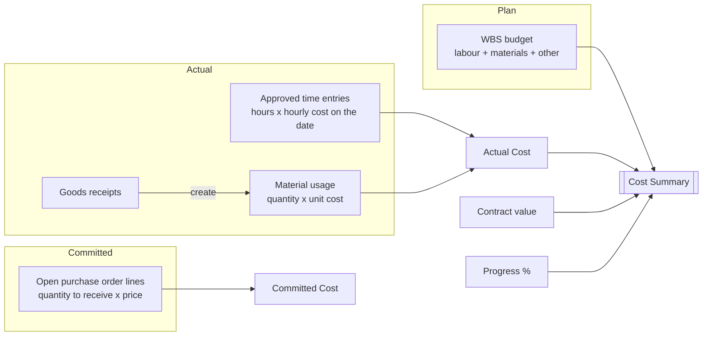
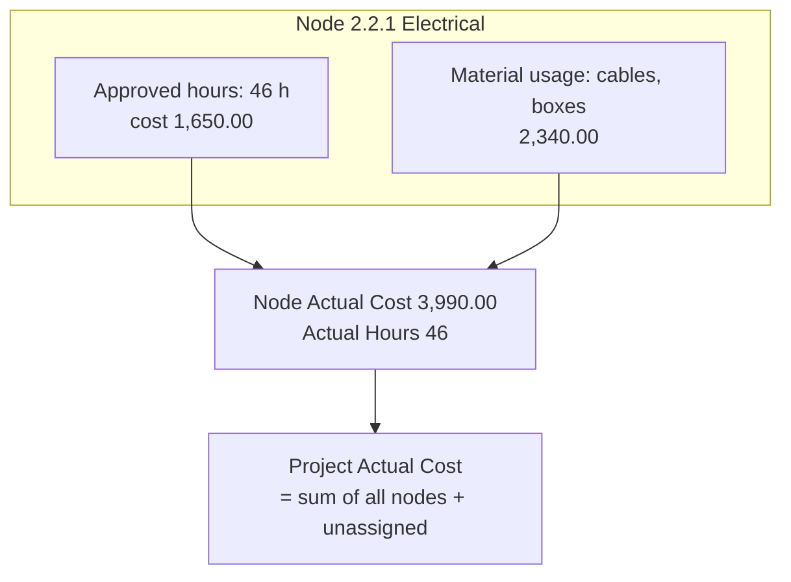
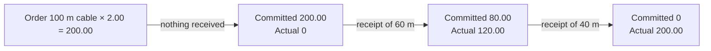

# Materials, actual costs and cost summary

> **Language:** English · [Italiano](../it/materials-and-costs.md) · [Français](../fr/materials-and-costs.md) · [Deutsch](../de/materials-and-costs.md)
> **Manual index:** [README](../../README.md#user-manuals)

A project is profitable only if you know, at any moment, how much it has really cost and how much it is going to cost. ProjectIQ collects **actual costs** from two sources — approved hours and material usage — and combines them with the **committed cost** of open purchase orders and with the **budget** of the WBS. The **Cost Summary** on the project form turns these figures into a forecast: the estimate at completion and the expected margin.

This manual explains how to record materials, how actual and committed costs are built, and how to read the cost summary.

## Where the numbers come from

| Figure | Source | Updated |
|---|---|---|
| **Budget Total** | Budget of the WBS nodes | When a node is saved |
| **Actual Hours** | Approved time entries | When an entry is approved (or submitted with approval off) |
| **Actual Cost** | Cost of approved time entries + total cost of all material usage | When an entry or a usage is saved or deleted |
| **Committed Cost** | Purchase order lines still to receive × price, on sent or confirmed orders | When orders, lines or receipts change |
| **Progress %** | Leaf node progress, weighted by budget | When a node is saved |

Every figure exists both on each **WBS node** (actual hours and cost of that node) and on the **project** (totals). Costs recorded on the project without a WBS node count in the project totals and are shown as *Not assigned to a WBS node* in the cost summary.

## Material usage

A **material usage** records material consumed on a project: what, how much, when, on which task, from which supplier and at what cost. It can be created by hand, or automatically by a goods receipt (see [Purchasing](purchasing.md#4-goods-receipts)).

### Recording material by hand

1. Open **Projects → Work → Material Usage** and click **+ New**, or use the **Materials** tab of the project (the project is then filled in), or the quick create form.
2. Choose the **Project** (must be **In Progress**) and optionally the **WBS Node** (only nodes of that project are offered).
3. Set the **Usage Date**.
4. Choose the **Item**. The **Description** and **Unit of Measure** are copied from the item if empty.
5. Optionally choose the **Supplier** the material came from.
6. Type the **Quantity**.
7. Leave **Unit Cost** empty to let the application fill it in, or type it.
8. Save: **Total Cost** = Quantity × Unit Cost.

### Fields

| Field | Meaning |
|---|---|
| **Project** | The project (required). The usage is deleted with the project |
| **WBS Node** | The task the material is used on (optional, same project only) |
| **Usage Date** | When it was used |
| **Item** | The item from the catalogue (optional: you can record free-text material) |
| **Description** | What was used; from the item when empty |
| **Supplier** | Where it came from (optional) |
| **Quantity** / **Unit of Measure** | How much; the unit comes from the item when empty |
| **Unit Cost** | Cost per unit (visible only with cost visibility) |
| **Total Cost** | Quantity × Unit Cost, calculated (visible only with cost visibility) |

### How the unit cost is proposed

When you choose an item and leave Unit Cost empty:

1. if a **Supplier** is set and an active **item supplier** row exists for that item and supplier, its **Price** is used;
2. otherwise the item's **Unit Cost** is used.

The proposal happens only when the item is chosen or changed; later changes of the catalogue price do not change existing records.

### Material from goods receipts

When a buyer registers a goods receipt on a purchase order, ProjectIQ creates one material usage per received line, at the **order price**, on the order's project and on the WBS node of the order line. These records are marked as coming from the receipt and **cannot be changed or deleted directly**: "This material usage comes from a goods receipt: cancel the receipt to change it." To fix them, cancel the receipt and register it again.

So you do **not** need to record purchased material twice: receive it, and it becomes actual cost automatically. Record by hand only material taken from stock or bought outside purchase orders.

### Views

| View | Shows |
|---|---|
| **All Material Usage** | Every usage you can see |
| **Material Usage by Project** | Used in the Materials tab of the project |

Quick Find (the search box of the view) is available on material usage.

## Actual cost in detail

- **Labour**: only **approved** time entries count (with time approval off, submitted entries are approved immediately). Draft, submitted and rejected hours are not actual cost yet.
- **Materials**: **all** material usage counts as soon as it is saved, whether typed by hand or created by a goods receipt.
- Recalculation is immediate and also covers moves: if an entry is moved to another node or project, both old and new totals are recalculated.

## Committed cost

The **committed cost** is money you have already promised to suppliers but not yet received as goods: for every line of the purchase orders that are **Sent** or **Confirmed**, (ordered quantity − received quantity) × price. Draft orders (not yet sent) and cancelled orders do not count. When goods are received, the received part moves from committed to actual (through the material usage). See [Purchasing](purchasing.md) for the details.

The committed cost is also used when a purchase request is submitted: if actual + committed + the new request exceed the budget of the node (or of the project), the request is flagged **Over Budget** for the approver.

## Cost summary

The **Costs** tab of the project shows the **Cost Summary** component.

### Header figures

| Figure | Meaning |
|---|---|
| **Contract value** | The agreed price (Contract Value of the project) |
| **Budget** | Total budget of the WBS |
| **Actual cost** | Actual cost to date, with the split **Labour** / **Materials** |
| **Estimate at completion** | Forecast of the final cost: **actual cost ÷ progress** when progress is above zero; otherwise the larger of budget and actual |
| **Expected margin** | Contract value − estimate at completion |

### Budget vs actual by WBS branch

Below the header, a table shows one line per **top-level WBS node** (each branch includes all its sub-nodes):

| Column | Meaning |
|---|---|
| **WBS branch** | Code and name of the top-level node |
| **Budget** | Budget total of the branch |
| **Actual** | Actual cost of the branch |
| **Variance** | Actual − budget: **positive means over budget** |
| **Spent** | Share of the budget already spent, as a bar |
| **Hours (actual / budget)** | Approved hours against budget hours |

Costs without a WBS node appear in a last line, **Not assigned to a WBS node**.

### Worked example

| | Value |
|---|---|
| Contract value | 120,000 |
| Budget | 100,000 |
| Actual cost | 45,000 (labour 30,000, materials 15,000) |
| Progress | 40% |
| **Estimate at completion** | 45,000 ÷ 0.40 = **112,500** |
| **Expected margin** | 120,000 − 112,500 = **7,500** (budgeted margin was 20,000) |

The forecast says the job is spending faster than it progresses: at this pace it will end 12,500 over budget. Look at the branch table to find where the variance comes from.

> The estimate at completion is only as good as the **progress** figures: update progress on the leaf nodes regularly. With progress at 0 the forecast falls back to the budget (or to the actual cost, if it is already higher).

Messages: "Save the project to see its costs." on a new project; "The cost summary could not be loaded" on network or permission problems (refresh the form).

## Cost visibility

Costs are sensitive. Columns holding hourly costs and material costs are protected by the **OP365 Cost Visibility** column security profile:

- users **with** the profile see Unit Cost, Total Cost, time entry Cost, resource hourly costs, supplier and item spend;
- users **without** it see these fields empty or masked, even on records they can open.

The project totals (Actual Cost, Committed Cost, Budget Total) are visible to whoever can read the project. Assign the profile to administrators, project managers and controllers (see [Administration](administration.md#cost-visibility)).

## Messages you may see

| Message | Meaning and solution |
|---|---|
| "Hours and materials can be recorded only on projects In Progress." | Set the project In Progress, or record on another project |
| "The WBS node belongs to another project." | Choose a node of the selected project |
| "This material usage comes from a goods receipt: cancel the receipt to change it." | Use **Cancel Receipt** on the goods receipt, then register it again |
| Unit Cost or Total Cost empty | You do not have the Cost Visibility profile, or the item has no cost and no supplier price |
