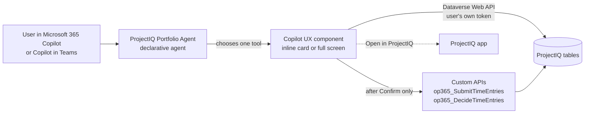
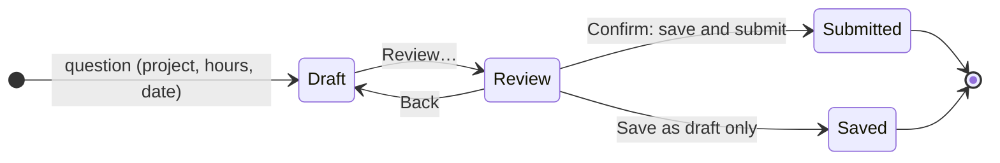
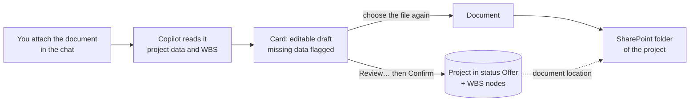
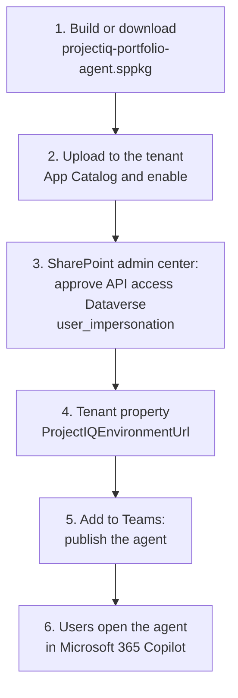

# Portfolio Agent: ProjectIQ in Microsoft 365 Copilot

> **Language:** English · [Italiano](../it/portfolio-agent.md) · [Français](../fr/portfolio-agent.md) · [Deutsch](../de/portfolio-agent.md)
> **Manual index:** [README](../../README.md#user-manuals)

The **ProjectIQ Portfolio Agent** brings ProjectIQ into Microsoft 365 Copilot and Copilot in Teams. People ask in their own words ("which projects are over budget?", "log 8 hours today on PRJ-000123") and the agent answers with an interactive card built on live ProjectIQ data: KPI tiles, traffic lights, charts, a timeline, a load heat map, and buttons to go further or to open the record in the app.

It is built with **SharePoint Framework (SPFx) Copilot UX components** and modelled on the Microsoft sample *Zava Project Tracker*, but every figure comes from the ProjectIQ tables in Dataverse, read **with the identity of the user**. It complements the [Copilot and Cowork](copilot.md) integration: Copilot Chat answers in text from the semantic model, the Portfolio Agent answers with cards and can also **log, submit and approve hours** after an explicit confirmation.

> Copilot UX components are generally available from SPFx 1.24 (October 2026). They work in Microsoft 365 Copilot and Copilot in Teams on the web and desktop, not yet on mobile.

## How it works

1. The agent reads the question and picks **one** component (a "tool"), passing the values it understood (project, person, date, hours).
2. The component opens as a card in the chat (**inline**); **Expand** opens it in **full screen** with more columns and rows.
3. The card reads Dataverse with the user's permissions: security roles, project access teams and column security apply exactly as in the app.
4. Each card tells Copilot what it shows, so follow-up questions ("why is it late?", "and the next phase?") are answered on the same data.
5. Buttons on the card send a new question (for example from *My work* to *Project health*) or open the record in the ProjectIQ app.

## What you can ask

| View | Example questions | Shows | Writes |
|---|---|---|---|
| My work | "What needs my attention across my projects this week?" | Ranked list: hours to approve, rejected and draft hours, missing hours of last week, projects at risk, purchase requests waiting for you, late orders, invoices, overload | – |
| Log and submit hours | "Log 8 hours today on PRJ-000123", "Submit my timesheet" | Your week, editable draft lines, review | Time entries (after **Confirm**) |
| Approve hours | "Which hours do I have to approve?" | Submitted hours of the projects you manage, by person and week, with flags | Approve / reject (after **Confirm**) |
| Project health | "How is project PRJ-000123 going?" | Traffic light and reasons, budget, actual, committed, remaining, estimate at completion, margin, WBS phases with flags, open purchases | – |
| Project budget | "Show the budget of the school roof" | Budget against actual cost by WBS branch (chart and table), labour, materials, committed | – |
| Project timeline | "Is PRJ-000123 late? Show the critical path" | WBS phases on a timeline with progress, critical path, baseline and bars pushed by dependencies | – |
| Project documents | "Show the documents of PRJ-000123" | Files and subfolders of the project folder in SharePoint, most recent first, with author, size and links | – |
| New project from a document | Attach an offer or contract and ask "Create a draft project from this document" | Editable draft of the project and its WBS, missing data flagged, document to save | Project in status **Offer**, WBS nodes, document in SharePoint (after **Confirm**) |
| Portfolio health | "Which projects are over budget or late?" | All projects with traffic light, totals, margin at completion | – |
| Resource load | "Who is overloaded in the next weeks?", "Show my load" | Heat map of allocated hours against capacity by week | – |
| Purchasing status | "What is waiting in purchasing?", "Which orders are late?" | Requests to approve or order, RFQs past deadline, late and open orders, invoices to review | – |
| Supplier compliance | "Which suppliers have an expired DURC?", "Can we order from Rossi Srl?" | Blocked suppliers, expired and expiring documents, whether a supplier can receive orders | – |
| What I can do | "Show me what you can help with" | The scenarios above with an example for each | – |

Conversation starters in the agent: *What needs my attention*, *Portfolio health*, *Hours to approve*, *Log my hours*, *Resource load*, *Explore the agent*.

## Project and portfolio health

The traffic light uses the figures kept by the plugins on the project (see [WBS, budget, Gantt and baselines](wbs-and-planning.md) and [Materials, actual costs and cost summary](materials-and-costs.md)). Projects in **Offer** or **Closed** are shown as *Not tracked*.

| Rule | Shown as | Light |
|---|---|---|
| Actual + committed above the budget | Actual + committed above budget | Off track |
| Estimate at completion above the contract value | Estimate at completion above contract value | Off track |
| End date passed and progress below 100% | End date passed, not complete | Off track |
| Actual + committed at 90% of the budget or more | 90% of the budget used | At risk |
| Estimate at completion above the budget | Estimate at completion above budget | At risk |
| Progress more than 20 points behind the share of time elapsed | Progress behind elapsed time | At risk |
| Project **Suspended** | Project suspended | At risk |
| No budget on the WBS | No budget on the WBS | At risk |

- **Estimate at completion** = actual cost ÷ progress when progress is above 0, otherwise the larger of budget and actual cost (the same rule as the **Cost Summary** control).
- **Margin at completion** = contract value − estimate at completion.
- **Remaining** = budget − actual − committed.

In *Project health* a WBS phase is flagged **Late** when its end date has passed and it is not complete, and **Hours over** when the actual hours exceed the budget hours. With a reference baseline, *Slip* is the difference in days between the current end and the baseline end.

## Log and submit hours

The agent never saves hours on its own: what you write in the question only **pre-fills a draft** that you can change.

1. Ask, for example, "log 6 hours yesterday on PRJ-000123 phase 2.1, site survey". The card shows your week and one draft line with project, WBS node, day, hours and notes.
2. Change the line or select **Add hours** for more lines; **Previous week** / **Next week** move the week.
3. Leave **Also submit the draft and rejected entries already in this week** selected to submit the whole week together.
4. Select **Review…**. The card lists what will be created and submitted; more than 10 hours on a day is flagged as a warning, more than 24 hours blocks the confirmation.
5. Select **Confirm: save and submit** (or **Save as draft only**). The entries are created as in the **Timesheet** and submitted with the same Custom API as the **Submit** button, so the same rules apply (see [Time tracking](time-tracking.md)): only In Progress projects, your own resource, cost valued at the rate of the day, notification to the project managers.

| Field | Rule |
|---|---|
| Project | Required; only **In Progress** projects are listed |
| WBS node | Optional; nodes of the chosen project |
| Day | A day of the week shown |
| Hours | 0 to 24, comma or dot, rounded to quarter hours |
| Notes | Optional, saved on the time entry |

## Approve hours

1. Ask "which hours do I have to approve?" (optionally for a project or a person). The card groups the **Submitted** hours of the projects where you are project manager or member with role **Manager**, by person and week.
2. Flags: **Since *date*** when submitted more than 7 days ago; ***n* days > 10 h** when a person has more than 10 hours on a day.
3. Select groups (or none for all), then **Approve selected…** / **Reject selected…**.
4. The review shows how many entries, hours and people. A rejection needs a **Note for the people**.
5. Select **Confirm approval** or **Confirm rejection**. The decision runs the same Custom API as the **Time Approval** dashboard: approved hours become actual cost, people get an in-app notification.

## Project documents

The card reads the SharePoint folder that ProjectIQ created for the project (see [Documents in SharePoint](documents.md)): the folder is found through the document location of the project, then its files and subfolders are listed **with your SharePoint permissions**. The KPIs show the number of files and folders and the last change; select a name to open the file (Office files open in the browser) or **Open folder in SharePoint**. Uploading and editing stay in SharePoint or in **Related** → **Documents** of the app.

### Questions on the content of documents

When the administrator has set a SharePoint knowledge source (see [Set up](#set-up-administrators)), you can also ask what a document says, for example "what penalties does the contract of PRJ-000123 set?" or "summarise the minutes of the last site meeting". Copilot searches the files of the documents site **with your SharePoint permissions** and names the file it used. Without a knowledge source the agent only lists the files.

## New project from a document

Attach an offer, a contract, a quote or a kickoff document to the chat and ask, for example, "create a draft project from this document". Copilot reads the document and passes what it finds to the card; the card shows it as a draft you complete and confirm. Nothing is created before **Confirm**.

1. The card pre-fills **Project name**, **Customer**, **Project manager**, **Start date**, **End date**, **Contract value**, **Description** and the **WBS** lines (code, phase or task, budget hours, start, end) with what the document states. Customer and project manager are chosen automatically only when exactly one account or user matches the name in the document; otherwise the card shows the name it read and you pick the record.
2. Complete the fields marked as missing. The **To complete** tile counts them; **Review…** stays disabled until there are none.
3. Adjust the WBS: the code gives the outline (1 is a phase, 1.1 and 1.2 are its tasks); **Add phase or task** adds a line, the bin removes one.
4. Select **Choose the document** and pick the same file again. Copilot reads the attachment but cannot pass the file itself to the card, so the card asks for it once more.
5. Select **Review…**, check the summary and the warnings, then **Confirm: create draft project**.

What is created:

| Item | Detail |
|---|---|
| Project | Status **Offer**, code from the autonumber (PRJ-######), customer, project manager, dates, contract value, description. You move it to **In Progress** in the app when the offer is accepted |
| WBS nodes | One per line, parents before children, with code, name, sort order, budget hours and dates. The plugins roll the budget up as for nodes created in the app (see [WBS, budget, Gantt and baselines](wbs-and-planning.md)) |
| Document | Saved in the SharePoint folder of the project, with **your SharePoint permissions**. The card creates the folder in the `op365_project` library and registers its document location, the same folder **Related** → **Documents** opens (see [Documents in SharePoint](documents.md)) |

| Check | Effect |
|---|---|
| Project name, customer, project manager, start date, end date missing; end before start; contract value not a number | Blocks **Review…** |
| WBS code not like 1 or 1.2, used twice, or without its parent; phase without a name; hours not a number; end before start | Blocks **Review…** |
| WBS dates outside the project dates | Warning |
| No WBS line | Warning: the project is created without phases |
| No document chosen | Warning: the project is created without saving the document |

- Creating projects needs a security role that can create them, such as **OP365 Administrator** (see [Administration](administration.md#security-roles)); **OP365 User** cannot.
- Team, resources, allocations and the baseline are set afterwards in the app.
- If SharePoint document management is not set up, the project and its WBS are created and the card says the document was not saved: upload it later from **Documents** on the project.

## Purchasing and suppliers

The purchasing and supplier views are **read-only**: approving requests, creating RFQs and orders, receiving goods and deciding invoices stay on the buttons of the app (see [Purchasing](purchasing.md)). Select a row to open the record in ProjectIQ.

- *Purchasing status* shows the requests whose **Current Approver** is you, the other submitted requests, the approved requests to order, the RFQs **Sent** with the deadline past, the orders **Sent** or **Confirmed** with the expected delivery past (late) or not, and the supplier invoices **To Review**. *Committed* is the amount of open orders not yet received.
- *Supplier compliance* lists blocked suppliers and documents expired or expiring in the next 30 days. For one supplier it answers whether you can order: the supplier must be **Active** and have no expired document.

## Set up (administrators)

Done once per Microsoft 365 tenant, by a SharePoint administrator together with the Power Platform administrator.

| Step | Who | What |
|---|---|---|
| 1 | IT | Build the package from `copilot/portfolio-agent` (`npm ci`, `npm run build`, see [dev environment](../dev-environment.md#portfolio-agent-spfx-copilot-components)) or take it from a GitHub release |
| 2 | SharePoint admin | Upload `projectiq-portfolio-agent.sppkg` to the tenant **App Catalog**, select **Enable app** |
| 3 | SharePoint admin | SharePoint admin center → **Advanced** → **API access** → approve the pending request **Dataverse** / **user_impersonation** |
| 4 | SharePoint admin | Set the tenant property `ProjectIQEnvironmentUrl` to the URL of the ProjectIQ environment (for example `https://contoso.crm4.dynamics.com`); optionally `ProjectIQAppId` to the id of the ProjectIQ app, used by the **Open in ProjectIQ** links. With the CLI for Microsoft 365: `m365 spo storageentity set --appCatalogUrl <app catalog URL> --key ProjectIQEnvironmentUrl --value https://contoso.crm4.dynamics.com` |
| 5 | SharePoint admin | In the App Catalog select the package → **Add to Teams**: this publishes the declarative agent to the tenant agent catalog. Repeat after changes to the agent name, instructions or starters |
| 6 | Each user | In Microsoft 365 Copilot open **Agents** → **ProjectIQ Portfolio Agent** |

One package serves one ProjectIQ environment (the tenant property). New versions of the cards are picked up a few minutes after the package is updated; start a new conversation to test them.

Steps 1, 2 and 4 can also be run by the GitHub workflow `deploy-agent`, after each change to the agent and with the approval of a reviewer; steps 3 and 5 stay manual. Setup: [Portfolio Agent deployment](../dev-environment.md#portfolio-agent-deployment).

**SharePoint knowledge (optional).** The agent can also read the content of the documents site (see [Documents in SharePoint](documents.md)). Set the URLs of the site, library or folder (comma separated) when the package is built: the variable `SHAREPOINT_KNOWLEDGE_URLS` of `npm run build`, or, for `deploy-agent`, the secret of the same name in the GitHub environment (a secret, so the URLs appear neither in the repository nor in the logs). The build adds the **OneDriveAndSharePoint** capability limited to those URLs. Then select **Add to Teams** again (step 5). Without the variable the agent has no knowledge source.

### Licences

Each person needs a **Microsoft 365 Copilot** licence and the **Power Apps Premium** licence used for ProjectIQ. Copilot UX components have no consumption charge.

## Security and privacy

- The cards call the Dataverse Web API with a **delegated token of the user** (permission *Dataverse user_impersonation* approved in step 3): no service account, no copy of the data. A person sees only the projects, rows and columns they see in the app.
- Columns protected by the **OP365 Cost Visibility** profile (hourly costs, time entry Cost, material costs, supplier Spend) show as 0 for users without the profile; the cards say so instead of estimating.
- The only writes are the user's own time entries, the time decisions and the draft projects created from a document (project in status Offer, its WBS nodes, its SharePoint folder and document), through the same plugins and Custom APIs as the app, and only after **Confirm**. Purchasing, existing projects and master data are never changed from Copilot.
- What a card shows is passed to Copilot as context of the conversation (at most about 9 KB of text), as for any other Copilot answer.
- Project documents are read from SharePoint with the **user's own SharePoint permissions** (no extra API access to approve): the card lists only the files the person can open.
- With the SharePoint knowledge source, Copilot searches only the configured site, library or folder, and only the files the person can open.

## Messages you may see

| Message | Meaning and solution |
|---|---|
| "ProjectIQ environment not configured" | The tenant property `ProjectIQEnvironmentUrl` is missing or is not a Dataverse URL: see [Set up](#set-up-administrators), step 4 |
| "No access to ProjectIQ" | The API access of step 3 is not approved, or the user has no security role in the environment |
| "Several projects match" / "No project matches ..." | Choose the project from the buttons |
| "No document folder yet" | Nobody has opened Documents on the project: see [Documents in SharePoint](documents.md#opening-the-documents-of-a-record) |
| "You have no access to the SharePoint folder of this project." | Your SharePoint account has no access to the document site: ask the SharePoint administrator |
| "Choose the customer." / "Choose the project manager." / "Enter the start date." and the other draft messages | Complete or fix the field of the new project |
| "The project was created, but the document was not saved" | SharePoint document management is not set up for projects, or you cannot write in the library: see [Documents in SharePoint](documents.md#part-2-set-up-administrators) and upload the document from Documents on the project |
| "You are not linked to a resource in ProjectIQ ..." | No active resource has your user in the *User* field: ask an administrator |
| "Choose the project." / "Hours must be a number from 0 to 24 (quarter hours)." / "Enter the hours or remove the line." | Fix the draft line |
| "More than 24 hours on ..." / "More than 10 hours on ..." | Too many hours on one day (blocking) / check the hours (warning) |
| "Nothing to save or submit in this week." | No new line and no draft or rejected entry in the week |
| "Hours and materials can be recorded only on projects In Progress." and the other time messages | Raised by the ProjectIQ plugins, see [Time tracking](time-tracking.md#messages-you-may-see) |
| "Only a manager of the project can approve or reject its time entries." | You are not Manager of that project |

## Limits

- Not available on mobile clients (iOS, Android) at SPFx 1.24 GA.
- One ProjectIQ environment per tenant package.
- The cards, the agent name, its description and the conversation starters are in English, Italian, French or German, following the language of your Microsoft 365 account; other languages see English. Copilot answers in the language of the question. This manual quotes the labels in English.
- Dates are whole days in your time zone; amounts are in the record currency, without conversion.
