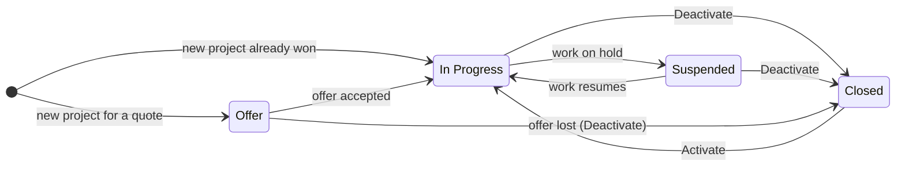
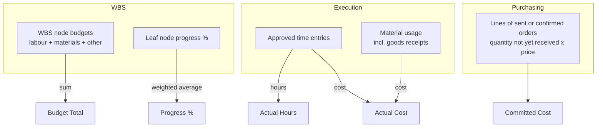
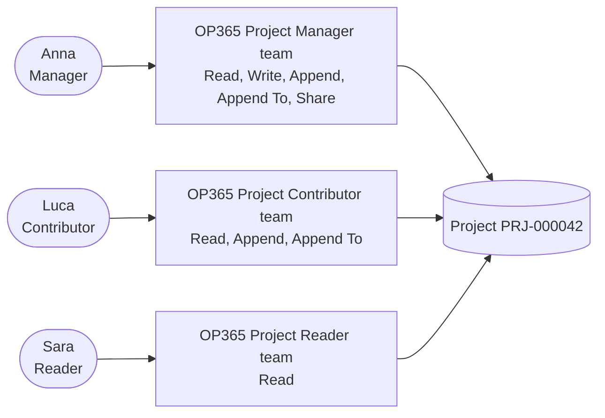

# Projects and project team

> **Language:** English · [Italiano](../it/projects-and-team.md) · [Français](../fr/projects-and-team.md) · [Deutsch](../de/projects-and-team.md)
> **Manual index:** [README](../../README.md#user-manuals)

The **project** is the heart of Open Project 365. Everything else — the work breakdown structure, the plan, the hours, the materials, the purchases — belongs to a project, and every figure you look at (budget, actual cost, committed cost, progress, margin) is ultimately a figure of a project. This manual explains how to create and run a project through its life cycle, what each field means, which figures are calculated for you, and how the **project team** decides who can see and do what.

You find projects in **Projects → Work → Projects**.

## Life cycle of a project

A project moves through four status reasons:

| Status reason | State | Meaning | What you can do |
|---|---|---|---|
| **Offer** | Active | You are preparing or negotiating an offer | Build the WBS and the budget, plan, save baselines, form the team, prepare purchase requests |
| **In Progress** | Active | The job is running | Everything: hours, materials, purchase requests, orders, receipts |
| **Suspended** | Active | Work is temporarily stopped | Look at data and plan; no new hours, materials or orders |
| **Closed** | Inactive | The job is finished (or the offer is lost) | Read only; reactivate it with **Activate** if needed |

To change between Offer, In Progress and Suspended, change the **Status Reason** field on the Summary tab and save. To close the project use **Deactivate** in the command bar; to reopen it use **Activate**.

> **Important:** time entries, material usage and purchase orders are accepted **only on projects In Progress**. If you get "Hours and materials can be recorded only on projects In Progress." or "Purchase orders can be created only on projects In Progress.", check the project's status reason.

## Views

| View | Shows |
|---|---|
| **All Projects** | Every project you can see |
| **In Progress Projects** | Running jobs |
| **Offers** | Projects in the Offer status |
| **Suspended Projects** | Jobs on hold |
| **Closed Projects** | Finished jobs and lost offers |

You see only the projects you own, the projects where you are a team member, and — with the *OP365 Administrator* role — all projects (see [Who sees a project](#who-sees-a-project)).

## Creating a project

1. Go to **Projects → Work → Projects** and click **+ New**.
2. Fill in at least the **Name**. The **Code** can be left empty: it is assigned automatically when you save (format `PRJ-000001`, `PRJ-000002`, ...). If your company uses its own codes you can type one; codes must be unique.
3. Choose the **Customer** (only accounts flagged as customer are meaningful here) and the **Project Manager**.
4. Set **Start Date**, **End Date** and **Contract Value** if you know them.
5. Choose the **Status Reason**: *Offer* if you are still quoting, *In Progress* if the job is confirmed.
6. Save. The project manager is automatically added to the team as **Manager**.

### Fields of the Summary tab

| Field | Meaning | Who fills it |
|---|---|---|
| **Code** | Unique project code. Empty = automatic `PRJ-######` | You or the system |
| **Name** | Project name (required) | You |
| **Customer** | The customer account | You |
| **Project Manager** | The user responsible for the project. Becomes a Manager member of the team | You |
| **Status Reason** | Offer, In Progress, Suspended (Closed via Deactivate) | You |
| **Owner** | Record owner (usually the creator) | System / you |
| **Start Date** / **End Date** | Planned project dates | You |
| **Contract Value** | Agreed price with the customer (revenue) | You |
| **Budget Total** | Sum of the budgets of the WBS nodes | Calculated |
| **Actual Cost** | Approved labour cost + material cost recorded on the project | Calculated |
| **Actual Hours** | Approved hours recorded on the project | Calculated |
| **Committed Cost** | Value of the lines of sent or confirmed purchase orders not yet received | Calculated |
| **Progress %** | Overall progress, from the WBS, shown as a green bar from 0 to 100 with the rounded percentage | Calculated |
| **Description** | Scope, notes, anything useful | You |

The right-hand column shows the **Timeline**: notes, mentions (`@name`) and activities (calls, tasks, appointments, emails) about the project.

### How the calculated figures are produced

The calculated fields are updated by the application **immediately when you save** the underlying records, so you never need to refresh a rollup.

- **Budget Total** = sum of the budget totals of the WBS nodes (each node: labour + materials + other).
- **Progress %** = progress of the **leaf** nodes (nodes without children), weighted by their budget total; if no node has a budget, weighted by budget hours; if there are no hours either, a plain average.
- **Actual Hours / Actual Cost** count only **approved** hours (or every submitted hour when time approval is switched off, see [Time tracking](time-tracking.md)) plus **all** material usage.
- **Committed Cost** counts what has been ordered and not yet received; when goods arrive, the amount moves from committed to actual.

Each customer also shows **Projects** (count) and **Contract Value Total** (sum of contract values), updated whenever a project of that customer changes.

## The project form, tab by tab

| Tab | What it contains | Manual |
|---|---|---|
| **Summary** | Project data, budget and progress figures, description, timeline | this manual |
| **WBS** | The WBS tree grid: phases and tasks with dates, hours, budget and progress, editable inline | [WBS and planning](wbs-and-planning.md) |
| **Gantt** | The Gantt chart with dependencies, critical path and baseline comparison; the list of baselines | [WBS and planning](wbs-and-planning.md) |
| **Costs** | The cost summary: contract, budget, actual, estimate at completion, margin, budget vs actual by WBS branch | [Materials and costs](materials-and-costs.md) |
| **Time** | Time entries of the project | [Time tracking](time-tracking.md) |
| **Materials** | Material usage of the project | [Materials and costs](materials-and-costs.md) |
| **Purchasing** | Purchase requests and purchase orders of the project | [Purchasing](purchasing.md) |
| **Team** | Project members and their roles | this manual |

The command bar of the project form also has **Save Baseline** (see [WBS and planning](wbs-and-planning.md#baselines)).

## The project team

The **Team** tab lists the **project members**. Each member is a user with a **project role**:

| Project role | Can do on the project |
|---|---|
| **Manager** | Read and change the project and everything in it, share it, approve time entries, approve purchase requests (up to the threshold), create RFQs and orders, change order statuses, register goods receipts |
| **Contributor** | Read the project, record their own hours and materials, create purchase requests, register goods receipts |
| **Reader** | Read the project and its data |

### Adding a member

1. On the project, open the **Team** tab and click **+ New Project Member**.
2. Choose the **User** and the **Project Role**.
3. Optionally set the **Hourly Rate**: the rate at which this member's hours are valued as **revenue** (time entry Revenue = hours × hourly rate).
4. Save. The member's name is filled in from the user.

A user can be a member of the same project only once: to change role, open the existing member and change **Project Role**.

The **project manager** of the project is always a member with role Manager: the application adds them when the project is created and, if you change the project manager, adds the new one as Manager (or upgrades their role). The previous manager stays in the team; change or remove them if needed.

All members of all projects are also visible to administrators in **Settings → Company → Project Members**.

### Who sees a project

Open Project 365 uses Dataverse **access teams**: each project has up to three hidden teams, one per project role, and adding a member to the project adds the user to the matching team.

In practice:

- a user with the **OP365 User** role sees the projects they **own** and the projects where they are a **member**;
- removing a member, or changing their role, immediately changes what they can see and do;
- a user with the **OP365 Administrator** role sees and changes every project, member or not.

The team templates are created automatically the first time they are needed in each environment; there is nothing to configure.

## Typical scenarios

### From offer to job

1. Create the project with status reason **Offer** and the customer marked as *Prospect*.
2. Build the WBS and the budget ([WBS and planning](wbs-and-planning.md)), set the contract value.
3. Save a baseline called "Offer" to remember what you quoted.
4. When the customer accepts: change the status reason to **In Progress**, change the customer type to *Customer*, save a new reference baseline ("Contract").
5. Add the team, plan allocations, start recording hours and purchasing.

### Putting a job on hold

Set **Suspended**. Nobody can record new hours, materials or orders until you set **In Progress** again; existing data and the plan are untouched.

### Closing a job

1. Make sure all hours are approved, all orders received or cancelled and all invoices decided.
2. Check the **Costs** tab for the final margin.
3. Click **Deactivate**. The project becomes read-only and leaves the In Progress views.

## Deleting a project

Deleting a project deletes everything that belongs to it: WBS nodes, dependencies, allocations, baselines, members, time entries, material usage, purchase requests, RFQs, purchase orders and goods receipts (supplier invoices stay, without the project link). **Prefer Deactivate**: a closed project keeps its history and its figures. Only delete projects created by mistake.

## Messages you may see

| Message | Why | What to do |
|---|---|---|
| "Hours and materials can be recorded only on projects In Progress." | The project is an Offer, Suspended or Closed | Change the status reason if work has really started |
| "Purchase orders can be created only on projects In Progress." | Same, for purchasing | As above |
| "The project is closed." | You tried to purchase on an inactive project | Reactivate the project if appropriate |
| "Only a manager of the project can …" | The action needs the Manager project role | Ask the project manager to add you as Manager, or to do it |
| A duplicate key error on Code | Another project already has that code | Leave Code empty for an automatic one, or choose another |
| A duplicate error on a project member | The user is already in the team | Change the role of the existing member |
