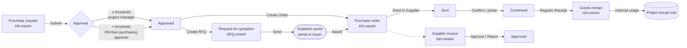
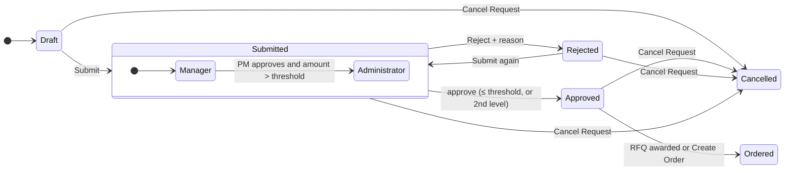
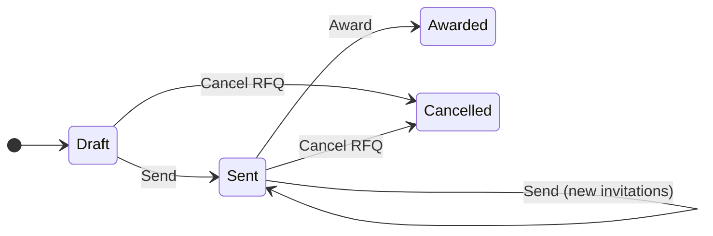
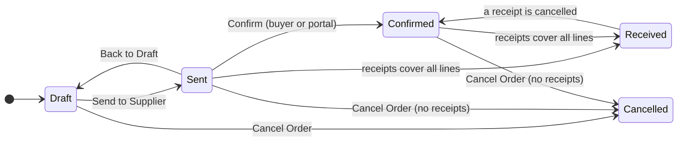
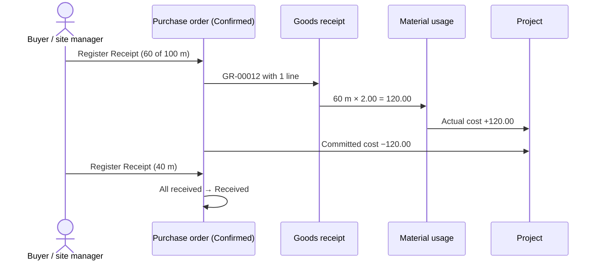

# Purchasing: requests, RFQs, orders, receipts and supplier invoices

> **Language:** English · [Italiano](../it/purchasing.md) · [Français](../fr/purchasing.md) · [Deutsch](../de/purchasing.md)
> **Manual index:** [README](../../README.md#user-manuals)

Purchases are where job costs are won or lost: buying the right thing, at the right price, from a reliable supplier, without exceeding the budget. ProjectIQ covers the whole purchasing chain inside the project: a team member **requests** what is needed, the project manager (and above a threshold the purchasing approver) **approves**, the buyer asks suppliers for **quotations** and compares them, the winning quote becomes a **purchase order**, the supplier confirms it (also from the [supplier portal](supplier-portal.md)), goods are **received** and become actual cost, and the **supplier invoice** is checked and approved.

Every step updates the project figures: **committed cost** when an order is sent, **actual cost** when goods are received, **spend** per supplier and item.

All purchasing pages are in the **Purchasing** area: group **Procurement** (Purchase Requests, RFQs, Purchase Orders, Goods Receipts, Supplier Invoices) and group **Analysis** (Spend dashboard). The **Purchasing** tab of the project form lists the requests and orders of the project.

## The chain at a glance

Numbers are assigned automatically when the record is saved: purchase requests `PR-00001`, requests for quotation `RFQ-00001`, purchase orders `PO-00001`, goods receipts `GR-00001`, supplier invoices `INV-00001`.

## Who does what

| Action | Who can do it |
|---|---|
| Create a purchase request | A Manager or Contributor of the project, an administrator (the requester is set to you) |
| Submit a request | The requester, a Manager of the project, an administrator |
| Approve / reject up to the threshold | The project manager (current approver), any Manager of the project, an administrator |
| Approve / reject above the threshold (second level) | The **Purchasing Approver** set in the [environment variables](administration.md#company-settings), or an administrator |
| Cancel a request | The requester, a Manager of the project, an administrator |
| Create RFQs and orders, send, award, change order status | A Manager of the project, an administrator |
| Register goods receipts | A Manager or Contributor of the project, an administrator |
| Approve / reject supplier invoices | The Purchasing Approver, an administrator |

"Administrator" means a user with the **OP365 Administrator** or **System Administrator** role.

All the actions are **buttons in the command bar** of the forms. Each button is enabled only in the statuses where it applies, and every action asks for confirmation.

## 1. Purchase requests

A purchase request (PR) says *what* is needed, *for which project and task*, *by when*, and roughly *how much it costs*.

### Creating a request

1. Go to **Purchasing → Procurement → Purchase Requests → + New**, or to the **Purchasing** tab of the project.
2. Fill in the header:

| Field | Meaning |
|---|---|
| **Title** | Short description of the need (for example "Cables for 2nd floor") |
| **Needed By** | Date the material is needed on site |
| **Project** | The project (must not be closed) |
| **WBS Node** | The task the purchase is for (same project only). Used for the budget check and copied to the order lines |
| **Preferred Supplier** | The supplier you suggest. Required to use **Create Order**; always invited when an RFQ is created |
| **Requester** | You, by default |
| **Justification** | Why it is needed, anything the approver should know |

3. Save, then add the **Lines** (section *Lines*, **+ New Purchase Request Line**):

| Field | Meaning |
|---|---|
| **Item** | Catalogue item (optional) |
| **Description** | From the item when empty |
| **Quantity** / **Unit of Measure** | How much (the unit comes from the item when empty) |
| **Estimated Price** | Unit price you expect. Empty = the preferred supplier's price for the item, else the item unit cost |
| **Amount** | Quantity × Estimated Price (calculated) |
| **Sort Order** | Order of the lines |
| **Notes** | Specifications for the supplier |

The **Estimated Amount** of the request is the sum of the line amounts.

### Submitting and approving

Click **Submit**. The request becomes **Submitted**, its content is locked (only the Justification can still be completed), and the application records three things in the *Approval* section:

- **Above Threshold**: whether the estimated amount exceeds the **Purchase Request Threshold** [environment variable](administration.md#company-settings);
- **Over Budget**: whether actual cost + committed cost + this request exceed the budget of the WBS node (or of the project, if no node is set);
- **Current Approver**: the project manager, who receives a notification "Purchase request to approve".

**Two-level approval**

| Level | Who decides | What happens on Approve |
|---|---|---|
| **Manager** (first) | Project manager / Managers of the project | If the request is **not** above the threshold → **Approved**. If it is above → it moves to level **Administrator**, *Manager Approved By/On* are recorded, and the second-level approvers are notified |
| **Administrator** (second) | Purchasing Approver environment variable (if set), otherwise every OP365 Administrator | → **Approved** |

If the person approving at the first level is already a second-level approver, the request is approved directly.

To **reject**, click **Reject**: a dialog asks for the **Reason** (required). The request becomes **Rejected**, the reason is stored in *Decision Note*, and the requester is notified. The requester can change the request and **Submit** it again.

The view **Purchase Requests to Decide** lists the requests waiting for a decision; **My Purchase Requests** lists yours; **Open Purchase Requests** lists those not yet ordered, cancelled or rejected.

> A threshold of zero (or empty) means that no request needs the second level. *Over Budget* is a warning for the approver: it does not block the approval.

### After approval: two ways to buy

| Button | When to use it | Result |
|---|---|---|
| **Create RFQ** | You want competing quotes | A new RFQ in Draft, with the preferred supplier and the default suppliers of the items already invited |
| **Create Order** | You already know the supplier and price | A Draft purchase order to the **Preferred Supplier** with the request lines; the request becomes **Ordered** |

**Cancel Request** stops the request at any status except Ordered and Cancelled. Only Draft, Rejected or Cancelled requests can be deleted.

## 2. Requests for quotation (RFQ)

An RFQ asks one or more suppliers to quote the lines of an approved request.

### Preparing and sending

1. On the approved request click **Create RFQ**. The RFQ is created with a **Deadline** in 7 days and the request title in **Notes**; the preferred supplier and the items' default suppliers are listed in **Invitations** with status *To Invite*.
2. Open the RFQ. Adjust the **Deadline** (today or later) and the **Notes** for the suppliers.
3. Add more suppliers in **Invitations** (**+ New RFQ Invitation**): choose the **Supplier**; the **Email** is copied from the supplier. Inactive, non-supplier or blocked accounts are refused.
4. Click **Send**. The RFQ becomes **Sent**, every *To Invite* invitation becomes **Invited** (with the RFQ number, deadline and notes), and **one empty quote line per request line** is prepared for each supplier.

You can add suppliers after sending: add the invitation and click **Send** again; only the new invitations are invited.

### Collecting quotes

Each invitation has its own **quote lines** (one per request line) with **Unit Price** and **Notes**, plus **Delivery Days** and **Supplier Notes** at invitation level. They can be filled in two ways:

- **by the supplier**, on the [supplier portal](supplier-portal.md): the supplier sees the RFQ, types prices, delivery days and notes, and clicks *Send quote* — or *Decline*;
- **by the buyer**, when the quote arrives by email or phone: open the invitation, tab **Quotes**, and type the prices.

The first price entered marks the invitation **Responded** (with the response date); the RFQ's **Responses** counter shows how many suppliers answered. The invitation's **Quoted Amount** is the sum of quantity × price over its lines.

| Invitation status | Meaning |
|---|---|
| **To Invite** | Added, not yet sent |
| **Invited** | Sent, waiting for an answer |
| **Responded** | At least one price entered |
| **Declined** | The supplier said no (portal) |

After the deadline, quotes can no longer be changed ("The deadline of the request for quotation has passed."); to extend it, change the **Deadline** of the RFQ and click **Send** again.

### Comparing and awarding

The **Quote Comparison** tab of the RFQ shows a grid **request lines × suppliers**:

| Line | Quantity | Supplier A | Supplier B | Supplier C | Best price |
|---|---|---|---|---|---|
| Cable 3x2.5 | 500 m | 0.95 | **0.89** | 0.97 | 0.89 (B) |
| Junction box | 40 pcs | **3.10** | 3.40 | – | 3.10 (A) |
| **Total** | | **2,989.00** | 3,081.00 | 3/4 lines | Best total: A |
| **Delivery** | | 10 days | 7 days | 5 days | |

- the **best price** of each line is highlighted;
- the **total** of each supplier is shown, with "x of y lines" when the supplier did not quote every line; the **best total** is chosen only among suppliers who quoted all the lines;
- **delivery days** and the invitation status are shown for each supplier;
- **Refresh** reloads the quotes.

Click **Award** under the supplier you choose and confirm ("Award the request for quotation to <supplier> and create the purchase order?"). The application:

1. creates a **Draft purchase order** to that supplier with the quoted lines and prices (only lines with a price), the WBS node of the request, and an **Expected Delivery** = today + the supplier's delivery days;
2. sets the RFQ to **Awarded**, records the winning invitation and the order;
3. sets the purchase request to **Ordered**.

Only suppliers who **responded** can be awarded. **Cancel RFQ** closes a Draft or Sent RFQ without an order.

## 3. Purchase orders

A purchase order (PO) is the commitment to buy from a supplier. It is usually created by **Award** or **Create Order**, but a Manager can also create one from scratch (**Purchasing → Purchase Orders → + New**) on an In Progress project.

### Fields

| Field | Meaning |
|---|---|
| **Number** | PO-##### (automatic) |
| **Supplier** | Must be an active, not blocked supplier |
| **Project** | Must be **In Progress** |
| **Purchase Request** | The originating request, if any |
| **Order Date** | Today by default |
| **Expected Delivery** | When the goods are expected |
| **Delivery Place** | Site address or warehouse |
| **Payment Terms** | From the supplier |
| **Total Amount** | Sum of the lines (calculated) |
| *Progress section* | Sent To, Sent On, Supplier Confirmed, Confirmed On, Received Amount, Received On, Cancelled On |

**Lines**: Item, Description, **WBS Node** (same project), Quantity, Unit, **Unit Price** (empty = the supplier's price for the item, else the item cost), **Amount**, **Received Quantity** (from the receipts, read-only), Sort Order, Notes.

### Statuses

| Button | From | Effect |
|---|---|---|
| **Send to Supplier** | Draft | → **Sent**. Lines are locked. *Sent To* records the supplier's email, *Sent On* the date. The order becomes visible to the supplier on the portal. Requires at least one line |
| **Back to Draft** | Sent | → **Draft**, to change the order (then send it again) |
| **Confirm** | Sent | → **Confirmed**, records the supplier's confirmation. The supplier can also confirm on the portal, with the same effect |
| **Register Receipt** | Sent, Confirmed | Opens the goods receipt dialog (see below) |
| **Cancel Order** | Draft, Sent, Confirmed | → **Cancelled**, only if the order has no goods receipts ("Cancel the goods receipts before cancelling the order.") |

**Received** is never set by hand: the order becomes Received when the receipts cover all its lines. Only Draft or Cancelled orders can be deleted.

Once an order has left Draft, you can still update its **Notes**, **Expected Delivery** and **Delivery Place** (for example when the supplier announces a new delivery date); everything else needs **Back to Draft**.

> *Send to Supplier* records that the order was sent; it does not email the supplier by itself. Send the order document by your usual channel, or let the supplier find it on the portal.

### Effect on costs

- Sent and Confirmed orders count in the project **Committed Cost** for the quantities not yet received.
- Every order not cancelled counts in the supplier's **Spend**; every line in the item's **Order Lines** and **Spend**.

## 4. Goods receipts

A goods receipt (GR) records what arrived, against which delivery note.

### Registering a receipt

1. On a Sent or Confirmed order click **Register Receipt**.
2. In the dialog fill in **Receipt date** (today by default), **Delivery note number** and **Delivery note date**.
3. For each order line type the **quantity received** now. **Receive all** fills in everything still to receive; **Clear** empties the quantities.
4. Click **Register**.

The application:

- creates the receipt (GR-#####) with one **receipt line** per received order line;
- creates one **material usage** per line, at the **order price**, on the order's project and the line's WBS node → **actual cost**;
- increases the **Received Quantity** of the order lines (and the order's Received Amount); the received part leaves the **committed cost**;
- sets the order to **Received** when every line is fully received.

You cannot receive more than ordered: "<line>: only N still to receive."

### Cancelling a receipt

If a receipt is wrong, open it and click **Cancel Receipt**. Its material usage and lines are deleted, the quantities to receive are restored, and a Received order goes back to **Confirmed**. Then register the correct receipt.

On a registered receipt only the **delivery note** data and the **notes** can be changed; lines and quantities change only through Cancel Receipt. Receipts can be created only with **Register Receipt**.

## 5. Supplier invoices

A supplier invoice is a **container** for a passive invoice: it holds the invoice data, its lines, the XML or PDF file, the link to the order, and the approval decision. (Automatic import from the Italian SDI exchange system is planned for a later release; today the file is attached by hand.)

### Recording an invoice

1. **Purchasing → Supplier Invoices → + New** (or the **Invoices** tab of the purchase order, so that the order is filled in).
2. Fill in **Supplier**, **Document Type** (TD01 Invoice, TD02 Advance invoice, TD04 Credit note, TD05 Debit note, TD06 Fee note, TD24 Deferred invoice, TD25 Deferred invoice (triangular)), **Invoice Number**, **Invoice Date**, **Purchase Order**.
3. **Seller Name** and **Seller VAT Number** are copied from the supplier; the **Project** from the order.
4. Attach the XML (FatturaPA) or PDF in **Invoice File**.
5. Optionally fill in **Order References** and **Delivery Note References** as written on the invoice.
6. Add the **Lines**: Line Number, Code, Description, Quantity, Unit, Unit Price, Total Price (= quantity × unit price when empty), VAT Rate %, and optionally the **Order Line** it refers to.
7. **Taxable Amount**, **VAT Amount** and **Total Amount** are calculated from the lines.

New invoices start in **To Review**.

### Approving

The Purchasing Approver (or an administrator) checks the invoice against the order and the receipts, then clicks **Approve** or **Reject** (reason required). Decided invoices — and their lines — are locked.

| Status | Meaning |
|---|---|
| **To Review** | Waiting for the check; data and lines can be changed |
| **Approved** | Accepted for payment |
| **Rejected** | Contested; the reason is in *Decision Note* |

Views: **Invoices to Review**, **Approved Invoices**, **Rejected Invoices**, **Supplier Invoices by Order**.

> Regular users (OP365 User) can read supplier invoices but not create or change them: invoices are handled by administrative staff with the OP365 Administrator role.

## 6. The Spend dashboard

**Purchasing → Analysis → Spend** gives buyers and management an overview:

| Component | Content |
|---|---|
| **Spend by Supplier** | Bar chart: total of purchase orders by supplier |
| **Spend by Project** | Bar chart: total of purchase orders by project |
| **Purchase Orders by Status** | Pie chart: number of orders by status |
| **Open Purchase Orders** | List of orders not yet received or cancelled |
| **Invoices to Review** | List of invoices waiting for approval |

Click a chart segment to filter, or open the list to see the records.

## Views

| Table | Views |
|---|---|
| Purchase requests | All, My, To Decide, Open, By Project |
| RFQs | All, Open, Awarded |
| Purchase orders | All, Open, Confirmed, Received, By Project, By Supplier |
| Goods receipts | All, By Order |
| Supplier invoices | All, To Review, Approved, Rejected, By Order |

## Messages you may see

| Message | Meaning and solution |
|---|---|
| "Use Submit to send a purchase request for approval." / "Use Submit, Approve, Reject or Cancel to change the status of a purchase request." | Status changes only through the buttons |
| "A purchase request can be changed only while it is Draft or Rejected." / "Lines can be changed only while the purchase request is Draft or Rejected." | Reject or cancel the request to change it |
| "Add at least one line before submitting." | The request has no lines |
| "Only the requester or a manager of the project can submit the purchase request." | Ask the requester or the project manager |
| "This purchase request is above the threshold: only the purchasing approver or an administrator can decide it." | It is at the second level |
| "Add a note to reject the purchase request." / "...the invoice." / "...time entries." | The reason is required |
| "Only approved purchase requests can go to a request for quotation." / "...can be ordered." | Approve the request first |
| "Choose the supplier: set Preferred Supplier on the request." | Create Order needs a preferred supplier |
| "The deadline must be today or later." / "The deadline has passed: move it before sending." | Change the RFQ deadline |
| "Invite at least one supplier." | Add an invitation before Send |
| "Use Send on the request for quotation to invite suppliers." | Invitation status changes only with Send (or from the portal) |
| "This supplier already has a quote for the line: change its price." | Edit the existing quote line |
| "Award a supplier who sent a quote." / "The supplier quoted no lines." | Only responding suppliers with prices can win |
| "<name> is not an active supplier." / "<name> is blocked." | Check the supplier account |
| "<name> is not a supplier." | Choose an account flagged Is Supplier |
| "Purchase orders can be created only on projects In Progress." | Check the project status |
| "A purchase order can be changed only while it is Draft." / "Lines can be changed only while the purchase order is Draft." | Use **Back to Draft** |
| "Add at least one line before sending." | The order has no lines |
| "Cancel the goods receipts before cancelling the order." | Cancel the receipts first |
| "An order becomes Received when all its lines are received." | Register the receipts |
| "Goods can be received only on sent or confirmed purchase orders." | Send the order first |
| "<line>: only N still to receive." / "Nothing to receive." | Check the quantities in the dialog |
| "Received quantities come from goods receipts." | Do not type received quantities |
| "Use Register Receipt on the purchase order to receive goods, and Cancel Receipt to undo a receipt." | Receipts are managed only with the buttons |
| "Approved or rejected invoices cannot be changed." | Decided invoices are final |
| "Only the purchasing approver or an administrator can decide supplier invoices." | Ask the purchasing approver |
