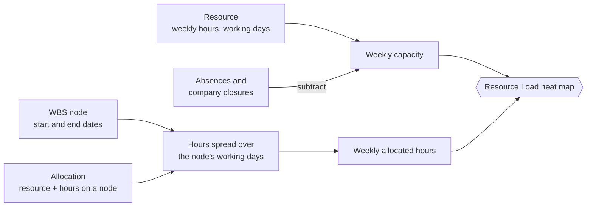
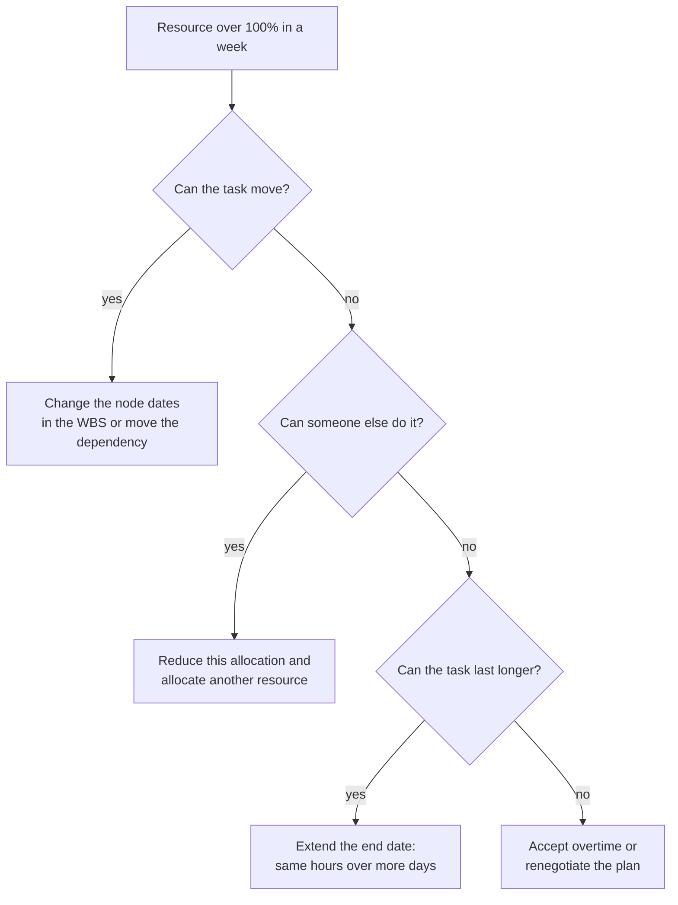

# Resource allocation and resource load

> **Language:** English · [Italiano](../it/resource-load.md) · [Français](../fr/resource-load.md) · [Deutsch](../de/resource-load.md)
> **Manual index:** [README](../../README.md#user-manuals)

Knowing *what* has to be done is half of planning; the other half is knowing *who* will do it and whether they have time. Open Project 365 answers the second question with **allocations** (hours of a resource planned on a WBS node) and the **Resource Load** dashboard, a heat map that compares, week by week, the hours allocated to every resource across all projects with the hours that resource actually has available.

This manual explains how to allocate resources, how capacity is calculated, how to read the heat map and how to fix overloads.

## The ingredients

| Ingredient | Where it is maintained | Manual |
|---|---|---|
| **Resource** with Weekly Hours and Working Days | Master Data → Resources | [Master data](master-data.md#resources) |
| **Absences** and **company closures** | Projects → Planning → Absences, or the Absences tab of the resource | [Master data](master-data.md#absences-and-company-closures) |
| **WBS node** with Start Date and End Date | Project → WBS tab | [WBS and planning](wbs-and-planning.md) |
| **Allocation** | WBS node → Allocations tab | this manual |

## Allocating a resource to a WBS node

1. Open the WBS node (click its name in the WBS tab of the project).
2. Go to the **Allocations** tab and click **+ New WBS Allocation**.
3. Choose the **Resource** and type the **Hours** you plan for this resource on this node (must be greater than zero).
4. Save.

| Field | Meaning |
|---|---|
| **WBS Node** | The task (the allocation is deleted with the node) |
| **Resource** | Who will do the work |
| **Hours** | Planned hours of this resource on this node (> 0) |
| **Name** | Description of the allocation |

A resource can be allocated to the same node only once: to change the hours, open the existing allocation. Several resources can be allocated to the same node (for example an electrician for 40 hours and an apprentice for 24 hours).

> Allocations are a **plan**, not a record of work done. Hours actually worked are recorded with time entries ([Time tracking](time-tracking.md)) and appear as Actual Hours on the node.

Tip: the node's **Budget Hours** is your overall estimate; the sum of its allocations is how that estimate is split between people. Keeping the two consistent makes both the budget and the load reliable.

## How the load is calculated

### Capacity

For each resource and each week:

- **daily capacity** = Weekly Hours ÷ number of Working Days (for example 40 ÷ 5 = 8 hours);
- each working day contributes its daily capacity; non-working days contribute nothing;
- an **absence** removes the whole day, or only its **Hours** for a single-day absence with hours (for example 4 hours of leave);
- a **company closure** (an absence without resource) removes the day for everybody.

### Allocated hours

For each allocation:

- the hours are **spread evenly over the working days of the resource** between the node's **Start Date** and **End Date**;
- each day's share is added to the week it falls in, and recorded under the project's name (shown in the tooltip);
- allocations on nodes **without dates** (or with the end before the start) cannot be placed on the calendar: they are summed in the **No dates** column;
- only active allocations on active nodes of active projects (Offer, In Progress, Suspended) are counted; closed projects do not load anybody.

### Worked example

Marco works 40 hours a week, Monday to Friday. He is allocated 60 hours on "2.2.1 Electrical", which runs from Monday 2 to Friday 13 March (10 working days), and 16 hours on another project's node that runs Monday 9 to Tuesday 10 March. He is on vacation on Friday 13 March.

| Week | Capacity | Allocated | Utilisation |
|---|---|---|---|
| 2–6 March | 5 × 8 = 40 h | 60 ÷ 10 × 5 = 30 h | 75% |
| 9–13 March | 4 × 8 = 32 h (Friday off) | 30 h + 16 h = 46 h | 144% — overloaded |

Note that the allocation still counts on the vacation day: allocations follow the node dates, absences only reduce capacity. The heat map tells you that the plan, as it stands, does not fit.

## The Resource Load dashboard

Open **Projects → Planning → Resource Load**.

Illustration of the heat map (allocated / capacity hours):

| Resource | No dates | Week of 2 March | Week of 9 March | Week of 16 March |
|---|---|---|---|---|
| Giulia | 12 | ⬜ 16 / 40 | 🟨 38 / 40 | 🟨 40 / 40 |
| Marco | – | 🟩 30 / 40 | 🟥 46 / 32 | ⬜ 8 / 40 |

- **Rows**: active resources, in alphabetical order.
- **Columns**: the weeks of the window. The first column, **No dates**, shows allocated hours on nodes without dates.
- **Cells**: allocated hours / capacity for the week, coloured by utilisation.
- **Tooltip** on a cell: allocated hours, capacity and the split of the hours **by project**.

### Colour bands

| Colour band | Utilisation | Meaning |
|---|---|---|
| ⬜ **Under 50%** | allocated < 50% of capacity | Plenty of room |
| 🟩 **50–90%** | 50% to 90% | Healthy load |
| 🟨 **90–100%** | 90% to 100% | Fully booked |
| 🟥 **Over 100%** | above capacity (or hours with zero capacity) | Overloaded: something must move |

The dashboard shows a legend with these bands. (The emoji colours in this manual are only indicative of the colours on screen.)

### Toolbar

| Control | What it does |
|---|---|
| **Previous** / **Next** | Moves the window back or forward by its length |
| **This week** | Returns to the current week |
| **4 / 8 / 12 / 26 weeks** | Length of the window (default 8 weeks) |
| **Refresh** | Reloads resources, allocations and absences |

## Fixing an overload

When a cell is red, you have four levers:

After each change, click **Refresh** on the dashboard to see the effect.

## Good practices

- Give every node that will be allocated **start and end dates**: otherwise its hours fall into the "No dates" column and never show up in a week.
- Record **absences and closures** in advance (holidays, August shutdown): the load of those weeks becomes realistic.
- Keep **Weekly Hours** and **Working Days** correct for part-time staff and crews.
- Review the dashboard at least weekly with the project managers of the projects that share resources.

## Messages you may see

| Message | Meaning |
|---|---|
| "The resource load could not be loaded" | A network or permission problem: use Refresh; if it persists, check your security roles |
| A duplicate key error on an allocation | The resource is already allocated to the node: change the existing allocation |
| A validation error on Hours | Hours must be greater than zero |
