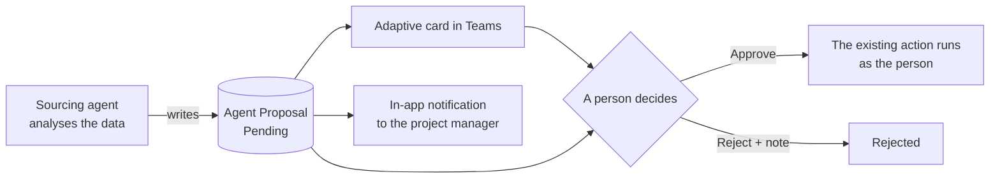
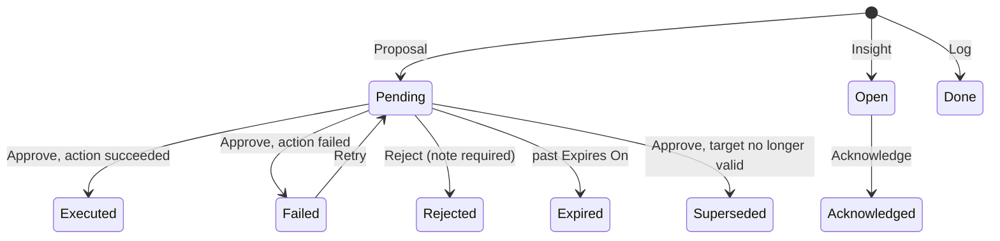
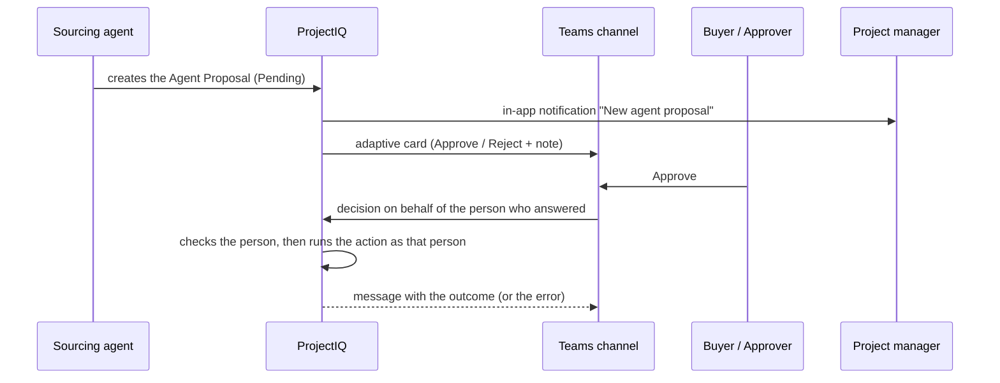
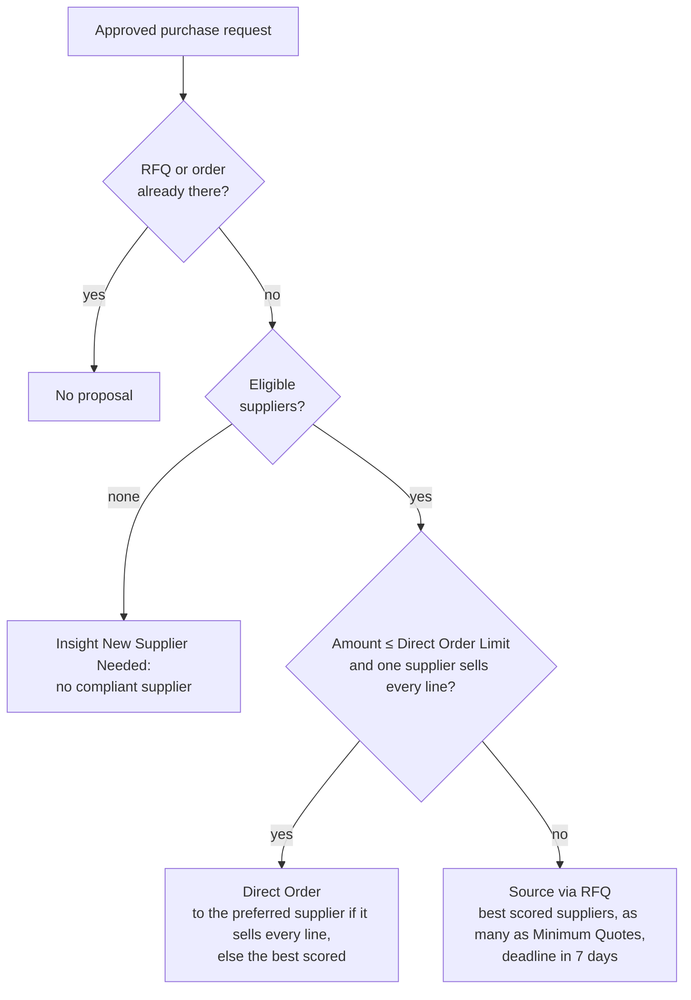

# Sourcing agent: proposals that a person decides

> **Language:** English · [Italiano](../it/sourcing-agent.md) · [Français](../fr/sourcing-agent.md) · [Deutsch](../de/sourcing-agent.md)
> **Manual index:** [README](../../README.md#user-manuals)

The **sourcing agent** is meant to work like a Sourcing Manager on the [purchasing](purchasing.md) data: it prepares every sourcing decision with numbers and a reason, so that the buyer stops opening requests, quotations and invoices "just to check". The agent never changes purchasing records on its own. It writes a **proposal** ("source this request via RFQ", "award this RFQ to that supplier"), a person reads the reason and decides, and only then the action runs, **with the identity and the rights of the person who approved**.

> **Coming.** The Copilot Studio agent that creates the proposals is delivered in later releases, task by task. This release delivers the foundations: the Agent Proposal table, the roles, the approval card in Teams, the Approve, Reject, Retry and Acknowledge commands in the app, the expiry of old proposals and the notifications. Until the agent is switched on, the proposal views are empty; this manual describes what you will see and do when proposals arrive.

## What the agent does

The agent has ten tasks, delivered in the order of the purchasing chain. Each task either ends in a proposal (a person decides) or in an insight or log row (information only).

| # | Task | Result | Status |
|---|---|---|---|
| 1 | Route an approved purchase request: RFQ or direct order | Proposal **Source via RFQ** or **Direct Order** | Available: build the agent with the [guide](../../copilot/sourcing-agent/README.md) ([how](#how-a-request-is-routed)) |
| 2 | Choose the suppliers to invite (items sold, valid documents, price, lead time, answers to past RFQs) | Invitation list inside the proposal of task 1 | Available inside task 1 ([how](#how-a-request-is-routed)) |
| 3 | Analyse the quotes (price, delivery, risk) and recommend the award | Proposal **Award RFQ** | Planned |
| 4 | Remind suppliers who have not answered an RFQ | E-mail to the supplier and a log row | Planned |
| 5 | Supplier compliance: expiring or expired documents of suppliers with open RFQs or orders | Insight **Compliance Alert** | Planned |
| 6 | Three-way match of invoice, order and goods receipt | Proposal **Approve Invoice** or **Reject Invoice** | Planned |
| 7 | Late orders: confirmed, not received beyond the lead time | E-mail to the supplier and insight **Late Delivery** | Planned |
| 8 | Project budget: remaining WBS budget | Insight **Budget Alert** | Planned |
| 9 | Spend analysis: fragmented purchases across projects | Insight **Consolidation** | Planned |
| 10 | Supplier scouting and onboarding | Insight **New Supplier Needed** and proposal **Invite Supplier** | Planned |
| – | The proposal mechanics described in this manual: Teams card, app commands, expiry, notifications | – | Available |

Why proposals and not direct actions: purchasing involves money and commitments with suppliers. The existing rules (who may send an RFQ, award it, approve an invoice) stay exactly as they are, and the audit trail shows the person who approved, not a robot. The notes written when rejecting are the feedback used to improve the agent. This is recorded in [ADR 0003](../adr/0003-sourcing-agent-proposals.md); the read-only Copilot and Cowork integration ([ADR 0001](../adr/0001-copilot-work-iq-read-only.md)) is not affected.

## Who does what

| Action | Who can do it |
|---|---|
| See a proposal | Members of the project (through the project team), buyers and administrators. Proposals without a project are seen by buyers and administrators only |
| See the **Evidence** of a proposal | Users with the **OP365 Cost Visibility** profile |
| Approve or reject **Source via RFQ**, **Direct Order**, **Award RFQ** | An administrator, a user with the **OP365 Buyer** role, a project manager of the proposal's project |
| Approve or reject **Invite Supplier** | An administrator, a user with the **OP365 Buyer** role |
| Approve or reject **Approve Invoice**, **Reject Invoice** | The **Purchasing Approver**, an administrator (segregation of duties: the buyer who prepares an order does not decide on its invoice) |
| **Retry** a failed proposal | Whoever could decide that proposal |
| **Acknowledge** an insight | An administrator, a user with the **OP365 Buyer** role, a project manager of the insight's project |
| Create proposals, insights and log rows | The sourcing agent only (its application user) |
| Change a proposal | Nobody: only the **Decision Note** can be edited, while the proposal is Pending, Open or Failed. Status changes happen only through the commands |

"Administrator" means a user with the **OP365 Administrator** or **System Administrator** role. The **OP365 Buyer** role also lets a user do the purchasing actions that were reserved to project managers and administrators (create, send, award and cancel RFQs, create orders, change order status, cancel purchase requests and goods receipts), on every project; see [Purchasing](purchasing.md#who-does-what). The project manager of the proposal's project is informed with an in-app notification when a proposal arrives.

## Agent proposals

An **Agent Proposal** is one row of the table of the same name. Its **Kind** says what it is:

| Kind | Meaning | Starts as |
|---|---|---|
| **Proposal** | Waits for a decision. When approved, the action runs | Pending |
| **Insight** | A finding for people to read and acknowledge | Open |
| **Log** | Records something the agent already did (for example a reminder sent) | Done |

### Fields

| Field | Meaning |
|---|---|
| **Name** | Generated as "{Action Type} – {record}", for example "Award RFQ – RFQ-00012", when the agent leaves it empty |
| **Kind**, **Action Type** | What the row is and what it proposes or reports. Fixed when the row is created |
| **Status** | Pending, Open, Failed (active); Executed, Rejected, Expired, Superseded, Acknowledged, Done (inactive) |
| **Project**, **Purchase Request**, **RFQ**, **Invitation**, **Purchase Order**, **Supplier Invoice**, **Supplier** | The records the proposal is about, as links you can open |
| **Rationale** | The explanation written by the agent: why it proposes this |
| **Evidence** | The output of the analysis behind the proposal (JSON). Visible only with the **OP365 Cost Visibility** profile |
| **Amount**, **Estimated Saving** | Value of the order, award or invoice, and the saving the agent expects |
| **Expires On** | For proposals: the creation date plus the days of the *Sourcing Proposal Expiry Days* setting (5 by default); **Retry** sets it again from the day of the retry |
| **Decided By**, **Decided On**, **Decision Note** | Who decided, when, and the note (up to 2,000 characters; a longer note is cut). A note is required to reject |
| **Result Id** | The record created by the approved action (RFQ, purchase order…) |
| **Error** | The message of the action when it failed |

Not on the form: **Payload** (the inputs of the action, such as the suppliers to invite) and **Dedup Key**.

### Action types

| Action Type | Kind | Runs when approved | Decided by |
|---|---|---|---|
| **Source via RFQ** | Proposal | Creates the RFQ from the purchase request, invites the suppliers of the proposal and sends it | Buyer, project manager, administrator |
| **Direct Order** | Proposal | Creates the draft purchase order | Buyer, project manager, administrator |
| **Award RFQ** | Proposal | Awards the RFQ to the invitation of the proposal; creates the draft purchase order | Buyer, project manager, administrator |
| **Approve Invoice**, **Reject Invoice** | Proposal | Approves or rejects the supplier invoice | Purchasing Approver, administrator |
| **Invite Supplier** | Proposal | Sends the supplier portal invitation to the contact of the proposal | Buyer, administrator |
| **Supplier Reminder** | Log | Nothing: the e-mail was already sent | – |
| **Compliance Alert**, **Budget Alert**, **Late Delivery**, **Consolidation**, **New Supplier Needed** | Insight | Nothing | – |

### Life cycle

| Status | Active | Meaning |
|---|---|---|
| **Pending** | Yes | Waiting for a decision |
| **Open** | Yes | An insight nobody has acknowledged yet |
| **Failed** | Yes | The person approved, but the action failed; see **Error**. It can be retried |
| **Executed** | No | Approved and done; **Result Id** points to the new record |
| **Rejected** | No | Rejected with a note |
| **Expired** | No | Nobody decided before **Expires On** |
| **Superseded** | No | Approved too late: the record is no longer in the expected status (for example the RFQ was already awarded by hand) and nothing was done |
| **Acknowledged** | No | An insight somebody has read |
| **Done** | No | A log row |

A **Source via RFQ** or **Direct Order** proposal is also **Superseded** when its purchase request already has an RFQ or an order that is not cancelled: somebody sourced the request in the meantime.

### Rules

- **One open proposal per subject.** The agent cannot create a second active (Pending, Open or Failed) proposal for the same record and action: the system refuses with "An open proposal for the same action already exists." Once the first one is decided, expired or superseded, a new one is possible.
- **Nobody edits a proposal.** Rationale, Evidence, Payload, Kind, Action Type and links are fixed at creation; only the **Decision Note** can change, and only until the proposal is decided ("The Decision Note cannot be changed after the proposal is decided."). A direct status change is refused with "Use Approve, Reject, Retry or Acknowledge to change the status of an agent proposal."
- **Only the commands decide.** The decision, the person and the time are written by the system, never typed.
- **Proposals expire.** The **Daily agent proposal expiry** flow runs every day at 06:30 (W. Europe time) and moves to **Expired** the Pending proposals whose **Expires On** is before today.

## Deciding a proposal

A proposal can be decided from Teams or from the app. Both do the same thing; the first decision wins, and a later click gets "This proposal has already been decided."

### From Teams

The **Agent proposal approval** flow posts an **adaptive card** in the Teams channel chosen by the administrator (setting *Sourcing Approval Team*) for every new proposal. The card shows the action type, project, supplier, amount, the rationale and a link to the proposal in the app.

1. Read the card. Open the proposal in ProjectIQ if you want to see the Evidence.
2. To approve, select **Approve**. The **Note** is optional.
3. To reject, type a reason in **Note (required to reject)** and select **Reject**.
4. The channel gets a message with the real outcome: "Proposal ...: Executed (decided by ...)." or **Rejected**, or **Superseded (nothing was done)** when the record was no longer in the expected status (see [Life cycle](#life-cycle)).

The decision is recorded for **you**, identified by the e-mail address of your Teams account, and the action runs with **your** rights. The person who answers must therefore be a ProjectIQ user allowed to decide that proposal; otherwise the channel shows the message "You cannot decide this proposal." or "The user who decided is not a ProjectIQ user." and nothing changes: the proposal stays **Pending** and is not marked Failed.

If the action fails (for example the RFQ cannot be sent), nothing is created, the proposal becomes **Failed** with the reason in **Error**, and the channel shows "Proposal ... not decided: ...". If you reject without a note, the card answers "Add a note to reject the proposal." in the channel and the proposal stays **Pending**: reject it again from the app, with a note.

### From the app

Open the proposal (from the **Agent Proposals** section of the project, or from the link of the card). The commands are in the command bar of the **Agent Proposal** form and appear only where they apply:

| Command | Visible when | What it does |
|---|---|---|
| **Approve** | Pending | Asks for confirmation ("Approve this proposal? The agent's action runs with your identity.") and runs the action |
| **Reject** | Pending | Opens a dialog that requires a note |
| **Retry** | Failed | After confirmation, moves the proposal back to **Pending**, clears the error and sets a new **Expires On** |
| **Acknowledge** | Open | Marks the insight as **Acknowledged** |

1. Read the **Rationale** and, if you have the profile, the **Evidence**.
2. Select **Approve** and confirm, or **Reject** and write the note.
3. The form refreshes: the status is **Executed** and **Result Id** shows the new record, or **Failed** with the reason, or **Superseded**.

If the action fails, the app shows the error message and the proposal becomes **Failed**. Fix the cause (for example the request was changed or the deadline passed), then select **Retry** and approve again.

### What happens on approval

The action runs in one step, in the name of the person who approved, so every existing rule applies to that person: status checks, "Only a manager of the project or a buyer can ..." and the second-level approver rule for invoices.

| Action Type | What runs |
|---|---|
| **Source via RFQ** | Create RFQ from the purchase request (with the suppliers and the deadline of the proposal, if any), then send it. If the second step fails, the RFQ is not created either |
| **Direct Order** | Create the draft purchase order (supplier of the proposal, else the preferred supplier of the request) |
| **Award RFQ** | Award the RFQ to the invitation of the proposal |
| **Approve Invoice**, **Reject Invoice** | Decide the supplier invoice; the note is the decision note, else the stored note, else the note of the proposal |
| **Invite Supplier** | Invite the contact of the proposal to the supplier portal |

A rejected proposal leaves nothing behind: the agent never creates drafts.

## How a request is routed

Tasks 1 and 2 work on an **approved** purchase request. Two read-only analyses do the numbers; the agent only explains them in the proposal's **Rationale** and copies the analysis into **Evidence**:

- **Sourcing Suggest Suppliers** ranks the suppliers that could serve the request;
- **Sourcing Route Request** chooses between a request for quotation and a direct order, and fills the proposal's suppliers and deadline.

Then the agent calls **Sourcing Propose Route** with its explanation. That call computes the route again (the agent never passes numbers) and creates the proposal with the payload, the analysis as Evidence, the amount, the project, the request and, for a direct order, the supplier. When no supplier is eligible it creates the insight **New Supplier Needed** instead. It is refused while *Sourcing Agent Enabled* is No ("The sourcing agent is switched off.") and when the request already has an open proposal for the same action.

Both read the data with the rights of whoever calls them: a user sees only the suppliers and prices their roles let them read.

**Candidates.** The preferred supplier of the request, the suppliers of the requested items (item supplier rows and default supplier of the item) and the suppliers whose *Supplier Category* is the *Category* of a requested item.

**Not eligible** (listed last, never invited): inactive or not a supplier, **Blocked**, or with **expired documents**. Documents expiring soon are only shown as a warning.

**Score** of the eligible suppliers, out of 100 plus a bonus:

| Part | Points | How |
|---|---|---|
| Lines covered | 40 | Share of the request lines whose item the supplier sells |
| Price | 25 | Cheapest supplier price ÷ this supplier's price, on the lines with a supplier price. No price on record: 12.5 |
| Lead time | 15 | Shortest lead time ÷ this supplier's lead time (longest of its items). Unknown: 7.5 |
| Answers | 15 | Requests for quotation answered ÷ closed in the last 12 months (declined, answered, or past the deadline). No history: 7.5 |
| Preferred supplier | +5 | The preferred supplier of the request |

The reasons (amount against the limit, suppliers chosen, fewer suppliers than *Sourcing Minimum Quotes*) are part of the analysis, so the proposal always says why. When you approve, the RFQ or the order is created exactly as if you had used **Create RFQ** or **Create Purchase Order** yourself, with your rights.

## Insights and log

Insights and log rows are information. An **Insight** stays **Open** until somebody acknowledges it with **Acknowledge** (an administrator, a buyer or the project manager of the insight's project); it then becomes **Acknowledged**. A **Log** row is created as **Done** and is never decided. There is no Teams card for insights and logs.

Use the **Agent Log** view as the history of everything the agent proposed, found or did.

## Views

| View | Shows |
|---|---|
| **Open Agent Proposals** (default) | Proposals waiting for a decision, soonest expiry first |
| **Agent Insights** | Open insights, newest first |
| **Agent Log** | Everything, active or not, newest first |
| **My Agent Decisions** | The proposals you approved or rejected, latest first |

On the project form, the **Agent Proposals** section lists the proposals of that project.

## Messages you may see

| Message | When |
|---|---|
| This proposal has already been decided. | Somebody decided first (for example in Teams), or the proposal is not Pending any more |
| Add a note to reject the proposal. | Reject without a note |
| Only failed proposals can be retried. | **Retry** on a proposal that is not Failed |
| You cannot decide this proposal. | You are not allowed to decide that action type, see [Who does what](#who-does-what) |
| Only the sourcing agent can decide on behalf of another user. | An attempt to decide in the name of somebody else |
| The user who decided is not a ProjectIQ user. | The Teams account of the person who answered is not a ProjectIQ user |
| The sourcing agent must give the user who decided. | A call of the sourcing agent without the person who decided (the agent never decides for itself) |
| Use Approve, Reject, Retry or Acknowledge to change the status of an agent proposal. | A direct status change |
| An agent proposal cannot be changed after it is created. | An edit of a field other than Decision Note |
| The Decision Note cannot be changed after the proposal is decided. | An edit of the Decision Note of an Executed, Rejected, Expired, Superseded, Acknowledged or Done row |
| An open proposal for the same action already exists. | A duplicate proposal |
| Set the Kind and the Action Type of the agent proposal. | A proposal created without them |
| The proposal has no invitation to award. | **Award RFQ** without an invitation |
| The proposal has no contact to invite. | **Invite Supplier** without a contact |
| Only a manager of the project or a buyer can ... | A purchasing action by a user who is neither a project manager nor a buyer |

## Setup and settings

Administrators prepare the agent once per environment: application user, roles, the settings below, the Teams connection and the two flows. The steps are in the [first setup checklist](administration.md#first-setup-checklist) of the Administration manual.

| Setting | Effect on proposals |
|---|---|
| *Sourcing Agent Enabled* | No (default): the agent triggers stop; open proposals can still be decided |
| *Sourcing Agent User* | The application user of the agent. Only this user can pass the person who decided (the Teams flow does it) |
| *Sourcing Approval Team* | Teams team and channel of the approval cards |
| *Sourcing Proposal Expiry Days* | Days before a pending proposal expires (5) |
| *Sourcing Direct Order Limit* | Estimated amount up to which a request can go to a direct order ([routing](#how-a-request-is-routed)). Empty: always a request for quotation |
| *Sourcing Minimum Quotes* | Suppliers invited to a request for quotation (3) |
| *Sourcing Reminder Days*, *Sourcing Budget Warning %* | Used by the tasks of later releases |
