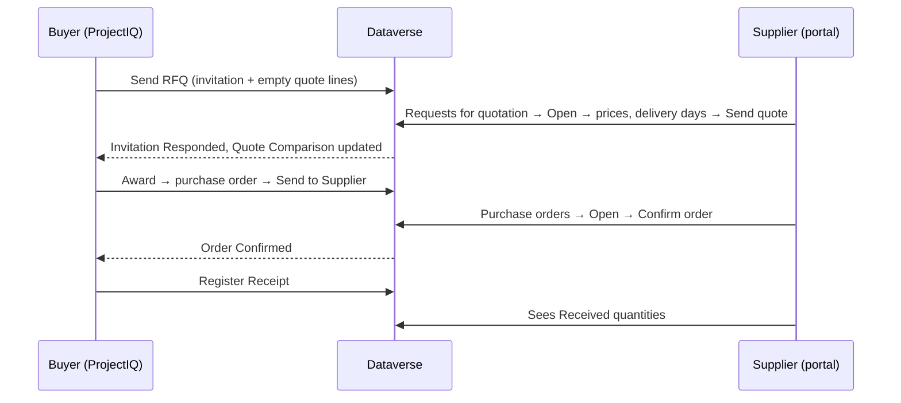

# Supplier portal

> **Language:** English · [Italiano](../it/supplier-portal.md) · [Français](../fr/supplier-portal.md) · [Deutsch](../de/supplier-portal.md)
> **Manual index:** [README](../../README.md#user-manuals)

The **supplier portal** is a website, built with Microsoft Power Pages on the same Dataverse database as ProjectIQ, where your suppliers can work with you without emails and spreadsheets going back and forth. On the portal a supplier:

- sees the **requests for quotation** (RFQs) you sent them, types **unit prices**, **delivery days** and **notes**, and sends the quote — or declines;
- sees the **purchase orders** you sent them, with lines and amounts, and **confirms** them;
- sees how much of each order has already been **received**.

Everything the supplier does is immediately visible in ProjectIQ: quotes appear in the Quote Comparison of the RFQ, confirmations change the order status.

This manual has two parts: **Part 1 for suppliers** (you can send it to them) and **Part 2 for your internal staff**, who give suppliers access and follow their answers.

## Part 1 — Guide for suppliers

### Signing in

Your customer gives you access to its supplier portal. You receive the portal address (for example `https://<customer>-suppliers.powerappsportals.com`) and the instructions to create or activate your account. Use the email address your customer registered for you.

1. Open the portal address and click **Sign in**.
2. Sign in with your account.
3. The menu shows **Requests for quotation** and **Purchase orders**.

If a page says "This area is reserved to suppliers. Sign in with the account your customer invited.", you are not signed in, or your account has not been enabled as supplier yet: contact your customer.

You see only the RFQs and orders **of your company**. Colleagues of your company with their own account see the same data.

### Answering a request for quotation

1. Click **Requests for quotation**. The list shows, for each RFQ: number, **Deadline**, **Status** and the **Quoted** amount once you have answered.

| Status | Meaning |
|---|---|
| **Invited** | Waiting for your quote |
| **Responded** | You sent a quote (you can still change it until the deadline) |
| **Declined** | You declined |

2. Click **Open** on the RFQ. You see the RFQ number, the deadline, your customer's notes and the list of items with quantity and unit.
3. For each line type the **Unit price** and, if needed, **Notes** (brand, alternative product, conditions...).
4. Type the **Delivery days** (how many days after the order you can deliver) and any **Notes for the buyer**.
5. Click **Send quote**. A green message confirms: "Your quote has been sent. You can change it until the deadline."

Good to know:

- You can leave a line without price if you do not supply that item: "Lines without a price are not quoted." Quoting every line gives you a better chance, because the best total is calculated only among suppliers who quoted all the lines.
- You can come back and **change prices until the deadline**. After the deadline (or after declining) the fields are read-only.
- If you cannot quote, click **Decline** and confirm. The RFQ is marked Declined.
- The **Quoted** amount in the list is quantity × unit price over all your lines.

### Confirming a purchase order

1. Click **Purchase orders**. The list shows number, order **Date**, **Expected delivery**, **Status** and **Total**. Orders waiting for your confirmation are marked **To confirm**.
2. Click **Open**. You see order date, expected delivery, **Delivery place**, **Payment terms**, status, and the lines with quantity, unit price, amount and the quantity already **Received**.
3. Check the order and click **Confirm order**, then confirm. The status becomes **Confirmed** with the confirmation date.

| Status shown | Meaning |
|---|---|
| **To confirm** | The order has been sent to you and waits for your confirmation |
| **Confirmed** | You (or the buyer on your behalf) confirmed it |
| **Received** | All the goods have been received by your customer |

If something in the order is wrong (price, quantity, date), do not confirm it: contact the buyer, who will correct the order and send it again.

### Errors

If an action fails, a red message explains why. Common cases: "Session expired: sign in again." (sign in and repeat), "The deadline of the request for quotation has passed." (contact the buyer to extend it), "The request for quotation is closed." (it was awarded or cancelled).

## Part 2 — Guide for internal staff

### What the portal exposes

The portal is deliberately narrow. Suppliers can read only their own records and can write only a few fields:

| Data | Supplier can read | Supplier can change |
|---|---|---|
| RFQ invitations of their company | Number, deadline, notes, status, quoted amount | **Delivery days**, **supplier notes**, **status** (only to Responded or Declined) |
| Quote lines of those invitations | Item, quantity, unit, price, notes | **Unit price**, **notes** |
| Purchase orders of their company (Sent, Confirmed, Received) | Header and amounts | **Supplier confirmed** (which confirms the order) |
| Lines of those orders | Item, quantity, price, amount, received quantity | Nothing |

Draft and cancelled orders and RFQs not yet sent are never shown. Prices of other suppliers are never visible.

### Giving a supplier access

A supplier user is a **contact** whose **company** is the supplier account, with the **Supplier** web role.

1. In ProjectIQ make sure the supplier account is **Is Supplier**, **Active** and not **Blocked**, and has a valid **Email**.
2. Create (or open) the **contact** of the person, with **Company Name** = the supplier and their email.
3. In **Power Pages Management** (or the portal studio, *Set up → Web roles*) assign the web role **Supplier** to the contact.
4. Let the person sign in with the method configured on your site (for example send an **invitation** from Power Pages Management → *Invitations*, or let them register with the email you recorded).
5. Send the person the address of the portal and [Part 1](#part-1--guide-for-suppliers) of this manual.

To remove access, remove the Supplier web role from the contact or deactivate the contact.

### Following the answers

- In the RFQ, the **Invitations** list shows each supplier's status, **Responded On**, **Quoted Amount** and **Delivery Days**; the **Responses** counter shows how many answered.
- The **Quote Comparison** tab shows the portal quotes next to the ones you typed yourself. Award as described in [Purchasing](purchasing.md#comparing-and-awarding).
- When a supplier confirms an order on the portal, the order becomes **Confirmed** and *Supplier Confirmed* / *Confirmed On* are filled in, exactly as if you had clicked **Confirm**.

### Remember

- An RFQ appears on the portal only after **Send**; an order only after **Send to Supplier**.
- Neither action sends an email by itself: tell the supplier that a new RFQ or order is waiting (your usual email, or an automation your administrator may add).
- If you move an order **Back to Draft**, it disappears from the portal until you send it again.
- After the deadline the supplier can no longer change the quote: extend the **Deadline** and **Send** again if you want more answers.

### For administrators

The portal is shipped as a separate solution, **OpenProject365SupplierPortal**, which depends on the main solution. Setup, the table permissions, the Web API settings and the deployment steps are documented in [Development environment setup](../dev-environment.md#supplier-portal-power-pages). After every deployment of the portal, clear the site cache (`/_services/about` → *Clear cache*, Administrators web role) and sign in again. In a new environment, an imported site must be reactivated (Power Pages → *Inactive sites*) before use.
