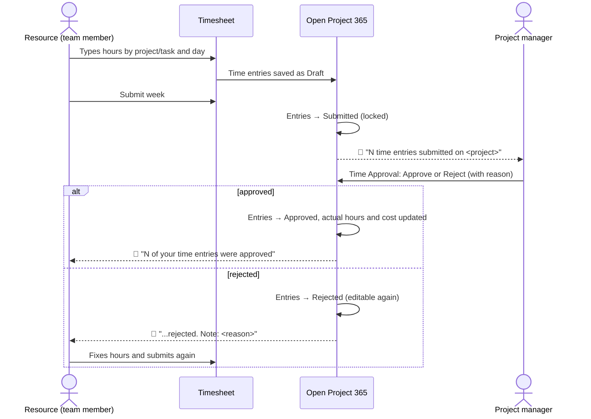
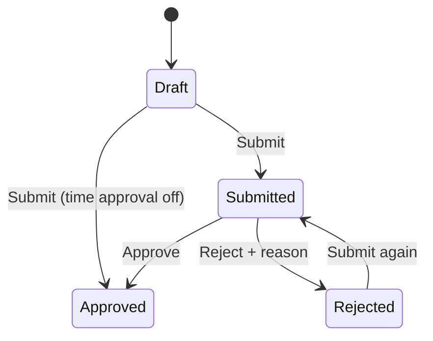
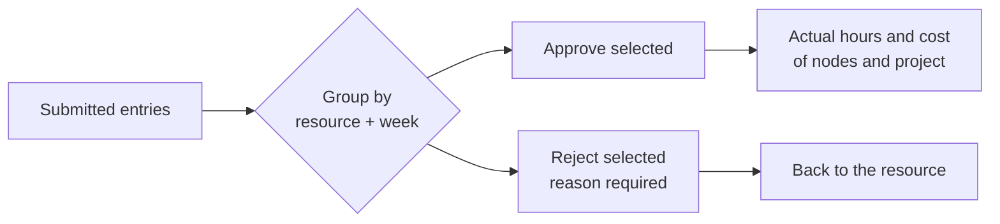

# Time tracking: timesheet, approval and reminders

> **Language:** English · [Italiano](../it/time-tracking.md) · [Français](../fr/time-tracking.md) · [Deutsch](../de/time-tracking.md)
> **Manual index:** [README](../../README.md#user-manuals)

Hours are usually the largest cost of a job, and the hardest to collect on time. Open Project 365 makes recording them a weekly routine: every person fills in a **weekly timesheet** by project and task, submits the week, and the project managers **approve** or **reject** the hours from a single screen. Approved hours become **actual hours and actual cost** of the WBS nodes and of the project, valued at the hourly cost that was valid on the day. A **daily reminder** tells people who forgot to record their hours.

This manual is for everybody who records hours (part 1), for the project managers who approve them (part 2), and for administrators who configure the process (part 3).

## The whole process

### Statuses of a time entry

| Status | Who can change the entry | Counts in actuals |
|---|---|---|
| **Draft** | The resource (edit, delete) | No |
| **Submitted** | Nobody: locked while waiting for approval | No |
| **Approved** | Nobody: final | **Yes** |
| **Rejected** | The resource (edit, delete, submit again) | No |

## Part 1 — Recording your hours

### Before you start

- Your user must be linked to a **Resource** (Master Data → Resources → *User* field). If not, the timesheet shows "Your user is not linked to a resource. Ask an administrator to set User on your Resource."
- You can record hours only on projects **In Progress** that you can see (you are a member, or the owner).

### The Timesheet dashboard

Open **Projects → Time → Timesheet**. You see one week, Monday to Sunday, of **your** hours.

| Area | What it shows |
|---|---|
| **Toolbar** | **Previous week**, **This week**, **Next week**, **Refresh**, **Submit week** |
| **Rows** | One row per *project / task* combination; the task (WBS node) is optional |
| **Day columns** | Hours per day; each cell shows a coloured badge with the status of its entry |
| **Total column** | Hours of the row in the week |
| **Footer** | Daily totals and the weekly total, compared with your **Weekly hours** |

Illustration:

| Project / task | Mon | Tue | Wed | Thu | Fri | Sat | Sun | Total |
|---|---|---|---|---|---|---|---|---|
| PRJ-000042 Office renovation / 2.2.1 Electrical | 8 ✅ | 6 ✅ | 8 📝 | | | | | 22 |
| PRJ-000051 Warehouse / 1.2 Executive design | | 2 ✅ | | 8 📝 | 4 📝 | | | 14 |
| **Total** (weekly hours 40) | 8 | 8 | 8 | 8 | 4 | | | **36 / 40** |

(✅ approved, 📝 draft: the actual badges on screen are coloured labels *Draft*, *Submitted*, *Approved*, *Rejected*.)

### Adding a line

1. At the bottom of the grid choose the **Project** (only In Progress projects are listed).
2. Optionally choose the **Task** (a WBS node of that project). Leave it empty to record time on the project as a whole.
3. Click **Add line**. An empty row appears.

### Typing hours

1. Click a day cell of the row and type the hours: **0 to 24**, with comma or dot decimals. Values are rounded to the **quarter of an hour** (1.3 becomes 1.25).
2. Press **Enter** or move to another cell: the entry is saved as **Draft** immediately.
3. To remove hours, type **0** or clear the cell: the draft entry is deleted.

If you type something that is not a valid number, the cell shows "Enter hours between 0 and 24."

A cell can be edited only when it holds **at most one entry** and that entry is Draft or Rejected. Cells with submitted or approved entries are read-only. If you recorded two entries for the same project, task and day (for example from the Time Entries list), the cell shows their sum and must be edited from the list.

### Submitting the week

When the week is complete, click **Submit week**. All **Draft** and **Rejected** entries of the week are submitted at once, a message confirms how many ("N entries submitted"), and the project managers are notified. Submitted entries are locked.

> Submit each week, even if it is incomplete: approvers see your hours sooner and the project costs stay current. You can add more hours later and submit again; already approved entries are not touched.

### When hours are rejected

You get a notification with the reason. Open the timesheet on that week: rejected cells are editable again. Correct them (or delete them) and click **Submit week** again.

### Notes on an entry and other ways to record time

The timesheet is the fastest way, but not the only one:

- **Projects → Time → Time Entries** lists your entries (**My Time Entries**) and lets you create one with **+ New**: choose project, task, date, hours and add **Notes** (for example what you did).
- On the project form, the **Time** tab lists the time entries of the project.
- The quick create form (**+** in the top bar → Time Entry) asks for project, task, date, hours and notes.

On the time entry form only the WBS nodes of the chosen project can be selected. The **Resource** is filled in with your own resource; **Name** (resource + date), **Cost** and **Revenue** are calculated.

### The daily reminder

From Monday to Friday at **17:30** (Rome time) the application checks everybody's hours for the day. If you recorded fewer hours than expected, you receive the notification **"Record your hours"** — "You have recorded X of Y hours on <date>." — with an **Open timesheet** button.

Expected hours are your Weekly Hours divided by your working days, minus any absence of the day:

| Situation | Expected hours (40 h/week, Mon–Fri) |
|---|---|
| Normal working day | 8 |
| Half day leave (single-day absence, 4 hours) | 4 |
| Whole-day vacation or sickness | 0 (no reminder) |
| Saturday or Sunday | 0 (no reminder) |
| Company closure | No reminders for anybody |

Hours count whatever their status (draft included), so recording them is enough to stop the reminder; you do not need to submit every day.

## Part 2 — Approving hours

Approvers are the **Managers** of each project (members with the Manager role, which always includes the project manager) and the administrators.

### The Time Approval dashboard

Open **Projects → Time → Approvals**. It lists every **submitted** time entry you can see, grouped by **resource** and **week**.

| Column | Content |
|---|---|
| **Resource** | Who worked |
| **Week** | Monday of the week |
| **Hours** | Total submitted hours of the group, with the split by project |
| **Expand** | Shows the single entries of the group (date, project, task, hours, notes) |

To decide:

1. Select whole groups with their check box (or **Select all**), or expand a group and select single entries.
2. Click **Approve**: a message confirms "N entries approved."
3. Or click **Reject**: a dialog "Reject N time entries" asks for the **Reason (sent to the resource)**, which is required. Confirm with **Reject**.

You can decide only the entries of projects where you are a Manager. If you select others, the operation stops with "Only a manager of the project can approve or reject its time entries."

The view **Time Entries to Approve** (Projects → Time → Time Entries) shows the same entries as a list, and **Time Entries by Project** is used in the Time tab of the project.

### What approval changes

When an entry is approved:

- its **hours** are added to the **Actual Hours** of its WBS node and of the project;
- its **cost** is added to the **Actual Cost** of the node and of the project, and appears in the [cost summary](materials-and-costs.md#cost-summary);
- the entry becomes final: it cannot be changed or deleted.

## How hours are valued

Each time entry carries two amounts, calculated whenever it is saved:

| Amount | Formula | Visible to |
|---|---|---|
| **Cost** | Hours × the resource's **hourly cost valid on the entry date** (from the Resource Costs history) | Only users with the *OP365 Cost Visibility* profile |
| **Revenue** | Hours × the **Hourly Rate** of the resource's user as a member of the project (0 if not set) | Users who can read the entry |

Example: Marco's cost is 35.00 €/h until 30 June and 38.50 €/h from 1 July. 8 hours on 28 June cost 280.00; 8 hours on 2 July cost 308.00, even if both entries are recorded on the same day. If Marco's Hourly Rate on the project is 55.00 €/h, both entries have a revenue of 440.00.

## Part 3 — Configuration (administrators)

| Setting | Where | Effect |
|---|---|---|
| **Time Approval Enabled** | Environment variable `op365_TimeApprovalEnabled` ([Administration](administration.md#company-settings)) | Yes (default): submitted hours wait for approval. No: **Submit** approves the entries immediately (they count in actuals straight away) |
| **User** on Resource | Master Data → Resources | Links a person to their resource: required to use the timesheet |
| **Weekly Hours**, **Working Days** | Resource | Expected hours (reminder, weekly total) |
| **Absences** | Planning → Absences | Reduce expected hours; company closures suspend reminders |
| **Hourly Rate** on Project Member | Project → Team | Revenue of the member's hours |
| **Daily time reminder** flow | Power Automate, solution Open Project 365 | Sends the reminders (Mon–Fri 17:30). See [Administration](administration.md#daily-time-reminder) |

Administrators can submit entries on behalf of others and approve or reject entries of any project.

## Messages you may see

| Message | Meaning and solution |
|---|---|
| "Your user is not linked to a resource. Ask an administrator to set User on your Resource." | No active resource has your user in the *User* field |
| "Hours and materials can be recorded only on projects In Progress." | The project is an offer, suspended or closed |
| "The WBS node belongs to another project." | The task chosen is not part of the selected project |
| "Submitted or approved time entries cannot be changed." / "...cannot be deleted." | Ask the project manager to reject the entry if it must be fixed |
| "Use Submit, Approve or Reject to change the status of time entries." | Status cannot be edited directly |
| "Only draft or rejected time entries can be submitted." | Some selected entries are already submitted or approved |
| "You can submit only your own time entries." | Only administrators can submit for others |
| "Select at least one time entry." | Nothing was selected |
| "Add a note to reject time entries." | The rejection reason is required |
| "Only submitted time entries can be approved or rejected." | The entry was already decided (perhaps by another manager): refresh |
| "Enter hours between 0 and 24." | The value typed in the timesheet is not valid |
