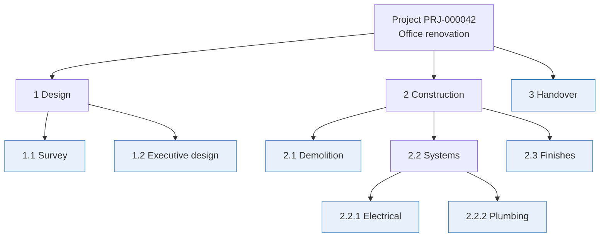
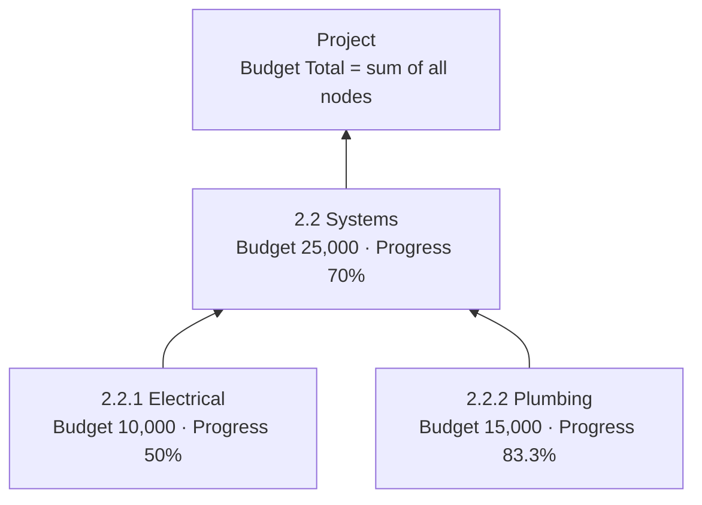
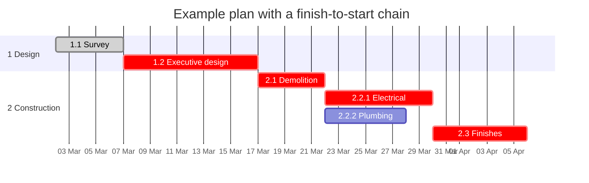
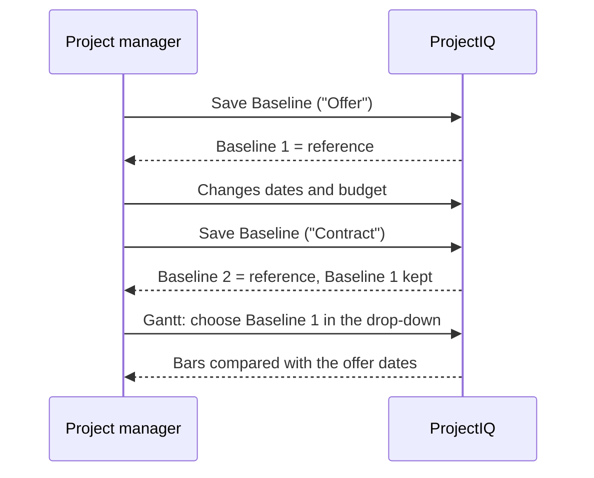

# WBS, budget, Gantt and baselines

> **Language:** English · [Italiano](../it/wbs-and-planning.md) · [Français](../fr/wbs-and-planning.md) · [Deutsch](../de/wbs-and-planning.md)
> **Manual index:** [README](../../README.md#user-manuals)

The **Work Breakdown Structure (WBS)** splits a project into phases, work packages and tasks. In ProjectIQ the WBS is where the budget is built, where dates and dependencies are planned, where progress is reported and where hours and costs are collected. On top of it sit the **Gantt chart**, with the **critical path**, and the **baselines**, frozen copies of the plan that let you compare what was agreed with what is happening.

This manual covers the **WBS** and **Gantt** tabs of the project form, the WBS node form, dependencies, allocations and baselines. Planned hours by resource are covered in [Resource load](resource-load.md).

## Concepts

- A **WBS node** is any element of the tree. A node can have a **parent node**, so the tree can be as deep as you need.
- A **leaf node** (highlighted above) has no children: it is a real task. Budget, dates and progress are typed on leaf nodes.
- A **parent node** (summary) has children: in the tree grid and in the Gantt its figures are **rolled up** from the nodes below.
- A **dependency** links two nodes: the successor can start only after the predecessor has finished (finish-to-start), optionally after some **lag days**.
- An **allocation** says how many hours a resource is planned to work on a node.
- A **baseline** is a snapshot of budget and dates of all nodes at a given moment.

## The WBS node

### Fields

**General tab**

| Field | Meaning |
|---|---|
| **Project** | The project (required). The node is deleted with the project |
| **Parent Node** | The node above in the tree. Only nodes **of the same project** can be chosen. Empty = top-level node |
| **Code** | Outline code, for example `2.2.1`. Free text; it is used for ordering (see below) |
| **Name** | Name of the phase or task (required) |
| **Owner Resource** | The resource responsible for the node |
| **Sort Order** | Optional number that forces the position among siblings |
| **Start Date** / **End Date** | Planned dates |
| **Progress %** | Completion percentage (0–100), typed on leaf nodes |
| **Owner** | Record owner |

**Budget tab**

| Field | Meaning |
|---|---|
| **Budget Hours** | Planned hours |
| **Actual Hours** | Approved hours recorded on the node (calculated) |
| **Budget Labour** | Planned labour cost |
| **Budget Materials** | Planned material cost |
| **Budget Other** | Other planned costs (subcontracting, rentals, travel...) |
| **Budget Total** | Labour + Materials + Other (calculated on save) |
| **Actual Cost** | Approved labour cost + material usage on the node (calculated) |

**Dependencies tab**: **Predecessors** (nodes this node waits for) and **Successors** (nodes waiting for this one).

**Allocations tab**: resources and hours planned on the node.

### Ordering of nodes

Siblings are shown in this order:

1. by **Sort Order**, when set (lower first);
2. then by **Code**, in natural outline order: `1.2` comes before `1.10`, `2` before `10`;
3. then by **Name**.

So in most cases you only need consistent codes; use Sort Order when you want a different order from the codes.

## The WBS tab (WBS Tree Grid)

The WBS tab of the project shows the whole tree as an expandable grid.

| Column | Leaf nodes | Parent nodes |
|---|---|---|
| **Name** (with code) | Click to open the node form | Click the arrow to expand/collapse; click the name to open the form |
| **Start** / **End** | Editable inline | Earliest start / latest end of the nodes below (grey, rolled up) |
| **Budget Hours** | Editable inline | Sum of the nodes below |
| **Labour**, **Materials**, **Other** | Editable inline | – |
| **Budget Total** | Calculated | Sum of the nodes below |
| **Progress %** | Green bar from 0 to 100; click the percentage to edit it inline | Budget-weighted progress of the leaves below, as a bar |

Amounts are shown in the currency of the project.

The last row shows the **Total** of hours and budget for the whole project. Rolled-up values are shown in grey; hover over them to see the "Includes child nodes" tooltip.

### Toolbar

| Button | What it does |
|---|---|
| **New node** | Opens a new WBS node form for the project (top level) |
| **New child node** | Opens a new node under the selected row (click a row first to select it) |
| **Expand all** / **Collapse all** | Opens or closes every branch |
| **Refresh** | Reloads the tree (use it after you changed nodes in another window) |

### Editing inline

1. Click a cell of a leaf node (dates, hours, labour, materials, other, progress).
2. Type the value. Decimal numbers can use comma or dot.
3. Press **Enter** or click elsewhere to save; **Esc** cancels.

The change is saved immediately, the budget total of the node is recalculated and the project's **Budget Total** and **Progress %** are updated. If a value cannot be saved, a message "The change could not be saved" shows the reason.

> If the project has not been saved yet, the grid shows "Save the project to build its WBS."

### Building a WBS quickly

1. Create the top-level phases with **New node** (code `1`, `2`, `3`...).
2. Select a phase, click **New child node** and create its tasks (`1.1`, `1.2`...).
3. Fill in dates, hours and budget directly in the grid.
4. Open the nodes that need dependencies or allocations and add them in their tabs.

## How the budget and progress roll up

- **Budget Total of a node** = Budget Labour + Budget Materials + Budget Other, recalculated on every save.
- **Project Budget Total** = sum of the budget totals of the nodes.
- **Progress** of a summary node and of the project = progress of the **leaf nodes** weighted by their budget total: (10,000 × 50% + 15,000 × 83.3%) ÷ 25,000 = 70%. If no leaf has a budget, the weights are the budget hours; if there are no hours either, a simple average is used.

> Type budget amounts on **leaf nodes only**. A budget typed on a parent node is still added to the project total, which may count it twice if its children also have a budget.

## Dependencies

A dependency says that the **successor** can start only after the **predecessor** has finished.

| Field | Meaning |
|---|---|
| **Predecessor** | The node that must finish first |
| **Successor** | The node that waits |
| **Dependency Type** | *Finish-to-Start* |
| **Lag Days** | Calendar days to wait after the predecessor finishes (0 = the successor can start the day after) |
| **Project** / **Name** | Filled in automatically ("Predecessor → Successor") |

Create dependencies from the **Dependencies** tab of a node: **+ New WBS Dependency** in *Predecessors* (this node waits for another) or in *Successors* (another node waits for this one).

The application checks every dependency when you save:

| Rule | Message |
|---|---|
| A node cannot depend on itself | "A WBS node cannot depend on itself." |
| Both nodes must be in the same project | "Predecessor and successor must belong to the same project." |
| No loops (A → B → C → A) | "This dependency would create a cycle in the plan." |
| The same pair only once | A duplicate key error |

When you delete a node, its dependencies and all its child nodes are deleted too.

## The Gantt tab (Gantt Chart)

The Gantt tab draws the WBS on a time line.

What you see:

- **Left column**: the WBS tree (expand/collapse with the arrows; click a name to open the node).
- **Summary bars** (dark) for parent nodes, from the earliest start to the latest end of their children.
- **Task bars** for leaf nodes, with the **progress** shown as a darker fill.
- **Arrows** for finish-to-start dependencies.
- **Critical path** in red: the chain of tasks with zero float, i.e. the tasks whose delay would delay the end of the project. It is computed from the planned dates and the dependencies (with lag).
- **Pushed bars**: when the dependencies force a task to start later than its planned start, the task is drawn dashed at the date where it can actually start ("Pushed by dependencies to ...").
- **Baseline bars**: thin bars under each task with the dates of the selected baseline.
- **Today line**: a vertical line on today's date.
- **Tooltip**: hover over a bar to see dates, progress, float (days), whether it is on the critical path, and the baseline dates.

### Toolbar

| Control | What it does |
|---|---|
| **Weeks** / **Months** / **Quarters** | Changes the time scale |
| **Baseline** | Chooses the baseline to compare with. The **reference** baseline is preselected; *No baseline* hides the comparison |
| **Critical path** | Shows or hides the critical path highlighting |
| **Refresh** | Reloads nodes, dependencies and baselines |

Messages:

- "No WBS node has start and end dates yet." — fill in dates in the WBS tab.
- "Some dependencies form a loop and were ignored." — the critical path ignores tasks on a loop; this can happen only with data imported outside the application, because loops are refused on save.

## Baselines

A baseline freezes the **budget hours, budget total, start date and end date** of every active WBS node at a moment in time. Typical baselines are "Offer", "Contract", "Re-plan after variation 1".

### Saving a baseline

1. On the project form click **Save Baseline** in the command bar.
2. Confirm. The current WBS is copied into a new baseline, named "Baseline yyyy-mm-dd hh:mm UTC", which becomes the **reference** baseline.
3. The Gantt and the **Baselines** list (Gantt tab) are refreshed and a "Baseline saved." notification appears.

Open the baseline from the list to **rename** it or add a **Description**. Its **Nodes** section lists the frozen values of each node.

### Reference baseline

Each project has **at most one reference baseline**: the one the Gantt preselects for comparison. Saving a new baseline makes it the reference. To choose another reference, open that baseline and tick **Is Reference**: the previous reference is cleared automatically.

Baselines are never changed by later edits to the WBS. Nodes created after a baseline do not appear in it; deleted nodes stay in it.

## Good practices

- Keep **codes consistent** (`1`, `1.1`, `1.1.1`): ordering, readability and reporting all benefit.
- Put **budget, dates and progress on leaves**; let summaries roll up.
- Add **dependencies only where they really exist**: the critical path is only as good as the links.
- **Save a baseline** at each formal milestone (offer, contract, approved variation) and give it a meaningful name.
- Update **progress** weekly: it drives the project progress and the estimate at completion in the [cost summary](materials-and-costs.md#cost-summary).

## Messages you may see

| Message | Meaning |
|---|---|
| "Save the project to build its WBS." / "Save the project to see its Gantt." | The project is new and not saved yet |
| "The WBS could not be loaded" / "The plan could not be loaded" | A network or permission problem; use Refresh, then check your access to the project |
| "The change could not be saved" | The inline value was refused (for example progress outside 0–100, or no write access) |
| "Save the project before saving a baseline." | Save Baseline was clicked on a new project |
| "The WBS node belongs to another project." | A time entry, material usage or request pointed to a node of a different project |
