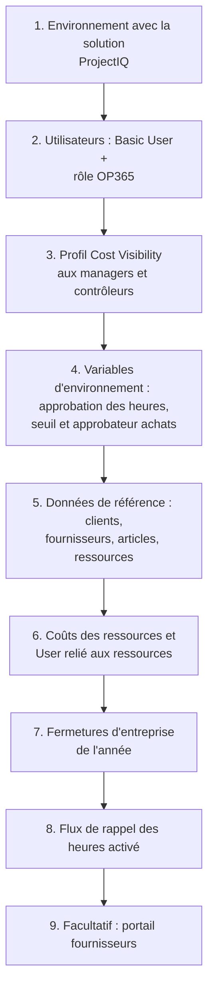
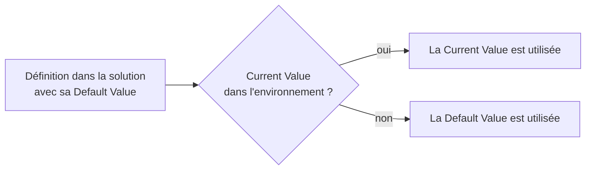
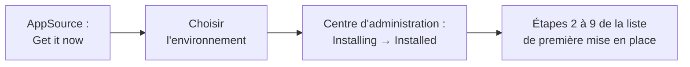

# Administration : utilisateurs, sécurité, paramètres et automatisations

> **Langue :** [English](../en/administration.md) · [Italiano](../it/administration.md) · Français · [Deutsch](../de/administration.md)
> **Index des manuels :** [README](../../README.md#user-manuals)

Ce manuel s'adresse aux personnes qui mettent en place et exploitent ProjectIQ dans une entreprise : administrateurs fonctionnels, équipe informatique et administrateur de la Power Platform. Il explique comment donner accès aux utilisateurs, comment fonctionne le modèle de sécurité, à quoi servent les paramètres de l'entreprise, quelles automatisations tournent en arrière-plan et quoi vérifier après une mise à jour. Les sujets techniques (build, déploiement, schéma Dataverse) sont traités dans [Development environment setup](../dev-environment.md) et [Data model](../data-model.md) (en anglais).

> Les noms des champs et des boutons sont en anglais, comme à l'écran.

## Liste de contrôle de la première mise en place

| Étape | Où | Détails |
|---|---|---|
| 1 | Centre d'administration Power Platform | Un environnement Dataverse par entreprise. La solution s'installe depuis [Microsoft AppSource](#installation-depuis-microsoft-appsource) ou est installée par l'informatique (voir [dev environment](../dev-environment.md)) |
| 2 | Centre d'administration Power Platform → Users | [Rôles de sécurité](#rôles-de-sécurité) |
| 3 | Centre d'administration Power Platform → Column security profiles | [Visibilité des coûts](#visibilité-des-coûts) |
| 4 | Power Apps → Solutions → ProjectIQ → Environment variables | [Paramètres de l'entreprise](#paramètres-de-lentreprise) |
| 5 | Master Data | [Données de référence](master-data.md) |
| 6 | Master Data → Resources | [Données de référence](master-data.md#ressources) |
| 7 | Projects → Planning → Absences (sans ressource) | [Données de référence](master-data.md#absences-et-fermetures-dentreprise) |
| 8 | Power Automate | [Rappel quotidien des heures](#rappel-quotidien-des-heures) |
| 9 | Power Pages | [Portail fournisseurs](supplier-portal.md) |

## Licences

Chaque utilisateur interne a besoin d'une licence **Power Apps Premium** (ou d'une licence équivalente incluant les applications pilotées par modèle sur Dataverse). Les fournisseurs qui utilisent le portail n'ont pas besoin de licence Power Apps : ce sont des utilisateurs du portail, couverts par la capacité Power Pages de l'environnement.

## Rôles de sécurité

Les rôles de ProjectIQ sont **cumulatifs** : chaque utilisateur interne a besoin du rôle standard **Basic User** **plus** un rôle ProjectIQ.

| Rôle | Pour | Accès |
|---|---|---|
| **OP365 Administrator** | Administrateurs fonctionnels, contrôleurs de gestion, back-office, approbateur achats | Au niveau de l'organisation : création, lecture, écriture, suppression, ajout, attribution et partage sur toutes les tables de ProjectIQ, les clients, fournisseurs et contacts. Voit tous les projets. Peut approuver heures et demandes sur tous les projets, décider des factures fournisseurs, soumettre des heures pour d'autres |
| **OP365 User** | Chefs de projet, membres des équipes, acheteurs | Lit les données de référence au niveau de l'organisation ; crée et gère ses propres enregistrements ; voit les projets dont il est **propriétaire** ou **membre**, avec les droits de son rôle projet (voir [Projets et équipe](projects-and-team.md#léquipe-du-projet)). Factures fournisseurs : lecture seule |

Le rôle standard **System Administrator** est traité comme OP365 Administrator par toutes les règles de ProjectIQ.

### Ce que peut faire un OP365 User, selon son rôle projet

| | Reader | Contributor | Manager |
|---|---|---|---|
| Voir le projet, la WBS, le planning, les coûts | ✓ | ✓ | ✓ |
| Saisir ses propres heures et matériaux | | ✓ | ✓ |
| Créer des demandes d'achat | | ✓ | ✓ |
| Enregistrer des réceptions | | ✓ | ✓ |
| Modifier le projet, la WBS, l'équipe, les baselines | | | ✓ |
| Approuver heures et demandes d'achat (premier niveau) | | | ✓ |
| Appels d'offres, commandes, statuts des commandes | | | ✓ |

Les rôles projet sont accordés via des **équipes d'accès** sur chaque projet ; les trois modèles d'équipe (**OP365 Project Manager**, **OP365 Project Contributor**, **OP365 Project Reader**) sont créés automatiquement la première fois qu'ils sont nécessaires. Ne les supprimez pas et ne les renommez pas.

### Donner accès à un nouveau collaborateur

1. Ajoutez l'utilisateur à l'environnement (centre d'administration Power Platform → Environments → *votre environnement* → Users) et attribuez **Basic User** et **OP365 User** (ou **OP365 Administrator**).
2. Si la personne doit voir les coûts, ajoutez l'utilisateur au profil **OP365 Cost Visibility**.
3. Si elle saisira des heures, créez ou ouvrez sa **Resource** (Master Data → Resources), renseignez **User**, Weekly Hours, Working Days et une ligne **Resource Cost**.
4. Ajoutez l'utilisateur aux équipes de ses projets (onglet **Team** du projet), ou demandez aux chefs de projet de le faire.

## Visibilité des coûts

Les colonnes de coût sont protégées par le profil de sécurité de colonne **OP365 Cost Visibility**. Sans lui, un utilisateur voit ces champs vides ou masqués, même sur les enregistrements qu'il peut ouvrir :

| Table | Colonnes protégées |
|---|---|
| Resource | Hourly Cost |
| Resource Cost | Hourly Cost |
| Time Entry | Cost |
| Material Usage | Unit Cost, Total Cost |
| Account | Spend (fournisseurs), IBAN |
| Item | Spend |

Attribuez le profil (centre d'administration Power Platform → *Settings* → *Users + permissions* → *Column security profiles* → **OP365 Cost Visibility** → ajouter des utilisateurs ou équipes) aux administrateurs, chefs de projet et contrôleurs de gestion. Les totaux du projet (Budget Total, Actual Cost, Committed Cost) ne sont pas protégés : quiconque peut lire le projet les voit.

## Paramètres de l'entreprise

Les réglages valables pour toute l'entreprise sont des **variables d'environnement** (environment variables) de la solution ProjectIQ. Chaque environnement (Dev, Test, Production) a ses propres valeurs : un environnement de test peut par exemple ignorer l'approbation des heures sans toucher à la production. Ils ne se trouvent pas dans l'application : un administrateur Power Platform ou un maker de l'environnement les modifie.

Pour modifier une valeur :

1. Ouvrez [Power Apps](https://make.powerapps.com), sélectionnez l'environnement, puis **Solutions** → **ProjectIQ** (ou **Default Solution**) → **Environment variables**.
2. Ouvrez la variable et, sous **Current Value**, cliquez sur **+ New value** (ou modifiez la valeur existante). Ne modifiez pas la **Default Value** d'une solution gérée.
3. **Save**. La modification s'applique à la soumission suivante ; aucune publication n'est nécessaire.

| Variable d'environnement | Nom affiché | Type | Par défaut | Effet |
|---|---|---|---|---|
| `op365_TimeApprovalEnabled` | **Time Approval Enabled** | Yes/No | Yes | Yes : les heures soumises attendent l'approbation d'un chef de projet. No : **Submit** approuve immédiatement les heures |
| `op365_PurchaseRequestThreshold` | **Purchase Request Threshold** | Number | Vide | Montant au-delà duquel une demande d'achat nécessite aussi une approbation de second niveau. Vide ou 0 = jamais |
| `op365_PurchasingApprover` | **Purchasing Approver** | Text | Vide | **User Name** (p. ex. `anna.rossi@contoso.com`) ou e-mail principal de l'utilisateur qui approuve les demandes au-dessus du seuil et décide des factures fournisseurs. Vide, ou aucun utilisateur actif avec ce nom = tous les OP365 Administrator |
| `op365_SupplierEmailTemplates` | **Supplier Email Templates** | JSON | Les modèles ProjectIQ | Modèle d'e-mail (type Compte) de chaque message aux fournisseurs, par **Language** du fournisseur : `{"DocumentExpiring": {"Italian": "<titre du modèle>", "English": "<titre du modèle>", "default": "English"}, "DocumentExpired": {...}}`. `default` est la langue utilisée quand le fournisseur n'en a pas ou qu'il n'existe pas de modèle |
| `op365_SupplierEmailSender` | **Supplier Email Sender** | Text | Vide | Nom ou adresse e-mail de la **file d'attente** (boîte aux lettres avec synchronisation côté serveur) qui envoie les e-mails aux fournisseurs. Vide = aucun e-mail |

Le Purchasing Approver est un nom d'utilisateur et non une recherche (lookup), car les identifiants des utilisateurs diffèrent dans chaque environnement. Les demandes déjà soumises gardent le niveau d'approbation qui leur a été attribué.

En Test, l'informatique peut aussi définir les valeurs au déploiement, via les deployment settings (voir [environnement de développement](../dev-environment.md#github-repository-security)) ; une valeur définie là écrase celle de l'environnement à chaque déploiement.

## Autres données de l'entreprise dans la zone Settings

| Page | Usage |
|---|---|
| **Resource Costs** | Toutes les lignes de coût horaire de toutes les ressources : utile pour la mise à jour annuelle des taux (ajoutez une ligne par ressource avec le nouveau *Valid From*) |
| **Project Members** | Tous les membres de tous les projets : utile pour savoir qui travaille où, ou pour retirer une personne qui a quitté l'entreprise |

## Automatisations en arrière-plan

ProjectIQ tient la plupart des chiffres à jour grâce à des **plug-ins** qui s'exécutent dans Dataverse à l'enregistrement des données ; ils ne demandent aucune maintenance. Deux automatisations sont planifiées.

### Rappel quotidien des heures

Le **Daily time reminder** est un flux cloud Power Automate de la solution ProjectIQ. Du **lundi au vendredi à 17 h 30** (heure d'Europe de l'Ouest), il appelle l'action *op365_SendTimeReminders*, qui envoie la notification « Record your hours » à chaque ressource active liée à un utilisateur ayant saisi moins d'heures que prévu dans la journée (voir [Saisie des temps](time-tracking.md#le-rappel-quotidien)). Aucun rappel n'est envoyé les jours de fermeture d'entreprise.

Le flux utilise la référence de connexion **op365_dataverse** (Microsoft Dataverse). Un principal de service ne peut pas posséder de connexions Power Automate ; un **utilisateur** doit donc :

1. créer une connexion Microsoft Dataverse (l'authentification par principal de service convient) ;
2. la lier à la référence de connexion dans la solution (dans les environnements de test/production, le déploiement la mappe via les paramètres de déploiement) ;
3. partager la connexion avec l'utilisateur d'application du déploiement (*Can use*) pour que les imports puissent activer le flux ;
4. activer le flux (**on**) et vérifier son historique d'exécution le jour ouvré suivant.

### Expiration quotidienne des documents

Le flux **Daily document expiry** s'exécute **chaque jour à 06:00** (heure W. Europe) et appelle l'action *op365_UpdateDocumentExpiry* : il met à jour le statut d'expiration des documents fournisseur et les compteurs d'alertes des fournisseurs, et envoie aux fournisseurs les e-mails d'expiration (voir [Données de référence](master-data.md#expiration-et-e-mails)). Il utilise la même référence de connexion que le Daily time reminder ; activez-le (**on**) de la même façon.

Pour envoyer les e-mails :

1. Créez une **file d'attente** avec une boîte aux lettres (par exemple *Fournisseurs*, `fournisseurs@contoso.com`), approuvez l'adresse de la boîte et activez la **synchronisation côté serveur** pour les e-mails sortants.
2. Renseignez **Supplier Email Sender** avec le nom ou l'adresse e-mail de la file d'attente.
3. Vérifiez les modèles dans **Settings** → **Templates** → **E-mail Templates** (*ProjectIQ - Document expiring* et *ProjectIQ - Document expired*, avec une version par langue comme *ProjectIQ - Document expiré*). Adaptez leur texte à votre guise ; les espaces réservés `{Document}`, `{DocumentType}`, `{Number}`, `{IssueDate}` et `{ExpiryDate}` sont remplis pour chaque document. Pour utiliser d'autres modèles, indiquez leurs titres dans **Supplier Email Templates**. Les modèles sont des données de l'environnement, pas de la solution : s'ils manquent, l'IT les crée avec `tools/dataverse/supplier_email_templates.py`.
4. Renseignez **Language** et **Email** de chaque compte fournisseur.

### Ce qui se passe aussi automatiquement

| Automatisation | Quand |
|---|---|
| Totaux du projet, totaux WBS et avancement | À chaque enregistrement de nœuds, saisies d'heures, consommations, commandes, réceptions |
| Nombre de projets et montant total des contrats du client | À chaque modification d'un projet |
| Dépenses et nombre de contacts du fournisseur ; lignes de commande et dépenses de l'article | À chaque modification de commande, ligne de commande ou contact |
| Coût horaire de la ressource | À chaque modification d'un Resource Cost |
| Notifications dans l'application | À la soumission et à la décision des heures et des demandes d'achat, et depuis le rappel quotidien |
| Accès aux équipes projet | À chaque modification d'un membre de projet |

### Notifications

Les notifications dans l'application sont activées par défaut dans les nouveaux environnements. Les utilisateurs les gèrent depuis l'icône en forme de cloche. Les notifications ne sont jamais bloquantes : si l'une d'elles ne peut pas être envoyée, l'opération aboutit quand même.

## Audit et historique

L'audit est activé sur les tables de ProjectIQ : une fois l'audit activé aussi au niveau de l'environnement (centre d'administration Power Platform → *Settings* → *Audit and logs*), chaque modification est enregistrée et visible dans l'**Audit history** de chaque enregistrement (Related → Audit history). La chronologie de chaque enregistrement conserve notes, mentions et pièces jointes.

## Installation depuis Microsoft AppSource

ProjectIQ est gratuit sur Microsoft AppSource : c'est le moyen le plus rapide de l'installer dans un nouvel environnement. Le package AppSource installe dans l'ordre les deux solutions managées, **ProjectIQ** (`OpenProject365`) et le **portail fournisseurs** (`OpenProject365SupplierPortal`), avec les étapes des plugins déjà activées.

Avant de commencer : un environnement Dataverse pour l'entreprise, le rôle **System Administrator** dans cet environnement et, pour afficher l'application en italien, français ou allemand, ces langues activées dans l'environnement (*Settings* → *Languages*).

1. Ouvrez ProjectIQ sur [Microsoft AppSource](https://appsource.microsoft.com) et sélectionnez **Get it now** ; connectez-vous avec votre compte professionnel.
2. Choisissez l'**environnement** cible, acceptez les conditions d'utilisation et les conditions Microsoft, puis sélectionnez **Install**.
3. Suivez la progression dans le centre d'administration Power Platform → *Environments* → votre environnement → *Resources* → **Dynamics 365 apps** : le statut passe de *Installing* à **Installed** (quelques minutes). En cas de *Install failed*, ouvrez les détails et réessayez.
4. Réalisez les étapes 2 à 9 de la [liste de contrôle de la première mise en place](#liste-de-contrôle-de-la-première-mise-en-place). Le package ne peut pas les faire à votre place :
    - attribuez aux utilisateurs les [rôles de sécurité](#rôles-de-sécurité) et le profil de [visibilité des coûts](#visibilité-des-coûts) ;
    - définissez les [variables d'environnement](#paramètres-de-lentreprise) (approbation des heures, seuil et approbateur des achats) ;
    - créez la connexion Dataverse du flux [rappel quotidien des heures](#rappel-quotidien-des-heures) et **activez** le flux ;
    - pour le [portail fournisseurs](supplier-portal.md#pour-les-administrateurs) : réactivez le site importé dans Power Pages → *Inactive sites*, puis videz son cache.

Les nouvelles versions sont publiées sur AppSource : installez-les depuis la même page **Dynamics 365 apps** (*Update* sur ProjectIQ), puis suivez [Après une mise à jour de la solution](#après-une-mise-à-jour-de-la-solution).

## Après une mise à jour de la solution

Quand l'informatique déploie une nouvelle version :

1. Vérifiez que les étapes de plug-in sont **activées** (un import interrompu peut les laisser désactivées ; l'informatique peut le contrôler dans les *Plug-in steps* de la solution).
2. Vérifiez que le flux **Daily time reminder** est **activé**.
3. Si le portail fournisseurs a été mis à jour, **videz le cache du portail** (`/_services/about` → *Clear cache*) et reconnectez-vous.
4. Lisez les notes de version et les manuels mis à jour (cette documentation est mise à jour avec chaque évolution fonctionnelle).

## Retirer une personne qui a quitté l'entreprise

1. Retirez-la des équipes projet (Settings → Project Members, filtre sur l'utilisateur).
2. Désactivez sa **Resource** (ses heures et coûts passés restent).
3. Désactivez l'utilisateur dans le centre d'administration Power Platform / Microsoft 365.
4. Réattribuez les enregistrements dont elle est propriétaire (Assign) si nécessaire.
5. Si elle était **Purchasing Approver** ou chef de projet, mettez à jour la [variable d'environnement](#paramètres-de-lentreprise) et les projets.

## Dépannage

| Symptôme | Cause probable | Solution |
|---|---|---|
| Un utilisateur ne voit aucun projet | Il n'est membre d'aucun projet, ou le rôle OP365 manque | Ajoutez le rôle ; ajoutez l'utilisateur aux équipes projet |
| « Your user is not linked to a resource » | Aucune Resource active avec ce User | Renseignez User sur la Resource |
| Coûts vides pour un manager | Profil Cost Visibility manquant | Ajoutez l'utilisateur au profil |
| Personne ne reçoit le rappel quotidien | Flux désactivé ou connexion rompue | Vérifiez le flux et sa connexion |
| Totaux non mis à jour après un import | Étapes de plug-in désactivées | Activez les étapes de plug-in |
| Les demandes au-dessus du seuil vont à tous les administrateurs | Purchasing Approver vide, ou pas le User Name d'un utilisateur actif | Renseignez la [variable d'environnement](#paramètres-de-lentreprise) |
| Les fournisseurs voient « This area is reserved to suppliers » | Rôle web Supplier manquant ou non connectés | Attribuez le rôle web au contact |
