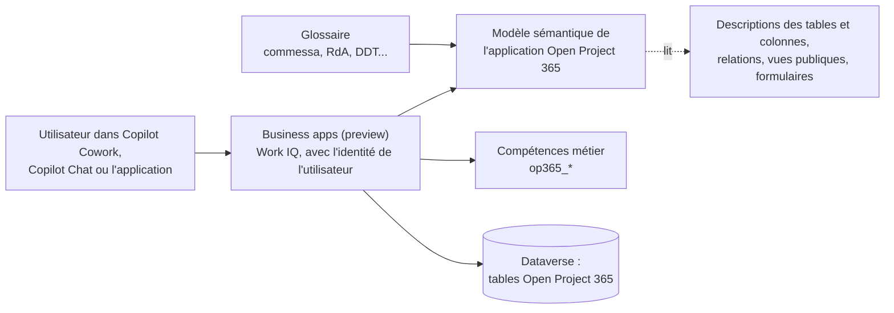
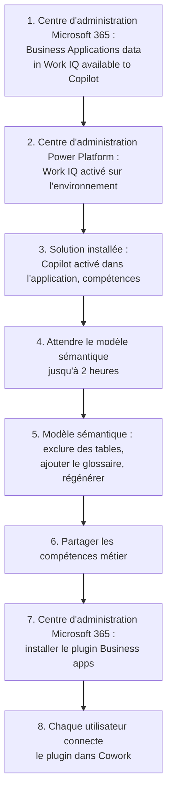

# Copilot et Cowork : poser des questions sur vos projets

> **Langue :** [English](../en/copilot.md) · [Italiano](../it/copilot.md) · Français · [Deutsch](../de/copilot.md)
> **Index des manuels :** [README](../../README.md#user-manuals)

Les données d'Open Project 365 peuvent être lues depuis **Microsoft Copilot** : dans le volet Copilot de l'application, dans Microsoft 365 Copilot Chat et dans **Copilot Cowork** grâce au plugin **Business apps (preview)**. Les utilisateurs posent leurs questions avec leurs propres mots (« où en est le projet PRJ-000123 ? », « quelles heures dois-je approuver ? ») et obtiennent des réponses construites sur les mêmes enregistrements qu'ils voient dans l'application, avec les mêmes autorisations.

Cette première version est en **lecture seule** : Copilot trouve, explique et résume les données, mais il ne crée, ne modifie, ne soumet et n'approuve rien. Chaque action reste sur les boutons de l'application.

> Les noms des champs, des boutons et des écrans sont en anglais, comme à l'écran. Ces fonctionnalités Microsoft sont en **préversion** : noms, écrans et comportement peuvent changer.

## Fonctionnement

| Élément | Rôle | Origine |
|---|---|---|
| Modèle sémantique | Explique à Copilot ce que signifient les tables, les colonnes et les relations | Créé par Dataverse pour l'application quand Microsoft Copilot est activé ; il lit les descriptions des tables et colonnes, les relations, les vues publiques et les noms des formulaires de la solution |
| Glossaire | Relie les termes métier (commessa, RdA, DDT, fattura passiva...) aux tables | Saisi par un administrateur, voir [Glossaire du modèle sémantique](#glossaire-du-modèle-sémantique) |
| Compétences métier (business skills) | Instructions pas à pas pour les questions courantes | Livrées dans la solution, voir [Compétences métier](#compétences-métier) |
| Autorisations | Ce que chaque personne peut voir | Les rôles de sécurité, les équipes d'accès des projets et la sécurité au niveau des colonnes habituels d'Open Project 365 |

## Ce que l'on peut demander

| Sujet | Exemples de questions | Compétence métier |
|---|---|---|
| État du projet | « Où en est le projet PRJ-000123 ? », « Quels projets dépassent le budget ? » | Open Project 365 - Project status |
| Heures à approuver | « Quelles heures dois-je approuver ? » | Open Project 365 - Hours to approve |
| Heures manquantes | « Qui n'a pas saisi ses heures hier ? » | Open Project 365 - Missing hours |
| Achats | « Où en est la demande d'achat des échafaudages ? », « Quelles commandes sont en retard ? », « Quelles factures fournisseurs sont à vérifier ? » | Open Project 365 - Purchasing status |
| Conformité des fournisseurs | « Quels fournisseurs ont un DURC expiré ? », « Pouvons-nous commander chez Rossi Srl ? » | Open Project 365 - Supplier compliance |
| Charge des ressources | « Qui est surchargé le mois prochain ? » | Open Project 365 - Resource load |

Les questions sur d'autres sujets fonctionnent aussi : Copilot utilise le modèle sémantique pour trouver les bonnes tables. Quand la réponse demande une action (approuver, soumettre, envoyer, réceptionner), Copilot indique quel écran de l'application utiliser.

## Mise en place (administrateurs)

Les étapes se font une fois par environnement, par les personnes ayant le rôle d'administration adapté.

| Étape | Qui | Où | Quoi |
|---|---|---|---|
| 1 | Administrateur Microsoft 365 | Microsoft 365 admin center → **Copilot** → **Settings** → **Business Applications data in Work IQ available to Copilot** | **All users**, ou les groupes Entra des utilisateurs d'Open Project 365 |
| 2 | Administrateur Power Platform | Power Platform admin center → environnement → **Work IQ** | Activé. Vérifier aussi que **Dataverse search** est sur **On** ou **Default** |
| 3 | IT | Import de la solution (voir [dev environment](../dev-environment.md#copilot-and-work-iq), en anglais) | La solution active **Microsoft Copilot in model-driven apps** pour l'application Open Project 365 et ajoute les compétences métier |
| 4 | – | – | La première génération du modèle sémantique prend jusqu'à deux heures |
| 5 | System Administrator | Power Apps → **Semantic model** | Voir [Ajuster le modèle sémantique](#ajuster-le-modèle-sémantique) |
| 6 | System Administrator | Power Apps → **Business skills (preview)** | Voir [Compétences métier](#compétences-métier) |
| 7 | Administrateur Microsoft 365 | Microsoft 365 admin center → **Agents** → **Tools** → **Plugins** → **Business apps (preview)** → **Install** | **All users** ou **Specific users and groups** |
| 8 | Chaque utilisateur | Copilot → **Cowork** → **Customize** → **Business apps (preview)** → **Show more** → **Connect** à côté de **Business apps (preview)** | Se connecter et approuver la demande dans l'application Authenticator |

Les actions d'écriture via Work IQ sont bloquées par défaut par la stratégie du locataire. Les laisser bloquées : dans cette version, Open Project 365 est en lecture seule depuis Copilot.

### Licences

Chaque personne a besoin de la licence **Power Apps Premium** utilisée pour Open Project 365 et d'une licence **Microsoft 365 Copilot**. L'indexation sémantique utilise de la capacité Dataverse supplémentaire.

## Ajuster le modèle sémantique

Le modèle sémantique de l'application s'appelle `M365_Primary_model_op365_OpenProject365` (constaté en Dev ; Microsoft documente aussi `M365_Secondary_model_<application>`). Dataverse le régénère toutes les 12 heures ; les modifications des descriptions, des vues et du glossaire sont prises en compte à la régénération suivante, ou tout de suite avec une régénération manuelle.

1. Se connecter à Power Apps, sélectionner l'environnement, puis **More** → **Discover all** → **Semantic model**.
2. Ouvrir le modèle de l'application **Open Project 365**.
3. Sélectionner **Configuration** et décocher **Include in semantic model** pour ces tables, puis sélectionner **Save and sync** :

| Table | Pourquoi elle est exclue |
|---|---|
| Resource Cost | Coûts horaires : sensibles, et inutiles pour répondre aux questions |
| Settings | Configuration de l'entreprise (une seule ligne) |
| Baseline Node | Valeurs enregistrées dans une baseline : elles dupliquent la WBS et brouillent les questions sur le plan actuel |
| WBS Dependency | Liens du Gantt : du bruit pour les questions métier |

4. Laisser **Sample table rows** désactivé (par défaut) : les réponses viennent des données réelles, pas d'exemples.
5. Ajouter le glossaire, voir la section suivante.
6. Sélectionner **Regenerate**.

Le modèle sémantique **n'est pas** transporté par les solutions : répéter ces étapes dans chaque environnement (Dev, Test, production), et après une copie ou un déplacement d'environnement désactiver puis réactiver Work IQ.

### Glossaire du modèle sémantique

Le glossaire ajoute les termes métier que Dataverse ne peut pas déduire des métadonnées. La liste complète est conservée dans le dépôt, dans [copilot/glossary.md](../../copilot/glossary.md) (en anglais, avec les synonymes italiens).

1. Dans le modèle sémantique, sélectionner **Glossary** → **Add item**.
2. Pour chaque ligne de la liste, saisir **Term** et **Definition**, puis ajouter les **Synonyms** (rouvrir l'entrée et sélectionner **Edit** si le champ des synonymes n'est pas sur le premier écran).
3. Sélectionner **Add term**, puis **Regenerate** quand tous les termes sont saisis.

| Term | Synonymes (exemples) |
|---|---|
| Project | commessa, progetto |
| Time entry | ore, rapportino, timesheet |
| Purchase request | RdA, richiesta di acquisto |
| RFQ | RdO, richiesta di offerta |
| Purchase order | OdA, ordine fornitore |
| Goods receipt | entrata merce, DDT |
| Supplier invoice | fattura passiva |
| Supplier document | DURC |

## Compétences métier

Les compétences métier (business skills) sont des instructions qui expliquent à Copilot comment répondre à un type de question : quelles tables lire, comment calculer les chiffres, quoi signaler. Elles font partie de la solution Open Project 365 (noms uniques commençant par `op365_`) ; elles sont donc installées et mises à jour avec elle. Leur texte est conservé dans le dépôt, dans `copilot/skills/`.

| Compétence | Lit | Renvoie l'utilisateur vers |
|---|---|---|
| Open Project 365 - Project status | Projet, nœuds WBS, baseline, achats en cours | – |
| Open Project 365 - Hours to approve | Heures soumises des projets de l'utilisateur | Projects → Time → **Approvals** |
| Open Project 365 - Missing hours | Ressources, absences, heures | – (le flux Daily time reminder prévient déjà les personnes) |
| Open Project 365 - Purchasing status | Demandes d'achat, RFQ, commandes, réceptions, factures fournisseurs | Les boutons des formulaires d'achat |
| Open Project 365 - Supplier compliance | Fournisseurs et documents fournisseurs | Le formulaire du fournisseur, ou le [portail fournisseurs](supplier-portal.md) |
| Open Project 365 - Resource load | Ressources, affectations, absences | Projects → Planning → **Resource Load** |

Toutes les compétences sont en **lecture seule** : elles ne créent ni ne modifient jamais d'enregistrements.

Pour les rendre disponibles à tous :

1. Dans Power Apps, sélectionner **More** → **Business skills (preview)**.
2. Vérifier que les six compétences `Open Project 365 - ...` sont listées et actives. Elles sont installées comme compétences **Organization** (visibles par tous dans l'environnement).
3. Si un utilisateur ne voit pas une compétence, la sélectionner → **Share** → **Anyone can view**.

Ne pas modifier les compétences en production : les modifications se font dans le dépôt et arrivent avec la solution.

## Sécurité et confidentialité

- Copilot travaille **avec l'identité de l'utilisateur** : il ne voit que les enregistrements et les colonnes que l'utilisateur voit dans l'application (rôles de sécurité et équipes d'accès des projets, voir [Administration](administration.md#rôles-de-sécurité)).
- Les colonnes protégées par le profil **OP365 Cost Visibility** (coûts horaires, Cost des heures, coûts des matériaux, Spend des fournisseurs, voir [Visibilité des coûts](administration.md#visibilité-des-coûts)) restent masquées pour les utilisateurs sans ce profil. Les compétences le signalent au lieu de deviner.
- Copilot ne modifie pas les données. Toute modification passe toujours par l'application, ses règles de validation et ses plugins.

## Limites

- Fonctionnalités en préversion : les réponses peuvent être incomplètes ; vérifier toujours les chiffres importants dans l'application.
- Aucune action depuis Copilot dans cette version : soumettre, approuver, envoyer, attribuer, réceptionner et annuler restent dans l'application.
- Le modèle sémantique, ses réglages de tables et le glossaire se configurent par environnement.
- Les réponses dépendent de la qualité des descriptions de la solution : quand une question est mal comprise, le signaler pour améliorer la description ou le glossaire.
