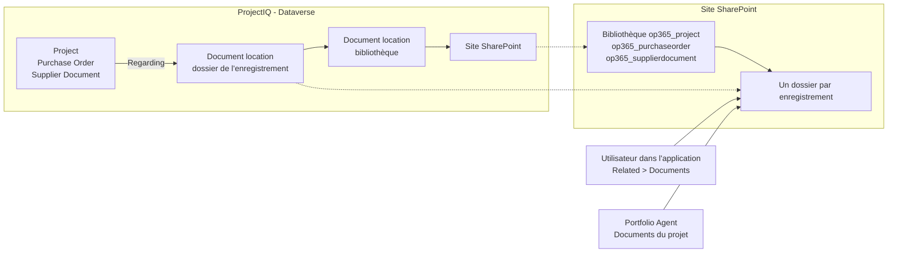
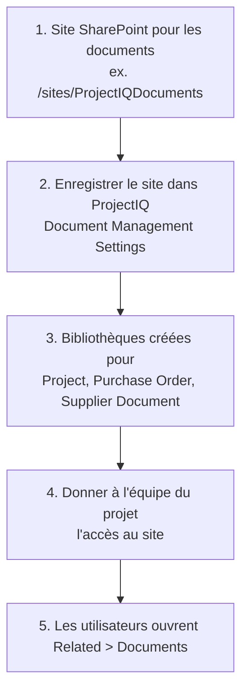

# Documents dans SharePoint

> **Langue :** [English](../en/documents.md) · [Italiano](../it/documents.md) · Français · [Deutsch](../de/documents.md)
> **Index des manuels :** [README](../../README.md#user-manuals)

Contrats, plans, situations de travaux, devis et bons de livraison appartiennent à un projet, mais pas à la base de données. ProjectIQ les conserve dans **SharePoint**, avec la gestion de documents standard de Dataverse : chaque **Project**, **Purchase Order** et **Supplier Document** a son propre dossier SharePoint, ouvert depuis l'enregistrement. Les fichiers gardent le versionnage SharePoint, la co-édition dans Office, la recherche et le partage ; ProjectIQ mémorise seulement l'emplacement du dossier.

Ce manuel s'adresse à tous ceux qui travaillent avec les documents de projet (partie 1) et aux administrateurs qui relient ProjectIQ à SharePoint (partie 2).

## Fonctionnement

| Table | Bibliothèque SharePoint | Dossier |
|---|---|---|
| Project | `op365_project` | Un par projet, nommé d'après le projet et son id |
| Purchase Order | `op365_purchaseorder` | Un par commande |
| Supplier Document | `op365_supplierdocument` | Un par document (par exemple le DURC numérisé avec ses pièces jointes) |

Le dossier est créé la **première fois que quelqu'un ouvre Documents** sur l'enregistrement. Dataverse enregistre un *emplacement de document* (document location) qui relie l'enregistrement au dossier ; l'agent et l'application trouvent le dossier par cet emplacement. Un projet créé dans Copilot à partir d'un document a déjà son dossier, avec le document dedans (voir [Portfolio Agent](portfolio-agent.md#nouveau-projet-à-partir-dun-document)).

## Partie 1 : travailler avec les documents

### Ouvrir les documents d'un enregistrement

1. Ouvrez le projet (ou la commande d'achat, ou le document fournisseur).
2. Sélectionnez **Related** → **Documents**. La première fois, ProjectIQ crée le dossier SharePoint de l'enregistrement.
3. La grille liste les fichiers du dossier : **Upload**, **New** (Word, Excel, PowerPoint, OneNote), **Open in SharePoint**, **Delete**, **Check Out** / **Check In** et **Edit Properties** agissent directement sur SharePoint.

| Commande | Effet |
|---|---|
| **Upload** | Charge un ou plusieurs fichiers dans le dossier (ou un sous-dossier) |
| **New** | Crée un document Office dans le dossier et l'ouvre dans le navigateur |
| **Open Location** / **Open in SharePoint** | Ouvre le dossier dans SharePoint, pour les sous-dossiers, le partage, les versions et les déplacements en masse |
| **Document Location** → **Add Location** | Relie à l'enregistrement un autre dossier SharePoint existant (par exemple un dossier d'une équipe Teams) |

### Qui voit quels fichiers

- Pour voir l'onglet **Documents**, il faut le rôle ProjectIQ (voir [Administration](administration.md#rôles-de-sécurité)) : **OP365 User** peut créer le dossier des enregistrements qu'il peut ouvrir et lire tous les emplacements de document.
- **Ce sont les autorisations SharePoint qui décident des fichiers visibles.** ProjectIQ ne copie pas le partage de ses projets dans SharePoint : donnez à l'équipe du projet l'accès au site (ou à une bibliothèque ou un dossier) dans SharePoint.

### Documents dans Copilot

Dans le [Portfolio Agent](portfolio-agent.md#documents-du-projet), demandez « affiche les documents du projet PRJ-000123 » : la carte liste les fichiers et sous-dossiers du dossier du projet, les plus récents d'abord, avec un lien vers chaque fichier et vers le dossier. Si une source de connaissances SharePoint est définie, vous pouvez aussi demander ce que dit un document (voir [Portfolio Agent](portfolio-agent.md#questions-sur-le-contenu-des-documents)).

### Documents fournisseur

Un **Supplier Document** (DURC, certification, assurance) garde sa colonne **File**, utilisée par le [portail fournisseurs](supplier-portal.md). Le dossier SharePoint de l'enregistrement sert aux autres fichiers qui l'accompagnent (renouvellements, correspondance). Les dates d'expiration et la conformité des fournisseurs continuent de s'appuyer sur les champs du Supplier Document comme avant.

## Partie 2 : configuration (administrateurs)

À faire une fois par environnement, par l'administrateur Power Platform avec un administrateur SharePoint.

| Étape | Qui | Quoi |
|---|---|---|
| 1 | Administrateur SharePoint | Créez un site SharePoint d'équipe ou de communication pour les documents, dans le même tenant Microsoft 365 que l'environnement |
| 2 | Administrateur Power Platform | Dans l'application, ouvrez **Settings** (engrenage) → **Advanced Settings** → **Document Management** → **Document Management Settings**, sélectionnez **Project**, **Purchase Order** et **Supplier Document**, saisissez l'URL du site, sélectionnez **Next** puis **Finish**. Les bibliothèques sont créées sur le site |
| 3 | Administrateur Power Platform | Alternative à l'étape 2 pour les environnements scriptés : `SHAREPOINT_SITE_URL=<URL du site> python3 tools/dataverse/documents.py` enregistre le site comme site par défaut ; les bibliothèques sont créées quand le premier enregistrement de chaque table ouvre Documents |
| 4 | Administrateur SharePoint | Donnez aux personnes qui utilisent ProjectIQ au moins **Edit** (ou **Read**) sur le site |
| 5 | Chaque utilisateur | Ouvrez **Related** → **Documents** sur un enregistrement |

L'intégration SharePoint côté serveur est active par défaut dans Dataverse online ; si **Document Management Settings** indique qu'elle est désactivée, activez-la depuis **Advanced Settings** → **Document Management** → **Enable Server-Based SharePoint Integration**.

La gestion de documents sur les trois tables et les privilèges sur les emplacements de document et le site SharePoint des rôles **OP365 User** et **OP365 Administrator** font partie de la solution ProjectIQ : une mise à jour de la solution les apporte. Le site SharePoint est un paramètre de chaque environnement et n'est pas dans la solution.

## Messages possibles

| Message | Signification et solution |
|---|---|
| Pas de **Documents** sous **Related**, ou un message indiquant que la gestion de documents n'est pas configurée | Le site n'est pas enregistré (voir [Partie 2](#partie-2--configuration-administrateurs), étape 2), ou l'application ProjectIQ ne contient pas les tables **SharePoint Document** et **Document Location** : exécutez `tools/dataverse/app.py` ou ajoutez les tables dans le concepteur d'application et publiez |
| La grille Documents indique que vous n'avez pas d'autorisation sur l'emplacement | Votre compte SharePoint n'a pas accès au site ou au dossier : demandez à l'administrateur SharePoint (étape 4) |
| Accès refusé lors de la création du dossier | Vous ne pouvez pas écrire dans la bibliothèque : demandez **Edit** sur le site |
| Carte : "No document folder yet" | Personne n'a ouvert Documents sur le projet : ouvrez le projet dans ProjectIQ et sélectionnez **Related** → **Documents** |
| Carte : "You have no access to the SharePoint folder of this project." | Comme ci-dessus : l'accès SharePoint au site manque |
