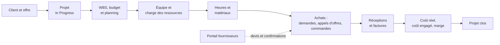
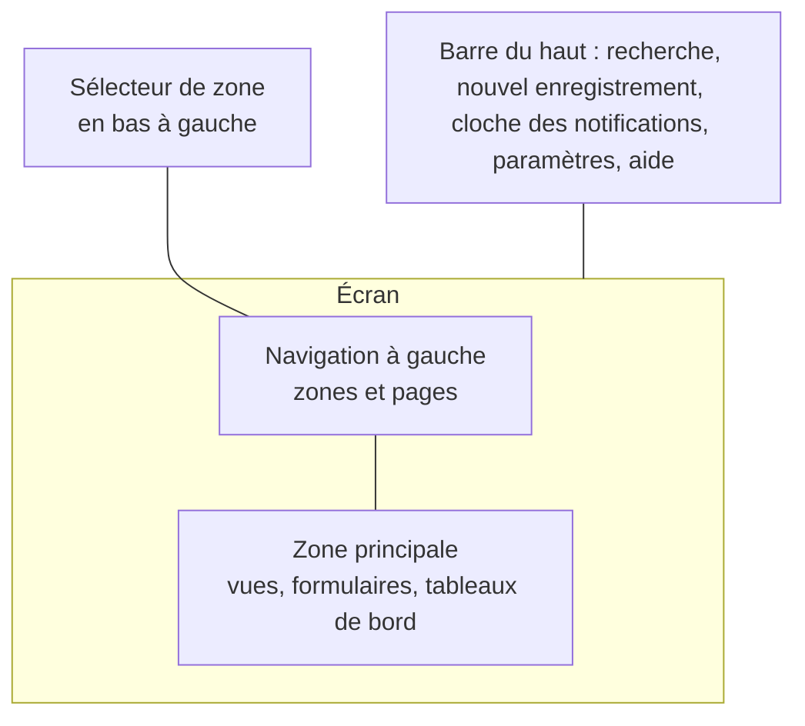
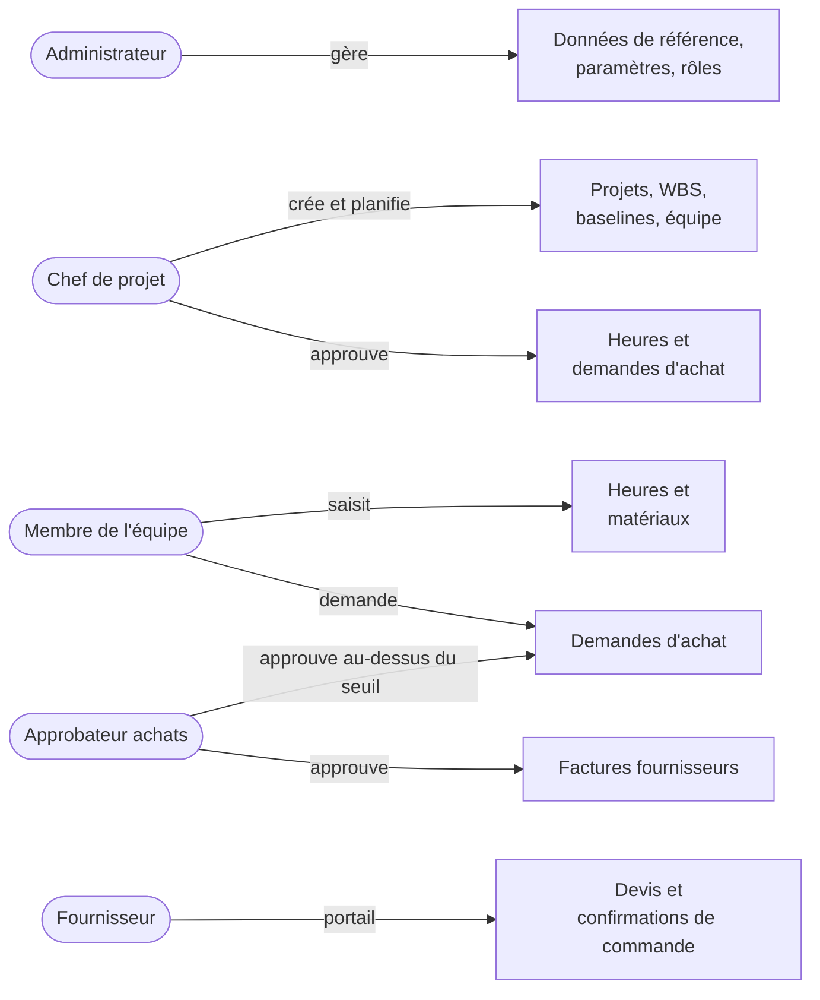

# Premiers pas avec ProjectIQ

> **Langue :** [English](../en/getting-started.md) · [Italiano](../it/getting-started.md) · Français · [Deutsch](../de/getting-started.md)
> **Index des manuels :** [README](../../README.md#user-manuals)

Ce guide est la première chose à lire si vous découvrez ProjectIQ. Il explique à quoi sert l'application, comment ses différentes parties s'articulent, comment vous repérer dans les écrans et quel manuel ouvrir pour chaque tâche. Les autres manuels détaillent chaque domaine fonctionnel ; celui-ci vous donne la carte.

> **Note sur les libellés à l'écran.** L'interface de l'application est aujourd'hui en **anglais** (les traductions italienne, française et allemande sont prévues). Dans ce manuel, les noms des boutons, champs et pages sont écrits en anglais, exactement comme à l'écran, avec une traduction lorsque c'est utile.

## Ce que fait ProjectIQ

ProjectIQ est une application de gestion de projets et d'affaires, conçue pour les entreprises qui travaillent à la commande : entreprises du bâtiment et d'installation, bureaux d'études, ateliers, sociétés de services et toute organisation qui doit savoir, pour chaque affaire, **ce qui était prévu, ce qui a été dépensé et ce qui est encore engagé**.

Elle fonctionne dans Microsoft Power Apps comme application pilotée par modèle (model-driven) sur Microsoft Dataverse. Concrètement :

- vous l'ouvrez depuis un navigateur (ou depuis Teams, si votre entreprise l'y ajoute) avec votre compte Microsoft 365 professionnel ;
- toutes les données résident dans l'environnement Dataverse de votre entreprise : chaque entreprise a sa propre base, rien n'est partagé avec d'autres clients ;
- sécurité, audit, notes, notifications et recherche sont ceux de la Power Platform et se comportent comme dans le reste de Dynamics 365.

L'application couvre tout le cycle de vie d'une affaire :

## Les principaux concepts en une page

| Concept | Ce que c'est | Pour en savoir plus |
|---|---|---|
| **Customer** (client) / **Supplier** (fournisseur) | Les entreprises pour lesquelles vous travaillez ou chez qui vous achetez. Ce sont des *comptes* Dataverse : une même entreprise peut être les deux | [Données de référence](master-data.md) |
| **Item** (article) | Ce que vous achetez ou utilisez sur une affaire (matériau, composant, service), avec un coût unitaire et les fournisseurs qui le vendent | [Données de référence](master-data.md) |
| **Resource** (ressource) | Une personne (ou une équipe) dont les heures sont planifiées et saisies, avec une capacité hebdomadaire et un coût horaire | [Données de référence](master-data.md) |
| **Project** (projet / affaire) | Le chantier : client, chef de projet, dates, montant du contrat, budget, coût réel et engagé, avancement | [Projets et équipe](projects-and-team.md) |
| **Project member** (membre du projet) | Un utilisateur qui travaille sur un projet comme Manager, Contributor ou Reader. L'appartenance décide qui voit le projet | [Projets et équipe](projects-and-team.md) |
| **WBS node** (nœud WBS) | Un élément de l'organigramme des tâches : phase, lot de travaux ou tâche, avec budget, dates et avancement | [WBS et planification](wbs-and-planning.md) |
| **Dependency** (dépendance) | « La tâche B ne peut commencer qu'après la fin de A » (fin-début, avec décalage en jours) | [WBS et planification](wbs-and-planning.md) |
| **Baseline** (référence) | Copie figée du budget et des dates, pour comparer le planning actuel avec ce qui a été convenu | [WBS et planification](wbs-and-planning.md) |
| **Allocation** (affectation) | Heures d'une ressource prévues sur un nœud WBS ; elles alimentent la charge des ressources | [Charge des ressources](resource-load.md) |
| **Time entry** (saisie d'heures) | Heures travaillées par une ressource sur un projet (et éventuellement une tâche) un jour donné, avec un circuit d'approbation | [Saisie des temps](time-tracking.md) |
| **Material usage** (consommation de matériaux) | Matériaux consommés sur un projet, valorisés au prix fournisseur ou au coût de l'article | [Matériaux et coûts](materials-and-costs.md) |
| **Purchase request → RFQ → Purchase order → Goods receipt → Supplier invoice** | La chaîne achats : demande d'achat, appel d'offres, commande, réception, facture fournisseur | [Achats](purchasing.md) |
| **Supplier portal** (portail fournisseurs) | Site web où les fournisseurs répondent aux appels d'offres et confirment les commandes | [Portail fournisseurs](supplier-portal.md) |
| **Settings** (paramètres) | Réglages valables pour toute l'entreprise : approbation des heures, seuil et approbateur des achats | [Administration](administration.md) |

## Connexion

1. Ouvrez le lien fourni par votre administrateur (du type `https://<entreprise>.crm4.dynamics.com/main.aspx?appid=...`), ou allez sur [make.powerapps.com](https://make.powerapps.com) → **Apps** et choisissez **ProjectIQ**.
2. Connectez-vous avec votre compte professionnel.
3. Si le message « You don't have permissions » apparaît, demandez à votre administrateur les rôles de sécurité **Basic User** et **OP365 User** (voir [Administration](administration.md#rôles-de-sécurité)).

Si vous allez saisir des heures, votre administrateur doit aussi relier votre utilisateur à un enregistrement **Resource** ; sinon la feuille de temps affiche « Your user is not linked to a resource ».

## Se repérer dans l'application

L'application utilise la présentation standard des applications pilotées par modèle :

- **Sélecteur de zone** (en bas de la navigation de gauche) : change le groupe de pages affiché. ProjectIQ a quatre zones : **Projects** (projets), **Purchasing** (achats), **Master Data** (données de référence) et **Settings** (paramètres).
- **Navigation de gauche** : les pages de la zone courante.
- **Vues** : listes d'enregistrements avec colonnes, filtres et tri ; changez de vue avec la liste déroulante à côté du titre.
- **Formulaires** : un enregistrement, organisé en onglets. Les modifications s'enregistrent avec **Save** (ou Ctrl+S) ; le formulaire enregistre aussi automatiquement après un court délai.
- **Barre de commandes** : les boutons au-dessus d'une vue ou d'un formulaire (New, Save, Delete et les commandes de ProjectIQ comme **Submit**, **Approve**, **Save Baseline**).
- **Tableaux de bord** : pages complètes avec graphiques et composants interactifs (Timesheet, Time Approval, Resource Load, Spend).

### Le plan de navigation

| Zone | Groupe | Page | Utilisateur type |
|---|---|---|---|
| Projects | Work | **Projects** (projets), **Material Usage** (consommations) | Chefs de projet, membres de l'équipe |
| Projects | Time | **Timesheet** (feuille de temps), **Approvals** (approbations), **Time Entries** (saisies) | Tous ceux qui saisissent des heures ; les managers qui approuvent |
| Projects | Planning | **Resource Load** (charge), **Absences** | Chefs de projet, planificateurs |
| Purchasing | Procurement | **Purchase Requests**, **RFQs**, **Purchase Orders**, **Goods Receipts**, **Supplier Invoices** | Chefs de projet, acheteurs, comptabilité |
| Purchasing | Analysis | **Spend** (dépenses) | Acheteurs, direction |
| Master Data | Records | **Customers**, **Suppliers**, **Contacts**, **Items**, **Resources** | Personnel administratif, acheteurs |
| Settings | Company | **Settings**, **Resource Costs**, **Project Members** | Administrateurs |

Selon votre rôle de sécurité, certaines pages peuvent n'afficher aucun enregistrement ou ne pas permettre d'en créer.

## Qui fait quoi

| Rôle | Ce que vous ferez le plus souvent | Manuels à lire |
|---|---|---|
| **Membre de l'équipe** (Contributor) | Remplir la feuille de temps hebdomadaire, saisir des matériaux, créer des demandes d'achat | [Saisie des temps](time-tracking.md), [Matériaux et coûts](materials-and-costs.md), [Achats](purchasing.md) |
| **Chef de projet** (Manager) | Créer le projet, construire la WBS et le planning, enregistrer des baselines, gérer l'équipe, approuver heures et demandes, suivre les coûts | [Projets et équipe](projects-and-team.md), [WBS et planification](wbs-and-planning.md), [Charge des ressources](resource-load.md), [Saisie des temps](time-tracking.md), [Matériaux et coûts](materials-and-costs.md), [Achats](purchasing.md) |
| **Acheteur / approbateur achats** | Approuver les demandes au-dessus du seuil, mener les appels d'offres, gérer commandes, réceptions et factures | [Achats](purchasing.md), [Portail fournisseurs](supplier-portal.md) |
| **Administrateur** | Utilisateurs, rôles, données de référence, paramètres, visibilité des coûts, portail fournisseurs | [Administration](administration.md), [Données de référence](master-data.md), [Portail fournisseurs](supplier-portal.md) |
| **Fournisseur** (externe) | Répondre aux appels d'offres et confirmer les commandes sur le portail | [Portail fournisseurs](supplier-portal.md) |

## Notifications

ProjectIQ utilise les **notifications dans l'application** des applications pilotées par modèle : l'icône en forme de cloche dans la barre du haut. Vous recevez une notification lorsque :

| Événement | Qui est notifié |
|---|---|
| Des heures sont soumises à approbation | Les managers du projet |
| Vos heures sont approuvées ou rejetées (avec le motif) | Vous (la ressource) |
| Vous avez saisi moins d'heures que prévu dans la journée (lundi–vendredi, 17 h 30) | Vous, avec un lien vers la feuille de temps |
| Une demande d'achat attend votre approbation | Le chef de projet, puis l'approbateur achats si la demande dépasse le seuil |
| Votre demande d'achat est approuvée ou rejetée | Le demandeur |

Les notifications apparaissent dans le panneau de la cloche et, quelques secondes, sous forme d'alerte en haut à droite. Cliquez sur une notification pour ouvrir l'enregistrement. Les préférences de notification sont celles de la plateforme.

## Notes, mentions et chronologie

La plupart des enregistrements de ProjectIQ ont une **Timeline** (chronologie), généralement dans la colonne de droite du premier onglet du formulaire. Vous pouvez :

- ajouter des **notes**, avec pièces jointes ;
- **mentionner un collègue** en tapant `@` suivi de son nom : le collègue est notifié et la note devient un petit fil de commentaires ;
- sur les projets, enregistrer aussi des **activités** (appels, tâches, rendez-vous, e-mails).

La chronologie est l'endroit idéal pour les décisions, les échanges avec le client et tout ce que vous voulez conserver avec l'enregistrement.

## Statuts et enregistrements verrouillés

De nombreux enregistrements suivent un circuit (saisies d'heures, demandes d'achat, commandes, factures...). Quelques règles s'appliquent partout :

- **Les changements de statut passent par les boutons de commande** (Submit, Approve, Send, Confirm...), jamais en modifiant le champ Status Reason. Si vous essayez, vous obtenez un message tel que « Use Submit, Approve or Reject to change the status ».
- **Les enregistrements au-delà d'un certain statut sont verrouillés** : une saisie d'heures soumise, une commande envoyée, une facture approuvée ne peuvent plus être modifiées. Pour les corriger, utilisez le bouton qui les fait revenir en arrière (Reject, Back to Draft, Cancel Receipt).
- **L'essentiel du travail n'est possible que sur les projets In Progress** : heures, matériaux et commandes sont refusés sur les offres, les projets suspendus ou clos.

## Recherche et vues personnelles

- La **zone de recherche** de la barre du haut cherche dans toutes les tables (projets par nom ou code, clients, articles, commandes...).
- Dans chaque vue, vous pouvez filtrer les colonnes, changer le tri et **enregistrer le résultat comme vue personnelle** (Create view). Les vues personnelles peuvent être partagées avec des collègues.
- Utilisez **Export to Excel** dans la barre de commandes d'une vue pour analyser les données hors de l'application.

## Langue

L'interface est disponible en **anglais, italien, français et allemand**. Chaque utilisateur choisit la langue dans **Paramètres (icône d'engrenage) > Paramètres de personnalisation > Langues > Langue de l'interface utilisateur** ; tables, champs, vues, boutons, les contrôles du projet (WBS, Gantt, feuille de temps...), les boîtes de dialogue, les messages d'erreur et les notifications suivent ce choix. Ces manuels sont disponibles dans les quatre langues ; certains noms de boutons et de champs peuvent encore apparaître en anglais, avec une traduction lorsque c'est utile.

## Et ensuite

- Nouveau sur un projet ? Lisez [Projets et équipe](projects-and-team.md).
- Vous devez saisir des heures aujourd'hui ? Allez directement à [Saisie des temps](time-tracking.md).
- Vous configurez l'entreprise pour la première fois ? Commencez par [Administration](administration.md) et [Données de référence](master-data.md).
