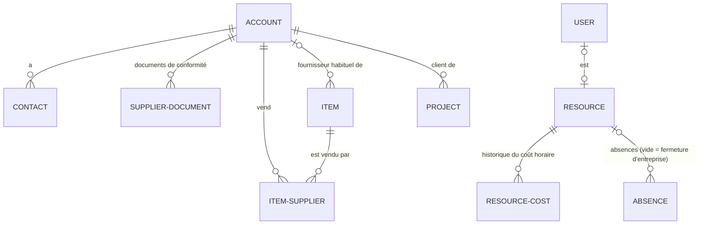
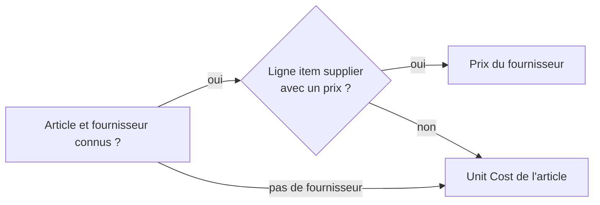
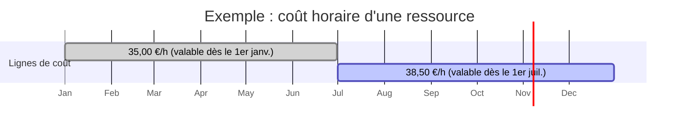
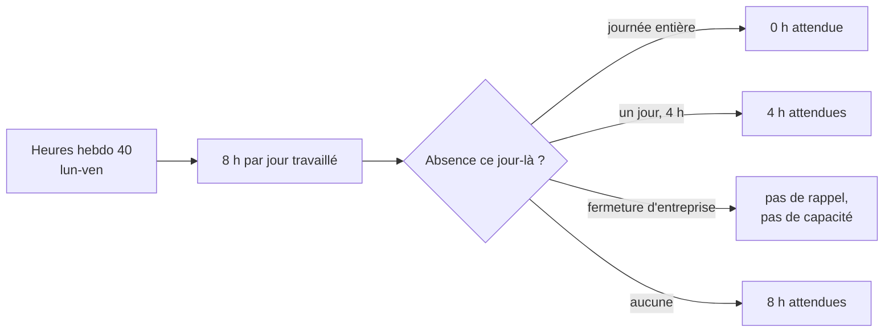

# Données de référence : clients, fournisseurs, contacts, articles et ressources

> **Langue :** [English](../en/master-data.md) · [Italiano](../it/master-data.md) · Français · [Deutsch](../de/master-data.md)
> **Index des manuels :** [README](../../README.md#user-manuals)

Les données de référence sont les informations sur lesquelles repose tout le reste d'Open Project 365 : les entreprises pour lesquelles vous travaillez et chez qui vous achetez, les personnes avec qui vous échangez, les articles que vous achetez et consommez, et les ressources dont vous planifiez et saisissez les heures. Les tenir propres et complètes, c'est ce qui rend fiables les coûts, les achats et le planning. Ce manuel décrit chaque type d'enregistrement, l'usage de chaque champ et les règles que l'application applique automatiquement.

Toutes les données de référence se trouvent dans la zone **Master Data**, groupe **Records** : **Customers** (clients), **Suppliers** (fournisseurs), **Contacts**, **Items** (articles), **Resources** (ressources). Les coûts horaires des ressources et les paramètres de l'entreprise sont dans la zone **Settings** (voir [Administration](administration.md)).

> Les noms des champs et des boutons sont en anglais, comme à l'écran.

## Comment les données de référence sont reliées

## Clients et fournisseurs (comptes)

Clients et fournisseurs sont tous deux enregistrés comme **comptes** (accounts), la table standard de Dataverse pour les entreprises. Une même entreprise peut être cliente, fournisseur ou les deux à la fois : deux cases à cocher, **Is Customer** (est client) et **Is Supplier** (est fournisseur), en décident.

### Deux formulaires, un seul enregistrement

Un compte a deux formulaires :

- le formulaire **Customer**, avec les données nécessaires pour vendre et facturer ;
- le formulaire **Supplier**, avec les données nécessaires pour acheter, plus les documents de conformité et les prix des articles.

L'application choisit le bon formulaire pour vous :

- lorsque vous ouvrez une entreprise qui est **uniquement fournisseur**, elle s'affiche sur le formulaire Supplier ; tous les autres comptes s'ouvrent sur le formulaire Customer ;
- lorsque vous créez un compte depuis **Suppliers** (ou choisissez le formulaire Supplier), **Is Supplier** est coché automatiquement ; depuis **Customers** (formulaire Customer), c'est **Is Customer**.

Vous pouvez toujours changer de formulaire avec le sélecteur à côté du nom de l'enregistrement.

### Vues

| Vue | Affiche |
|---|---|
| **All Customers** (par défaut dans Customers) | Tous les comptes marqués comme clients |
| **Prospects** | Clients dont le Customer Type est *Prospect* |
| **Customers with Projects** / **Customers without Projects** | Clients ayant (ou n'ayant pas) au moins un projet |
| **All Suppliers** (par défaut dans Suppliers) | Tous les comptes marqués comme fournisseurs |
| **Active Suppliers** / **Blocked Suppliers** | Fournisseurs selon leur Supplier Status |
| **Suppliers with Document Alerts** | Fournisseurs avec des documents de conformité expirés ou proches de l'expiration |

### Champs du client (formulaire Customer, onglet Summary)

| Champ | Signification |
|---|---|
| **Account Name** | Raison sociale, telle que vous la voulez sur les documents |
| **Is Customer** | L'entreprise apparaît parmi les clients et peut être choisie comme client d'un projet |
| **Customer Type** | *Prospect* (client potentiel, par exemple pendant qu'une offre est ouverte) ou *Customer* |
| **VAT Number** / **Tax Code** | Numéro de TVA et code fiscal (Partita IVA et codice fiscale en Italie, ou équivalents étrangers) |
| **Primary Contact**, **Main Phone**, **Email**, **Website** | Coordonnées standard |
| **Owner** | L'utilisateur responsable du compte |
| **Address** | Rue, ville, code postal, province, pays |
| **Payment Terms**, **IBAN**, **PEC**, **Language** | Données de facturation ; PEC est l'adresse de courrier électronique certifié italienne ; Language est la langue des documents et e-mails envoyés à l'entreprise (italien, anglais, allemand, français) |

Valeurs en lecture seule tenues à jour par l'application : **Projects** (nombre de projets du client) et **Contract Value Total** (somme des montants de contrat de ses projets). Elles sont mises à jour à chaque création, modification ou suppression d'un projet.

L'onglet **Contacts** liste les personnes de l'entreprise.

### Champs du fournisseur (formulaire Supplier)

L'onglet **Summary** contient les mêmes données d'entreprise, d'adresse et de paiement que le formulaire client, plus :

| Champ | Signification |
|---|---|
| **Is Supplier** | L'entreprise peut recevoir des appels d'offres et des commandes |
| **Supplier Status** | *Active* ou *Blocked* (bloqué). Un fournisseur bloqué ne peut être ni invité à un appel d'offres ni recevoir de commande : l'application vous arrête avec « <name> is blocked. » |
| **Supplier Category** | Texte libre pour regrouper les fournisseurs (par exemple « Électricité », « Béton », « Location ») |
| **Email** | Adresse d'invitation par défaut dans les appels d'offres, enregistrée comme **Sent To** lorsqu'une commande est envoyée |

Valeurs en lecture seule : **Spend** (total des commandes du fournisseur, visible uniquement avec la visibilité des coûts) et **Contacts** (nombre de contacts). Elles sont tenues à jour par les plug-ins achats.

L'onglet **Documents** liste les **documents de conformité** du fournisseur et affiche les compteurs **Document Alerts** (Expired Documents = expirés, Expiring Documents = bientôt expirés). L'onglet **Item Prices** liste les articles que le fournisseur vend, avec son prix pour chacun.

> Les compteurs d'alertes documents sont prévus pour une mise à jour quotidienne ; tant que ce traitement n'est pas activé dans votre environnement, ils peuvent rester vides. Les documents eux-mêmes, avec leurs dates d'expiration, sont toujours disponibles dans l'onglet Documents et dans les vues.

### Documents du fournisseur

Un document fournisseur enregistre une pièce de conformité que vous devez conserver : DURC (attestation italienne de régularité sociale), extrait du registre du commerce, certifications, polices d'assurance, contrats, etc.

| Champ | Signification |
|---|---|
| **Supplier** | Le fournisseur (le document est supprimé avec le fournisseur) |
| **Document Type** | DURC, Company Report (extrait du registre), Certification, Insurance, Contract, Other (obligatoire) |
| **Description** | Courte description (obligatoire) |
| **Number** | Numéro ou référence du document |
| **Issue Date** / **Expiry Date** | Période de validité (émission et expiration) |
| **External URL** | Lien vers le document dans un autre système (par exemple SharePoint) |
| **File** | Le document lui-même, chargé dans Dataverse |
| **Notes** | Divers |

Créez les documents depuis l'onglet Documents du fournisseur (**+ New Supplier Document**), pour que le fournisseur soit renseigné automatiquement.

## Contacts

Les contacts sont les contacts standard de Dataverse : les personnes qui travaillent pour vos clients et fournisseurs. Open Project 365 ajoute un champ :

- **Is Decision Maker** : cochez-le pour les décideurs (par exemple la personne qui signe l'offre ou la commande).

Un contact appartient à une entreprise via **Company Name** (compte parent). Pour les fournisseurs, c'est aussi important pour le [portail fournisseurs](supplier-portal.md) : un utilisateur fournisseur est un contact dont l'entreprise est le fournisseur.

## Articles

Un article est tout ce que vous achetez ou consommez sur une affaire : un matériau, un composant, un consommable, un service ou une location.

| Champ | Signification |
|---|---|
| **Code** | Code article unique (obligatoire ; l'application refuse deux articles avec le même code) |
| **Name** | Désignation (obligatoire) |
| **Category** | Texte libre pour regrouper les articles |
| **Unit of Measure** | pce, m, kg, h, m², ... Elle est recopiée sur les lignes de demande, de commande et les consommations |
| **Unit Cost** | Coût standard d'une unité. Utilisé lorsqu'il n'y a pas de prix fournisseur |
| **Default Supplier** | Le fournisseur chez qui vous achetez habituellement l'article. Il est invité automatiquement lorsqu'un appel d'offres est créé pour une demande contenant l'article |
| **Notes** | Divers |

Valeurs en lecture seule, tenues à jour par les achats : **Order Lines** (nombre de lignes de commande utilisant l'article) et **Spend** (montant total commandé, visible uniquement avec la visibilité des coûts).

### Fournisseurs et prix de l'article

La section **Suppliers** de l'article (et l'onglet **Item Prices** du fournisseur) liste les **item suppliers** : une ligne par fournisseur qui vend l'article.

| Champ | Signification |
|---|---|
| **Item** / **Supplier** | Le couple ; il ne peut y avoir qu'une ligne pour le même article et le même fournisseur |
| **Supplier Code** | La référence du fournisseur pour l'article |
| **Price** | Le prix unitaire du fournisseur |
| **Lead Time (Days)** | Délai de livraison habituel en jours |
| **Minimum Lot** | Quantité minimale par commande |
| **Notes** | Conditions, remises, ... |

### Quel prix est utilisé

Chaque fois que l'application doit valoriser un article (consommations, lignes de demande et de commande), elle cherche un prix dans cet ordre :

Vous pouvez toujours remplacer le prix proposé sur la ligne ; la règle ne le renseigne que lorsqu'il est vide.

## Ressources

Une **ressource** est une personne (ou une équipe, ou toute capacité) dont les heures sont planifiées sur la WBS et saisies dans les saisies d'heures. Une ressource n'a pas besoin d'être un utilisateur : vous pouvez planifier des sous-traitants ou des ouvriers sans licence. Pour saisir leurs heures eux-mêmes, en revanche, les personnes doivent avoir un utilisateur relié à leur ressource.

### Champs de la ressource

| Champ | Signification |
|---|---|
| **Name** | Nom de la personne ou de l'équipe (obligatoire) |
| **Role** | Fonction ou compétence (par exemple « Électricien », « Chef de chantier ») |
| **User** | L'utilisateur Dataverse de la personne. Nécessaire pour la feuille de temps : elle retrouve « ma ressource » via ce champ |
| **Owner** | Propriétaire de l'enregistrement |
| **Weekly Hours** | Heures contractuelles par semaine, de 0 à 80. Par défaut **40** |
| **Working Days** | Les jours travaillés. Par défaut **du lundi au vendredi** |
| **Hourly Cost** | Coût horaire actuel. **Lisez-le, ne le saisissez pas** : il est synchronisé depuis les Resource Costs (voir plus bas). Visible uniquement avec le profil *OP365 Cost Visibility* |

Si vous créez une ressource en laissant Weekly Hours et Working Days vides, l'application renseigne 40 heures et du lundi au vendredi.

Les heures hebdomadaires et les jours travaillés servent à trois endroits :

- le **rappel quotidien** : heures attendues par jour = heures hebdomadaires ÷ nombre de jours travaillés ;
- la **feuille de temps** : le total hebdomadaire est comparé aux heures hebdomadaires ;
- la **charge des ressources** : capacité hebdomadaire = heures hebdomadaires, moins absences et fermetures d'entreprise.

### Historique du coût horaire (Resource Costs)

Les coûts évoluent, et le coût d'une heure travaillée en mars ne doit pas changer quand le taux augmente en septembre. C'est pourquoi le coût horaire est conservé comme un **historique** dans l'onglet **Costs** de la ressource (ou dans **Settings → Resource Costs**) :

| Champ | Signification |
|---|---|
| **Resource** | La ressource |
| **Valid From** | Premier jour d'application du coût (obligatoire ; une ligne par ressource et par date) |
| **Hourly Cost** | Coût horaire à partir de cette date (obligatoire, visible uniquement avec la visibilité des coûts) |

Fonctionnement :

- le **coût d'une saisie d'heures** est heures × le coût valable **à la date de la saisie** (la dernière ligne dont le Valid From n'est pas postérieur à la date). Une saisie du 15 mars utilise 35,00 ; une saisie du 15 juillet utilise 38,50, même si les deux sont saisies aujourd'hui ;
- l'**Hourly Cost** affiché sur la ressource est la ligne au Valid From le plus récent qui n'est pas dans le futur. Il est recalculé à chaque création, modification ou suppression d'une ligne de coût ;
- si vous saisissez un coût qui commence dans le futur, le champ de la ressource l'affichera lorsqu'une ligne de coût sera de nouveau modifiée après cette date ; les saisies d'heures à partir de cette date l'utilisent immédiatement.

Si une ressource n'a aucune ligne de coût, son propre Hourly Cost est utilisé.

### Absences et fermetures d'entreprise

L'onglet **Absences** de la ressource (et **Projects → Planning → Absences**) enregistre les périodes d'indisponibilité.

| Champ | Signification |
|---|---|
| **Resource** | La personne absente. **Laissez vide pour enregistrer une fermeture d'entreprise** (par exemple la fermeture d'août ou un pont) : elle s'applique à tout le monde |
| **Absence Type** | Vacation (congés), Leave (permission), Sickness (maladie), Closure (fermeture) — obligatoire |
| **From** / **To** | Premier et dernier jour (obligatoires) |
| **Hours** | Uniquement pour les absences d'une journée : les heures d'absence (par exemple 4 pour une demi-journée). Vide pour des journées entières |
| **Notes** | Divers |

Les absences sont utilisées par :

- le **rappel quotidien**, qui attend moins d'heures (ou aucune) les jours d'absence et n'envoie rien les jours de fermeture ;
- la **charge des ressources**, qui réduit la capacité hebdomadaire.

## Bonnes pratiques

- **Vérifiez les doublons** avant de créer une entreprise : cherchez par nom et numéro de TVA.
- **Cochez à la fois Is Customer et Is Supplier** quand une entreprise joue les deux rôles, au lieu de créer deux comptes.
- **Bloquez** un fournisseur plutôt que de le supprimer : son historique (commandes, factures, documents) reste intact.
- **Ne saisissez jamais le coût horaire sur la ressource** : ajoutez une ligne Resource Cost avec sa date de début.
- **Reliez le User** de chaque ressource qui saisit des heures, et vérifiez que l'utilisateur a les bons rôles de sécurité (voir [Administration](administration.md)).
- **Donnez à chaque article un fournisseur habituel** et les prix des fournisseurs que vous utilisez : appels d'offres, commandes et consommations seront préremplis.

## Messages possibles

| Message | Pourquoi | Que faire |
|---|---|---|
| « <name> is not an active supplier. » | Le compte est inactif ou non marqué fournisseur | Cochez Is Supplier ou réactivez le compte |
| « <name> is blocked. » | Supplier Status vaut Blocked | Repassez-le à Active si le fournisseur peut de nouveau être utilisé |
| Erreur de clé en double à l'enregistrement d'un article | Un autre article a le même Code | Utilisez un autre code ou ouvrez l'article existant |
| Erreur de clé en double sur un item supplier | Ce fournisseur a déjà une ligne de prix pour l'article | Ouvrez et modifiez la ligne existante |
| Erreur de clé en double sur un resource cost | La ressource a déjà un coût avec ce Valid From | Modifiez la ligne existante |
| Hourly Cost vide ou masqué | Vous n'avez pas le profil Cost Visibility | Demandez à un administrateur si vous devez voir les coûts |
