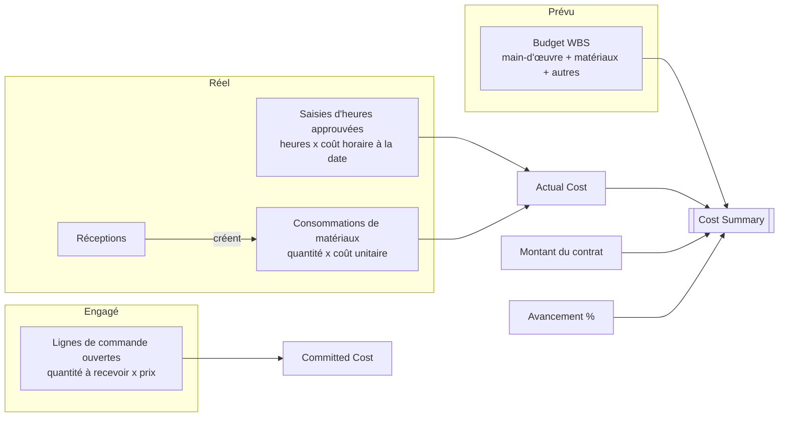
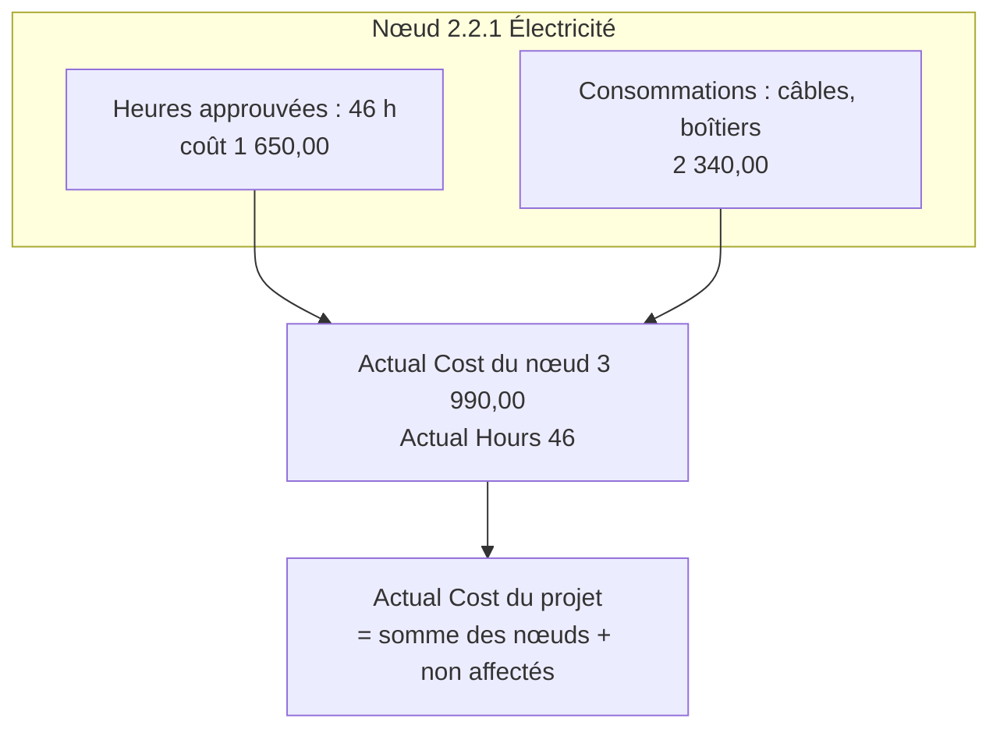
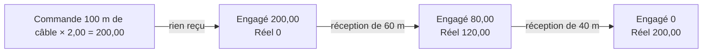

# Matériaux, coûts réels et synthèse des coûts

> **Langue :** [English](../en/materials-and-costs.md) · [Italiano](../it/materials-and-costs.md) · Français · [Deutsch](../de/materials-and-costs.md)
> **Index des manuels :** [README](../../README.md#user-manuals)

Une affaire n'est rentable que si vous savez, à tout moment, combien elle a réellement coûté et combien elle va coûter. Open Project 365 collecte les **coûts réels** de deux sources — heures approuvées et consommations de matériaux — et les combine avec le **coût engagé** des commandes ouvertes et le **budget** de la WBS. La **Cost Summary** (synthèse des coûts) du formulaire projet transforme ces chiffres en prévision : l'estimation à terminaison et la marge attendue.

Ce manuel explique comment saisir les matériaux, comment se forment les coûts réels et engagés et comment lire la synthèse des coûts.

> Les noms des champs et des boutons sont en anglais, comme à l'écran.

## D'où viennent les chiffres

| Valeur | Source | Mise à jour |
|---|---|---|
| **Budget Total** | Budget des nœuds WBS | À l'enregistrement d'un nœud |
| **Actual Hours** | Saisies d'heures approuvées | À l'approbation d'une saisie (ou à la soumission, approbation désactivée) |
| **Actual Cost** | Coût des heures approuvées + coût total de toutes les consommations | À l'enregistrement ou à la suppression d'une saisie ou d'une consommation |
| **Committed Cost** | Lignes de commande restant à recevoir × prix, sur les commandes envoyées ou confirmées | Lorsque commandes, lignes ou réceptions changent |
| **Progress %** | Avancement des nœuds feuilles, pondéré par le budget | À l'enregistrement d'un nœud |

Chaque valeur existe à la fois sur chaque **nœud WBS** (heures et coût réels de ce nœud) et sur le **projet** (totaux). Les coûts saisis sur le projet sans nœud WBS comptent dans les totaux du projet et apparaissent comme *Not assigned to a WBS node* dans la synthèse des coûts.

## Consommations de matériaux

Une **material usage** (consommation de matériaux) enregistre des matériaux consommés sur un projet : quoi, combien, quand, sur quelle tâche, de quel fournisseur et à quel coût. Elle peut être créée à la main ou automatiquement par une réception (voir [Achats](purchasing.md#4-réceptions-de-marchandises)).

### Saisir des matériaux à la main

1. Ouvrez **Projects → Work → Material Usage** et cliquez sur **+ New**, ou utilisez l'onglet **Materials** du projet (le projet est alors prérempli), ou le formulaire de création rapide.
2. Choisissez le **Project** (il doit être **In Progress**) et éventuellement le **WBS Node** (seuls les nœuds de ce projet sont proposés).
3. Indiquez la **Usage Date**.
4. Choisissez l'**Item**. **Description** et **Unit of Measure** sont reprises de l'article si elles sont vides.
5. Choisissez éventuellement le **Supplier** d'où provient le matériau.
6. Saisissez la **Quantity**.
7. Laissez **Unit Cost** vide pour que l'application le renseigne, ou saisissez-le.
8. Enregistrez : **Total Cost** = Quantity × Unit Cost.

### Champs

| Champ | Signification |
|---|---|
| **Project** | Le projet (obligatoire). La consommation est supprimée avec le projet |
| **WBS Node** | La tâche sur laquelle le matériau est utilisé (facultatif, même projet uniquement) |
| **Usage Date** | Date d'utilisation |
| **Item** | L'article du catalogue (facultatif : vous pouvez saisir un matériau en texte libre) |
| **Description** | Ce qui a été utilisé ; reprise de l'article si vide |
| **Supplier** | Provenance (facultatif) |
| **Quantity** / **Unit of Measure** | Quantité ; l'unité vient de l'article si vide |
| **Unit Cost** | Coût par unité (visible uniquement avec la visibilité des coûts) |
| **Total Cost** | Quantity × Unit Cost, calculé (visible uniquement avec la visibilité des coûts) |

### Comment le coût unitaire est proposé

Quand vous choisissez un article et laissez Unit Cost vide :

1. si un **Supplier** est renseigné et qu'une ligne **item supplier** active existe pour cet article et ce fournisseur, son **Price** est utilisé ;
2. sinon, le **Unit Cost** de l'article est utilisé.

La proposition n'a lieu que lorsque l'article est choisi ou changé ; les changements ultérieurs des prix du catalogue ne modifient pas les enregistrements existants.

### Matériaux issus des réceptions

Quand un acheteur enregistre une réception sur une commande, Open Project 365 crée une consommation par ligne reçue, au **prix de la commande**, sur le projet de la commande et sur le nœud WBS de la ligne. Ces enregistrements sont marqués comme issus de la réception et **ne peuvent être ni modifiés ni supprimés directement** : « This material usage comes from a goods receipt: cancel the receipt to change it. » Pour les corriger, annulez la réception et enregistrez-la de nouveau.

Vous n'avez donc **pas** à saisir deux fois les matériaux achetés : réceptionnez-les, ils deviennent automatiquement du coût réel. Ne saisissez à la main que les matériaux pris en stock ou achetés hors commande.

### Vues

| Vue | Affiche |
|---|---|
| **All Material Usage** | Toutes les consommations que vous pouvez voir |
| **Material Usage by Project** | Utilisée dans l'onglet Materials du projet |

La recherche rapide (zone de recherche de la vue) est disponible sur les consommations.

## Le coût réel en détail

- **Main-d'œuvre** : seules les saisies **approuvées** comptent (approbation désactivée, les saisies soumises sont approuvées immédiatement). Les heures en brouillon, soumises ou rejetées ne sont pas encore du coût réel.
- **Matériaux** : **toutes** les consommations comptent dès leur enregistrement, qu'elles soient saisies à la main ou créées par une réception.
- Le recalcul est immédiat et couvre aussi les déplacements : si une saisie passe à un autre nœud ou projet, les anciens et les nouveaux totaux sont recalculés.

## Coût engagé

Le **coût engagé** est l'argent déjà promis aux fournisseurs mais pas encore reçu sous forme de marchandises : pour chaque ligne des commandes **Sent** (envoyées) ou **Confirmed** (confirmées), (quantité commandée − quantité reçue) × prix. Les commandes en brouillon (pas encore envoyées) et annulées ne comptent pas. À la réception, la part reçue passe de l'engagé au réel (via la consommation). Voir [Achats](purchasing.md) pour le détail.

Le coût engagé sert aussi lors de la soumission d'une demande d'achat : si réel + engagé + la nouvelle demande dépassent le budget du nœud (ou du projet), la demande est signalée **Over Budget** à l'approbateur.

## Synthèse des coûts

L'onglet **Costs** du projet affiche le composant **Cost Summary**.

### Chiffres d'en-tête

| Chiffre | Signification |
|---|---|
| **Contract value** | Le prix convenu (Contract Value du projet) |
| **Budget** | Budget total de la WBS |
| **Actual cost** | Coût réel à date, avec la répartition **Labour** (main-d'œuvre) / **Materials** (matériaux) |
| **Estimate at completion** | Estimation à terminaison, c'est-à-dire prévision du coût final : **coût réel ÷ avancement** lorsque l'avancement est supérieur à zéro ; sinon le plus grand du budget et du réel |
| **Expected margin** | Montant du contrat − estimation à terminaison |

### Budget vs réel par branche WBS

Sous l'en-tête, un tableau montre une ligne par **nœud WBS de premier niveau** (chaque branche inclut tous ses sous-nœuds) :

| Colonne | Signification |
|---|---|
| **WBS branch** | Code et nom du nœud de premier niveau |
| **Budget** | Budget total de la branche |
| **Actual** | Coût réel de la branche |
| **Variance** | Réel − budget : **positif signifie dépassement** |
| **Spent** | Part du budget déjà consommée, sous forme de barre |
| **Hours (actual / budget)** | Heures approuvées par rapport aux heures budgétées |

Les coûts sans nœud WBS apparaissent sur une dernière ligne, **Not assigned to a WBS node**.

### Exemple chiffré

| | Valeur |
|---|---|
| Montant du contrat | 120 000 |
| Budget | 100 000 |
| Coût réel | 45 000 (main-d'œuvre 30 000, matériaux 15 000) |
| Avancement | 40 % |
| **Estimation à terminaison** | 45 000 ÷ 0,40 = **112 500** |
| **Marge attendue** | 120 000 − 112 500 = **7 500** (la marge budgétée était de 20 000) |

La prévision indique que l'affaire dépense plus vite qu'elle n'avance : à ce rythme, elle finira 12 500 au-dessus du budget. Consultez le tableau par branche pour trouver d'où vient l'écart.

> L'estimation à terminaison ne vaut que par les valeurs d'**avancement** : mettez à jour régulièrement l'avancement des nœuds feuilles. Avec un avancement à 0, la prévision se rabat sur le budget (ou sur le coût réel s'il est déjà plus élevé).

Messages : « Save the project to see its costs. » sur un projet nouveau ; « The cost summary could not be loaded » en cas de problème de réseau ou de droits (rechargez le formulaire).

## Visibilité des coûts

Les coûts sont des données sensibles. Les colonnes contenant les coûts horaires et les coûts des matériaux sont protégées par le profil de sécurité de colonne **OP365 Cost Visibility** :

- les utilisateurs **avec** le profil voient Unit Cost, Total Cost, le Cost des saisies d'heures, les coûts horaires des ressources, les dépenses par fournisseur et par article ;
- les utilisateurs **sans** le profil voient ces champs vides ou masqués, même sur les enregistrements qu'ils peuvent ouvrir.

Les totaux du projet (Actual Cost, Committed Cost, Budget Total) sont visibles par quiconque peut lire le projet. Attribuez le profil aux administrateurs, chefs de projet et contrôleurs de gestion (voir [Administration](administration.md#visibilité-des-coûts)).

## Messages possibles

| Message | Signification et solution |
|---|---|
| « Hours and materials can be recorded only on projects In Progress. » | Passez le projet en In Progress, ou saisissez sur un autre projet |
| « The WBS node belongs to another project. » | Choisissez un nœud du projet sélectionné |
| « This material usage comes from a goods receipt: cancel the receipt to change it. » | Utilisez **Cancel Receipt** sur la réception, puis enregistrez-la de nouveau |
| Unit Cost ou Total Cost vides | Vous n'avez pas le profil Cost Visibility, ou l'article n'a ni coût ni prix fournisseur |
